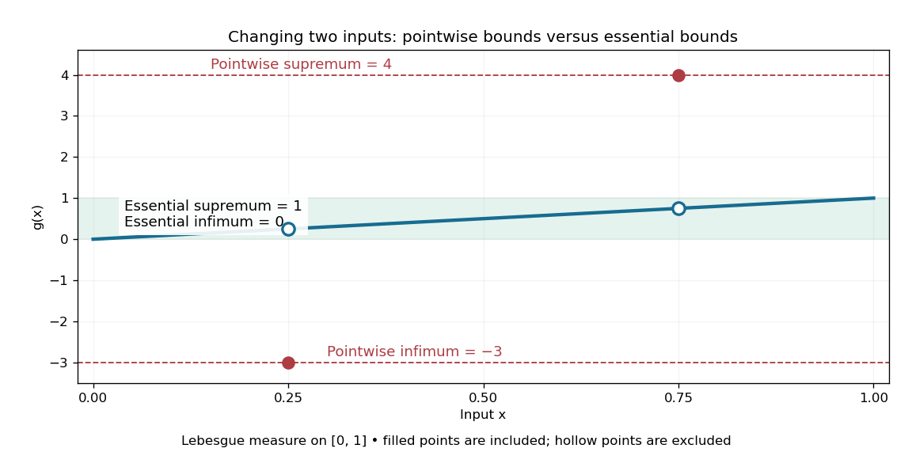

# Essential infimum and essential supremum

↑ **Parent:** [Infimum and supremum](infimum-and-supremum.md)  
ⓦ [Wiki](https://en.wikipedia.org/wiki/Essential_infimum_and_essential_supremum)

The [essential infimum](essential-infimum.md) and [essential supremum](essential-supremum.md) describe the lower and upper bounds of a [measurable function](measurable-function.md) after disregarding [null sets](null-set.md) for a specified [measure](measure.md). A pointwise [infimum](infimum.md) or [supremum](supremum.md) sees every input; an essential bound sees whether values below or above a proposed threshold occur on a set of positive [measure](measure.md). Thus "essential" means insensitive to changes on a [null set](null-set.md), rather than insensitive to unusual values. This distinction makes essential bounds compatible with [Lebesgue integrals](lebesgue-integral.md) and the [equivalence classes](equivalence-class.md) used in [Lp spaces](lp-space.md). [Hunter, Measure Theory, Definitions 7.1, 7.3–7.4: almost-everywhere equivalence and essential bounds](measure-theory-by-john-k-hunter/lp-spaces-chapter-7-of-measure-theory.md).

For a real [measurable function](measurable-function.md) $f$ on a [measure space](measure-space.md) $(X,\Sigma,\mu)$, the definitions are

$$
\operatorname{ess\,inf}_\mu f=\sup\{a\in\mathbb R:\mu(\{x:f(x)<a\})=0\},\qquad
\operatorname{ess\,sup}_\mu f=\inf\{b\in\mathbb R:\mu(\{x:f(x)>b\})=0\}.
$$

These can take values in the [extended real number line](extended-real-number-line.md). On a space of positive total [measure](measure.md), finite essential bounds obey $\operatorname{ess\,inf}_\mu f\leq f\leq\operatorname{ess\,sup}_\mu f$ [almost everywhere](almost-everywhere.md). If $s=\operatorname{ess\,sup}_\mu f$ is finite, every threshold $b<s$ has $\mu(\{f>b\})>0$; the corresponding lower-edge statement is $\mu(\{f<a\})>0$ for every $a>\operatorname{ess\,inf}_\mu f$. These are the measure-based counterparts of the [approximation property of a supremum](approximation-property-of-a-supremum.md) and [approximation property of an infimum](approximation-property-of-an-infimum.md).

Here is a two-sided example on $[0,1]$ with [Lebesgue measure](lebesgue-measure.md):

$$
g(x)=\begin{cases}-3,&x=1/4,\\4,&x=3/4,\\x,&\text{otherwise}.\end{cases}
$$

**The pointwise bounds are $\inf g=-3$ and $\sup g=4$, while the essential bounds are $\operatorname{ess\,inf}g=0$ and $\operatorname{ess\,sup}g=1$.** Both exceptional [singletons](singleton-mathematics.md) are [null sets](null-set.md). But for $0<a<1$, the inputs where $g<a$ still have [measure](measure.md) $a$, and those where $g>a$ have [measure](measure.md) $1-a$: deleting or adding two individual inputs cannot change those lengths. Hence neither essential bound can be moved inward.

**[Figure 2](#image-essential-infimum-and-essential-supremum-ignore-two-exceptional-singletons-while-pointwise-infimum-and-supremum-retain-them). Essential infimum and essential supremum ignore two exceptional singletons, while pointwise infimum and supremum retain them**. The [function](function-split.md) follows $g(x)=x$ except for the filled values $g(1/4)=-3$ and $g(3/4)=4$. Hollow markers exclude the ordinary values at those inputs. The shaded horizontal band spans the essential bounds zero and one for [Lebesgue measure](lebesgue-measure.md).

The choice of [measure](measure.md) is part of the answer. The same $g$ has essential bounds $-3$ and $4$ under [counting measure](counting-measure.md), because every nonempty [set](set-split.md) has positive [measure](measure.md). Under the [Dirac measure](dirac-measure.md) at $1/4$, both essential bounds equal $-3$. A [null set](null-set.md) for one [measure](measure.md) need not be a [null set](null-set.md) for another.

Nor must the exceptional inputs be isolated. The [Dirichlet function](dirichlet-function.md), equal to one at [rational numbers](rational-number.md) and zero at [irrational numbers](irrational-number.md), has pointwise [supremum](supremum.md) one on $[0,1]$, but [essential supremum](essential-supremum.md) zero for [Lebesgue measure](lebesgue-measure.md): the [rational numbers](rational-number.md) form a [countable set](countable-set.md) that is a [null set](null-set.md), even though they are [dense](dense-set.md). Conversely, a value ten on an [interval](interval-mathematics.md) of length $0.001$ affects the [essential supremum](essential-supremum.md) just as decisively as it would on half the domain. Small positive [measure](measure.md) is not zero [measure](measure.md).

**Table of contents**

- [Essential infimum](essential-infimum.md)

## ↑ Ancestors (6)

1. [Infimum and supremum](infimum-and-supremum.md)
2. [Real analysis](real-analysis-split.md)
3. [Analysis](analysis-split.md)
4. [Area of mathematics](area-of-mathematics.md)
5. [Mathematics](mathematics-split.md)
6. [Codex Wiki](split.md)

## ← Incoming links (3)

- [Essential infimum](essential-infimum.md)
- [Essential range](essential-range.md)
- [L-infinity norm](l-infinity-norm.md)
