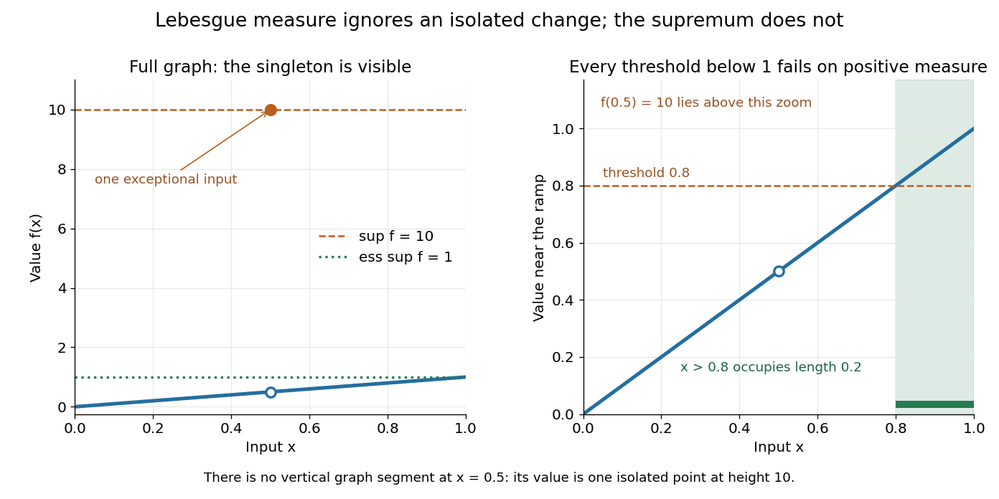

# Essential supremum

↑ **Parent:** [Measure theory](measure-theory-split.md)

The [essential supremum](essential-supremum.md) is the upper bound for a [measurable function](measurable-function.md) after disregarding [null sets](null-set.md) for a specified [measure](measure.md) $\mu$. Its definition is

$$
\operatorname{ess\,sup}_\mu f=\inf\{M\in\mathbb R:\mu(\{x:f(x)>M\})=0\},
$$

with values allowed in the [extended real number line](extended-real-number-line.md). A [supremum](supremum.md) controls every value; an [essential supremum](essential-supremum.md) controls values [almost everywhere](almost-everywhere.md). It therefore depends on the chosen [measure](measure.md), as well as on the [function](function-split.md). [Hunter, Measure Theory, Definition 7.3: essential supremum](https://www.math.ucdavis.edu/~hunter/measure_theory/measure_notes_ch7.pdf).

For a worked example, use [Lebesgue measure](lebesgue-measure.md) on $[0,1]$ and put

$$
f(x)=\begin{cases}10,&x=1/2,\\x,&x\ne1/2.\end{cases}
$$

Its [supremum](supremum.md) is ten, attained at $1/2$. But **its [essential supremum](essential-supremum.md) is one**: $f\leq1$ outside the [singleton](singleton-mathematics.md) $\{1/2\}$, which is a [null set](null-set.md). Every candidate $M<1$ fails, because the [interval](interval-mathematics.md) $(\max(0,M),1)$ has positive [Lebesgue measure](lebesgue-measure.md) and includes values larger than $M$; changing one point cannot remove that interval. In particular, $\mu(\{f>0.8\})=0.2$, while $\mu(\{f>1\})=0$.

**[Figure 8](#image-a-supremum-sees-an-isolated-exceptional-value-an-essential-supremum-depends-on-positive-measure). A supremum sees an isolated exceptional value; an essential supremum depends on positive measure**. Left: $f(1/2)=10$, with the ordinary value $1/2$ excluded at that input. Right: a zoom shows that values above $0.8$ still occur on an [interval](interval-mathematics.md) of [Lebesgue measure](lebesgue-measure.md) $0.2$. The isolated value at ten lies outside the zoom. Thus the [essential supremum](essential-supremum.md) is one, despite the pointwise [supremum](supremum.md) being ten.

Why is this useful? [Lebesgue integrals](lebesgue-integral.md) ignore changes on [null sets](null-set.md), and [Lp spaces](lp-space.md) identify [functions](function-split.md) that agree [almost everywhere](almost-everywhere.md). The [L-infinity norm](l-infinity-norm.md) uses $\operatorname{ess\,sup}|f|$ so it respects that identification. For this nonnegative example the [supremum norm](supremum-norm.md) is ten and the [L-infinity norm](l-infinity-norm.md) is one; replacing $f(1/2)$ by $1/2$ changes the former while leaving the latter unchanged. [Hunter, Measure Theory, Definition 7.4: the L-infinity norm](https://www.math.ucdavis.edu/~hunter/measure_theory/measure_notes_ch7.pdf).

The [measure](measure.md) qualification is essential. For $\mu=\delta_{1/2}$, the [Dirac measure](dirac-measure.md) concentrated at the exceptional input, that [singleton](singleton-mathematics.md) has [measure](measure.md) one and this [function](function-split.md) has [essential supremum](essential-supremum.md) ten. A set ignored by one [measure](measure.md) need not be ignored by another. The lower counterpart is the [essential infimum](essential-infimum.md), with $\operatorname{ess\,inf}f=-\operatorname{ess\,sup}(-f)$.

## ↑ Ancestors (6)

1. [Measure theory](measure-theory-split.md)
2. [Real analysis](real-analysis-split.md)
3. [Analysis](analysis-split.md)
4. [Area of mathematics](area-of-mathematics.md)
5. [Mathematics](mathematics-split.md)
6. [Codex Wiki](split.md)

## ← Incoming links (32)

- [Dispersion with a nonlinear velocity map](dispersion-with-a-nonlinear-velocity-map.md)
- [Effective bandwidth](effective-bandwidth.md)
- [Equality in Minkowski inequality](equality-in-minkowski-inequality.md)
- [Essential infimum and essential supremum](essential-infimum-and-essential-supremum.md)
- [Essential range](essential-range.md)
- [Essential supremum](essential-supremum.md)
- [Free-transport semigroup](free-transport-semigroup.md)
- [L-infinity norm](l-infinity-norm.md)
- [Lp conservation for incompressible transport](lp-conservation-for-incompressible-transport.md)
- [Lp norm](lp-norm.md)
- [Lp norms converge to the supremum norm](lp-norms-converge-to-the-supremum-norm.md)
- [Minkowski inequality](minkowski-inequality.md)
- [Mixed Lebesgue norm](mixed-lebesgue-norm.md)
- [Moment ratios converge to the essential supremum](moment-ratios-converge-to-the-essential-supremum.md)
- [Moser product on geometric radii](moser-product-on-geometric-radii.md)
- [Solution](past-exam-of-the-mathematics-course-of-the-university-of-cambridge/2007/ii/paper-3/24j/a/solution.md)
- [Solution](past-exam-of-the-mathematics-course-of-the-university-of-cambridge/2007/ii/paper-3/24j/c/solution.md)
- [Solution](past-exam-of-the-mathematics-course-of-the-university-of-cambridge/2008/iii/paper-35/4/solution.md)
- [Solution](past-exam-of-the-mathematics-course-of-the-university-of-cambridge/2009/iii/paper-9/2/a/solution.md)
- [Solution](past-exam-of-the-mathematics-course-of-the-university-of-cambridge/2012/iii/paper-32/4/solution.md)
- [Solution](past-exam-of-the-mathematics-course-of-the-university-of-cambridge/2012/iii/paper-7/1/e/solution.md)
- [Solution](past-exam-of-the-mathematics-course-of-the-university-of-cambridge/2013/iii/paper-6/1/f/solution.md)
- [Solution](past-exam-of-the-mathematics-course-of-the-university-of-cambridge/2014/iii/paper-7/1/b/solution.md)
- [Solution](past-exam-of-the-mathematics-course-of-the-university-of-cambridge/2014/iii/paper-7/1/c/solution.md)
- [Solution](past-exam-of-the-mathematics-course-of-the-university-of-cambridge/2015/iii/paper-5/3/1/c/solution.md)
- [Solution](past-exam-of-the-mathematics-course-of-the-university-of-cambridge/2015/iii/paper-6/1/solution.md)
- [Solution](past-exam-of-the-mathematics-course-of-the-university-of-cambridge/2015/iii/paper-9/1/iii/solution.md)
- [Solution](past-exam-of-the-mathematics-course-of-the-university-of-cambridge/2016/iii/paper-107/5/a/solution.md)
- [Solution](past-exam-of-the-mathematics-course-of-the-university-of-cambridge/2016/iii/paper-213/1/ii/solution.md)
- [Solution](past-exam-of-the-mathematics-course-of-the-university-of-cambridge/2017/iii/paper-107/6/a/solution.md)
- [Solution](past-exam-of-the-mathematics-course-of-the-university-of-cambridge/2026/iii/paper-359/2/c/solution.md)
- [Spectrum of a bounded operator](spectrum-of-a-bounded-operator.md)
