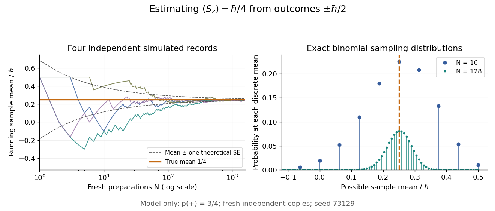

# Estimating a quantum expectation value

↑ **Parent:** [Expectation value](expectation-value.md)

Prepare a fresh copy of the same [quantum state](quantum-state.md) for each trial and measure the same [observable](observable.md). If preparations and readouts are independent, the outcomes $X_i$ are [independent and identically distributed random variables](independent-and-identically-distributed-random-variables.md) with the [Born rule](born-rule.md) [probability distribution](probability-distribution-split.md). Their [sample mean](sample-mean.md) is an [unbiased estimator](unbiased-estimator.md) of the [expectation value](expectation-value.md):

$$
\widehat\mu_N=\frac1N\sum_{i=1}^NX_i,\qquad
\mathbb E[\widehat\mu_N]=\langle A\rangle,\qquad
\operatorname{Var}(\widehat\mu_N)=\frac{(\Delta A)^2}{N},\qquad
\operatorname{SE}(\widehat\mu_N)=\frac{\Delta A}{\sqrt N}.
$$

The [law of large numbers](law-of-large-numbers.md) explains convergence of the [sample mean](sample-mean.md), while the [standard error](standard-error.md) describes its finite-sample spread. It takes four times as many independent trials to halve that [standard error](standard-error.md). This reduces estimation error; it does not reduce the [quantum uncertainty](quantum-uncertainty.md) of a single prepared copy.

For the [spin expectation value](spin-expectation-value.md), let $n_+$ and $n_-$ be the two outcome counts, with $N=n_++n_-$. Then

$$
\widehat\mu_N=\frac{\hbar}{2}\frac{n_+-n_-}{N},\qquad
n_+\sim\operatorname{Binomial}(N,p_+),\qquad
\Pr\left(\widehat\mu_N=\hbar\left(\frac{k}{N}-\frac12\right)\right)
=\binom Nk p_+^k(1-p_+)^{N-k}.
$$

The [binomial distribution](binomial-distribution.md) gives the exact sampling model. For $\theta=\pi/3$, the [standard error](standard-error.md) is $\hbar\sqrt3/(4\sqrt N)$: approximately $0.1083\hbar$ for $N=16$ and $0.03827\hbar$ for $N=128$. A run can fluctuate away from the predicted mean even as its typical spread decreases.

**[Figure 6](#image-simulated-running-spin-means-and-exact-sample-mean-probabilities). Simulated running spin means and exact sample mean probabilities**. [Source](quantum-expectation-repeated-sampling.py). Original independent-trial model with $p_+=3/4$. Left: four seeded simulated sequences of fresh preparations, with one-theoretical-[standard error](standard-error.md) curves about $\hbar/4$. These curves are not simultaneous bounds on trajectories. Right: exact [binomial distribution](binomial-distribution.md) masses for the [sample mean](sample-mean.md) at $N=16$ and $N=128$; each set sums to one. The possible sample means become more closely spaced as $N$ increases. All points are simulations or calculations, not measured observations.

Repeatedly measuring one surviving system is a different protocol. Under the ideal [Lüders rule](luders-rule.md), outcome $a_r$ leaves $P_r|\psi\rangle/\sqrt{p_r}$ when $p_r>0$. With no intervening change of [observable](observable.md) or dynamics moving the state out of that [eigenspace](eigenspace.md), the next [projective measurement](projective-measurement.md) returns $a_r$ with certainty. Such a record is correlated and does not sample the original [Born rule](born-rule.md) distribution independently. The [quantum nondemolition measurement](quantum-nondemolition-measurement.md) discussion describes this repeatability; fresh [quantum state preparations](quantum-state-preparation.md) supply the ensemble needed for the estimator above.

**Table of contents**

- [Stern-Gerlach expectation estimation](stern-gerlach-expectation-estimation.md)

## ↑ Ancestors (8)

1. [Expectation value](expectation-value.md)
2. [Observable](observable.md)
3. [Quantum state](quantum-state.md)
4. [Quantum system](quantum-system-split.md)
5. [Quantum mechanics](quantum-mechanics-split.md)
6. [Branches of physics](branches-of-physics.md)
7. [Physics](physics-split.md)
8. [Codex Wiki](split.md)
