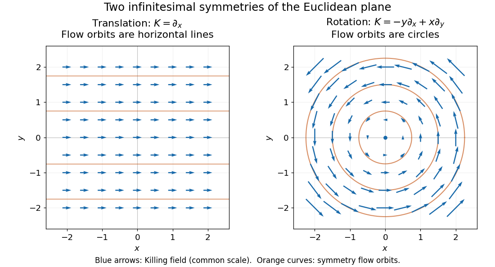

# Euclidean Killing vector field

↑ **Parent:** [Killing vector field](killing-vector-field-split.md)

On [Euclidean space](euclidean-norm.md), every [Killing vector field](killing-vector-field-split.md) is a constant [translation](translation-geometry.md) generator plus a constant infinitesimal [rotation](rotation-mathematics.md) generator:

$$
K(\mathbf x)=A+B\mathbf x,\qquad B^T=-B.
$$

Here $A$ is a constant vector and $B$ is an [antisymmetric matrix](skew-symmetric-matrix.md). The [second covariant derivative of a Killing vector](second-covariant-derivative-of-a-killing-vector.md) vanishes for the [Euclidean metric](euclidean-metric.md), so the components are affine functions of [Cartesian coordinates](cartesian-coordinate-system.md); the [Killing equation](killing-equation.md) makes the linear coefficient antisymmetric.

In the [Euclidean plane](euclidean-plane.md) with [metric tensor](metric-tensor.md) $g=dx^2+dy^2$, two useful examples are

$$
K_{\mathrm{tr}}=\partial_x,\qquad
K_{\mathrm{rot}}=-y\partial_x+x\partial_y.
$$

The notation $\partial_x$ denotes a [coordinate basis](coordinate-basis.md) vector; $dx$ denotes a [differential one-form](one-form.md). The corresponding [flow of a vector field](flow-of-a-vector-field.md) maps are

$$
\Phi_s^{\mathrm{tr}}(x,y)=(x+s,y),\qquad
\Phi_s^{\mathrm{rot}}(x,y)=(x\cos s-y\sin s,\ x\sin s+y\cos s).
$$

For [translation](translation-geometry.md), all arrows have the same direction and length. For [rotation](rotation-mathematics.md), arrows are tangent to [circles](circle.md), have length $\sqrt{x^2+y^2}$, and vanish at the origin. The [rotation](rotation-mathematics.md) flow keeps $x^2+y^2$ fixed, and its nonstationary [integral curves of a vector field](integral-curve-of-a-vector-field.md) are [circles](circle.md). Both flows preserve the [Euclidean metric](euclidean-metric.md). See [Carroll's original notes, section 5, equations (5.45)-(5.46)](https://arxiv.org/pdf/gr-qc/9712019#page=148).

**[Figure 1](#image-euclidean-killing-vector-fields-translation-arrows-and-straight-flow-orbits-rotation-arrows-and-circular-flow-orbits). Euclidean Killing vector fields: translation arrows and straight flow orbits, rotation arrows and circular flow orbits**.

The circular [integral curves of a vector field](integral-curve-of-a-vector-field.md) are symmetry orbits, whereas [geodesics](geodesic.md) of the [Euclidean plane](euclidean-plane.md) are straight [lines](straight-line.md). A [Killing vector field](killing-vector-field-split.md) does not require its own orbits to be [geodesics](geodesic.md). The [geodesic conserved quantity from a Killing vector](geodesic-conserved-quantity-from-a-killing-vector.md) pairs the field with the [velocity](velocity.md) of a separate [geodesic](geodesic.md); it does not require the [velocity](velocity.md) to equal the [Killing vector field](killing-vector-field-split.md).

**Table of contents**

- [Helical orbit of a Euclidean Killing vector](helical-orbit-of-a-euclidean-killing-vector.md)

## ↑ Ancestors (5)

1. [Killing vector field](killing-vector-field-split.md)
2. [General relativity](general-relativity-split.md)
3. [Branches of physics](branches-of-physics.md)
4. [Physics](physics-split.md)
5. [Codex Wiki](split.md)

## ← Incoming links (4)

- [Geodesic conserved quantity from a Killing vector](geodesic-conserved-quantity-from-a-killing-vector.md)
- [Killing equation](killing-equation.md)
- [Killing vector field](killing-vector-field-split.md)
- [Solution](past-exam-of-the-mathematics-course-of-the-university-of-cambridge/2018/iii/paper-309/2/iii/solution.md)
