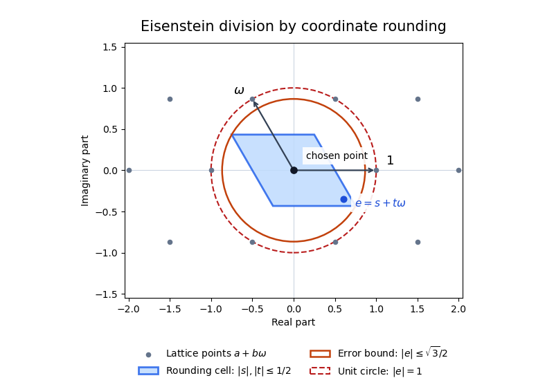

# Euclidean norm on the Eisenstein integers

↑ **Parent:** [Eisenstein integer](eisenstein-integer.md)

Every [complex number](complex-number.md) can be written uniquely as $x+y\omega$ with real $x,y$, where $\omega=(-1+i\sqrt3)/2$. Round $x,y$ separately to [integers](integer-split.md) $m,n$. The error is $s+t\omega$ with $|s|,|t|\leq1/2$, and

$$
|s+t\omega|^2=s^2-st+t^2\leq s^2+|st|+t^2\leq\frac34<1.
$$

For [Eisenstein integers](eisenstein-integer.md) $\alpha,\beta$ with $\beta\ne0$, apply this to $\alpha/\beta$ to choose $q=m+n\omega$. The remainder $r=\alpha-q\beta$ is an [Eisenstein integer](eisenstein-integer.md) and $N(r)\leq3N(\beta)/4<N(\beta)$ if nonzero. Thus the [Eisenstein norm](eisenstein-norm.md) is a [Euclidean function](euclidean-function.md) and these integers form a [Euclidean domain](euclidean-domain.md). Coordinate rounding suffices; no closest-point theorem is needed.

**[Figure 3](#image-coordinate-rounding-in-the-eisenstein-integer-lattice). Coordinate rounding in the Eisenstein integer lattice**. The translated error lies in the blue parallelogram, whose farthest corners have squared modulus $3/4$. The dashed unit circle lies strictly outside the error bound.

## ↑ Ancestors (9)

1. [Eisenstein integer](eisenstein-integer.md)
2. [Euclidean domain](euclidean-domain.md)
3. [Principal ideal domain](principal-ideal-domain.md)
4. [Integral domain](integral-domain.md)
5. [Commutative algebra](commutative-algebra-split.md)
6. [Algebra](algebra-split.md)
7. [Area of mathematics](area-of-mathematics.md)
8. [Mathematics](mathematics-split.md)
9. [Codex Wiki](split.md)

## ← Incoming links (3)

- [Solution](past-exam-of-the-mathematics-course-of-the-university-of-cambridge/2023/ib/paper-4/9e/solution.md)
- [Solution](past-exam-of-the-rings-and-modules-course-of-the-university-of-oxford/2017/2/c/solution.md)
- [Prime representation by the Eisenstein norm](prime-representation-by-the-eisenstein-norm.md)
