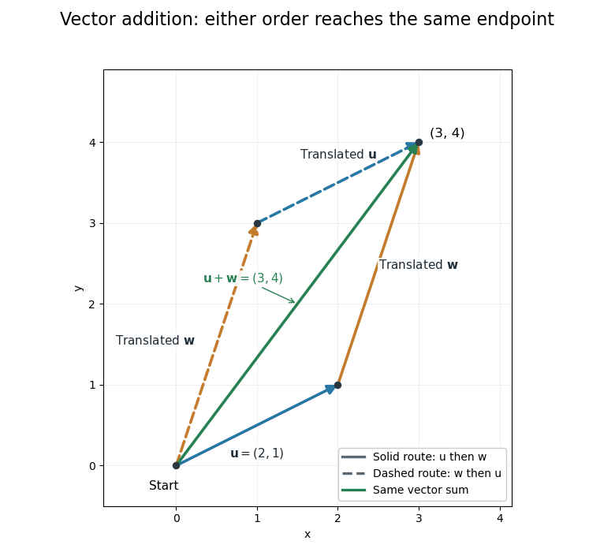

# Euclidean vector

↑ **Parent:** [Vector](vector.md)  
ⓦ [Wiki](https://en.wikipedia.org/wiki/Euclidean_vector)

A [Euclidean vector](euclidean-vector.md) is a [vector](vector.md) in a finite-dimensional real [inner product space](inner-product-space.md). Choosing an [orthonormal basis](orthonormal-basis.md) identifies it with its real [vector components](coordinate-linear-algebra.md) in $\mathbb R^n$. A geometric arrow represents a [Euclidean vector](euclidean-vector.md) by a length and a direction; translating the arrow without changing either represents the same [Euclidean vector](euclidean-vector.md). The [zero vector](zero-vector.md) has length zero and no distinguished direction.[University Physics Volume 1 by William Moebs and others; §2.1, Figures 2.2–2.5: vector arrows, equal vectors and displacement](university-physics-volume-1-by-william-moebs-and-others/2-1-scalars-and-vectors.md)

For points $P=(1,1)$ and $Q=(4,5)$ in a [Cartesian coordinate system](cartesian-coordinate-system.md), the [displacement](displacement.md) is $Q-P=(3,4)$. The arrow from $(-2,0)$ to $(1,4)$ represents the same [Euclidean vector](euclidean-vector.md), even though its endpoints differ. An endpoint is a position; their difference is a [vector](vector.md). In an [orthonormal basis](orthonormal-basis.md) $(\mathbf e_1,\mathbf e_2)$,

$$
\mathbf v=(3,4)=3\mathbf e_1+4\mathbf e_2,\qquad
\|\mathbf v\|_2=\sqrt{3^2+4^2}=5.
$$

The [Euclidean norm](euclidean-norm.md) comes from the [inner product](inner-product-split.md): $\|\mathbf v\|_2^2=\langle\mathbf v,\mathbf v\rangle$. The sum of squared [vector components](coordinate-linear-algebra.md) is valid in an [orthonormal basis](orthonormal-basis.md); an arbitrary [basis](basis.md) requires the appropriate [Gram matrix](gram-matrix.md). This distinction lets the geometric [vector](vector.md) stay the same while its [coordinate vector](coordinate-vector.md) changes.[University Physics Volume 1 by William Moebs and others; §2.2, Cartesian coordinates: equations (2.10)–(2.13) and Figure 2.16, unit basis vectors and scalar components](university-physics-volume-1-by-william-moebs-and-others/2-2-coordinate-systems-and-components-of-a-vector.md)

[Vector addition](vector-addition.md) is componentwise. With $\mathbf u=(2,1)$ and $\mathbf w=(1,3)$,

$$
\mathbf u+\mathbf w=(3,4).
$$

Geometrically, translate the second arrow so its tail starts at the first arrow's head. The [vector sum](vector-sum.md) joins the starting point to the final endpoint. Reversing the order gives the other route around the same [parallelogram](parallelogram.md), so [vector addition](vector-addition.md) is [commutative](commutativity.md). This is the useful bookkeeping behind adding successive [displacements](displacement.md), [velocities](velocity.md), or [forces](force-split.md): direction information survives the calculation. For a [force](force-split.md), the [Euclidean vector](euclidean-vector.md) alone does not specify its point of application, which also affects the [torque](torque.md).[University Physics Volume 1 by William Moebs and others; §2.1, Algebra of Vectors in Two Dimensions: Figure 2.12 and the head-to-tail construction](university-physics-volume-1-by-william-moebs-and-others/2-1-scalars-and-vectors.md)

**[Figure 4](#image-two-orders-of-vector-addition-reach-the-same-endpoint). Two orders of vector addition reach the same endpoint**. The original [Euclidean vectors](euclidean-vector.md) $\mathbf u=(2,1)$ and $\mathbf w=(1,3)$ form a [parallelogram](parallelogram.md). Either head-to-tail route gives their [vector sum](vector-sum.md) $(3,4)$; dashed copies are translated arrows, not additional terms.

The magnitude of a [vector sum](vector-sum.md) is generally different from the sum of the magnitudes. Here $\|\mathbf u+\mathbf w\|_2=5$, whereas $\|\mathbf u\|_2+\|\mathbf w\|_2=\sqrt5+\sqrt{10}>5$. The [triangle inequality](triangle-inequality.md) explains why the direct [displacement](displacement.md) cannot exceed the length of this two-segment route. A return [displacement](displacement.md) $(-3,-4)$ makes the net [vector sum](vector-sum.md) zero, although the lengths of the three travelled segments sum to a positive number.

The [dot product](dot-product.md) exposes direction quantitatively: for nonzero [Euclidean vectors](euclidean-vector.md), $\langle\mathbf u,\mathbf w\rangle=\|\mathbf u\|_2\|\mathbf w\|_2\cos\theta$. For the displayed pair, the [dot product](dot-product.md) is $2\cdot1+1\cdot3=5$, so $\cos\theta=1/\sqrt2$ and the angle is $45^\circ$. For [orthogonal vectors](orthogonal-vectors.md), that [dot product](dot-product.md) is zero. Dividing by magnitudes separates direction from size, which is the purpose of [vector normalization](vector-normalization.md).

## ↑ Ancestors (7)

1. [Vector](vector.md)
2. [Vector space](vector-space-split.md)
3. [Linear algebra](linear-algebra-split.md)
4. [Algebra](algebra-split.md)
5. [Area of mathematics](area-of-mathematics.md)
6. [Mathematics](mathematics-split.md)
7. [Codex Wiki](split.md)

## ← Incoming links (8)

- [Centroid sum-of-squares identity](centroid-sum-of-squares-identity.md)
- [Dot product](dot-product.md)
- [Euclidean vector](euclidean-vector.md)
- [Orthogonal vectors](orthogonal-vectors.md)
- [Scalar projection](scalar-projection.md)
- [Unit vector](unit-vector.md)
- [Vector](vector.md)
- [Vector projection](vector-projection.md)
