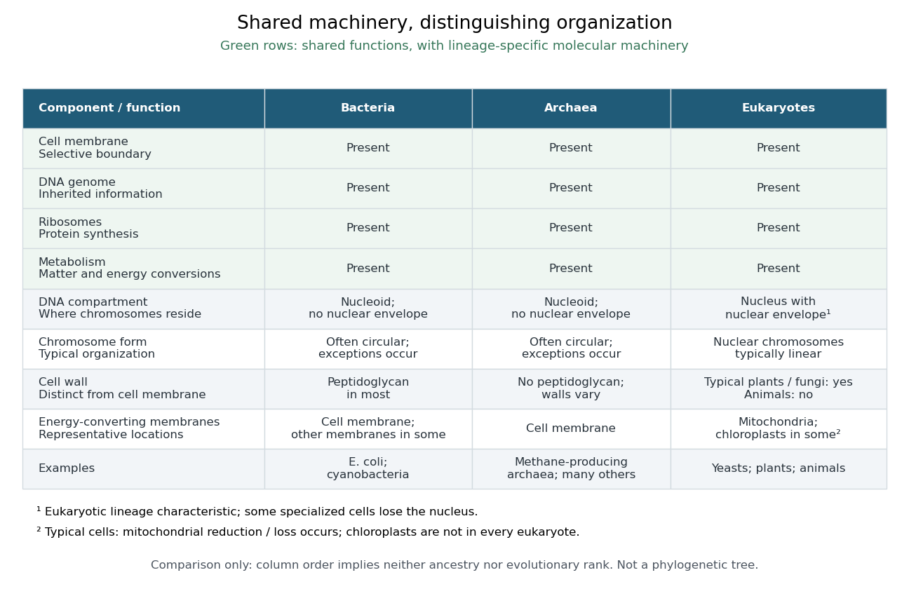

# Eukaryote

↑ **Parent:** [Organism](organism-split.md)  
ⓦ [Wiki](https://en.wikipedia.org/wiki/Eukaryote)

A [eukaryote](eukaryote.md) is an [organism](organism-split.md) belonging to the lineage characterized by a membrane-bounded [cell nucleus](cell-nucleus.md) and extensive cellular compartmentalization. A [nuclear envelope](nuclear-envelope.md) surrounds the nuclear [genome](genome.md); nuclear [chromosomes](chromosome.md) are typically linear. [Ribosomes](ribosome.md) perform [biological translation](translation-biology.md) outside the [cell nucleus](cell-nucleus.md). See [OpenStax Microbiology, 3.4: nuclear organization and protein synthesis](https://openstax.org/books/microbiology/pages/3-4-unique-characteristics-of-eukaryotic-cells). Specialized [biological cells](biological-cell-split.md) can lose their [cell nucleus](cell-nucleus.md), as mature mammalian [red blood cells](red-blood-cell.md) do, while remaining parts of [eukaryotic](eukaryote.md) [organisms](organism-split.md); see [OpenStax Biology 2e, 40.2: mature red blood cells](https://openstax.org/books/biology-2e/pages/40-2-components-of-the-blood).

[Yeasts](yeast.md), [plants](plant.md) and [animals](animal.md) are all [eukaryotes](eukaryote.md). Typical cells in these groups have [mitochondria](mitochondria.md), but [chloroplasts](chloroplast.md) belong to photosynthetic [plant](plant.md) and [algae](algae.md) lineages, not to every [eukaryote](eukaryote.md). A [cell wall](cell-wall.md) occurs in typical [plant](plant.md) and [fungus](fungus.md) cells but is absent from [animal](animal.md) cells. These are comparisons of representative cells, not a checklist every specialized cell must satisfy. See [OpenStax Biology 2e, 4.3: nucleus, organelles and representative cells](https://openstax.org/books/biology-2e/pages/4-3-eukaryotic-cells).

The interesting feature is controlled separation: [cell membranes](cell-membrane-split.md) and [organelle](organelle.md) membranes let different cellular processes occupy distinct compartments while [membrane transport](membrane-transport.md) connects them. The [evolution](evolution.md) of [eukaryotes](eukaryote.md) also involved partnership: [mitochondria](mitochondria.md) descend from a bacterial [endosymbiosis](endosymbiosis.md). Modern [phylogenetics](phylogenetics.md) supports an archaeal ancestry for the nuclear lineage, alongside this bacterial contribution; see [two-domain system](two-domain-system.md). Thus the history of a whole [eukaryote](eukaryote.md) cannot be read as the history of just one of its [genes](gene.md).

**[Figure 6](#image-shared-cellular-machinery-and-distinguishing-organization-across-bacteria-archaea-and-eukaryotes). Shared cellular machinery and distinguishing organization across bacteria, archaea and eukaryotes**. Original comparison table, not a [phylogenetic tree](phylogenetic-tree.md). The shared functions do not require identical [molecules](molecule-split.md). Entries describe representative cellular organization and explicitly qualify exceptions; column positions imply neither ancestry nor evolutionary rank.

**Table of contents**

- [Ciliate](ciliate.md)
  - [Nuclear dimorphism](nuclear-dimorphism.md)
    - [Macronucleus](macronucleus.md)
    - [Micronucleus](micronucleus.md)
  - [Paramecium](paramecium.md)
    - [Paramecium tetraurelia](paramecium-tetraurelia.md)
  - [Tetrahymena thermophila](tetrahymena-thermophila.md)
- [Camelina sativa](camelina-sativa.md)
- [Entamoeba histolytica](entamoeba-histolytica.md)
- [Giardia](giardia.md)
- [Dinoflagellate](dinoflagellate.md)
- [Fungus](fungus.md)
  - [Yeast](yeast.md)
    - [Budding yeast](budding-yeast.md)
      - [Yeast budding](yeast-budding.md)
    - [Schizosaccharomyces pombe](schizosaccharomyces-pombe.md)
    - [Saccharomyces cerevisiae](saccharomyces-cerevisiae.md)
- [Plant](plant.md)
  - [Arabis alpina](arabis-alpina.md)
  - [Bread wheat](bread-wheat.md)
  - [Rice](rice.md)
  - [Tomato](tomato.md)
  - [African oil palm](african-oil-palm.md)
  - [Perennial plant](perennial-plant.md)
  - [Annual plant](annual-plant.md)
  - [Mimulus](mimulus.md)
    - [Mimulus guttatus](mimulus-guttatus.md)
  - [Milkweed](milkweed.md)
  - [Ophrys sphegodes](ophrys-sphegodes.md)
  - [Desiccation tolerance](desiccation-tolerance.md)
  - [Rhizoid](rhizoid.md)
  - [Vascular plant](vascular-plant.md)
    - [Seed plant](seed-plant.md)
      - [Gymnosperm](gymnosperm.md)
        - [Gnetum](gnetum.md)
    - [Fern](fern.md)
      - [Sorus](sorus.md)
  - [Bryophyte](bryophyte.md)
    - [Hornwort](hornwort.md)
    - [Liverwort](liverwort.md)
    - [Moss](moss.md)
  - [Pea](pea.md)
  - [Flower](flower.md)
    - [Dichogamy](dichogamy.md)
    - [Herkogamy](herkogamy.md)
    - [Perianth](perianth.md)
    - [Bisexual flower](bisexual-flower.md)
    - [Floral symmetry](floral-symmetry.md)
      - [Bilateral floral symmetry](bilateral-floral-symmetry.md)
      - [Radial floral symmetry](radial-floral-symmetry.md)
    - [Stamen](stamen.md)
      - [Anther](anther.md)
      - [Stamen filament](stamen-filament.md)
    - [Stigma (botany)](stigma-botany.md)
    - [Carpel](carpel.md)
      - [Style (botany)](style-botany.md)
      - [Ovary (botany)](ovary-botany.md)
        - [Ovule](ovule.md)
          - [Angiosperm female gametophyte](angiosperm-female-gametophyte.md)
    - [Petal](petal.md)
    - [Sepal](sepal.md)
  - [Seed](seed.md)
    - [Seed vigor](seed-vigor.md)
    - [Plant embryo](plant-embryo.md)
      - [Cotyledon](cotyledon.md)
      - [Radicle](radicle.md)
    - [Seed coat](seed-coat.md)
    - [Seed food reserve](seed-food-reserve.md)
    - [Endosperm](endosperm.md)
    - [Seedling](seedling.md)
    - [Germination](germination.md)
      - [Seed imbibition](seed-imbibition.md)
      - [Seed dormancy](seed-dormancy.md)
      - [Seed viability](seed-viability.md)
      - [Lettuce red and far-red germination experiment](lettuce-red-and-far-red-germination-experiment.md)
      - [Germination assay](germination-assay.md)
  - [Lettuce](lettuce.md)
  - [Root (botany)](root-botany.md)
  - [Leaf](leaf.md)
  - [Plant tissue](plant-tissue.md)
    - [Meristem](meristem.md)
    - [Plant cuticle](plant-cuticle.md)
    - [Stoma](stoma.md)
      - [Stomatal closure](stomatal-closure.md)
    - [Phloem](phloem.md)
    - [Xylem](xylem.md)
      - [Tracheid](tracheid.md)
  - [Angiosperm](angiosperm.md)
    - [Cadia](cadia.md)
    - [Antirrhinum](antirrhinum.md)
    - [Lilium](lilium.md)
- [Algae](algae.md)
  - [Chromera velia](chromera-velia.md)
  - [Microalga](microalga.md)
- [Reclinomonas americana](reclinomonas-americana.md)
- [Animal](animal.md)
  - [Crustacean](crustacean.md)
    - [Ostracod](ostracod.md)
  - [Bilaterian](bilaterian.md)
    - [Kimberella](kimberella.md)
  - [Echolocation](echolocation.md)
  - [Chordate](chordate.md)
    - [Amphioxus](amphioxus.md)
    - [Cephalochordate](cephalochordate.md)
    - [Tunicate](tunicate.md)
      - [Oikopleura dioica](oikopleura-dioica.md)
  - [Ciona](ciona.md)
  - [Caenorhabditis elegans](caenorhabditis-elegans.md)
  - [Marmoset](marmoset.md)
  - [Vertebrate](vertebrate.md)
    - [Metaspriggina](metaspriggina.md)
    - [Myllokunmingia](myllokunmingia.md)
    - [Haikouichthys](haikouichthys.md)
    - [Ostracoderm](ostracoderm.md)
    - [Gnathostome](gnathostome.md)
      - [Osteostracan](osteostracan.md)
      - [Galeaspid](galeaspid.md)
        - [Tujiaaspis vividus](tujiaaspis-vividus.md)
      - [Janusiscus schultzei](janusiscus-schultzei.md)
      - [Placoderm](placoderm.md)
        - [Kolymaspis sibirica](kolymaspis-sibirica.md)
        - [Minjinia turgenensis](minjinia-turgenensis.md)
        - [Entelognathus primordialis](entelognathus-primordialis.md)
      - [Acanthodian](acanthodian.md)
        - [Acanthodes](acanthodes.md)
      - [Chondrichthyes](chondrichthyes.md)
        - [Leucoraja erinacea](leucoraja-erinacea.md)
        - [Chimaera](chimaera.md)
        - [Ray fish](ray-fish.md)
        - [Shark](shark.md)
      - [Qianodus](qianodus.md)
      - [Osteichthyes](osteichthyes.md)
        - [Gar](gar.md)
        - [Psarolepis](psarolepis.md)
        - [Sarcopterygii](sarcopterygii.md)
          - [Tiktaalik](tiktaalik.md)
          - [Lungfish](lungfish.md)
          - [Coelacanth](coelacanth.md)
    - [Cyclostome](cyclostome.md)
      - [Lamprey](lamprey.md)
        - [Priscomyzon](priscomyzon.md)
      - [Hagfish](hagfish.md)
        - [Tethymyxine](tethymyxine.md)
    - [Tetrapod](tetrapod.md)
      - [Acanthostega](acanthostega.md)
      - [Hind limb](hind-limb.md)
      - [Forelimb](forelimb.md)
        - [Shoulder](shoulder.md)
        - [Elbow](elbow.md)
      - [Amniote](amniote.md)
        - [Sauropsida](sauropsida.md)
          - [Eunotosaurus](eunotosaurus.md)
          - [Diapsida](diapsida.md)
            - [Lizard](lizard.md)
            - [Turtle](turtle.md)
              - [Pappochelys](pappochelys.md)
            - [Archosauria](archosauria.md)
              - [Pterosaur](pterosaur.md)
              - [Panaves](panaves.md)
              - [Dinosaur](dinosaur.md)
                - [Theropod dinosaur](theropod-dinosaur.md)
                  - [Avialae](avialae.md)
                  - [Yutyrannus](yutyrannus.md)
                  - [Bird](bird.md)
                    - [Janavis finalidens](janavis-finalidens.md)
                    - [Ichthyornis](ichthyornis.md)
                    - [Archaeopteryx](archaeopteryx.md)
                    - [Aves](aves.md)
                      - [Neognathae](neognathae.md)
                        - [Sparrow](sparrow.md)
                        - [Galloanserae](galloanserae.md)
                          - [Waterfowl](waterfowl.md)
                          - [Landfowl](landfowl.md)
                      - [Palaeognathae](palaeognathae.md)
                        - [Tinamou](tinamou.md)
                        - [Ostrich](ostrich.md)
                    - [Great tit](great-tit.md)
                    - [Scrub jay](scrub-jay.md)
                    - [Raven](raven.md)
                    - [Darwin's finches](darwin-s-finches.md)
                      - [Geospiza conirostris](geospiza-conirostris.md)
                      - [Geospiza fortis](geospiza-fortis.md)
                    - [Barn owl](barn-owl.md)
                    - [Fork-tailed drongo](fork-tailed-drongo.md)
              - [Crocodilian](crocodilian.md)
            - [Lepidosaur](lepidosaur.md)
              - [Tuatara](tuatara.md)
          - [Reptilia](reptilia.md)
        - [Synapsid](synapsid.md)
          - [Therapsid](therapsid.md)
            - [Cynodont](cynodont.md)
              - [Mammaliamorph](mammaliamorph.md)
              - [Mammaliaform](mammaliaform.md)
                - [Castorocauda](castorocauda.md)
                - [Sinodelphys](sinodelphys.md)
                - [Gondwanatheria](gondwanatheria.md)
                  - [Adalatherium](adalatherium.md)
                  - [Vintana](vintana.md)
                - [Boreosphenida](boreosphenida.md)
                - [Australosphenida](australosphenida.md)
                - [Ambondro mahabo](ambondro-mahabo.md)
                - [Hadrocodium](hadrocodium.md)
                - [Morganucodon](morganucodon.md)
                - [Mammal](mammal.md)
                  - [Pygmy shrew](pygmy-shrew.md)
                  - [Greater white-toothed shrew](greater-white-toothed-shrew.md)
                  - [Hedgehog](hedgehog.md)
                  - [Bat](bat.md)
                    - [Vampire bat](vampire-bat.md)
                  - [Topi](topi.md)
                  - [Human](human.md)
                  - [Lactation](lactation.md)
                  - [Theria](theria.md)
                    - [Eutheria](eutheria.md)
                      - [Ambolestes zhoui](ambolestes-zhoui.md)
                      - [Eomaia scansoria](eomaia-scansoria.md)
                      - [Placental mammal](placental-mammal.md)
                        - [Macrauchenia](macrauchenia.md)
                        - [Toxodon](toxodon.md)
                        - [Mesonychian](mesonychian.md)
                        - [Euarchontoglires](euarchontoglires.md)
                          - [Primates](primates.md)
                            - [Saimiri sciureus](saimiri-sciureus.md)
                            - [Ape](ape.md)
                            - [Great ape](great-ape.md)
                              - [Australopithecus](australopithecus.md)
                                - [Australopithecus afarensis](australopithecus-afarensis.md)
                              - [Paranthropus](paranthropus.md)
                                - [Paranthropus boisei](paranthropus-boisei.md)
                              - [Hominin](hominin.md)
                              - [Pierolapithecus](pierolapithecus.md)
                              - [Ardipithecus](ardipithecus.md)
                                - [Ardipithecus ramidus](ardipithecus-ramidus.md)
                              - [Pongo](pongo.md)
                              - [Gorilla](gorilla.md)
                              - [Homo](homo.md)
                                - [Denisovan](denisovan.md)
                                - [Neanderthal](neanderthal.md)
                                - [Homo sapiens](homo-sapiens.md)
                              - [Pan](pan.md)
                                - [Bonobo](bonobo.md)
                                - [Chimpanzee](chimpanzee.md)
                            - [Colobinae](colobinae.md)
                            - [Colobine monkey](colobine-monkey.md)
                          - [Glires](glires.md)
                            - [Lagomorpha](lagomorpha.md)
                              - [Rabbit](rabbit.md)
                            - [Rodentia](rodentia.md)
                              - [Water vole](water-vole.md)
                              - [Muskrat](muskrat.md)
                              - [Coypu](coypu.md)
                              - [Red squirrel](red-squirrel.md)
                              - [Grey squirrel](grey-squirrel.md)
                              - [Beaver](beaver.md)
                        - [Xenarthra](xenarthra.md)
                          - [Anteater](anteater.md)
                        - [Afrotheria](afrotheria.md)
                          - [Sirenia](sirenia.md)
                            - [Pezosiren portelli](pezosiren-portelli.md)
                          - [Proboscidea](proboscidea.md)
                            - [Asian elephant](asian-elephant.md)
                            - [Mammoth](mammoth.md)
                        - [Laurasiatheria](laurasiatheria.md)
                          - [Pholidota](pholidota.md)
                          - [Perissodactyla](perissodactyla.md)
                            - [Horse](horse.md)
                          - [Carnivora](carnivora.md)
                            - [Bear](bear.md)
                            - [Pine marten](pine-marten.md)
                            - [American mink](american-mink.md)
                            - [Wolf](wolf.md)
                              - [Dog](dog.md)
                            - [Brown bear](brown-bear.md)
                            - [Lynx](lynx.md)
                          - [Artiodactyla](artiodactyla.md)
                            - [Pig](pig.md)
                            - [Goat](goat.md)
                            - [Sheep](sheep.md)
                            - [Cattle](cattle.md)
                            - [Muntjac](muntjac.md)
                            - [Sika deer](sika-deer.md)
                            - [Fallow deer](fallow-deer.md)
                            - [Red deer](red-deer.md)
                            - [Wild boar](wild-boar.md)
                            - [Aurochs](aurochs.md)
                            - [Giant deer](giant-deer.md)
                            - [Ruminantia](ruminantia.md)
                            - [Ruminant](ruminant.md)
                            - [Hippopotamus](hippopotamus.md)
                            - [Cetacea](cetacea.md)
                              - [Dolphin](dolphin.md)
                                - [Bottlenose dolphin](bottlenose-dolphin.md)
                              - [Tail fluke](tail-fluke.md)
                              - [Basilosaurid](basilosaurid.md)
                                - [Basilosaurus](basilosaurus.md)
                              - [Protocetid](protocetid.md)
                                - [Rodhocetus](rodhocetus.md)
                              - [Ambulocetus](ambulocetus.md)
                              - [Pakicetidae](pakicetidae.md)
                              - [Pakicetid](pakicetid.md)
                              - [Mysticeti](mysticeti.md)
                                - [Baleen](baleen.md)
                              - [Odontoceti](odontoceti.md)
                    - [Metatheria](metatheria.md)
                      - [Marsupial](marsupial.md)
                        - [Australidelphia](australidelphia.md)
                          - [Microbiotheria](microbiotheria.md)
                          - [Dasyuromorphia](dasyuromorphia.md)
                            - [Thylacine](thylacine.md)
                          - [Diprotodontia](diprotodontia.md)
                            - [Macropod](macropod.md)
                          - [Djarthia](djarthia.md)
                  - [Monotreme](monotreme.md)
                    - [Platypus](platypus.md)
                    - [Monotrematum](monotrematum.md)
  - [Insect](insect.md)
    - [Water strider](water-strider.md)
    - [Nasonia](nasonia.md)
      - [Nasonia giraulti](nasonia-giraulti.md)
      - [Nasonia vitripennis](nasonia-vitripennis.md)
    - [Butterfly](butterfly.md)
      - [Monarch butterfly](monarch-butterfly.md)
        - [Danaus plexippus](danaus-plexippus.md)
    - [Dung beetle](dung-beetle.md)
      - [Onthophagus gazella](onthophagus-gazella.md)
      - [Onthophagus taurus](onthophagus-taurus.md)
    - [Bumblebee](bumblebee.md)
    - [Acyrthosiphon pisum](acyrthosiphon-pisum.md)
    - [Heliconius](heliconius.md)
      - [Heliconius erato](heliconius-erato.md)
      - [Heliconius cydno](heliconius-cydno.md)
      - [Heliconius melpomene](heliconius-melpomene.md)
    - [Rhagoletis pomonella](rhagoletis-pomonella.md)
    - [Drosophila](drosophila.md)
      - [Drosophila persimilis](drosophila-persimilis.md)
      - [Drosophila simulans](drosophila-simulans.md)
    - [Temnothorax albipennis](temnothorax-albipennis.md)
    - [Honeybee](honeybee.md)
    - [Andrena nigroaenea](andrena-nigroaenea.md)
    - [Tribolium castaneum](tribolium-castaneum.md)
    - [Drosophila melanogaster](drosophila-melanogaster.md)
    - [Drosophila pseudoobscura](drosophila-pseudoobscura.md)
  - [Amphibian](amphibian.md)
    - [Salamander](salamander.md)
    - [Salientia](salientia.md)
      - [Prosalirus bitis](prosalirus-bitis.md)
      - [Triadobatrachus massinoti](triadobatrachus-massinoti.md)
    - [Axolotl](axolotl.md)
    - [Frog](frog.md)
      - [Anura](anura.md)
      - [Spadefoot toad](spadefoot-toad.md)
      - [Xenopus laevis](xenopus-laevis.md)
  - [Fish](fish.md)
    - [Guppy](guppy.md)
      - [Poecilia reticulata](poecilia-reticulata.md)
    - [Cleaner wrasse](cleaner-wrasse.md)
      - [Labroides dimidiatus](labroides-dimidiatus.md)
    - [Astyanax mexicanus](astyanax-mexicanus.md)
    - [Cichlid](cichlid.md)
      - [Astatotilapia burtoni](astatotilapia-burtoni.md)
    - [Giant moray eel](giant-moray-eel.md)
    - [Grouper](grouper.md)
    - [Three-spined stickleback](three-spined-stickleback.md)
    - [Zebrafish](zebrafish.md)
  - [House mouse](house-mouse.md)
  - [Echinoderm](echinoderm.md)
    - [Sand dollar](sand-dollar.md)

## ↑ Ancestors (3)

1. [Organism](organism-split.md)
2. [Biology](biology-split.md)
3. [Codex Wiki](split.md)

## ← Incoming links (29)

- [Archaea](archaea.md)
- [Asgard archaea](asgard-archaea.md)
- [Biological cell](biological-cell-split.md)
- [Cell membrane](cell-membrane-split.md)
- [Clade](clade.md)
- [Entamoeba histolytica](entamoeba-histolytica.md)
- [Eukaryote](eukaryote.md)
- [Evidence for bacterial ancestry of organelles](evidence-for-bacterial-ancestry-of-organelles.md)
- [Fungus](fungus.md)
- [Genome](genome.md)
- [Giardia](giardia.md)
- [Organism](organism-split.md)
- [Origin recognition complex](origin-recognition-complex.md)
- [Solution](past-exam-of-the-biochemistry-and-molecular-biology-course-of-the-university-of-cambridge/2025/paper-1/section-a/3/solution.md)
- [Solution](past-exam-of-the-biochemistry-and-molecular-biology-course-of-the-university-of-cambridge/2025/paper-2/section-a/10/solution.md)
- [Solution](past-exam-of-the-biochemistry-course-of-the-university-of-cambridge/2024/paper-3/section-ii/6/solution.md)
- [Solution](past-exam-of-the-biochemistry-course-of-the-university-of-cambridge/2025/paper-2/section-ii/6/solution.md)
- [Solution](past-exam-of-the-biochemistry-course-of-the-university-of-cambridge/2025/paper-3/section-i/1/solution.md)
- [Solution](past-exam-of-the-biochemistry-course-of-the-university-of-cambridge/2025/paper-3/section-ii/4/solution.md)
- [Plant](plant.md)
- [Prokaryote](prokaryote.md)
- [Reclinomonas americana](reclinomonas-americana.md)
- [Ribosome](ribosome.md)
- [Saccharomyces cerevisiae](saccharomyces-cerevisiae.md)
- [Telomerase](telomerase.md)
- [Three-domain system](three-domain-system.md)
- [Translation (biology)](translation-biology.md)
- [Two-domain system](two-domain-system.md)
- [Yeast](yeast.md)
