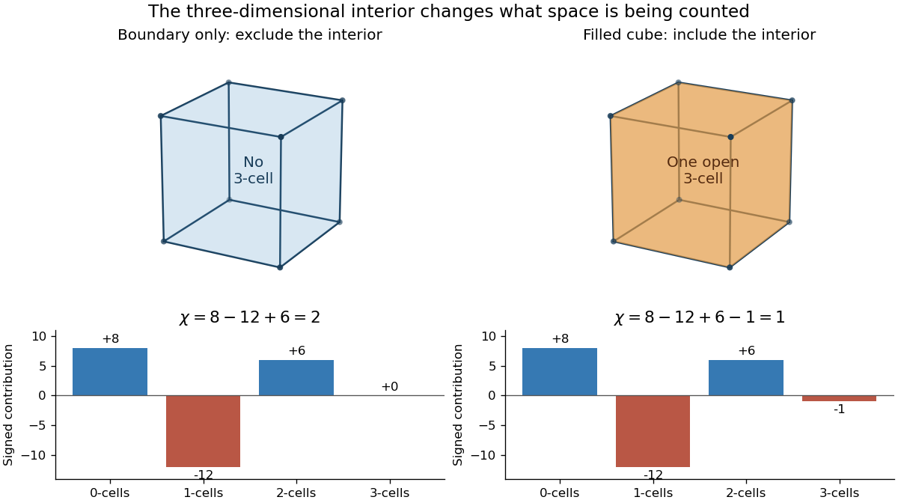

# Euler characteristic of a cube boundary and its interior

↑ **Parent:** [Euler characteristic](euler-characteristic.md)

The boundary of a [cube](cube.md) has eight [vertices](vertex-graph-theory.md), twelve [edges](edge-of-a-graph.md) and six square faces. Treating each open face as a two-dimensional [topological cell](topological-cell.md) gives

$$
\boxed{\chi(\partial[0,1]^3)=8-12+6=2.}
$$

This agrees with its being a [two-sphere](two-sphere.md): stretching the hollow polyhedral surface changes its geometry but not its [topology](topology-split.md). The interior is excluded from this space.

Now include the solid interior. The [cube](cube.md) has the same lower-dimensional [topological cells](topological-cell.md), together with one open three-dimensional [topological cell](topological-cell.md). The [cell-count formula for Euler characteristic](cell-count-formula-for-euler-characteristic.md) becomes

$$
\boxed{\chi([0,1]^3)=8-12+6-1=1.}
$$

The filled [cube](cube.md) is [contractible](contractible-space.md), so its [homology](homology-split.md) agrees with that of a point. The term $-1$ is essential: $V-E+F$ by itself is the full count only for a two-dimensional [CW complex](cw-complex.md).

**[Figure 1](#image-the-boundary-of-a-cube-has-euler-characteristic-2-including-its-three-dimensional-interior-adds-one-negative-contribution-and-gives-1). The boundary of a cube has Euler characteristic 2; including its three-dimensional interior adds one negative contribution and gives 1**.

Adding a diagonal within one square face replaces that face by two triangular faces and introduces one [edge](edge-of-a-graph.md). Thus the [Euler characteristic](euler-characteristic.md) changes by $-1+1=0$, as in [subdivision invariance of Euler characteristic](subdivision-invariance-of-euler-characteristic.md). Including an interior is a different operation: it adds points to the space, rather than giving the same space a finer description. This distinction matters whenever a geometric model could mean either a surface or the solid it encloses.

## ↑ Ancestors (8)

1. [Euler characteristic](euler-characteristic.md)
2. [Simplicial homology](simplicial-homology.md)
3. [Homology (mathematics)](homology-split.md)
4. [Algebraic topology](algebraic-topology-split.md)
5. [Geometry and topology](geometry-and-topology-split.md)
6. [Area of mathematics](area-of-mathematics.md)
7. [Mathematics](mathematics-split.md)
8. [Codex Wiki](split.md)

## ← Incoming links (1)

- [History of Euler characteristic](history-of-euler-characteristic.md)
