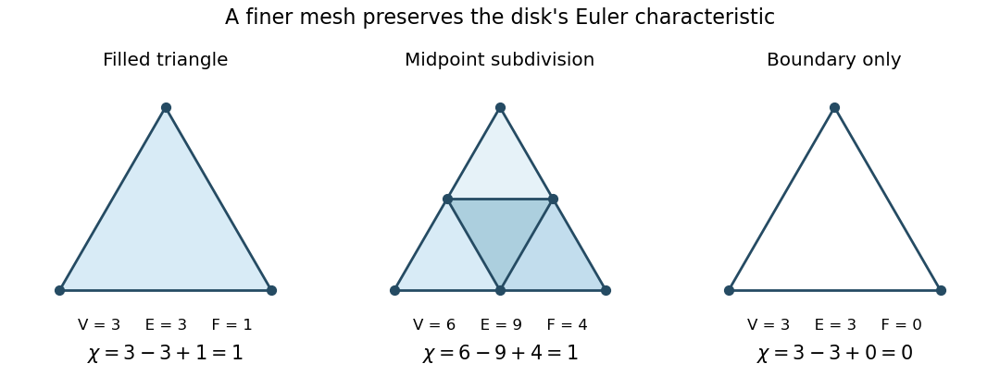

# Euler characteristic of a disk and its boundary

↑ **Parent:** [Euler characteristic](euler-characteristic.md)

A filled [triangle](triangle.md) is a [disk](disk-mathematics.md) with three [vertices](vertex-graph-theory.md), three [edges](edge-of-a-graph.md) and one two-dimensional [topological cell](topological-cell.md), so $\chi=3-3+1=1$. Its [simplicial homology](simplicial-homology.md) has $(b_0,b_1,b_2)=(1,0,0)$: the filled [triangle](triangle.md) is [contractible](contractible-space.md), and the three-edge [chain cycle](chain-cycle.md) is the [chain boundary](chain-boundary.md) of its face. Keeping only the [cycle graph](cycle-graph.md) on those three [vertices](vertex-graph-theory.md) gives $\chi=3-3=0$ and $(b_0,b_1)=(1,1)$, since that [chain cycle](chain-cycle.md) no longer bounds a face. The surrounding plane's exterior is not part of either [simplicial complex](simplicial-complex.md); do not add it to $F$.

**[Figure 1](#image-the-filled-triangle-its-midpoint-subdivision-and-its-unfilled-boundary). The filled triangle, its midpoint subdivision, and its unfilled boundary**.

## ↑ Ancestors (8)

1. [Euler characteristic](euler-characteristic.md)
2. [Simplicial homology](simplicial-homology.md)
3. [Homology (mathematics)](homology-split.md)
4. [Algebraic topology](algebraic-topology-split.md)
5. [Geometry and topology](geometry-and-topology-split.md)
6. [Area of mathematics](area-of-mathematics.md)
7. [Mathematics](mathematics-split.md)
8. [Codex Wiki](split.md)
