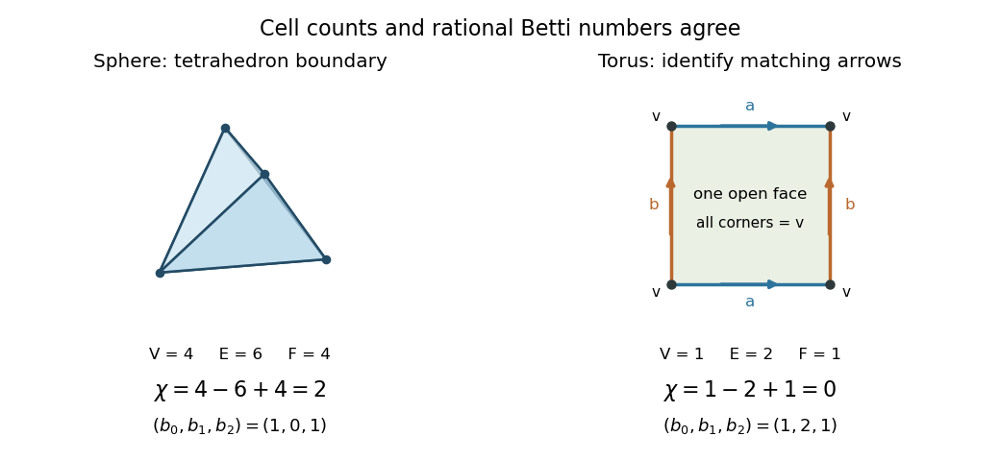

# Euler characteristic of a torus

↑ **Parent:** [Euler characteristic](euler-characteristic.md)

Identify opposite sides of a [square](square.md) by translations to obtain a [torus](torus.md). All four corners become one [vertex](vertex-graph-theory.md); the horizontal sides give one [topological cell](topological-cell.md) $a$ and the vertical sides one [topological cell](topological-cell.md) $b$. The open [square](square.md) supplies one two-dimensional [topological cell](topological-cell.md). Thus $(c_0,c_1,c_2)=(1,2,1)$ and $\chi=0$. The [cellular boundary](cellular-boundary.md) of each one-dimensional [topological cell](topological-cell.md) is zero because its endpoints agree. Traversing the face boundary gives the [group commutator](group-commutator.md) $aba^{-1}b^{-1}$, whose signed counts of both $a$ and $b$ vanish. Hence its [cellular boundary](cellular-boundary.md) is also zero, and $(b_0,b_1,b_2)=(1,2,1)$.[A Concise Course in Algebraic Topology, Chapter 13, §5, p. 103, Example (i), the torus cellular chains and integral homology](a-concise-course-in-algebraic-topology-by-j-p-may.md)

**[Figure 4](#image-the-tetrahedral-sphere-and-the-square-presentation-of-a-torus-have-different-alternating-cell-counts). The tetrahedral sphere and the square presentation of a torus have different alternating cell counts**.

The boundary of a [tetrahedron](tetrahedron.md) is a [two-sphere](two-sphere.md), with four [vertices](vertex-graph-theory.md), six [edges](edge-of-a-graph.md) and four triangular [topological cells](topological-cell.md): $\chi=4-6+4=2$. Its rational [Betti numbers](betti-number.md) are $(1,0,1)$ by [homology of a sphere](homology-of-a-sphere.md). The [torus](torus.md)'s two independent one-dimensional [homology classes](homology-class.md) cancel its degree-zero and degree-two contributions. The [torus](torus.md) and [annulus](annulus-mathematics.md) both have [Euler characteristic](euler-characteristic.md) zero, yet different [homology groups](homology-group.md); one integer cannot recover all of [homology](homology-split.md).

## ↑ Ancestors (8)

1. [Euler characteristic](euler-characteristic.md)
2. [Simplicial homology](simplicial-homology.md)
3. [Homology (mathematics)](homology-split.md)
4. [Algebraic topology](algebraic-topology-split.md)
5. [Geometry and topology](geometry-and-topology-split.md)
6. [Area of mathematics](area-of-mathematics.md)
7. [Mathematics](mathematics-split.md)
8. [Codex Wiki](split.md)

## ← Incoming links (1)

- [Euler characteristic](euler-characteristic.md)
