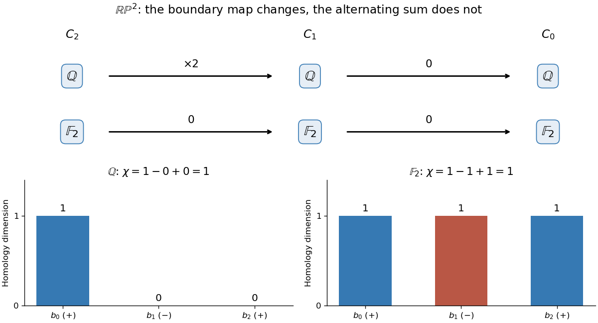

# Euler characteristic with different coefficient fields

↑ **Parent:** [Euler characteristic](euler-characteristic.md)

For a concrete example of [cellular homology of real projective space](cellular-homology-of-real-projective-space.md), the [real projective plane](real-projective-plane.md) $\mathbb{RP}^2$ has one [topological cell](topological-cell.md) in each of [dimensions](dimension-vector-space.md) zero, one and two. Its one-dimensional [topological cell](topological-cell.md) is a loop, and the face attaches around that loop twice. Choose orientations so that the [cellular chain complex](cellular-chain-complex.md) over the [integers](integer-split.md) is

$$
0\longrightarrow\mathbb Z\xrightarrow{\;2\;}\mathbb Z\xrightarrow{\;0\;}\mathbb Z\longrightarrow0,
$$

with nonzero [chain groups](chain-group.md) in degrees two, one and zero. The twice-around attachment is why the first [boundary operator](boundary-operator.md) shown is multiplication by two.[Algebraic Topology by Allen Hatcher, §2.2, Example 2.42, printed p. 144: real projective cellular boundary maps](algebraic-topology-by-allen-hatcher.md)

Over the [rational numbers](rational-number.md), multiplication by two is invertible, so $H_2$ and $H_1$ vanish, while $H_0\cong\mathbb Q$. Over the [finite field](finite-field.md) $\mathbb F_2$, two equals zero. Both [boundary operators](boundary-operator.md) then vanish, giving one-dimensional [homology groups](homology-group.md) in all three degrees. Their respective [Betti numbers](betti-number.md) are

$$
(b_0,b_1,b_2)_{\mathbb Q}=(1,0,0),\qquad
(b_0,b_1,b_2)_{\mathbb F_2}=(1,1,1).
$$

Nevertheless,

$$
\boxed{\chi(\mathbb{RP}^2)=1-0+0=1-1+1=1.}
$$

The direct cell count is also $1-1+1=1$.

**[Figure 2](#image-changing-coefficients-changes-the-projective-plane-s-homology-groups-but-their-alternating-dimension-sum-remains-1). Changing coefficients changes the projective plane's homology groups, but their alternating dimension sum remains 1**.

This calculation makes the strength and loss of information visible. The [Euler characteristic](euler-characteristic.md) survives a change of the [field](field.md) used for coefficients, while individual [homology groups](homology-group.md) can change. Over the [integers](integer-split.md), the same [chain complex](chain-complex.md) has $H_1\cong\mathbb Z/2\mathbb Z$ and $H_2=0$: a [torsion subgroup](torsion-subgroup.md) that rational [Betti numbers](betti-number.md) do not record. The [rank cancellation in the Euler-Poincare formula](rank-cancellation-in-the-euler-poincare-formula.md) explains why the alternating total still agrees with the cell count.

## ↑ Ancestors (8)

1. [Euler characteristic](euler-characteristic.md)
2. [Simplicial homology](simplicial-homology.md)
3. [Homology (mathematics)](homology-split.md)
4. [Algebraic topology](algebraic-topology-split.md)
5. [Geometry and topology](geometry-and-topology-split.md)
6. [Area of mathematics](area-of-mathematics.md)
7. [Mathematics](mathematics-split.md)
8. [Codex Wiki](split.md)
