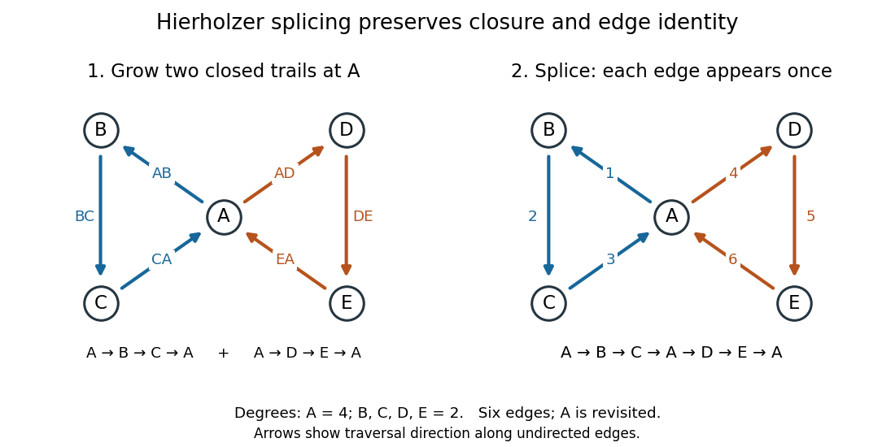

# Euler circuit criterion

↑ **Parent:** [Eulerian graph](eulerian-graph.md)

Let $G=(V,E)$ be a finite undirected [multigraph](multigraph.md), allowing [self-loops](loop-graph-theory.md) and distinct parallel [edges](edge-of-a-graph.md), with $E\ne\varnothing$. Then

$$
G\text{ has an Euler circuit}\quad\Longleftrightarrow\quad G_+\text{ is connected and }\deg(v)\equiv0\pmod2\text{ for every }v\in V,
$$

where $G_+$ is the [edge support of a graph](edge-support-of-a-graph.md), and [vertex degrees](degree-graph-theory.md) count each [self-loop](loop-graph-theory.md) twice. There is no lower bound of three on the number of [vertices](vertex-graph-theory.md). If $E=\varnothing$, the zero-length convention gives an [Euler circuit](euler-circuit.md) exactly when $V\ne\varnothing$.[p. 1, Theorem 1.1.2(a) and isolated-vertex note; p. 2, trivial trail convention](math-530-graph-theory-combinatorial-mathematics-i-spring-2023/math-530-spring-2023-lecture-6-multigraphs-and-digraphs.md)

The two requirements are independent: two separate [vertices](vertex-graph-theory.md), each carrying a [self-loop](loop-graph-theory.md), have even [vertex degrees](degree-graph-theory.md) but disconnected [edge support of a graph](edge-support-of-a-graph.md), so no [Euler circuit](euler-circuit.md) can cover both [edges](edge-of-a-graph.md).

Necessity follows because a single [trail](trail-in-a-graph.md) cannot cover [edges](edge-of-a-graph.md) in different [connected components of a graph](component-graph-theory.md), while a closed [trail](trail-in-a-graph.md) pairs all arriving and departing incidences, including those at its starting [vertex](vertex-graph-theory.md). For sufficiency, extend a [trail](trail-in-a-graph.md) using unused [edges](edge-of-a-graph.md) until no extension is possible. Even [vertex degree](degree-graph-theory.md) [parity](parity.md) prevents it from stopping anywhere except its starting [vertex](vertex-graph-theory.md): a different stopping [vertex](vertex-graph-theory.md) would have an odd number of used incidences and hence at least one unused incidence. The result is a closed [trail](trail-in-a-graph.md).

If unused [edges](edge-of-a-graph.md) remain, connectivity of the [edge support of a graph](edge-support-of-a-graph.md) supplies a [vertex](vertex-graph-theory.md) on the current closed [trail](trail-in-a-graph.md) with an unused incident [edge](edge-of-a-graph.md). Removing a closed [trail](trail-in-a-graph.md) leaves even unused [vertex degrees](degree-graph-theory.md), so the same argument constructs another closed [trail](trail-in-a-graph.md) from that [vertex](vertex-graph-theory.md). Splice it into the existing record. The two [trails](trail-in-a-graph.md) use disjoint [edge](edge-of-a-graph.md) identities, so the splice repeats no [edge](edge-of-a-graph.md). Each splice uses more [edges](edge-of-a-graph.md); finiteness ensures termination with an [Euler circuit](euler-circuit.md). This is the constructive idea of [Hierholzer's algorithm](hierholzer-s-algorithm.md).

**[Figure 29](#image-hierholzer-s-algorithm-inserts-one-closed-trail-into-another-at-their-shared-vertex-using-each-of-six-edges-exactly-once). Hierholzer's algorithm inserts one closed trail into another at their shared vertex, using each of six edges exactly once**.

In the drawing, arrows indicate the chosen traversal direction along undirected [edges](edge-of-a-graph.md). The first closed [trail](trail-in-a-graph.md) uses $AB,BC,CA$ and the second uses $AD,DE,EA$. Insert the second at the final occurrence of $A$ in $A,B,C,A$, giving $A,B,C,A,D,E,A$. A reader can check consecutive endpoints, closure, and the six distinct [edges](edge-of-a-graph.md) directly. With [multigraphs](multigraph.md), perform the same check on [edge](edge-of-a-graph.md) identities, since endpoint pairs alone cannot distinguish parallel [edges](edge-of-a-graph.md).

**Table of contents**

- [Hierholzer's algorithm](hierholzer-s-algorithm.md)

## ↑ Ancestors (6)

1. [Eulerian graph](eulerian-graph.md)
2. [Graph theory](graph-theory-split.md)
3. [Foundations of mathematics](foundations-of-mathematics-split.md)
4. [Area of mathematics](area-of-mathematics.md)
5. [Mathematics](mathematics-split.md)
6. [Codex Wiki](split.md)

## ← Incoming links (6)

- [Eulerian graph](eulerian-graph.md)
- [Eulerian trail](eulerian-trail.md)
- [Hamilton cycle](hamilton-cycle.md)
- [Hierholzer's algorithm](hierholzer-s-algorithm.md)
- [Line graph of a regular graph is Eulerian](line-graph-of-a-regular-graph-is-eulerian.md)
- [Solution](past-exam-of-the-mathematics-course-of-the-university-of-cambridge/2025/ii/paper-3/17f/a/solution.md)
