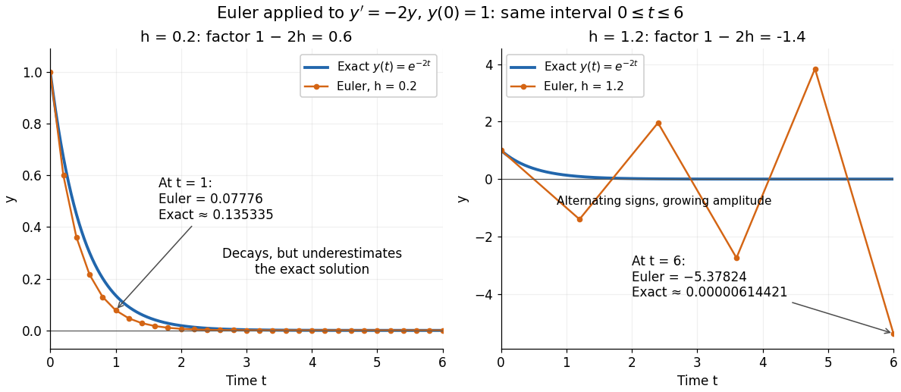

# Euler method

↑ **Parent:** [Linear stability domain](linear-stability-domain.md)  
ⓦ [Wiki](https://en.wikipedia.org/wiki/Euler_method)

The [Euler method](euler-method.md) approximates an [initial value problem](initial-value-problem.md) $y'=f(t,y)$, $y(t_0)=y_0$, by evaluating the [derivative](derivative.md) at the current point and moving along that [tangent line](tangent-line.md) for a time $h$. With $t_n=t_0+nh$, its displayed update needs one evaluation of $f$ per step. This simple rule turns local slope information into a whole approximate trajectory. MIT's course notes derive it by dropping the second-order [Taylor remainder](taylor-remainder.md).[MIT 10.001, Forward and Backward Euler Methods, equations 6–7](https://web.mit.edu/10.001/Web/Course_Notes/Differential_Equations_Notes/node3.html)

Take $y'=-2y$, $y(0)=1$, whose exact solution is the [exponential function](exponential-function.md) $y(t)=e^{-2t}$. The [Euler method](euler-method.md) gives

$$
y_{n+1}=(1-2h)y_n,\qquad y_n=(1-2h)^n.
$$

At $h=0.2$, the first values are $1,0.6,0.36,0.216$. At $t=1$, five steps give $0.6^5=0.07776$, compared with $e^{-2}\approx0.135335$. The result decays but is too small: [absolute stability](linear-stability-domain.md) alone does not ensure accuracy. At $h=1.2$, the first values are $1,-1.4,1.96,-2.744$, and at $t=6$ five steps give $-5.37824$, while the exact solution is about $0.00000614421$.

**[Figure 21](#image-euler-approximations-to-exponential-decay-on-the-same-finite-time-interval). Euler approximations to exponential decay on the same finite time interval**.

For the [Dahlquist test equation](dahlquist-test-equation.md) $y'=\lambda y$, the [Euler method](euler-method.md) has [stability function](stability-function.md) $R(z)=1+z$ with $z=h\lambda$. Its [absolute stability](linear-stability-domain.md) region is $|1+z|\leq1$, the closed disk centred at $-1$ with radius one. For the present real decay problem and $h>0$, bounded numerical values require $0<h\leq1$; strict decay requires $0<h<1$. At $h=1$ the values alternate $1,-1,1,\ldots$ without decay. These conditions follow directly from the [amplification factor](amplification-factor.md) $1-2h$, matching MIT's criterion for $y'=-ay$.[MIT 10.001, Forward and Backward Euler Methods, linear decay example](https://web.mit.edu/10.001/Web/Course_Notes/Differential_Equations_Notes/node3.html)

The [Euler method](euler-method.md) is first order: with bounded second [derivative](derivative.md) and suitable [Lipschitz continuity](lipschitz-continuity.md), its [global error](global-discretization-error.md) is $O(h)$ on a fixed interval. In this example the [logarithm](logarithm.md) gives $\log(1-2h)=-2h-2h^2+O(h^3)$ for small positive $h$. At $t=nh$, this means $y_n=e^{-2t}(1-2th+O(h^2))$. It explains both the downward bias and why halving the step roughly halves the error once $h$ is sufficiently small.

## ↑ Ancestors (6)

1. [Linear stability domain](linear-stability-domain.md)
2. [Numerical analysis](numerical-analysis-split.md)
3. [Analysis](analysis-split.md)
4. [Area of mathematics](area-of-mathematics.md)
5. [Mathematics](mathematics-split.md)
6. [Codex Wiki](split.md)

## ← Incoming links (7)

- [Adaptive Euler step doubling for exponential decay](adaptive-euler-step-doubling-for-exponential-decay.md)
- [Consistency of a numerical method](consistency-of-a-numerical-method.md)
- [Euler-Heun embedded pair](euler-heun-embedded-pair.md)
- [Euler method](euler-method.md)
- [Peano existence theorem](peano-existence-theorem.md)
- [Runge-Kutta method](runge-kutta-method-split.md)
- [Stability of a numerical method](stability-of-a-numerical-method.md)
