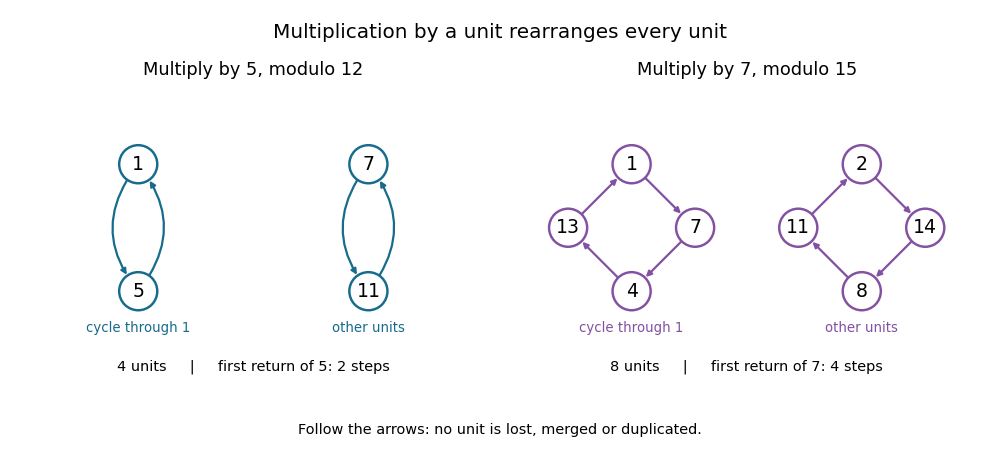

<h1 id="euler-s-theorem">Euler's theorem</h1>

↑ **Parent:** [Number theory](number-theory-split.md)  
ⓦ [Wiki](https://en.wikipedia.org/wiki/Euler's_theorem)

For an [integer modulus](modulus-in-modular-arithmetic.md) $n\geq2$ and an [integer](integer-split.md) $a$ with [greatest common divisor](greatest-common-divisor.md) $\gcd(a,n)=1$, Euler's theorem, also called the [Fermat-Euler theorem](euler-s-theorem.md), states

$$
a^{\varphi(n)}\equiv1\pmod n.
$$

Here [Euler's totient function](euler-totient-function.md) $\varphi(n)$ counts the [units](unit-in-a-ring.md) in the [unit group](unit-group.md) $U(n)=(\mathbb Z/n\mathbb Z)^\times$. These [congruence classes](congruence-class.md) have [modular multiplicative inverses](modular-multiplicative-inverse.md), equivalently their representatives are [coprime](coprime-integers.md) to $n$. The guaranteed return to one permits [exponent reduction for units](exponent-reduction-for-units.md).[p. 1, Theorem 1.2 and equation (1.1): modulus at least two, invertible classes and totient](euler%E2%80%99s-theorem-by-keith-conrad.md)

For a [prime number](prime-number-split.md) $p$, $\varphi(p)=p-1$, recovering [Fermat's little theorem](fermat-little-theorem.md) in the form $a^{p-1}\equiv1\pmod p$ when $p\nmid a$. Multiplying by $a$ and separately handling $p\mid a$ gives $a^p\equiv a\pmod p$ for every [integer](integer-split.md) $a$. For a [composite number](composite-number.md) used as the [integer modulus](modulus-in-modular-arithmetic.md), a nonzero [congruence class](congruence-class.md) can be a [nonunit](nonunit.md).

Modulo twelve, the [units](unit-in-a-ring.md) have representatives $1,5,7,11$, so [Euler's totient function](euler-totient-function.md) gives $\varphi(12)=4$. [Multiplication](multiplication.md) by five produces

$$
1\longmapsto5\longmapsto1,\qquad
7\longmapsto11\longmapsto7\pmod{12}.
$$

Thus this [permutation](permutation.md) has two [permutation cycles](permutation-cycle.md), each of length two. In particular $5^2\equiv1\pmod{12}$, and the guaranteed return $5^4\equiv1$ follows. **The number of [units](unit-in-a-ring.md) need not be the length of one [permutation cycle](permutation-cycle.md).** Modulo fifteen, [multiplication](multiplication.md) by seven similarly gives the two [permutation cycles](permutation-cycle.md) $(1,7,4,13)$ and $(2,14,8,11)$, covering all eight [units](unit-in-a-ring.md). The powers of seven follow the [permutation cycle](permutation-cycle.md) containing one; the other [permutation cycle](permutation-cycle.md) shows that these powers do not visit every [unit](unit-in-a-ring.md).

**[Figure 11](#image-two-unit-permutations-multiplication-by-five-modulo-twelve-and-by-seven-modulo-fifteen). Two unit permutations: multiplication by five modulo twelve and by seven modulo fifteen**. Every arrow multiplies by the indicated [unit](unit-in-a-ring.md) and reduces modulo the indicated [integer modulus](modulus-in-modular-arithmetic.md). The [permutation cycles](permutation-cycle.md) exhaust each [reduced residue system](reduced-residue-system.md). The [permutation cycle](permutation-cycle.md) containing one records the powers of the multiplier; its length is the multiplier's [multiplicative order](multiplicative-order.md), which can be smaller than [Euler's totient function](euler-totient-function.md).

There is a stronger obstruction for a [nonunit](nonunit.md) than just an occasional failed calculation. If a [positive integer](positive-integer.md) $d>1$ divides both $a$ and $n$, then $a^k\equiv0\pmod d$ for every $k\geq1$, so $a^k$ cannot be congruent to one modulo $n$. For example, $\gcd(3,15)=3$ and $3^{\varphi(15)}=3^8\equiv6\pmod{15}$, rather than one. Such a base has no [multiplicative order](multiplicative-order.md) modulo that [integer modulus](modulus-in-modular-arithmetic.md).[p. 2, explanation following Example 1.8: a positive-exponent return to one forces coprimality](orders-of-units-in-modular-arithmetic-by-keith-conrad.md)

**Table of contents**

- [Multiplication by a unit permutes reduced residues](multiplication-by-a-unit-permutes-reduced-residues.md)
- [Exponent reduction for units](exponent-reduction-for-units.md)
- [Generalized repunit pseudoprime construction](generalized-repunit-pseudoprime-construction.md)

## ↑ Ancestors (4)

1. [Number theory](number-theory-split.md)
2. [Area of mathematics](area-of-mathematics.md)
3. [Mathematics](mathematics-split.md)
4. [Codex Wiki](split.md)

## ← Incoming links (7)

- [Exponent reduction for units](exponent-reduction-for-units.md)
- [Fermat little theorem](fermat-little-theorem.md)
- [Multiplication by a unit permutes reduced residues](multiplication-by-a-unit-permutes-reduced-residues.md)
- [Multiplicative order](multiplicative-order.md)
- [Order as the exact period of modular exponentiation](order-as-the-exact-period-of-modular-exponentiation.md)
- [Solution](past-exam-of-the-mathematics-course-of-the-university-of-cambridge/2002/ia/paper-4/8b/solution.md)
- [Tetration](tetration.md)
