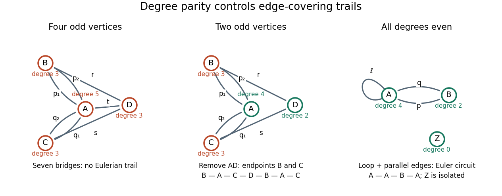

# Eulerian trail

↑ **Parent:** [Eulerian graph](eulerian-graph.md)

An [Eulerian trail](eulerian-trail.md), also called an [Eulerian path](eulerian-trail.md), is a [trail in a graph](trail-in-a-graph.md) traversing every [edge](edge-of-a-graph.md) exactly once. The name [Eulerian path](eulerian-trail.md) does not require a [graph path](path-in-a-graph.md): [vertices](vertex-graph-theory.md) may repeat. A [Hamiltonian path](hamiltonian-path.md) instead visits every [vertex](vertex-graph-theory.md) exactly once, and may omit [edges](edge-of-a-graph.md). An [Eulerian trail](eulerian-trail.md) may omit [isolated vertices](isolated-vertex.md), so these are different coverage requirements.

For a finite undirected [multigraph](multigraph.md) with at least one [edge](edge-of-a-graph.md), allowing [self-loops](loop-graph-theory.md), an [Eulerian trail](eulerian-trail.md) exists exactly when the [edge support of a graph](edge-support-of-a-graph.md) is a [connected graph](connected-graph.md) and there are zero or two [vertices](vertex-graph-theory.md) of odd [vertex degree](degree-graph-theory.md). In the two-odd-[vertex](vertex-graph-theory.md) case they must be the two distinct endpoints; in the zero-odd-[vertex](vertex-graph-theory.md) case every [Eulerian trail](eulerian-trail.md) is an [Euler circuit](euler-circuit.md). Count a [self-loop](loop-graph-theory.md) twice in the [vertex degree](degree-graph-theory.md) but once in the [trail](trail-in-a-graph.md), and count each parallel [edge](edge-of-a-graph.md) separately.[pp. 1–3, Theorem 1.1.2 and the note about isolated vertices](math-530-graph-theory-combinatorial-mathematics-i-spring-2023/math-530-spring-2023-lecture-6-multigraphs-and-digraphs.md)

The [parity](parity.md) obstruction is local: each intermediate visit pairs an arriving [edge](edge-of-a-graph.md) with a departing [edge](edge-of-a-graph.md). Only the distinct endpoints can have an unpaired incidence. The [handshaking lemma](degree-sum-formula.md), $\sum_{v\in V}\deg(v)=2|E|$, also shows that the number of [vertices](vertex-graph-theory.md) with odd [vertex degree](degree-graph-theory.md) is even. Sufficiency in the two-endpoint case reduces to the [Euler circuit criterion](euler-circuit-criterion.md): add one extra [edge](edge-of-a-graph.md) between the odd [vertices](vertex-graph-theory.md), construct an [Euler circuit](euler-circuit.md), rotate its record to start with the extra [edge](edge-of-a-graph.md), then delete that [edge](edge-of-a-graph.md). The remaining [trail](trail-in-a-graph.md) has the required endpoints.

For the [Seven Bridges of Königsberg](seven-bridges-of-konigsberg.md) [multigraph](multigraph.md), the [vertex degrees](degree-graph-theory.md) at $A,B,C,D$ are $(5,3,3,3)$, so no [Eulerian trail](eulerian-trail.md) exists. Remove the unique [edge](edge-of-a-graph.md) $AD$: the [vertex degrees](degree-graph-theory.md) become $(4,3,3,2)$, and a six-[edge](edge-of-a-graph.md) [Eulerian trail](eulerian-trail.md) runs from $B$ to $C$. Label the parallel [edges](edge-of-a-graph.md) $p_1,p_2$ between $A,B$ and $q_1,q_2$ between $A,C$; label $BD$ by $r$ and $CD$ by $s$. A complete record is $B,p_1,A,q_1,C,s,D,r,B,p_2,A,q_2,C$. It revisits $A,B,C$ while using every remaining [edge](edge-of-a-graph.md) once.

**[Figure 28](#image-four-odd-vertex-degrees-forbid-an-eulerian-trail-two-allow-distinct-endpoints-zero-allow-an-euler-circuit). Four odd vertex degrees forbid an Eulerian trail; two allow distinct endpoints; zero allow an Euler circuit**.

## ↑ Ancestors (6)

1. [Eulerian graph](eulerian-graph.md)
2. [Graph theory](graph-theory-split.md)
3. [Foundations of mathematics](foundations-of-mathematics-split.md)
4. [Area of mathematics](area-of-mathematics.md)
5. [Mathematics](mathematics-split.md)
6. [Codex Wiki](split.md)

## ← Incoming links (7)

- [Edge support of a graph](edge-support-of-a-graph.md)
- [Euler circuit](euler-circuit.md)
- [Eulerian graph](eulerian-graph.md)
- [Eulerian trail](eulerian-trail.md)
- [Graph](graph-split.md)
- [Seven Bridges of Königsberg](seven-bridges-of-konigsberg.md)
- [Trail in a graph](trail-in-a-graph.md)
