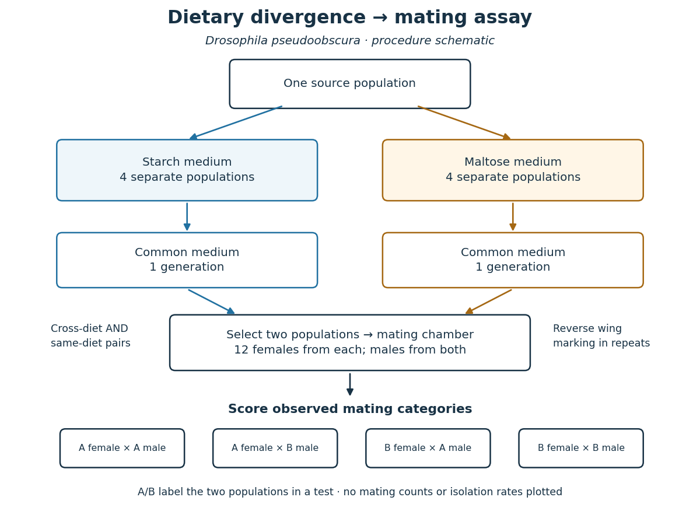
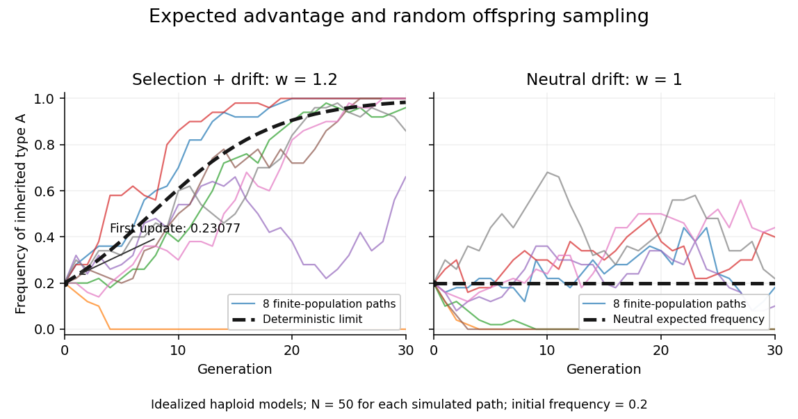

# Evolution

↑ **Parent:** [Biology](biology.md)  
ⓦ [Wiki](https://en.wikipedia.org/wiki/Evolution)

[Evolution](evolution.md) is descent with inherited modification. Within a population, changes in [allele frequencies](genetics.md#allele-frequency) provide a precise genetic description; over longer histories, branching descent connects populations through [common descent](#common-descent). An individual growing larger is [biological development](developmental-biology.md#biological-development), whereas an inherited variant becoming more frequent across generations is [evolution](evolution.md). See [UC Museum of Paleontology: the definition of evolution](https://evolution.berkeley.edu/evolution-101/an-introduction-to-evolution/).

[Mutation](genetics.md#mutation) supplies new [alleles](genetics.md#allele), [genetic recombination](genetics.md#genetic-recombination) reshuffles inherited material, [natural selection](#natural-selection) favors variants with greater reproductive contribution in a specified environment, and [genetic drift](population-genetics.md#genetic-drift) changes frequencies through chance. [Gene flow](#gene-flow) moves variants between populations. Consequently, an increasing [allele frequency](genetics.md#allele-frequency) alone does not identify [natural selection](#natural-selection). See [Clark, Douglas and Choi, Biology 2e: population genetics](https://openstax.org/books/biology-2e/pages/19-2-population-genetics).

Evidence includes ordered [fossils](paleontology.md#fossil), shared inherited structures and similarities in [DNA](polymer.md#deoxyribonucleic-acid); [phylogenetics](#phylogenetics) uses such observations to infer relationships. A [phylogenetic tree](#phylogenetic-tree) is an inferred historical account, with uncertainty about particular branches. See [Clark, Douglas and Choi, Biology 2e: evidence of evolution](https://openstax.org/books/biology-2e/pages/18-1-understanding-evolution). Evidence also comes from experiments: Blount, Borland and Lenski reported an [Escherichia coli](organism.md#escherichia-coli) lineage able to use [citrate](chemical-substance.md#citrate) with [oxygen](chemical-substance.md#oxygen) present by 31,500 generations, and tested historical dependence by replaying [evolution](evolution.md) from stored ancestors. See [Blount, Borland and Lenski, 2008: original experimental report](https://www.blount-lab.org/uploads/2/3/0/3/23037222/2008_pnas_blount_et_al.pdf). Such observations constrain explanations; no single frequency equation captures every evolutionary process.

**Table of contents**

- [Mass extinction](#mass-extinction)
- [Mosaic evolution](#mosaic-evolution)
- [Evolutionary reversal](#evolutionary-reversal)
- [Character loss](#character-loss)
- [Red Queen hypothesis](#red-queen-hypothesis)
- [Clonal selection](#clonal-selection)
- [Major evolutionary transition](#major-evolutionary-transition)
- [Somatic evolution](#somatic-evolution)
- [Gene loss](#gene-loss)
- [Biological fitness](#biological-fitness)
- [Mimicry](#mimicry)
  - [Mimicry ring](#mimicry-ring)
  - [Batesian mimicry](#batesian-mimicry)
  - [Müllerian mimicry](#mullerian-mimicry)
- [Evolutionary rescue](#evolutionary-rescue)
- [Baldwin effect](#baldwin-effect)
- [Fitness landscape](#fitness-landscape)
- [Gene–culture coevolution](#gene-culture-coevolution)
- [Macroevolution](#macroevolution)
  - [Diversification rate](#diversification-rate)
  - [Adaptive radiation](#adaptive-radiation)
- [Microevolution](#microevolution)
- [Coevolution](#coevolution)
  - [Antagonistic coevolution](#antagonistic-coevolution)
- [Evolutionary biologist](#evolutionary-biologist)
  - [List of evolutionary biologists](#list-of-evolutionary-biologists)
    - [Vincent Savolainen](#vincent-savolainen)
    - [Nancy Knowlton](#nancy-knowlton)
    - [August Weismann](#august-weismann)
    - [Jean-Baptiste Lamarck](#jean-baptiste-lamarck)
    - [Alfred Russel Wallace](#alfred-russel-wallace)
    - [Charles Darwin](#charles-darwin)
    - [Ashleigh S. Griffin](#ashleigh-s-griffin)
    - [Barbara McClintock](#barbara-mcclintock)
    - [John H. Werren](#john-h-werren)
    - [Johannes A. J. Breeuwer](#johannes-a-j-breeuwer)
    - [C. Graham](#c-graham)
    - [David Haig](#david-haig)
    - [Thomas M. DeChiara](#thomas-m-dechiara)
    - [Arpiar Saunders](#arpiar-saunders)
    - [Lila Fishman](#lila-fishman)
    - [Thierry Lefèvre](#thierry-lefevre)
    - [Marla Spivak](#marla-spivak)
    - [Robert D. Reed](#robert-d-reed)
    - [Durrell D. Kapan](#durrell-d-kapan)
    - [K. A. Osborne](#k-a-osborne)
    - [Daniel Ortiz-Barrientos](#daniel-ortiz-barrientos)
    - [Mohamed A. Noor](#mohamed-a-noor)
    - [Nicholas G. Crawford](#nicholas-g-crawford)
      - [Work by Nicholas G. Crawford](#work-by-nicholas-g-crawford)
    - [Frédéric Delsuc](#frederic-delsuc)
      - [Work by Frédéric Delsuc](#work-by-frederic-delsuc)
- [Domestication](#domestication)
- [Biogeography](#biogeography)
  - [Sympatry](#sympatry)
  - [Species translocation](#species-translocation)
  - [Phylogeography](#phylogeography)
  - [Vicariance](#vicariance)
- [Biological homology](#biological-homology)
- [Genetic assimilation](#genetic-assimilation)
- [Genetic accommodation](#genetic-accommodation)
  - [Plasticity-led evolution](#plasticity-led-evolution)
- [Convergent evolution](#convergent-evolution)
- [Experimental evolution](#experimental-evolution)
- [Exaptation](#exaptation)
- [Adaptation](#adaptation)
- [Speciation](#speciation)
  - [Parapatric speciation](#parapatric-speciation)
  - [Hybrid speciation](#hybrid-speciation)
  - [Reinforcement](#reinforcement)
  - [Secondary contact](#secondary-contact)
  - [Sympatric speciation](#sympatric-speciation)
  - [Allopatric speciation](#allopatric-speciation)
  - [Ecological speciation](#ecological-speciation)
    - [Sensory drive](#sensory-drive)
    - [Magic trait](#magic-trait)
  - [Reproductive isolation](#reproductive-isolation)
    - [Prezygotic reproductive isolation](#prezygotic-reproductive-isolation)
    - [Cytoplasmic incompatibility](#cytoplasmic-incompatibility)
    - [Reproductive character displacement](#reproductive-character-displacement)
    - [Haldane's rule](#haldane-s-rule)
    - [Dobzhansky-Muller incompatibility](#dobzhansky-muller-incompatibility)
    - [Premating isolation](#premating-isolation)
    - [Postmating reproductive isolation](#postmating-reproductive-isolation)
      - [Hybrid breakdown](#hybrid-breakdown)
      - [Postzygotic isolation](#postzygotic-isolation)
        - [Hybrid sterility](#hybrid-sterility)
    - [Dietary divergence and mating isolation in Drosophila pseudoobscura](#dietary-divergence-and-mating-isolation-in-drosophila-pseudoobscura)
    - [Mating assortment contrast](#mating-assortment-contrast)
- [Common descent](#common-descent)
- [Horizontal gene transfer](#horizontal-gene-transfer)
- [Gene flow](#gene-flow)
  - [Introgression](#introgression)
    - [Adaptive introgression](#adaptive-introgression)
- [Natural selection](#natural-selection)
  - [Struggle for existence](#struggle-for-existence)
  - [Artificial selection](#artificial-selection)
  - [Balancing selection](#balancing-selection)
  - [Viability selection](#viability-selection)
  - [Multilevel selection](#multilevel-selection)
  - [Frequency-dependent selection](#frequency-dependent-selection)
    - [Negative frequency-dependent selection](#negative-frequency-dependent-selection)
    - [Positive frequency-dependent selection](#positive-frequency-dependent-selection)
  - [Inclusive fitness](#inclusive-fitness)
    - [Kin selection](#kin-selection)
      - [Local competition](#local-competition)
  - [Evolutionary conflict](#evolutionary-conflict)
    - [Intragenomic conflict](#intragenomic-conflict)
      - [Meiotic drive](#meiotic-drive)
        - [Centromere drive](#centromere-drive)
        - [Drive suppressor](#drive-suppressor)
        - [Segregation distortion](#segregation-distortion)
      - [Selfish genetic element](#selfish-genetic-element)
    - [Sexual conflict](#sexual-conflict)
      - [Sex peptide](#sex-peptide)
      - [Interlocus sexual conflict](#interlocus-sexual-conflict)
      - [Intralocus sexual conflict](#intralocus-sexual-conflict)
      - [Sexual antagonistic coevolution](#sexual-antagonistic-coevolution)
    - [Sibling rivalry](#sibling-rivalry)
      - [Brood reduction](#brood-reduction)
      - [Siblicide](#siblicide)
      - [Sibling negotiation](#sibling-negotiation)
    - [Parent-offspring conflict](#parent-offspring-conflict)
    - [Evolutionary policing](#evolutionary-policing)
      - [Worker policing](#worker-policing)
      - [Partner sanctions](#partner-sanctions)
  - [Positive selection](#positive-selection)
  - [Purifying selection](#purifying-selection)
    - [Background selection](#background-selection)
  - [Sexual antagonism](#sexual-antagonism)
  - [Sexual selection](#sexual-selection)
    - [Mate choice](#mate-choice)
    - [Mate preference](#mate-preference)
  - [Haploid selection recurrence](#haploid-selection-recurrence)
  - [Reproductive success](#reproductive-success)
- [Phylogenetics](#phylogenetics)
  - [Phylogenetic character](#phylogenetic-character)
  - [Cladogram](#cladogram)
  - [Outgroup](#outgroup)
  - [Phylogenetic nomenclature](#phylogenetic-nomenclature)
    - [Phylogenetic specifier](#phylogenetic-specifier)
    - [Branch-based clade definition](#branch-based-clade-definition)
    - [Node-based clade definition](#node-based-clade-definition)
  - [Phylogenomics](#phylogenomics)
  - [Total-evidence phylogenetics](#total-evidence-phylogenetics)
  - [Molecular phylogeny](#molecular-phylogeny)
  - [Phylogenetic nonindependence](#phylogenetic-nonindependence)
  - [Turtle problem](#turtle-problem)
  - [Polyphyly](#polyphyly)
  - [Paraphyly](#paraphyly)
  - [Monophyly](#monophyly)
  - [Synapomorphy](#synapomorphy)
  - [Homoplasy](#homoplasy)
  - [Last common ancestor](#last-common-ancestor)
  - [Stem group](#stem-group)
  - [Crown group](#crown-group)
  - [Maximum parsimony](#maximum-parsimony)
  - [Ancestral state reconstruction](#ancestral-state-reconstruction)
    - [Character polarity](#character-polarity)
    - [Stochastic character mapping](#stochastic-character-mapping)
  - [Bayesian divergence-time inference](#bayesian-divergence-time-inference)
  - [Bayesian phylogenetic inference](#bayesian-phylogenetic-inference)
  - [Phylogenetic pruning algorithm](#phylogenetic-pruning-algorithm)
  - [Nucleotide substitution model](#nucleotide-substitution-model)
  - [Incomplete lineage sorting](#incomplete-lineage-sorting)
  - [Molecular clock](#molecular-clock)
    - [Molecular-clock calibration and rate-time identifiability](#molecular-clock-calibration-and-rate-time-identifiability)
    - [Fossil calibration](#fossil-calibration)
      - [Soft calibration bound](#soft-calibration-bound)
      - [Hard calibration bound](#hard-calibration-bound)
    - [Relaxed molecular clock](#relaxed-molecular-clock)
    - [Strict molecular clock](#strict-molecular-clock)
  - [Clade](#clade)
    - [Total group](#total-group)
  - [Phylogenetic tree](#phylogenetic-tree)
    - [Phylogenetic epoch](#phylogenetic-epoch)
    - [Species tree](#species-tree)
    - [Gene tree](#gene-tree)
    - [Felsenstein pruning algorithm](#felsenstein-pruning-algorithm)

## Mass extinction

↑ **Parent:** [Evolution](evolution.md)

Geologically rapid loss of a large fraction of biological diversity across many groups.

## Mosaic evolution

↑ **Parent:** [Evolution](evolution.md)

[evolution](evolution.md) in which different anatomical or developmental components change on different schedules. A [fossil](paleontology.md#fossil) can combine derived states in one system with retained ancestral states in another.

## Evolutionary reversal

↑ **Parent:** [Evolution](evolution.md)

A change returning a character to a state resembling an earlier ancestral state. Similar terminal appearances do not by themselves identify the developmental route of the change.

## Character loss

↑ **Parent:** [Evolution](evolution.md)

Loss of an inherited anatomical or molecular feature. Its inference requires distinguishing genuine absence from incomplete observation and reconstructing the ancestral state.

## Red Queen hypothesis

↑ **Parent:** [Evolution](evolution.md)

A family of hypotheses concerning continuing adaptation in response to other evolving organisms. In explanations of sex, changing host-parasite associations can favour production of less familiar host genotypes; the advantage is conditional.

## Clonal selection

↑ **Parent:** [Evolution](evolution.md)

Differential expansion or persistence of lineages under a specified environment. Increased survival can confer an advantage even without a higher instantaneous division rate.

## Major evolutionary transition

↑ **Parent:** [Evolution](evolution.md)

A transition in which previously reproducing entities become integrated into a new higher-level reproductive unit. [cooperation](ecology.md#cooperation) and control of lower-level conflict are complementary issues.

## Somatic evolution

↑ **Parent:** [Evolution](evolution.md)

Change among cell lineages within an organism through [mutation](genetics.md#mutation), drift and selection. Success of a cell lineage can conflict with the [reproductive success](#reproductive-success) of the organism.

## Gene loss

↑ **Parent:** [Evolution](evolution.md)

## Biological fitness

↑ **Parent:** [Evolution](evolution.md)

Reproductive contribution measured relative to a specified population, environment and timescale. Survival or task performance is a component or proxy, not automatically total [reproductive success](#reproductive-success).

## Mimicry

↑ **Parent:** [Evolution](evolution.md)

Resemblance between organisms that influences a receiver’s [animal behaviour](animal-behaviour.md) and thereby changes fitness. Similarity alone does not establish the receiver-mediated evolutionary process.

### Mimicry ring

↑ **Parent:** [Mimicry](#mimicry)

A set of co-occurring organisms sharing a mimetic signal. Membership should be tested against the relevant receiver’s [perception](neuroscience.md#perception) and behaviour rather than human resemblance alone.

### Batesian mimicry

↑ **Parent:** [Mimicry](#mimicry)

Resemblance of a relatively undefended organism to a defended model that reduces attack through the receiver’s response to the model. Protection depends on model abundance and [predator](ecology.md#predator) experience.

<h3 id="mullerian-mimicry">Müllerian mimicry</h3>

↑ **Parent:** [Mimicry](#mimicry)

Shared warning signals among defended organisms, potentially reducing each participant’s cost of educating [predators](ecology.md#predator) through [predator learning](animal-behaviour.md#predator-learning). Benefits depend on encounter rates, defence and generalization.

## Evolutionary rescue

↑ **Parent:** [Evolution](evolution.md)

Recovery of a declining [biological population](ecology.md#population-biology) through inherited adaptive change. Immediate survival enabled by [phenotypic plasticity](genetics.md#phenotypic-plasticity) can provide time for rescue, but is not itself evidence that inherited rescue occurred.

## Baldwin effect

↑ **Parent:** [Evolution](evolution.md)

An evolutionary role for acquired adjustments, including [learning](animal-behaviour.md#learning), in allowing persistence and changing the [natural selection](#natural-selection) experienced by inherited variants. It does not require direct inheritance of learned contents.

## Fitness landscape

↑ **Parent:** [Evolution](evolution.md)

Assignment of a fitness or experimental performance measure to genotypes, together with a specified relation between neighbouring genotypes. Context and [epistasis](genetics.md#epistasis) affect accessible improvement paths.

<h2 id="gene-culture-coevolution">Gene–culture coevolution</h2>

↑ **Parent:** [Evolution](evolution.md)

Evolutionary feedback between inherited genetic differences and culturally transmitted practices. Dairying and [lactase persistence](genetics.md#lactase-persistence) illustrate why the timing of the practice and allele rise should be tested separately.

## Macroevolution

↑ **Parent:** [Evolution](evolution.md)

Patterns and processes at and above the species level, including lineage origination, diversification and extinction. Its timescale does not make it independent of population processes.

### Diversification rate

↑ **Parent:** [Macroevolution](#macroevolution)

A rate describing lineage accumulation, often expressed as speciation rate minus extinction rate under a branching model.

### Adaptive radiation

↑ **Parent:** [Macroevolution](#macroevolution)

Diversification of a lineage into ecologically differentiated descendants. Colonization, ecological opportunity and reproductive barriers are distinct contributing processes.

## Microevolution

↑ **Parent:** [Evolution](evolution.md)

Evolutionary change within populations, including changes in allele frequencies and inherited quantitative traits.

## Coevolution

↑ **Parent:** [Evolution](evolution.md)

Reciprocal heritable evolutionary responses in interacting lineages, each altering selection on the other. Functional matching, co-occurrence and immediate plastic responses are insufficient by themselves to demonstrate coevolution.

### Antagonistic coevolution

↑ **Parent:** [Coevolution](#coevolution)

Reciprocal evolutionary change driven by opposed fitness effects, including some host–[parasite](ecology.md#parasite) and sexual interactions. Correlated traits or temporal change alone do not establish reciprocal selection.

## Evolutionary biologist

↑ **Parent:** [Evolution](evolution.md)

### List of evolutionary biologists

↑ **Parent:** [Evolutionary biologist](#evolutionary-biologist)

#### Vincent Savolainen

↑ **Parent:** [List of evolutionary biologists](#list-of-evolutionary-biologists)  
ⓦ [Wiki](https://en.wikipedia.org/wiki/Vincent_Savolainen)

[Evolutionary biologist](#evolutionary-biologist) whose research includes plant [speciation](#speciation) and the evolution of biodiversity.

#### Nancy Knowlton

↑ **Parent:** [List of evolutionary biologists](#list-of-evolutionary-biologists)  
ⓦ [Wiki](https://en.wikipedia.org/wiki/Nancy_Knowlton)

[Evolutionary biologist](#evolutionary-biologist) whose marine research includes [species delimitation](biology.md#species-delimitation) and divergence of snapping shrimp lineages.

**[Figure 1](#image-portrait-of-nancy-knowlton-at-world-oceans-day-in-2015). Portrait of Nancy Knowlton at World Oceans Day in 2015**. [Source](https://commons.wikimedia.org/wiki/File:Nancy\_Knowlton\_at\_World\_Oceans\_Day\_2015.JPG). Photograph by Wikimedia user fourandsixty, extracted on Commons. [Creative Commons Attribution 4.0](https://creativecommons.org/licenses/by/4.0/).

#### August Weismann

↑ **Parent:** [List of evolutionary biologists](#list-of-evolutionary-biologists)  
ⓦ [Wiki](https://en.wikipedia.org/wiki/August_Weismann)

**[Figure 2](#image-portrait-of-august-weismann). Portrait of August Weismann**. [Source](https://commons.wikimedia.org/wiki/File:August\_Weismann.jpg). Unknown photographer; reproduced with Edwin G. Conklin’s 1915 memorial in Proceedings of the American Philosophical Society 54(220), iii–xii. Public domain in the United States; Commons cites expired copyright for the historical publication. [Source usage terms](https://commons.wikimedia.org/wiki/Template:PD-US), via Wikimedia Commons.

#### Jean-Baptiste Lamarck

↑ **Parent:** [List of evolutionary biologists](#list-of-evolutionary-biologists)  
ⓦ [Wiki](https://en.wikipedia.org/wiki/Jean-Baptiste_Lamarck)

**[Figure 3](#image-portrait-of-jean-baptiste-lamarck). Portrait of Jean-Baptiste Lamarck**. [Source](https://commons.wikimedia.org/wiki/File:Jean-Baptiste\_Lamarck.jpg). Ambroise Tardieu, engraving drawn from life in Paris, 1824; reproduction recorded in the National Library of Medicine historical-image collection. Commons claims public domain in the country of origin and jurisdictions with life-plus-70 terms or shorter. [Source usage terms](https://creativecommons.org/publicdomain/mark/1.0/), via Wikimedia Commons.

#### Alfred Russel Wallace

↑ **Parent:** [List of evolutionary biologists](#list-of-evolutionary-biologists)  
ⓦ [Wiki](https://en.wikipedia.org/wiki/Alfred_Russel_Wallace)

**[Figure 4](#image-portrait-of-alfred-russel-wallace). Portrait of Alfred Russel Wallace**. [Source](https://commons.wikimedia.org/wiki/File:Portrait\_of\_Alfred\_Russel\_Wellcome\_L0025210.jpg). Wellcome Library, London / Wellcome Images, L0025210; reproduced in James Marchant’s Alfred Russel Wallace: Letters and Reminiscences (1916). Original photographer unspecified. [Creative Commons Attribution 4.0 International.](https://creativecommons.org/licenses/by/4.0/), via Wikimedia Commons.

#### Charles Darwin

↑ **Parent:** [List of evolutionary biologists](#list-of-evolutionary-biologists)

[Evolutionary biologist](#evolutionary-biologist) whose explanation of [natural selection](#natural-selection) linked inherited [genetic variation](genetics.md#genetic-variation) to differential [reproduction](reproduction.md).

#### Ashleigh S. Griffin

↑ **Parent:** [List of evolutionary biologists](#list-of-evolutionary-biologists)

#### Barbara McClintock

↑ **Parent:** [List of evolutionary biologists](#list-of-evolutionary-biologists)

#### John H. Werren

↑ **Parent:** [List of evolutionary biologists](#list-of-evolutionary-biologists)

#### Johannes A. J. Breeuwer

↑ **Parent:** [List of evolutionary biologists](#list-of-evolutionary-biologists)

#### C. Graham

↑ **Parent:** [List of evolutionary biologists](#list-of-evolutionary-biologists)

#### David Haig

↑ **Parent:** [List of evolutionary biologists](#list-of-evolutionary-biologists)

#### Thomas M. DeChiara

↑ **Parent:** [List of evolutionary biologists](#list-of-evolutionary-biologists)

#### Arpiar Saunders

↑ **Parent:** [List of evolutionary biologists](#list-of-evolutionary-biologists)

#### Lila Fishman

↑ **Parent:** [List of evolutionary biologists](#list-of-evolutionary-biologists)

<h4 id="thierry-lefevre">Thierry Lefèvre</h4>

↑ **Parent:** [List of evolutionary biologists](#list-of-evolutionary-biologists)

#### Marla Spivak

↑ **Parent:** [List of evolutionary biologists](#list-of-evolutionary-biologists)

#### Robert D. Reed

↑ **Parent:** [List of evolutionary biologists](#list-of-evolutionary-biologists)

#### Durrell D. Kapan

↑ **Parent:** [List of evolutionary biologists](#list-of-evolutionary-biologists)

#### K. A. Osborne

↑ **Parent:** [List of evolutionary biologists](#list-of-evolutionary-biologists)

#### Daniel Ortiz-Barrientos

↑ **Parent:** [List of evolutionary biologists](#list-of-evolutionary-biologists)

#### Mohamed A. Noor

↑ **Parent:** [List of evolutionary biologists](#list-of-evolutionary-biologists)

#### Nicholas G. Crawford

↑ **Parent:** [List of evolutionary biologists](#list-of-evolutionary-biologists)

An author of [the primary study linked here](https://pmc.ncbi.nlm.nih.gov/articles/PMC3440978/).

##### Work by Nicholas G. Crawford

↑ **Parent:** [Nicholas G. Crawford](#nicholas-g-crawford)

<h4 id="frederic-delsuc">Frédéric Delsuc</h4>

↑ **Parent:** [List of evolutionary biologists](#list-of-evolutionary-biologists)

An author of [the primary study linked here](https://www.nature.com/articles/nature04336).

<h5 id="work-by-frederic-delsuc">Work by Frédéric Delsuc</h5>

↑ **Parent:** [Frédéric Delsuc](#frederic-delsuc)

## Domestication

↑ **Parent:** [Evolution](evolution.md)

A historical process involving sustained relationships with humans and inherited population change. Individual tameness, management and species transport alone are not sufficient definitions.

## Biogeography

↑ **Parent:** [Evolution](evolution.md)

Study of the distribution of organisms through space and time and the historical processes producing it. Present distribution alone does not identify an evolutionary birthplace.

### Sympatry

↑ **Parent:** [Biogeography](#biogeography)

Geographic coexistence at a stated scale. [fossils](paleontology.md#fossil) from one deposit may still represent different times or habitats.

### Species translocation

↑ **Parent:** [Biogeography](#biogeography)

Human-mediated movement of organisms between places. It includes movements within a historical native range as well as introductions beyond it.

### Phylogeography

↑ **Parent:** [Biogeography](#biogeography)

Study of the geographic distribution of genealogical lineages. Modern distributions can reflect old structure, recent introductions and lineage loss.

### Vicariance

↑ **Parent:** [Biogeography](#biogeography)

Division of an ancestral distribution by a newly formed barrier. It must be distinguished from dispersal across an existing barrier using chronological as well as geographic evidence.

## Biological homology

↑ **Parent:** [Evolution](evolution.md)

Correspondence of structures or other characters through shared evolutionary ancestry. Shared function alone does not establish it; comparative position, [biological development](developmental-biology.md#biological-development) and [phylogenetics](#phylogenetics) help distinguish it from [convergent evolution](#convergent-evolution).

## Genetic assimilation

↑ **Parent:** [Evolution](evolution.md)

Evolution of expression of a formerly induced [phenotype](genetics.md#phenotype) in the absence of the original inducing condition. It is a particular outcome of [genetic accommodation](#genetic-accommodation), not direct copying of acquired bodily modifications into [DNA](polymer.md#deoxyribonucleic-acid).

## Genetic accommodation

↑ **Parent:** [Evolution](evolution.md)

Evolutionary modification of an environmentally responsive [phenotypic trait](genetics.md#phenotypic-trait) or its regulation. It can change a response threshold, magnitude or specificity and need not reduce [phenotypic plasticity](genetics.md#phenotypic-plasticity).

### Plasticity-led evolution

↑ **Parent:** [Genetic accommodation](#genetic-accommodation)

A sequence in which an environmental change induces a [phenotype](genetics.md#phenotype) through [phenotypic plasticity](genetics.md#phenotypic-plasticity), followed by inherited refinement through [natural selection](#natural-selection). Evidence requires separating initial induction from subsequent inherited change.

## Convergent evolution

↑ **Parent:** [Evolution](evolution.md)

Independent evolution of similar outcomes in different lineages. Similar [phenotypes](genetics.md#phenotype) can arise through the same [gene](genetics.md#gene), different [genes](genetics.md#gene) in a shared pathway, or distinct mechanisms; independence of the evolutionary events must first be established.

## Experimental evolution

↑ **Parent:** [Evolution](evolution.md)

Observation of evolutionary change in controlled, replicated [biological populations](ecology.md#population-biology). Known ancestors, archived samples, [DNA sequencing](molecular-genetics.md#dna-sequencing) and reconstruction of candidate [mutations](genetics.md#mutation) help connect genetic changes to measured [genotype fitness](population-genetics.md#genotype-fitness).

## Exaptation

↑ **Parent:** [Evolution](evolution.md)

Recruitment of an existing character for a function different from its previous role. It is a claim about functional history; [gene co-option](developmental-biology.md#gene-co-option) can supply a developmental mechanism for such recruitment.

## Adaptation

↑ **Parent:** [Evolution](evolution.md)

An inherited feature shaped by [natural selection](#natural-selection) for its contribution to [genotype fitness](population-genetics.md#genotype-fitness), or the evolutionary process producing such improvement. An immediately helpful response within a lifetime need not itself constitute evolutionary change.

## Speciation

↑ **Parent:** [Evolution](evolution.md)  
ⓦ [Wiki](https://en.wikipedia.org/wiki/Speciation)

[Speciation](#speciation) is the formation of distinct [species](biology.md#species) through [evolution](evolution.md). Detecting a difference between [biological populations](ecology.md#population-biology) is a starting observation; its interpretation depends on the stated [species concept](biology.md#species-concept) and the evidence for lasting separation. [Reproductive isolation](#reproductive-isolation) is one important route to limiting [gene flow](#gene-flow) in [sexual reproduction](reproduction.md#sexual-reproduction).

### Parapatric speciation

↑ **Parent:** [Speciation](#speciation)

Divergence of adjacent populations into distinct [species](biology.md#species) while some [gene flow](#gene-flow) persists across their contact region. Spatially varying [natural selection](#natural-selection) and the development of [reproductive isolation](#reproductive-isolation) can maintain differences despite exchange. It is a geographical mode distinct from complete separation in [allopatric speciation](#allopatric-speciation) and initial coexistence without such a barrier in [sympatric speciation](#sympatric-speciation).

### Hybrid speciation

↑ **Parent:** [Speciation](#speciation)

Origin of a reproductively distinct lineage through hybridization. A surviving hybrid individual alone is not a new species.

### Reinforcement

↑ **Parent:** [Speciation](#speciation)

Evolution of increased premating isolation because interpopulation mating has fitness costs. Ecological divergence without such selection is not sufficient evidence.

### Secondary contact

↑ **Parent:** [Speciation](#speciation)

Renewed contact between populations following a period of separation.

### Sympatric speciation

↑ **Parent:** [Speciation](#speciation)

Origin of distinct species without initial geographic separation at the relevant scale. Current sympatry alone does not establish this historical route.

### Allopatric speciation

↑ **Parent:** [Speciation](#speciation)

Evolution of distinct species during geographic separation. Persistence of isolation after renewed contact is a further test.

### Ecological speciation

↑ **Parent:** [Speciation](#speciation)

Evolution of [reproductive isolation](#reproductive-isolation) as a consequence of divergent ecological [natural selection](#natural-selection). Ecological differences or distinct [reaction norms](genetics.md#reaction-norm) alone are insufficient unless they reduce [gene flow](#gene-flow).

#### Sensory drive

↑ **Parent:** [Ecological speciation](#ecological-speciation)

Divergence of sensory systems and signals associated with the physical or ecological environment, potentially generating mating barriers.

#### Magic trait

↑ **Parent:** [Ecological speciation](#ecological-speciation)

A trait affected by divergent ecological selection that also contributes to assortative mating. Distinguish one pleiotropic trait from tightly linked separate loci.

### Reproductive isolation

↑ **Parent:** [Speciation](#speciation)  
ⓦ [Wiki](https://en.wikipedia.org/wiki/Reproductive_isolation)

[Reproductive isolation](#reproductive-isolation) consists of barriers that reduce [gene flow](#gene-flow) through [sexual reproduction](reproduction.md#sexual-reproduction). Distinguish [premating isolation](#premating-isolation) from barriers after mating. Barriers before [fertilization](reproduction.md#fertilization) also include incompatible [gametes](reproduction.md#gamete); barriers after [fertilization](reproduction.md#fertilization) can reduce offspring survival or fertility. [§18.2, “Reproductive Isolation”, opening paragraphs, gametic barriers and hybrid inviability/sterility](biology-bibliography.md#biology-2e-by-mary-ann-clark-and-others)

An assay should state which step it measures. Observing fewer cross-group matings does not measure offspring fertility; observing [fertilization](reproduction.md#fertilization) does not demonstrate that the offspring will reproduce. These distinctions make a partial barrier informative without declaring completed [speciation](#speciation).

#### Prezygotic reproductive isolation

↑ **Parent:** [Reproductive isolation](#reproductive-isolation)

Barriers to gene exchange acting before a zygote forms. Habitat separation, differing breeding times, behavioral discrimination and mechanical mismatch can reduce mating or gamete transfer; gametic incompatibility can act after mating while still preventing [fertilization](reproduction.md#fertilization). Thus [prezygotic isolation](#prezygotic-reproductive-isolation) is broader than [premating isolation](#premating-isolation) and distinct from [postzygotic isolation](#postzygotic-isolation). The time and biological stage measured by an assay determine which category it tests.

#### Cytoplasmic incompatibility

↑ **Parent:** [Reproductive isolation](#reproductive-isolation)

Reproductive incompatibility associated with an inherited cytoplasmic factor, including some bacterial symbionts. Reciprocal crosses, microbial manipulations and host-background controls identify its cause.

#### Reproductive character displacement

↑ **Parent:** [Reproductive isolation](#reproductive-isolation)

Greater divergence of mating signals or preferences in [sympatry](#sympatry) than outside contact. The pattern can follow [reinforcement](#reinforcement), but also ecological differences, sorting or interference without reduced hybrid fitness.

<h4 id="haldane-s-rule">Haldane's rule</h4>

↑ **Parent:** [Reproductive isolation](#reproductive-isolation)

When one sex of first-generation [hybrids](genetics.md#hybrid-biology) is absent, rare or sterile, it tends to be the [heterogametic sex](genetics.md#heterogametic-sex). This predicts a sex bias within crosses, rather than a universal difference in isolation between birds and mammals.[Journal of Genetics 12, pp. 101–109](ecology-and-evolution-bibliography.md#sex-ratio-and-unisexual-sterility-in-hybrid-animals-by-j-b-s-haldane)

#### Dobzhansky-Muller incompatibility

↑ **Parent:** [Reproductive isolation](#reproductive-isolation)

A harmful interaction between [alleles](genetics.md#allele) that evolved in separate lineages and are compatible with their own [genetic backgrounds](genetics.md#genetic-background). For example, substitutions yielding $Ab$ and $aB$ can each be tolerated, while the combination $AB$ is harmful in a [hybrid](genetics.md#hybrid-biology). This is a form of [epistasis](genetics.md#epistasis).

#### Premating isolation

↑ **Parent:** [Reproductive isolation](#reproductive-isolation)

[Premating isolation](#premating-isolation) reduces mating between [biological populations](ecology.md#population-biology). The [dietary divergence and mating isolation in Drosophila pseudoobscura](#dietary-divergence-and-mating-isolation-in-drosophila-pseudoobscura) assay measures this stage using observed pairings.

#### Postmating reproductive isolation

↑ **Parent:** [Reproductive isolation](#reproductive-isolation)

[Postmating reproductive isolation](#postmating-reproductive-isolation) acts after mating. Specify whether the test concerns [fertilization](reproduction.md#fertilization), offspring survival, or the offspring's own [reproduction](reproduction.md); those outcomes are not interchangeable.

##### Hybrid breakdown

↑ **Parent:** [Postmating reproductive isolation](#postmating-reproductive-isolation)

Reduced survival or fertility appearing in later-generation or backcross descendants of [hybrids](genetics.md#hybrid-biology), even when first-generation offspring are fertile. [genetic recombination](genetics.md#genetic-recombination) can expose harmful combinations previously masked in the first generation.

##### Postzygotic isolation

↑ **Parent:** [Postmating reproductive isolation](#postmating-reproductive-isolation)

A barrier to [gene flow](#gene-flow) acting after [fertilization](reproduction.md#fertilization), through reduced survival or fertility of [hybrids](genetics.md#hybrid-biology). Test both sexes and later generations: survival of first-generation offspring does not establish their fertility.

###### Hybrid sterility

↑ **Parent:** [Postzygotic isolation](#postzygotic-isolation)

Reduced or absent fertility of hybrid offspring. It must be distinguished from failure to mate or reduced viability before reproductive maturity.

#### Dietary divergence and mating isolation in Drosophila pseudoobscura

↑ **Parent:** [Reproductive isolation](#reproductive-isolation)

The 1989 experiment used eight [Drosophila pseudoobscura](organism.md#drosophila-pseudoobscura) [biological populations](ecology.md#population-biology) from one Bryce Canyon population: four maintained on starch medium, four on maltose, in cages at $25\,{}^\circ\mathrm{C}$. Testing began about a year after establishment. [p. 1308, population origin, media and cage conditions](ecology-and-evolution-bibliography.md#reproductive-isolation-as-a-consequence-of-adaptive-divergence-in-drosophila-pseudoobscura-by-diane-m-b-dodd)

Before testing, flies spent one generation on cornmeal–molasses–agar. Virgins aged 3–6 days entered multiple-choice chambers: twelve females from each population, followed by males from both populations introduced nearly simultaneously without anesthesia. Observers scored matings for 60–90 minutes under bright indirect lighting. One group's right wing tips were clipped for identification, with clipping reversed between replicates. [p. 1308, mating-preference procedure and wing-marking control](ecology-and-evolution-bibliography.md#reproductive-isolation-as-a-consequence-of-adaptive-divergence-in-drosophila-pseudoobscura-by-diane-m-b-dodd)

All sixteen cross-diet comparisons had positive [mating assortment contrasts](#mating-assortment-contrast); eleven departed significantly from [random mating](genetics.md#panmixia). Same-diet comparisons did not show significant departures. Common-medium rearing addressed immediate diet conditioning; same-diet controls addressed separation and establishment [population bottlenecks](population-genetics.md#population-bottleneck). Mate choice was not the selection target; the [biological populations](ecology.md#population-biology) were maintained separately. The result supports partial [premating isolation](#premating-isolation) accompanying dietary divergence, not completed [speciation](#speciation). [pp. 1309–1310, Tables 1–2 and discussion of conditioning and physical isolation](ecology-and-evolution-bibliography.md#reproductive-isolation-as-a-consequence-of-adaptive-divergence-in-drosophila-pseudoobscura-by-diane-m-b-dodd)

**[Figure 5](#image-design-of-the-dietary-divergence-and-mating-isolation-in-drosophila-pseudoobscura-assay). Design of the dietary divergence and mating isolation in Drosophila pseudoobscura assay**. Original design schematic. Arrows indicate procedure, not a measured [reproductive isolation](#reproductive-isolation) rate. The four mating categories are possible outcomes; no invented counts are shown.

The [causal inference](causal-inference.md) remains limited. A negative same-diet [hypothesis test](statistical-hypothesis-test.md) does not prove zero [reproductive isolation](#reproductive-isolation). One generation under common conditions does not exclude every persistent environmental influence. The chamber readout alone cannot identify a particular [gene](genetics.md#gene), establish offspring fertility, or predict [gene flow](#gene-flow) after sustained contact in nature. Further experiments would need to target those questions separately.

#### Mating assortment contrast

↑ **Parent:** [Reproductive isolation](#reproductive-isolation)

For observed pairings between two labels $A,B$, let $N_{\mathrm{same}}=N_{AA}+N_{BB}$ and $N_{\mathrm{cross}}=N_{AB}+N_{BA}$, where the first label denotes the female's group and the second the male's. A [mating assortment contrast](#mating-assortment-contrast) is

$$
I=\frac{N_{\mathrm{same}}-N_{\mathrm{cross}}}{N},\qquad N=N_{\mathrm{same}}+N_{\mathrm{cross}}>0.
$$

It lies between $-1$ and $1$. Positive $I$ describes an excess of same-label pairings over cross-label pairings; whether that is evidence of [assortative mating](genetics.md#assortative-mating) depends on the null [mathematical model](mathematics.md#mathematical-model) and the assay. The four counts form a [contingency table](statistical-modelling.md#contingency-table).

Here is an original scope check. Suppose independently paired females and males have [probabilities](probability-theory.md#probability) $p_f,p_m$ of carrying label $A$. Then

$$
q_{\mathrm{same}}=p_fp_m+(1-p_f)(1-p_m),\qquad \mathbb E[I]=2q_{\mathrm{same}}-1.
$$

With $p_f=p_m=1/2$, the [expected value](expected-value.md) is zero. With $p_f=p_m=4/5$, it is $9/25=0.36$, despite pairing being independent of label. This counterexample concerns unequal pool composition; it does not replace the group introductions and [contingency table](statistical-modelling.md#contingency-table) tests in the [dietary divergence and mating isolation in Drosophila pseudoobscura](#dietary-divergence-and-mating-isolation-in-drosophila-pseudoobscura) experiment. Even with balanced pools, finite observed samples fluctuate: a positive $I$ alone is not a [hypothesis test](statistical-hypothesis-test.md), much less a universal [species](biology.md#species) boundary.

## Common descent

↑ **Parent:** [Evolution](evolution.md)  
ⓦ [Wiki](https://en.wikipedia.org/wiki/Common_descent)

## Horizontal gene transfer

↑ **Parent:** [Evolution](evolution.md)  
ⓦ [Wiki](https://en.wikipedia.org/wiki/Horizontal_gene_transfer)

[Horizontal gene transfer](#horizontal-gene-transfer) moves genetic material between lineages through routes other than ordinary inheritance from parent to offspring. [Endosymbiotic gene transfer](ecology.md#endosymbiotic-gene-transfer) is a specialized case involving an internal partner or its descendant [organelle](biological-cell.md#organelle).

## Gene flow

↑ **Parent:** [Evolution](evolution.md)  
ⓦ [Wiki](https://en.wikipedia.org/wiki/Gene_flow)

### Introgression

↑ **Parent:** [Gene flow](#gene-flow)

Transfer of inherited material between diverged lineages through [hybrid](genetics.md#hybrid-biology) reproduction and subsequent crosses. Shared adaptive [alleles](genetics.md#allele) may therefore reflect transfer rather than repeated independent [mutations](genetics.md#mutation).

#### Adaptive introgression

↑ **Parent:** [Introgression](#introgression)

Transfer of inherited variation between lineages through [hybridization](genetics.md#hybridization-biology) and subsequent backcrossing, followed by a selective benefit in the recipient. Shared ancestry at a region and evidence of its benefit are separate requirements.

## Natural selection

↑ **Parent:** [Evolution](evolution.md)  
ⓦ [Wiki](https://en.wikipedia.org/wiki/Natural_selection)

[Natural selection](#natural-selection) involves systematic differences in expected [reproductive success](#reproductive-success) associated with variation in [phenotype](genetics.md#phenotype). For a continuing evolutionary response, the relevant variation must be inherited: offspring must tend to preserve the differences being favored. Actual offspring counts also fluctuate by chance, producing [genetic drift](population-genetics.md#genetic-drift). Survival matters insofar as it affects contribution to future generations. [Genotype fitness](population-genetics.md#genotype-fitness) is therefore contextual, depending on environment and the life cycle being counted, rather than simply measuring strength or longevity. See [Clark, Douglas and Choi, Biology 2e: population evolution](https://openstax.org/books/biology-2e/pages/19-1-population-evolution).

In chapter IV of his 1859 book, Darwin explained [natural selection](#natural-selection) through preservation of favorable variations and greater chances of survival and reproduction. See [Darwin, On the Origin of Species, first edition, chapter IV](https://darwin-online.org.uk/converted/published/1859_Origin_F373/1859_Origin_F373.html). The beautiful consequence is cumulative change without foresight: inherited differences are filtered repeatedly by present conditions. [Natural selection](#natural-selection) neither generates a needed [mutation](genetics.md#mutation) on demand nor guarantees progress toward a predetermined goal.

### Struggle for existence

↑ **Parent:** [Natural selection](#natural-selection)  
ⓦ [Wiki](https://en.wikipedia.org/wiki/Struggle_for_existence)

In [Charles Darwin](#charles-darwin)'s usage, the conditions affecting persistence and [reproduction](reproduction.md), including interdependence and physical difficulties as well as direct competition.[1859 edition, chapter III](ecology-and-evolution-bibliography.md#on-the-origin-of-species-by-charles-darwin)

### Artificial selection

↑ **Parent:** [Natural selection](#natural-selection)

Selection imposed through human choices about which organisms contribute to later generations. Strong consistent criteria and a controlled environment can produce rapid short-term response while exposing correlated costs.

### Balancing selection

↑ **Parent:** [Natural selection](#natural-selection)

Selection maintaining more than one inherited variant. Heterozygote advantage and appropriate negative frequency dependence are different mechanisms that can produce this outcome.

### Viability selection

↑ **Parent:** [Natural selection](#natural-selection)

### Multilevel selection

↑ **Parent:** [Natural selection](#natural-selection)

Analysis separating selection within groups from selection associated with differences among groups. Group benefit alone does not show that between-group selection overcomes within-group advantage.

### Frequency-dependent selection

↑ **Parent:** [Natural selection](#natural-selection)

Dependence of relative fitness on the frequencies of variants in the population. Its sign and strength must be specified for the ecological context.

#### Negative frequency-dependent selection

↑ **Parent:** [Frequency-dependent selection](#frequency-dependent-selection)

Selection in which relative advantage decreases as a variant becomes common, potentially maintaining variation under the stated ecological assumptions.

#### Positive frequency-dependent selection

↑ **Parent:** [Frequency-dependent selection](#frequency-dependent-selection)

[natural selection](#natural-selection) in which a variant’s relative fitness increases with its frequency under a specified ecological setting. Shared warning patterns can benefit from prior [predator learning](animal-behaviour.md#predator-learning).

### Inclusive fitness

↑ **Parent:** [Natural selection](#natural-selection)

A framework combining an actor’s effects on its own reproduction with effects on others, weighted by appropriate [genetic relatedness](population-genetics.md#genetic-relatedness) and reproductive values. Coefficients and marginal effects depend on the model and population structure.

#### Kin selection

↑ **Parent:** [Inclusive fitness](#inclusive-fitness)

Selection associated with the indirect reproductive consequences of actions affecting genetically associated recipients. It can favour cooperation without removing all [evolutionary conflicts](#evolutionary-conflict) among relatives.

##### Local competition

↑ **Parent:** [Kin selection](#kin-selection)

Competition among a restricted set of neighbours or relatives. Benefits to related recipients can be offset when those recipients compete for the same limited breeding opportunities.

### Evolutionary conflict

↑ **Parent:** [Natural selection](#natural-selection)

A divergence between the outcomes favoured by selection on different individuals, replicating lineages or genetic elements. Conflict can exist without overt fighting.

#### Intragenomic conflict

↑ **Parent:** [Evolutionary conflict](#evolutionary-conflict)

Conflict among genetic elements whose transmission or expression favours different outcomes despite residence in one organism. Organismal performance alone is not the relevant fitness currency for every element.

##### Meiotic drive

↑ **Parent:** [Intragenomic conflict](#intragenomic-conflict)

Transmission distortion favouring an element over the Mendelian expectation. In a strict usage this acts during [meiosis](genetics.md#meiosis); broader usage also includes biased survival of [gametes](reproduction.md#gamete).

###### Centromere drive

↑ **Parent:** [Meiotic drive](#meiotic-drive)

Biased transmission associated with centromere differences during asymmetric [meiosis](genetics.md#meiosis), where only some meiotic products contribute to the next generation.

###### Drive suppressor

↑ **Parent:** [Meiotic drive](#meiotic-drive)

A modifier reducing a driver’s transmission advantage or harmful consequences. Selection depends on linkage, background and the costs of suppression.

###### Segregation distortion

↑ **Parent:** [Meiotic drive](#meiotic-drive)

Deviation in inherited [allele](genetics.md#allele) proportions from the Mendelian expectation. Embryonic viability selection can also distort offspring counts and must be separated from gametic transmission bias.

##### Selfish genetic element

↑ **Parent:** [Intragenomic conflict](#intragenomic-conflict)

A genetic element that can spread through a transmission or replication advantage even when it imposes costs on the organism carrying it.

#### Sexual conflict

↑ **Parent:** [Evolutionary conflict](#evolutionary-conflict)

Differences in the outcomes favoured by selection on males and females, for example over mating, fertilization or [parental care](animal-behaviour.md#parental-care). Shared benefits from reproduction do not imply identical optima.

##### Sex peptide

↑ **Parent:** [Sexual conflict](#sexual-conflict)

A seminal protein studied in Drosophila melanogaster whose transfer affects female physiology and behaviour. Its evolutionary costs and benefits depend on mating regime and measured time horizon.

##### Interlocus sexual conflict

↑ **Parent:** [Sexual conflict](#sexual-conflict)

Conflict mediated by interacting traits encoded at different loci in the sexes, including manipulative traits and resistance.

##### Intralocus sexual conflict

↑ **Parent:** [Sexual conflict](#sexual-conflict)

Different sex-specific optima for a trait influenced by shared [genetic variation](genetics.md#genetic-variation). Sex-limited expression can reduce the conflict without requiring all genetic effects to become independent.

##### Sexual antagonistic coevolution

↑ **Parent:** [Sexual conflict](#sexual-conflict)

Reciprocal evolutionary change in traits of the sexes arising through opposed reproductive effects. Correlated morphologies alone need not prove historical reciprocal selection.

#### Sibling rivalry

↑ **Parent:** [Evolutionary conflict](#evolutionary-conflict)

Competition among offspring over resources, care or other opportunities. It can interact with [parent-offspring conflict](#parent-offspring-conflict) by redistributing a fixed supply and altering total parental provisioning.

##### Brood reduction

↑ **Parent:** [Sibling rivalry](#sibling-rivalry)

A decline in the number of surviving offspring within a brood, often associated with limited provisioning. The occurrence of brood reduction alone does not establish an adaptive parental or offspring strategy.

##### Siblicide

↑ **Parent:** [Sibling rivalry](#sibling-rivalry)

Killing of a sibling, whose ecological and evolutionary explanations depend on resource limitation, asymmetry and the consequences for survivors and parents.

##### Sibling negotiation

↑ **Parent:** [Sibling rivalry](#sibling-rivalry)

Contingent communication among siblings about their willingness to contest a resource, potentially reducing unnecessary competitive costs.

#### Parent-offspring conflict

↑ **Parent:** [Evolutionary conflict](#evolutionary-conflict)

Differences between parental and offspring strategies favoured by selection, including allocation and duration of care. Costs imposed on other offspring have different weights in the parties’ fitness accounts.

#### Evolutionary policing

↑ **Parent:** [Evolutionary conflict](#evolutionary-conflict)

Behaviour or control that reduces the success of selfish actions by other group members. Selection on policing depends on its costs, effects on productivity and genetic or direct benefits to the policing party.

##### Worker policing

↑ **Parent:** [Evolutionary policing](#evolutionary-policing)

Suppression of worker reproduction by other workers, including discriminatory removal of worker-laid eggs. Genetic incentives and effects on colony productivity can both matter.

##### Partner sanctions

↑ **Parent:** [Evolutionary policing](#evolutionary-policing)

Conditional reduction of benefits to a partner that supplies a poor service, potentially changing the returns to exploitation. An immediate physiological response and its evolutionary explanation should be distinguished.

### Positive selection

↑ **Parent:** [Natural selection](#natural-selection)

A process by which a heritable change is favoured through an increase in lineage reproductive success under defined conditions. In [tumours](biology.md#tumour), [mutation](genetics.md#mutation) opportunity and selection must be analysed separately.

### Purifying selection

↑ **Parent:** [Natural selection](#natural-selection)

Removal of harmful inherited variants through their lower [genotype fitness](population-genetics.md#genotype-fitness). Reduced efficacy in small [biological populations](ecology.md#population-biology) can permit harmful changes to spread more readily by [genetic drift](population-genetics.md#genetic-drift).

#### Background selection

↑ **Parent:** [Purifying selection](#purifying-selection)

Reduction of linked genetic diversity caused by removal of deleterious alleles and their associated backgrounds. It can mimic some genomic diversity patterns attributed to a recent selective sweep.

### Sexual antagonism

↑ **Parent:** [Natural selection](#natural-selection)

Opposing effects of the same inherited variant on reproductive performance in the two sexes. Net evolutionary outcomes depend on inheritance, sex-specific expression and the strength of the opposing effects.

### Sexual selection

↑ **Parent:** [Natural selection](#natural-selection)

Differences in reproductive success arising through access to mates or fertilizations. Conspicuous signals can diverge rapidly under [sexual selection](#sexual-selection) without equivalent divergence in the functions required for [meiosis](genetics.md#meiosis).

#### Mate choice

↑ **Parent:** [Sexual selection](#sexual-selection)

Behaviour influencing which potential partner contributes to reproduction. The opportunity to choose and the costs of searching constrain its expression.

#### Mate preference

↑ **Parent:** [Sexual selection](#sexual-selection)

Differential responsiveness to potential mates or mating cues. Preference must be distinguished from the realized mating pattern produced by encounter, competition and acceptance.

### Haploid selection recurrence

↑ **Parent:** [Natural selection](#natural-selection)

Consider an explicitly idealized [haploid](genetics.md#haploid) population with two inherited types $A,B$, one [allele](genetics.md#allele) per individual at the tracked [genetic locus](genetics.md#genetic-locus), and discrete, nonoverlapping generations. Assume faithful type transmission, no [mutation](genetics.md#mutation) or [gene flow](#gene-flow), a constant environment, and reproductive contributions independent of type frequency. Let the [expected values](expected-value.md) of offspring surviving to the next census be $m_A,m_B>0$, with relative [genotype fitness](population-genetics.md#genotype-fitness) $w=m_A/m_B$.

For $A$ frequency $p$, expected offspring contributions are proportional to $pm_A$ and $(1-p)m_B$. Normalizing gives the deterministic large-population [mathematical model](mathematics.md#mathematical-model)

$$
p'=\frac{pm_A}{pm_A+(1-p)m_B}=\frac{wp}{wp+(1-p)}.
$$

The denominator is mean relative [genotype fitness](population-genetics.md#genotype-fitness). For $w=1.2$ and $p_0=0.2$, $p_1=0.24/1.04=3/13\approx0.23077$. Equivalently, 200 $A$ and 800 $B$ parents with $m_A=1.2,m_B=1$ contribute expected counts 240 and 800. Fractional per-parent [expected values](expected-value.md) are averages, not literal fractional offspring. The ratio of these expectations is a deterministic approximation, not generally the expectation of a random ratio.

The odds multiply particularly simply:

$$
\frac{p_{t+1}}{1-p_{t+1}}=w\frac{p_t}{1-p_t},\qquad p_t=\frac{w^tp_0}{1-p_0+w^tp_0}.
$$

Thus $p_{10}\approx0.60753$: repeated modest advantage can substantially change composition. For $w>1$ and $0<p<1$, $p'-p=(w-1)p(1-p)/(1+(w-1)p)>0$. The deterministic boundary $p=0$ remains unchanged: [natural selection](#natural-selection) needs existing variation.

**[Figure 6](#image-deterministic-selection-and-stochastic-sampling-in-a-finite-population). Deterministic selection and stochastic sampling in a finite population**. Both panels start at $p_0=0.2$. The left compares the deterministic [haploid selection recurrence](#haploid-selection-recurrence) with eight simulated finite-population paths at $w=1.2$; the right shows eight neutral [genetic drift](population-genetics.md#genetic-drift) paths at $w=1$. Each simulation samples $N=50$ offspring independently per generation. These are illustrative [mathematical models](mathematics.md#mathematical-model), not experimental measurements.

A distinct stochastic extension fixes $N$ offspring and samples their types independently using a [binomial distribution](discrete-probability-distribution.md#binomial-distribution): $K\sim\operatorname{Binomial}(N,q)$, where $q=wp/(wp+1-p)$, then $p'=K/N$. Its conditional [expected value](expected-value.md) is $q$ and conditional [variance](variance.md) is $q(1-q)/N$. With $w=1$, the conditional [expected value](expected-value.md) remains $p$, yet realized frequencies wander through [genetic drift](population-genetics.md#genetic-drift). With $w>1$, [genetic drift](population-genetics.md#genetic-drift) can still lower $p$ or lose $A$ entirely. Over several generations, the deterministic curve need not equal the mean stochastic trajectory, because the recurrence is nonlinear.

### Reproductive success

↑ **Parent:** [Natural selection](#natural-selection)  
ⓦ [Wiki](https://en.wikipedia.org/wiki/Reproductive_success)

## Phylogenetics

↑ **Parent:** [Evolution](evolution.md)  
ⓦ [Wiki](https://en.wikipedia.org/wiki/Phylogenetics)

### Phylogenetic character

↑ **Parent:** [Phylogenetics](#phylogenetics)

A heritable feature represented by distinct states in a comparative analysis. State definitions, homology assumptions, uncertainty and correlations among characters affect the reconstruction.

### Cladogram

↑ **Parent:** [Phylogenetics](#phylogenetics)

A branching diagram representing a hypothesis of relationships. Branch geometry need not encode elapsed time or amount of anatomical change.

### Outgroup

↑ **Parent:** [Phylogenetics](#phylogenetics)

A lineage outside the focal group used to inform rooting and [character polarity](#character-polarity). An extant [outgroup](#outgroup) is not an unchanged ancestor.

### Phylogenetic nomenclature

↑ **Parent:** [Phylogenetics](#phylogenetics)

Naming [clades](#clade) by explicit ancestry-based definitions. A definition fixes the rule connecting a name to ancestry; an inferred [phylogenetic tree](#phylogenetic-tree) determines which organisms satisfy that rule.

#### Phylogenetic specifier

↑ **Parent:** [Phylogenetic nomenclature](#phylogenetic-nomenclature)

A named organism, species or other specified reference used to anchor a [clade](#clade) definition. Internal specifiers are included and external specifiers excluded.

#### Branch-based clade definition

↑ **Parent:** [Phylogenetic nomenclature](#phylogenetic-nomenclature)

A definition selecting the largest [clade](#clade) containing specified internal reference taxa but excluding specified external reference taxa. With one of each, it includes organisms more closely related to the internal than to the external specifier.

#### Node-based clade definition

↑ **Parent:** [Phylogenetic nomenclature](#phylogenetic-nomenclature)

A definition selecting the smallest [clade](#clade) containing specified internal reference taxa: their [last common ancestor](#last-common-ancestor) and every descendant. The specifiers need not be living.

### Phylogenomics

↑ **Parent:** [Phylogenetics](#phylogenetics)

### Total-evidence phylogenetics

↑ **Parent:** [Phylogenetics](#phylogenetics)

Inference combining evidence types such as morphological characters and molecular sequences, with explicit assumptions about homology, missing data and evolution.

### Molecular phylogeny

↑ **Parent:** [Phylogenetics](#phylogenetics)

Inference of evolutionary relationships from molecular data. Structural correspondence is most persuasive when evaluated alongside alignments, sequence profiles and taxonomic distributions.

### Phylogenetic nonindependence

↑ **Parent:** [Phylogenetics](#phylogenetics)

Correlation among species observations caused by shared evolutionary history. Comparative tests must distinguish replicated evolutionary changes from repeated sampling of the same ancestral trait.

### Turtle problem

↑ **Parent:** [Phylogenetics](#phylogenetics)

The historical difficulty of placing [turtles](organism.md#turtle) among reptiles, including conflict between a roofed temporal [skull](anatomy.md#skull) and evidence for [diapsid](organism.md#diapsida) ancestry. It exposes the difference between character similarity and inferred descent.

### Polyphyly

↑ **Parent:** [Phylogenetics](#phylogenetics)

Assembly of separate lineages without including their relevant connecting ancestry, often using independently acquired similar features. Selected tips alone do not always distinguish this from [paraphyly](#paraphyly); the ancestry included and the interpretation of characters matter.

### Paraphyly

↑ **Parent:** [Phylogenetics](#phylogenetics)

Inclusion of an ancestor while excluding some descendants. Traditional reptiles with [birds](organism.md#bird) excluded provide an example; the status depends on the stated group definition.

### Monophyly

↑ **Parent:** [Phylogenetics](#phylogenetics)

In the cladistic sense, inclusion of an ancestor and all its descendants. Such a group is a [clade](#clade).

### Synapomorphy

↑ **Parent:** [Phylogenetics](#phylogenetics)

A shared derived character supporting a particular branch of a [phylogenetic tree](#phylogenetic-tree). Its level depends on inferred character polarity; a trait shared ancestrally across a wider group need not diagnose a smaller [clade](#clade).

### Homoplasy

↑ **Parent:** [Phylogenetics](#phylogenetics)

Similarity of character states not explained simply by inheritance of that state from the relevant common ancestor. Independent origins and evolutionary reversals can make a single feature misleading.

### Last common ancestor

↑ **Parent:** [Phylogenetics](#phylogenetics)

The most recent ancestor shared by the stated descendant lineages. In population history it is important to distinguish a shared ancestral population from the common ancestor of copies at a particular [genetic locus](genetics.md#genetic-locus).

### Stem group

↑ **Parent:** [Phylogenetics](#phylogenetics)

Extinct lineages more closely related to the specified [crown group](#crown-group) than to its living sister group, but outside that crown. Its membership depends on the crown and sister group specified.

### Crown group

↑ **Parent:** [Phylogenetics](#phylogenetics)

The [clade](#clade) comprising the [last common ancestor](#last-common-ancestor) of a stated set of living lineages and all its descendants. An older fossil closely related to that group may instead belong to its [stem group](#stem-group).

### Maximum parsimony

↑ **Parent:** [Phylogenetics](#phylogenetics)

An inference criterion selecting histories or trees minimizing the stated cost of character changes. A minimum-change history is not automatically the most probable history under a stochastic evolutionary model.

### Ancestral state reconstruction

↑ **Parent:** [Phylogenetics](#phylogenetics)

Inference of characters at ancestral nodes from observed relatives and an evolutionary model. Historical hypotheses should carry uncertainty in trees, rates, character coding and root states into subsequent tests.

#### Character polarity

↑ **Parent:** [Ancestral state reconstruction](#ancestral-state-reconstruction)

The inferred ancestral or derived status of a character state relative to a particular comparison. A state can be derived at one node and ancestral at another.

#### Stochastic character mapping

↑ **Parent:** [Ancestral state reconstruction](#ancestral-state-reconstruction)

Sampling evolutionary character histories conditional on observations, a tree and transition assumptions. Histories can include multiple unobserved events along a branch, rather than only changes implied by endpoints.

### Bayesian divergence-time inference

↑ **Parent:** [Phylogenetics](#phylogenetics)

Joint inference of evolutionary times, rates and related parameters using [Bayesian inference](bayesian-statistics.md). Sequence distances identify products of rates and durations; absolute ages require additional time information and assumptions.

### Bayesian phylogenetic inference

↑ **Parent:** [Phylogenetics](#phylogenetics)

Inference of a [posterior distribution](bayesian-statistics.md#bayesian-posterior) over [phylogenetic trees](#phylogenetic-tree) and model parameters by combining a sequence [likelihood function](maximum-likelihood-estimation.md#likelihood-function) with a [prior distribution](bayesian-statistics.md#prior-probability). Integrating nuisance parameters is distinct from maximizing the likelihood.

### Phylogenetic pruning algorithm

↑ **Parent:** [Phylogenetics](#phylogenetics)

A recursive calculation of the [likelihood function](maximum-likelihood-estimation.md#likelihood-function) on a [phylogenetic tree](#phylogenetic-tree), summing over unknown ancestral states while reusing partial calculations from descendant subtrees.[Ancestral-state summation and likelihood recursion](ecology-and-evolution-bibliography.md#evolutionary-trees-from-dna-sequences-a-maximum-likelihood-approach-by-joseph-felsenstein)

### Nucleotide substitution model

↑ **Parent:** [Phylogenetics](#phylogenetics)

A probabilistic model of sequence changes along a [phylogenetic tree](#phylogenetic-tree). A [continuous-time Markov chain](continuous-time-markov-chain.md) rate matrix gives branch transition probabilities through a [matrix exponential](linear-operator-theory.md#matrix-exponential); assumptions about composition and rate variation affect inference.

### Incomplete lineage sorting

↑ **Parent:** [Phylogenetics](#phylogenetics)

Persistence of ancestral variation through successive lineage splits, allowing the ancestry of one genomic region to disagree with the population branching history. Such disagreement is not by itself evidence of [introgression](#introgression).

### Molecular clock

↑ **Parent:** [Phylogenetics](#phylogenetics)

A [molecular clock](#molecular-clock) relates accumulated [nucleotide substitutions](genetics.md#nucleotide-substitution) to elapsed evolutionary time through an assumed rate. Two lineages evolving at the same constant rate $r$ for time $T$ have total expected substitution count $2rT$ per site before accounting for repeated changes obscured in endpoint sequences. Rate variation among sites or branches requires a more general clock model.

#### Molecular-clock calibration and rate-time identifiability

↑ **Parent:** [Molecular clock](#molecular-clock)

A molecular branch length is expected substitutions per site, the product of evolutionary rate and elapsed time. Without external calibration, simultaneous rescaling of rate and time preserves the sequence likelihood. Fossil or geological bounds, or informative sampling dates, supply time information; relaxed clocks allow rate variation. Calibration uncertainty, saturation and gene/species-tree discordance must be propagated rather than turned into an exact historical date.

#### Fossil calibration

↑ **Parent:** [Molecular clock](#molecular-clock)

Use of dated fossil evidence to constrain evolutionary times. Geological age, phylogenetic placement, stem versus crown assignment and uncertainty all affect the constraint.

##### Soft calibration bound

↑ **Parent:** [Fossil calibration](#fossil-calibration)

A calibration constraint allowing a small nonzero probability outside its principal range. It represents uncertainty but still needs biologically defensible tail probabilities.

##### Hard calibration bound

↑ **Parent:** [Fossil calibration](#fossil-calibration)

A calibration constraint assigning zero probability to ages beyond a specified limit. Sequence data cannot overcome an excluded age under that prior.

#### Relaxed molecular clock

↑ **Parent:** [Molecular clock](#molecular-clock)

A model allowing evolutionary rates to vary among branches. The distribution and dependence of rates affect inferred times and must be distinguished from absolute-time calibration.

#### Strict molecular clock

↑ **Parent:** [Molecular clock](#molecular-clock)

A model assigning the same evolutionary rate to the relevant branches. Expected branch length is rate multiplied by duration; scaling times and inverse-scaling the rate preserves the sequence likelihood.

### Clade

↑ **Parent:** [Phylogenetics](#phylogenetics)  
ⓦ [Wiki](https://en.wikipedia.org/wiki/Clade)

A [clade](#clade) comprises an ancestor and all its descendants. Membership is about [common descent](#common-descent), not a taxonomic rank or a degree of cellular complexity. In a [two-domain system](biology.md#two-domain-system), the nuclear lineage of [eukaryotes](organism.md#eukaryote) nests within [archaea](organism.md#archaea); a group containing only the [prokaryotic](organism.md#prokaryote) members excludes descendants and is therefore not that complete [clade](#clade). See [OpenStax Biology 2e, 20.2: clades and shared ancestry](https://openstax.org/books/biology-2e/pages/20-2-determining-evolutionary-relationships).

#### Total group

↑ **Parent:** [Clade](#clade)

A specified [crown group](#crown-group) together with its [stem group](#stem-group). [fossil](paleontology.md#fossil) occurrences must be assigned at the correct level before they are used for [fossil calibration](#fossil-calibration).

### Phylogenetic tree

↑ **Parent:** [Phylogenetics](#phylogenetics)  
ⓦ [Wiki](https://en.wikipedia.org/wiki/Phylogenetic_tree)

A [phylogenetic tree](#phylogenetic-tree) describes ancestral relationships. In a [probabilistic graphical model](statistical-model.md#probabilistic-graphical-model) on a rooted [tree](tree-graph-theory.md), [latent variables](latent-variable.md) at ancestral vertices are inferred from observations at leaves using [belief propagation](statistical-model.md#belief-propagation).

#### Phylogenetic epoch

↑ **Parent:** [Phylogenetic tree](#phylogenetic-tree)

A [phylogenetic epoch](#phylogenetic-epoch) is an interval between successive branching or merging events during which the number of extant ancestral branches is constant. Its expected duration with $k$ branches is denoted $E_k$.

#### Species tree

↑ **Parent:** [Phylogenetic tree](#phylogenetic-tree)

A representation of the branching history of species lineages. Individual [gene trees](#gene-tree) can differ, so a well-supported tree for one gene is not automatically a complete species history.

#### Gene tree

↑ **Parent:** [Phylogenetic tree](#phylogenetic-tree)

A [phylogenetic tree](#phylogenetic-tree) describing the ancestry of sampled gene copies or a genomic region. It need not match a [species tree](#species-tree), because lineage sorting, duplication or [introgression](#introgression) can produce a different history.

#### Felsenstein pruning algorithm

↑ **Parent:** [Phylogenetic tree](#phylogenetic-tree)

The [Felsenstein pruning algorithm](#felsenstein-pruning-algorithm) computes a site [likelihood function](maximum-likelihood-estimation.md#likelihood-function) by [sum-product belief propagation](statistical-model.md#sum-product-belief-propagation) from leaves to root. For a finite-state [Markov kernel](markov-chain.md#markov-kernel) $K$, the subtree [likelihood function](maximum-likelihood-estimation.md#likelihood-function) obeys $L_v(a)=\prod_{w\text{ child of }v}\sum_bK(a,b)L_w(b)$, with observed-state indicators at leaves. Summing against the root [probability distribution](probability-distribution.md) gives the site [likelihood function](maximum-likelihood-estimation.md#likelihood-function). An outward pass gives edge [posterior probabilities](bayesian-statistics.md#posterior-probability) and expected transition counts for the [expectation-maximization algorithm](latent-variable.md#expectation-maximization-algorithm).

## ↑ Ancestors (2)

1. [Biology](biology.md)
2. [Codex Wiki](README.md)

## ← Incoming links (41)

- [Biology](biology.md)
- [David Jablonski](paleontology.md#david-jablonski)
- [Endosymbiosis](ecology.md#endosymbiosis)
- [Eukaryote](organism.md#eukaryote)
- [Evolution](evolution.md)
- [Evolutionary developmental biology](developmental-biology.md#evolutionary-developmental-biology)
- [Gar](organism.md#gar)
- [Genetics](genetics.md)
- [Life](biology.md#life)
- [Mosaic evolution](#mosaic-evolution)
- [Multicellularity](organism.md#multicellularity)
- [Natural selection on color patterns in Poecilia reticulata by John A. Endler](ecology-and-evolution-bibliography.md#natural-selection-on-color-patterns-in-poecilia-reticulata-by-john-a-endler)
- [Solution](past-exam-of-the-genetics-course-of-the-university-of-cambridge/2024/paper-2.md#6/solution)
- [Solution](past-exam-of-the-genetics-course-of-the-university-of-cambridge/2024/paper-2.md#7/solution)
- [Solution](past-exam-of-the-genetics-course-of-the-university-of-cambridge/2025/paper-4.md#1/solution)
- [Solution](past-exam-of-the-genetics-course-of-the-university-of-cambridge/2025/paper-4.md#5/solution)
- [Solution](past-exam-of-the-genetics-course-of-the-university-of-cambridge/2025/paper-4.md#6/solution)
- [Solution](past-exam-of-the-genetics-course-of-the-university-of-cambridge/2025/paper-4.md#7/solution)
- [Solution](past-exam-of-the-history-of-science-supplementary-subject-of-the-university-of-oxford/2016.md#7/solution)
- [Solution](past-exam-of-the-history-of-science-supplementary-subject-of-the-university-of-oxford/2018.md#6/solution)
- [Solution](past-exam-of-the-history-of-science-supplementary-subject-of-the-university-of-oxford/2022.md#6/solution)
- [Solution](past-exam-of-the-plant-sciences-course-of-the-university-of-cambridge/2025/paper-plm3.md#1/solution)
- [Solution](past-exam-of-the-plant-sciences-course-of-the-university-of-cambridge/2025/paper-plm3.md#2/solution)
- [Solution](past-exam-of-the-plant-sciences-course-of-the-university-of-cambridge/2025/paper-plm3.md#3/solution)
- [Solution](past-exam-of-the-plate-tectonics-course-of-the-university-of-oxford/2023.md#question-2/a/solution)
- [Solution](past-exam-of-the-plate-tectonics-course-of-the-university-of-oxford/2025.md#1/a/solution)
- [Solution](past-exam-of-the-short-options-paper-shared-by-prelims-and-parts-a-and-b-of-the-physics-course-of-the-university-of-oxford/2017.md#s12/1/solution)
- [Solution](past-exam-of-the-short-options-paper-shared-by-prelims-and-parts-a-and-b-of-the-physics-course-of-the-university-of-oxford/2017.md#s18/3/6/solution)
- [Solution](past-exam-of-the-short-options-paper-shared-by-prelims-and-parts-a-and-b-of-the-physics-course-of-the-university-of-oxford/2017.md#s19/3/e/solution)
- [Solution](past-exam-of-the-zoology-course-of-the-university-of-cambridge/2024/paper-zl3.md#1/solution)
- [Solution](past-exam-of-the-zoology-course-of-the-university-of-cambridge/2024/paper-zl3.md#2/solution)
- [Solution](past-exam-of-the-zoology-course-of-the-university-of-cambridge/2024/paper-zl3.md#6/solution)
- [Solution](past-exam-of-the-zoology-course-of-the-university-of-cambridge/2024/paper-zm1.md#2/solution)
- [Solution](past-exam-of-the-zoology-course-of-the-university-of-cambridge/2024/paper-zm1.md#6/solution)
- [Solution](past-exam-of-the-zoology-course-of-the-university-of-cambridge/2024/paper-zm5.md#1/solution)
- [Solution](past-exam-of-the-zoology-course-of-the-university-of-cambridge/2024/paper-zm5.md#3/solution)
- [Solution](past-exam-of-the-zoology-course-of-the-university-of-cambridge/2025/paper-zm1.md#4/solution)
- [Solution](past-exam-of-the-zoology-course-of-the-university-of-cambridge/2025/paper-zm1.md#5/solution)
- [Speciation](#speciation)
- [Species recognition](animal-behaviour.md#species-recognition)
- [Tiktaalik](organism.md#tiktaalik)
