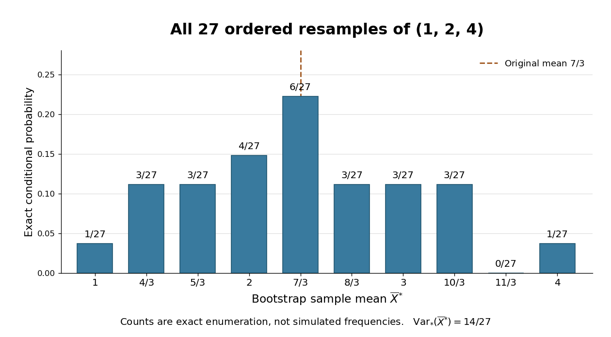

# Exact bootstrap distribution for three observations

↑ **Parent:** [Bootstrapping (statistics)](bootstrapping-statistics.md)

Take the original observations $(1,2,4)$, with [sample mean](sample-mean.md) $\overline x=7/3$. All $3^3=27$ ordered [bootstrap samples](bootstrap-sample.md) have [probability](probability.md) $1/27$. The [bootstrap sample](bootstrap-sample.md) $(1,1,4)$ has [sample mean](sample-mean.md) $2$; $(2,4,1)$ has [sample mean](sample-mean.md) $7/3$; $(4,4,4)$ has [sample mean](sample-mean.md) $4$. These are illustrative possibilities, not three simulated measurements used to estimate the distribution.

For [bootstrap count vectors](bootstrap-count-vectors.md) $(N_1,N_2,N_3)$, $N_i$ records the number of copies of observed slot $i$. Their [multinomial distribution](multinomial-distribution.md) is

$$
\mathbb P_*\bigl((N_1,N_2,N_3)=(a,b,c)\bigr)
=\frac{3!}{a!\,b!\,c!}\frac1{27},
\qquad a+b+c=3,
$$

and $\overline X^*=(N_1+2N_2+4N_3)/3$. Thus the unordered counts $(3,0,0)$ have [probability](probability.md) $1/27$, whereas $(1,1,1)$ have [probability](probability.md) $6/27$. [Stars and bars](stars-and-bars-combinatorics.md) gives ten count vectors, but assigning each [probability](probability.md) $1/10$ would be wrong. Two different count vectors, $(2,0,1)$ and $(0,3,0)$, both give [sample mean](sample-mean.md) $2$; combining their [probabilities](probability.md) gives $4/27$.

**[Figure 8](#image-exact-conditional-sampling-distribution-of-the-sample-mean-from-observations-1-2-4). Exact conditional sampling distribution of the sample mean from observations $(1,2,4)$**. All 27 ordered [bootstrap samples](bootstrap-sample.md) are enumerated. Bar labels give their counts out of 27, not empirical frequencies from a random simulation. The dashed line marks $\overline x=7/3$; the gaps reflect this discrete three-point [empirical measure](empirical-measure.md).

The [conditional bootstrap variance of a sample mean](conditional-bootstrap-variance-of-a-sample-mean.md) gives a compact check on the enumeration. Each resampled draw has [expected value](expected-value-split.md) $7/3$ and [variance](variance-split.md)

$$
\frac13\left[\left(1-\frac73\right)^2+\left(2-\frac73\right)^2+\left(4-\frac73\right)^2\right]=\frac{14}{9}.
$$

Averaging three [independent](independent-random-variables.md) draws divides that [variance](variance-split.md) by three:

$$
\boxed{\mathbb E_*[\overline X^*]=\frac73,\qquad
\operatorname{Var}_*(\overline X^*)=\frac{14}{27}.}
$$

The exact conditional [bootstrap standard error](bootstrap-standard-error.md) is $\sqrt{14/27}\simeq0.720$. The original [sample variance](sample-variance.md) with denominator $n-1$ is $7/3$, so its usual estimated [standard error](standard-error.md) for the [sample mean](sample-mean.md) is $\sqrt{7/9}\simeq0.882$. Their squared ratio is $(n-1)/n=2/3$ here; the difference follows from the [empirical measure](empirical-measure.md)'s denominator $n$, not a numerical simulation error. Neither number is the known true sampling [standard error](standard-error.md) of the unknown source [probability distribution](probability-distribution-split.md).

## ↑ Ancestors (7)

1. [Bootstrapping (statistics)](bootstrapping-statistics.md)
2. [Statistical modelling](statistical-modelling-split.md)
3. [Statistical model](statistical-model-split.md)
4. [Probability and statistics](probability-and-statistics-split.md)
5. [Area of mathematics](area-of-mathematics.md)
6. [Mathematics](mathematics-split.md)
7. [Codex Wiki](split.md)

## ← Incoming links (1)

- [Bootstrap sample](bootstrap-sample.md)
