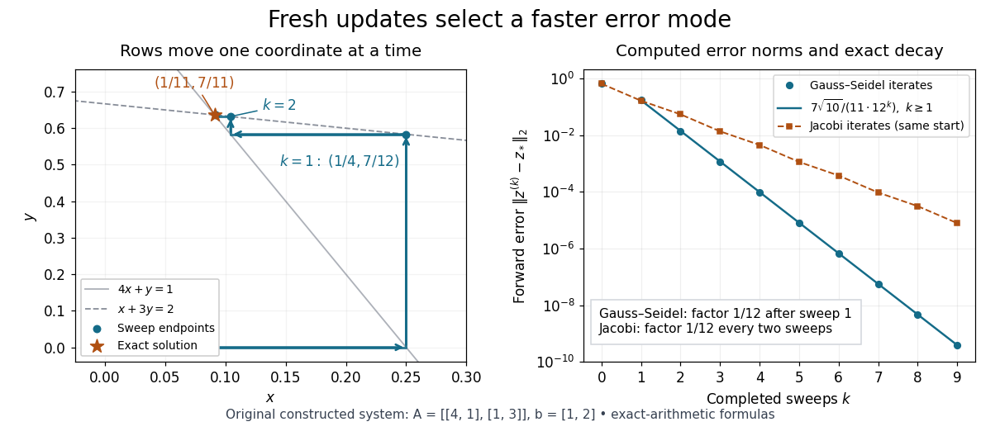

# Exact error contraction of a two-variable Gauss-Seidel iteration

↑ **Parent:** [Gauss-Seidel iteration for a two-variable positive-definite system](gauss-seidel-iteration-for-a-two-variable-positive-definite-system.md)

For the [Gauss-Seidel iteration for a two-variable positive-definite system](gauss-seidel-iteration-for-a-two-variable-positive-definite-system.md), define the [forward error](forward-error.md) by $e_x^{(k)}=x^{(k)}-x_*$ and $e_y^{(k)}=y^{(k)}-y_*$. Subtract the two exact solution equations from the two update equations:

$$
e_x^{(k+1)}=-\frac14e_y^{(k)},\qquad e_y^{(k+1)}=-\frac13e_x^{(k+1)}=\frac1{12}e_y^{(k)}.
$$

The fresh first coordinate passes the old second-coordinate error through two successive factors. The [iteration matrix](iteration-matrix.md) is therefore

$$
H=\begin{pmatrix}0&-1/4\\0&1/12\end{pmatrix},\qquad \det(tI-H)=t(t-1/12),\qquad \rho(H)=1/12.
$$

Its [eigenvalues](eigenvalue.md) are $0$ and $1/12$, as seen from the [determinant](determinant.md). The zero [eigenvalue](eigenvalue.md) explains why the old first-coordinate error disappears completely: the first row overwrites it. After one sweep, every remaining [forward error](forward-error.md) lies on the [eigenvector](eigenvector.md) line spanned by $(-3,1)^T$.

For this zero start, $e_y^{(0)}=-7/11$, so the exact [vectors](vector.md) for $k\geq1$ are

$$
\begin{pmatrix}x^{(k)}\\y^{(k)}\end{pmatrix}=\begin{pmatrix}1/11\\7/11\end{pmatrix}+\frac{7}{11\,12^k}\begin{pmatrix}3\\-1\end{pmatrix},\qquad \|e^{(k)}\|_2=\frac{7\sqrt{10}}{11\,12^k}.
$$

The [Euclidean norm](euclidean-norm.md) of the [forward error](forward-error.md) decreases by exactly $1/12$ per sweep from $k=1$ onward. The first decrease is different because the initial error has not yet reached that [eigenvector](eigenvector.md) line. Each row update moves horizontally or vertically in the coordinate plane; sweep endpoints then approach the solution along one straight line.

**[Figure 14](#image-computed-row-by-row-gauss-seidel-method-trajectory-and-exact-forward-error-contraction-for-the-original-two-variable-linear-system). Computed row-by-row Gauss-Seidel method trajectory and exact forward error contraction for the original two-variable linear system**.

The [linear-system residual](linear-system-residual.md) is an independent way to check the calculation. Completing a sweep satisfies the second row exactly, but changing $y$ disturbs the first row:

$$
r^{(k)}=b-A\begin{pmatrix}x^{(k)}\\y^{(k)}\end{pmatrix}=\begin{pmatrix}y^{(k-1)}-y^{(k)}\\0\end{pmatrix}=\begin{pmatrix}-7/12^k\\0\end{pmatrix}\qquad(k\geq1).
$$

Thus a zero residual in the last updated row alone does not certify a solution; inspect the complete [linear-system residual](linear-system-residual.md).

For the same [matrix](matrix.md), the stale schedule of the [Jacobi method](jacobi-method.md) gives the [iteration matrix](iteration-matrix.md)

$$
B=\begin{pmatrix}0&-1/4\\-1/3&0\end{pmatrix},\qquad B^2=\frac1{12}I,\qquad \rho(B)=\frac1{\sqrt{12}}.
$$

Here its [eigenvalues](eigenvalue.md) are $\pm1/\sqrt{12}$, whereas the fresh schedule gives $\rho(H)=\rho(B)^2$. This comparison belongs to this particular [linear system](system-of-linear-equations.md); it is not a universal relation between the two methods' [spectral radii](spectral-radius.md).

## ↑ Ancestors (9)

1. [Gauss-Seidel iteration for a two-variable positive-definite system](gauss-seidel-iteration-for-a-two-variable-positive-definite-system.md)
2. [Gauss-Seidel method](gauss-seidel-method.md)
3. [Stationary iterative method for a linear system](stationary-iterative-method-for-a-linear-system.md)
4. [Numerical linear algebra](numerical-linear-algebra-split.md)
5. [Numerical analysis](numerical-analysis-split.md)
6. [Analysis](analysis-split.md)
7. [Area of mathematics](area-of-mathematics.md)
8. [Mathematics](mathematics-split.md)
9. [Codex Wiki](split.md)
