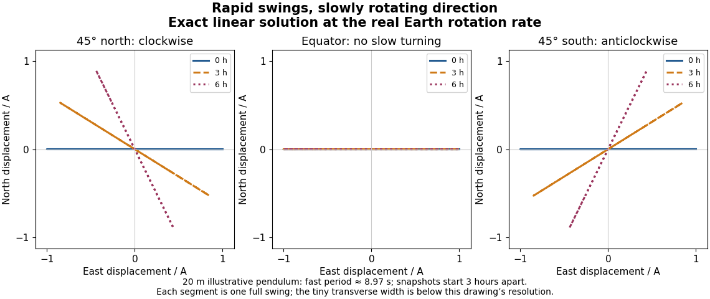

# Exact linear Foucault pendulum trajectory

↑ **Parent:** [Foucault pendulum](foucault-pendulum.md)

For release from rest relative to the building, take $x(0)=A>0$, $y(0)=\dot x(0)=\dot y(0)=0$. The exact solution of the stated coupled [linear differential equations](linear-differential-equation.md) is

$$
z(t)=Ae^{-i\alpha t}\left(\cos\beta t+i\frac\alpha\beta\sin\beta t\right),\qquad
\beta=\sqrt{\omega_0^2+\alpha^2}.
$$

Indeed $u(0)=A$ and $\dot u(0)=i\alpha A$, so $\dot z(0)=0$. In the slowly rotating coordinates, the [ellipse](ellipse.md) has semiaxes $A$ and $A|\alpha|/\beta$. A bob released from rest therefore does not describe a perfectly straight line even in this ideal linear model. Replacing the bracket by $\cos\omega_0t$ gives the familiar leading approximation but introduces a spurious initial transverse [velocity](velocity.md) $-i\alpha A$. The exact expression keeps the initial condition and separates that tiny orbit width from the slow rotation of its long axis.

**[Figure 7](#image-exact-trajectories-of-the-linear-foucault-pendulum-equations-at-the-actual-earth-rotation-rate-showing-one-swing-near-zero-three-and-six-hours-at-northern-equatorial-and-southern-latitudes). Exact trajectories of the linear Foucault pendulum equations at the actual Earth rotation rate, showing one swing near zero, three, and six hours at northern, equatorial, and southern latitudes**.

For the illustrative $\ell=20\,\mathrm m$ and $g=9.81\,\mathrm{m/s^2}$, the fast period $2\pi/\beta$ is approximately $8.9714\,\mathrm s$. At $45^\circ$ north, $|\alpha|/\beta\simeq7.3624\times10^{-5}$: the transverse semiaxis is too small to distinguish at the figure's scale. Nevertheless the long-axis orientation changes by about $-63.8138^\circ$ in six hours. Changing the sign of [geographical latitude](geographical-latitude.md) conjugates the entire solution, reflecting the [trajectory](trajectory.md) across the eastward axis; setting $\alpha=0$ gives $z=A\cos\omega_0t$ exactly. These are stronger checks than merely drawing a rotating line.

The coupled equations give an additional independent constraint. Multiplying them by $\dot x$ and $\dot y$ and adding cancels the [Coriolis force](coriolis-force.md)'s contributions:

$$
\frac d{dt}\left[\frac12(\dot x^2+\dot y^2)+\frac12\omega_0^2(x^2+y^2)\right]=0.
$$

This is [mechanical energy](mechanical-energy.md) per unit [mass](mass.md) in the reduced model; [precession](precession.md) does not require a loss of [mechanical energy](mechanical-energy.md). Also, direct [differentiation](differentiation.md) gives

$$
\frac d{dt}\left[x\dot y-y\dot x+\alpha(x^2+y^2)\right]=0.
$$

For this release the constant is $\alpha A^2$. The exact [trajectory](trajectory.md) satisfies both identities. They test the coupled dynamics separately from the visible slow rotation and express the fact that the [Coriolis force does no work](coriolis-force-does-no-work.md).

## ↑ Ancestors (6)

1. [Foucault pendulum](foucault-pendulum.md)
2. [Simple pendulum](simple-pendulum-split.md)
3. [Classical mechanics](classical-mechanics-split.md)
4. [Branches of physics](branches-of-physics.md)
5. [Physics](physics-split.md)
6. [Codex Wiki](split.md)

## ← Incoming links (1)

- [Controls and limitations of a Foucault pendulum](controls-and-limitations-of-a-foucault-pendulum.md)
