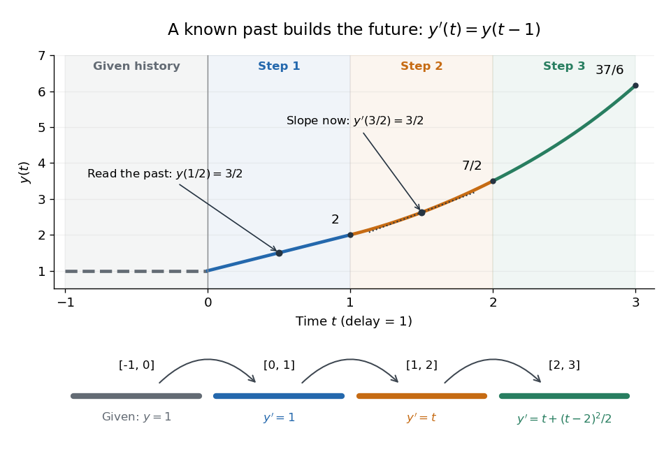

# Exact polynomial steps for a delay equation

↑ **Parent:** [Retarded delay differential equation](retarded-delay-differential-equation.md)

Use the [Malthusian delay differential equation](malthusian-delay-differential-equation.md) with time measured in units of its constant delay:

$$
y'(t)=a y(t-1),\qquad y(t)=1\quad(-1\leq t\leq0).
$$

Here $a$ is a real constant. On the first interval $y(t-1)=1$, hence $y(t)=1+at$. On the next interval the delayed input is $1+a(t-1)$, already known, so the [method of steps for a delay differential equation](method-of-steps-for-a-delay-differential-equation.md) gives

$$
y(t)=\begin{cases}
1+at,&0\leq t\leq1,\\
1+at+\dfrac{a^2}{2}(t-1)^2,&1\leq t\leq2,\\
1+at+\dfrac{a^2}{2}(t-1)^2+\dfrac{a^3}{6}(t-2)^3,&2\leq t\leq3.
\end{cases}
$$

Each [polynomial](polynomial-split.md) integrates the preceding interval's delayed [polynomial](polynomial-split.md), and its integration constant ensures [continuity](continuous-function.md). At $a=1$, the step endpoints are $y(1)=2$, $y(2)=7/2$, and $y(3)=37/6$. At $t=3/2$, the value is $21/8$, but its [derivative](derivative.md) is the earlier value $y(1/2)=3/2$. This is the geometric distinction from the [ordinary differential equation](ordinary-differential-equation.md) $y'=y$, whose [derivative](derivative.md) would equal its current value.

**[Figure 4](#image-a-prescribed-past-becomes-successive-exact-polynomial-steps). A prescribed past becomes successive exact polynomial steps**. The [history function of a delay differential equation](history-function-of-a-delay-differential-equation.md) is $1$ and $a=1$. Each colored interval supplies the delayed input for the next one; the lower panel gives that next interval's [derivative](derivative.md). The marked [tangent line](tangent-line.md) at $t=3/2$ has [slope](slope.md) $y(1/2)=3/2$. All curves are evaluated from exact [polynomials](polynomial-split.md).

More generally, for any integer $n\geq0$,

$$
y(t)=1+\sum_{k=1}^{n+1}\frac{a^k}{k!}(t-k+1)^k,\qquad n\leq t\leq n+1.
$$

At an integer join the newly introduced term vanishes. Inside a step, [differentiation](differentiation.md) lowers each power by one and gives exactly $a$ times the preceding step evaluated at $t-1$. Together with $y(0)=1$, this verifies the formula by [mathematical induction](mathematical-induction.md); it is an exact construction, not a truncated [power series](power-series.md).

The history and the new equation need not prescribe matching [derivatives](derivative.md) at the starting time; their mismatch can reappear later in higher [derivatives](derivative.md).[Skip Thompson, Delay-differential equations, Derivative Discontinuities: initial incompatibility and its propagation](delay-differential-equations-by-skip-thompson.md) In this example, $y'(0^-)=0$ and $y'(0^+)=a$. For $a\ne0$, $y'$ is continuous at $t=1$ but $y''$ jumps there by $a^2$; at $t=2$, the first jump is in $y'''$, of size $a^3$. The [solution of a differential equation](solution-of-a-differential-equation.md) is therefore continuously differentiable for positive time, although it need not have continuous [derivatives](derivative.md) of every order at step boundaries.

## ↑ Ancestors (7)

1. [Retarded delay differential equation](retarded-delay-differential-equation.md)
2. [Delay differential equation](delay-differential-equation.md)
3. [Differential equation](differential-equation-split.md)
4. [Analysis](analysis-split.md)
5. [Area of mathematics](area-of-mathematics.md)
6. [Mathematics](mathematics-split.md)
7. [Codex Wiki](split.md)

## ← Incoming links (1)

- [Delay differential equation](delay-differential-equation.md)
