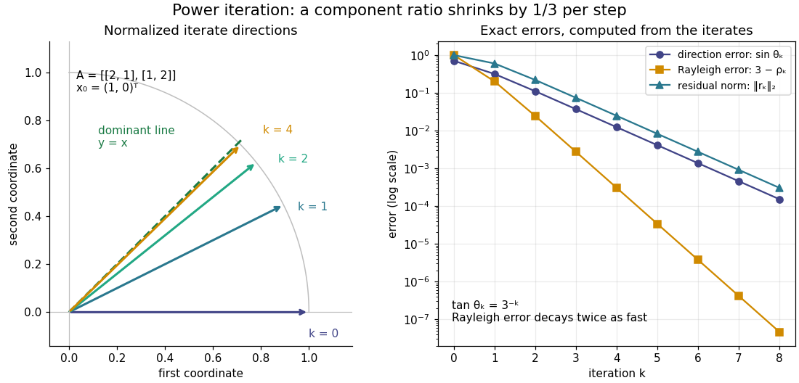

# Exact two-dimensional power iteration

↑ **Parent:** [Power iteration](power-iteration.md)

Consider the [symmetric matrix](symmetric-matrix.md) and initial [unit vector](unit-vector.md)

$$
A=\begin{pmatrix}2&1\\1&2\end{pmatrix},\qquad x_0=\begin{pmatrix}1\\0\end{pmatrix}.
$$

Its [orthonormal eigenbasis](orthonormal-eigenbasis.md) consists of $u_1=(1,1)^T/\sqrt2$ and $u_2=(1,-1)^T/\sqrt2$, with [eigenvalues](eigenvalue.md) $3$ and $1$. Since $x_0=(u_1+u_2)/\sqrt2$, direct multiplication gives

$$
A^kx_0=\frac12\begin{pmatrix}3^k+1\\3^k-1\end{pmatrix},\qquad x_k=\frac{u_1+3^{-k}u_2}{\sqrt{1+3^{-2k}}}.
$$

The first unnormalized [vectors](vector.md) are $(1,0)^T$, $(2,1)^T$, $(5,4)^T$, and $(14,13)^T$. If $\theta_k$ is the acute [angle](angle.md) from the line spanned by the dominant [eigenvector](eigenvector.md), then $\tan\theta_k=3^{-k}$. Every application divides the unwanted-to-wanted component ratio by three: normalization changes lengths, while the [spectral gap](spectral-gap.md) selects the direction.

**[Figure 40](#image-exact-power-iteration-directions-and-errors-for-a-symmetric-matrix-with-eigenvalues-3-and-1). Exact power iteration directions and errors for a symmetric matrix with eigenvalues 3 and 1**.

The right panel compares the [power iteration direction error](power-iteration-direction-error.md), [Rayleigh quotient](rayleigh-quotient.md) error, and [eigenpair residual](eigenpair-residual.md). With $t_k=3^{-k}$, their exact values are

$$
\varepsilon_k=\frac{t_k}{\sqrt{1+t_k^2}},\qquad 3-\rho_k=\frac{2t_k^2}{1+t_k^2},\qquad \|r_k\|_2=\frac{2t_k}{1+t_k^2}.
$$

Thus a very accurate [Rayleigh quotient](rayleigh-quotient.md) can appear well before the [eigenvector](eigenvector.md) is comparably accurate. This is an example of [quadratic Rayleigh-quotient improvement for the power method](quadratic-rayleigh-quotient-improvement-for-the-power-method.md).

## ↑ Ancestors (7)

1. [Power iteration](power-iteration.md)
2. [Numerical linear algebra](numerical-linear-algebra.md)
3. [Numerical analysis](numerical-analysis-split.md)
4. [Analysis](analysis-split.md)
5. [Area of mathematics](area-of-mathematics.md)
6. [Mathematics](mathematics-split.md)
7. [Codex Wiki](split.md)
