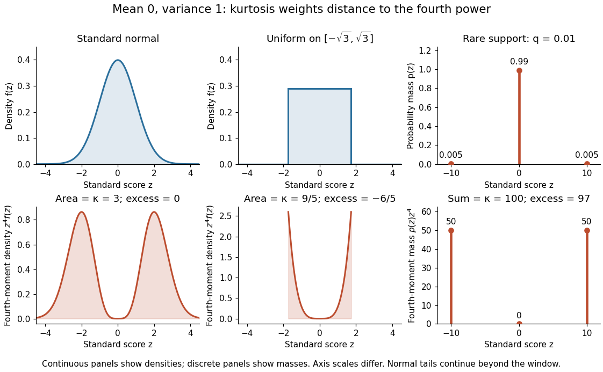

# Excess kurtosis

↑ **Parent:** [Kurtosis](kurtosis.md)

[Excess kurtosis](excess-kurtosis.md) subtracts $3$ from [kurtosis](kurtosis.md), making the [normal distribution](normal-distribution.md) baseline zero. The non-excess convention is sometimes called raw [kurtosis](kurtosis.md); this still uses a fourth [central moment](central-moment.md), not the uncentered [fourth moment](fourth-moment.md) $\mathbb E[X^4]$. Software may report either [kurtosis](kurtosis.md) or [excess kurtosis](excess-kurtosis.md), so the convention must be stated.[§1.3.5.11, Alternative Definition of Kurtosis, normal baseline and software convention warning](nist-and-sematech-e-handbook-of-statistical-methods/1-3-5-11-measures-of-skewness-and-kurtosis.md)

For a [standard normal distribution](standard-normal-distribution.md), the [moment-generating function of a standard normal variable](moment-generating-function-of-a-standard-normal-variable.md) gives $\mathbb E[Z^4]=3$, hence [excess kurtosis](excess-kurtosis.md) zero. For a [continuous uniform distribution](continuous-uniform-distribution.md) on $[-\sqrt3,\sqrt3]$, the [mean](expected-value.md) is zero, the [variance](variance-split.md) is one, and direct [integration](integral.md) gives

$$
\kappa=\frac1{2\sqrt3}\int_{-\sqrt3}^{\sqrt3}z^4\,dz=\frac95,\qquad \gamma_2=-\frac65.
$$

The [rare-outlier three-point distribution](rare-outlier-three-point-distribution.md) can instead have [kurtosis](kurtosis.md) $100$ and [excess kurtosis](excess-kurtosis.md) $97$ with [mean](expected-value.md) zero and [variance](variance-split.md) one. These are calculated properties of specified [probability distributions](probability-distribution.md), rather than a measured [statistic](statistic.md).

**[Figure 24](#image-kurtosis-comparison-for-a-standard-normal-distribution-a-continuous-uniform-distribution-and-a-rare-outlier-three-point-distribution). Kurtosis comparison for a standard normal distribution, a continuous uniform distribution, and a rare-outlier three-point distribution**. The upper panels show [probability density functions](probability-density-function.md) or a [probability mass function](probability-mass-function.md); the lower panels show their contributions to the fourth [central moment](central-moment.md). All three [probability distributions](probability-distribution.md) have [mean](expected-value.md) zero and [variance](variance-split.md) one. Areas in the continuous panels and sums in the discrete panels give [kurtosis](kurtosis.md). The [standard normal distribution](standard-normal-distribution.md) continues beyond the displayed window; density and mass heights have different meanings.

## ↑ Ancestors (7)

1. [Kurtosis](kurtosis.md)
2. [Probability distribution](probability-distribution.md)
3. [Probability theory](probability-theory-split.md)
4. [Probability and statistics](probability-and-statistics-split.md)
5. [Area of mathematics](area-of-mathematics.md)
6. [Mathematics](mathematics-split.md)
7. [Codex Wiki](split.md)

## ← Incoming links (3)

- [Affine invariance of kurtosis](affine-invariance-of-kurtosis.md)
- [Excess kurtosis](excess-kurtosis.md)
- [Rare-outlier three-point distribution](rare-outlier-three-point-distribution.md)
