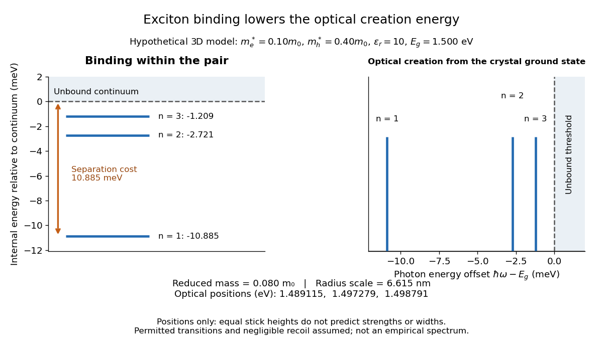

# Exciton optical transition

↑ **Parent:** [Exciton](exciton.md)

For the ideal [Wannier-Mott exciton](wannier-mott-exciton.md) in [energy bands](energy-band.md) whose edges occur at the same [crystal momentum](crystal-momentum.md), the pair excitation [energy](energy-split.md), measured from the unexcited crystal, is

$$
E_{X,n}(\mathbf K)=E_g-\frac{R^*}{n^2}+\frac{\hbar^2K^2}{2M}.
$$

Here $\hbar\mathbf K$ is the pair's total [crystal momentum](crystal-momentum.md); the last term is [center of mass](center-of-mass.md) [kinetic energy](kinetic-energy.md). For a permitted [photon absorption](photon-absorption.md) transition with negligible recoil [energy](energy-split.md), $\hbar\omega\simeq E_g-E_{B,n}$. An [electric-dipole selection rule](electric-dipole-selection-rule.md) and a nonzero transition [matrix element](matrix-element.md) are still needed: a [bound state](bound-state.md) need not produce an observable [spectral line](spectral-line.md). If the relevant [energy band](energy-band.md) edges have different values of [crystal momentum](crystal-momentum.md), a [phonon](phonon.md) can also be needed to conserve [crystal momentum](crystal-momentum.md); subtracting a binding scale from a [band gap](band-gap.md) alone does not specify the optical threshold.

**[Figure 3](#image-exciton-binding-energy-and-hypothetical-exciton-optical-transition-positions). Exciton binding energy and hypothetical exciton optical transition positions**. [Source](exciton-binding-optical-transition.py). Original three-dimensional [Wannier-Mott exciton](wannier-mott-exciton.md) model with the inputs given above. Left: internal [energy eigenvalues](energy-eigenvalue-split.md) relative to the unbound continuum. Right: corresponding optical [energy](energy-split.md) positions for hypothetical permitted transitions, with recoil neglected. Equal stick heights encode positions only, not predicted strengths or widths. The continuum threshold is $1.500\,\mathrm{eV}$; these sticks are not an empirical [optical spectrum](optical-spectrum.md) and are not the [copper(I) oxide](copper-i-oxide.md) experiment below.

For example, the lowest internal [bound state](bound-state.md) in this hypothetical model costs $1.489115\,\mathrm{eV}$ to create optically, yet needs only $0.010885\,\mathrm{eV}$ more to dissociate. The large creation [energy](energy-split.md) and the small [exciton binding energy](exciton-binding-energy.md) answer different physical questions. An [electron-hole recombination](electron-hole-recombination.md) event can instead release excitation [energy](energy-split.md) by [photon emission](photon-emission.md) or to other degrees of freedom; an emitted [photon](photon.md) need not reproduce the original absorption [energy](energy-split.md) if relaxation intervened.

**Table of contents**

- [Exciton absorption experiment in copper(I) oxide](exciton-absorption-experiment-in-copper-i-oxide.md)
  - [Copper(I) oxide](copper-i-oxide.md)

## ↑ Ancestors (6)

1. [Exciton](exciton.md)
2. [Quasiparticle](quasiparticle.md)
3. [Quantum mechanics](quantum-mechanics-split.md)
4. [Branches of physics](branches-of-physics.md)
5. [Physics](physics-split.md)
6. [Codex Wiki](split.md)

## ← Incoming links (2)

- [Exciton](exciton.md)
- [Exciton optical transition](exciton-optical-transition.md)
