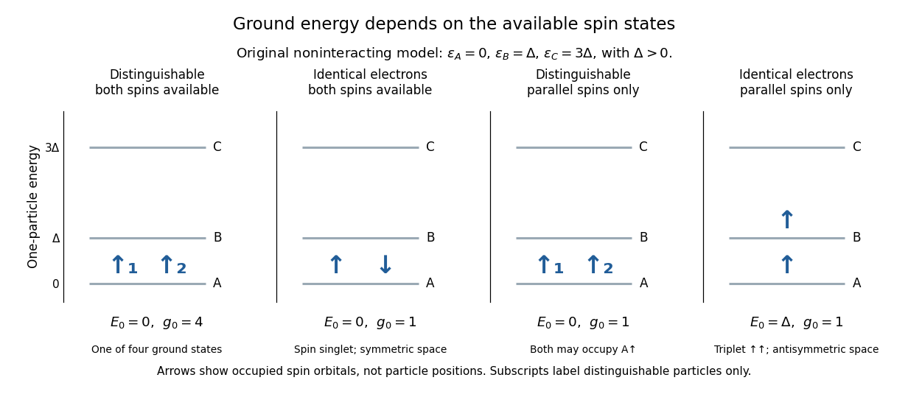

# Exclusion and the energy of two electrons in three spatial levels

↑ **Parent:** [Zero-temperature filling of finite fermion levels](zero-temperature-filling-of-finite-fermion-levels.md)

Consider an original noninteracting model with three [orthonormal](orthonormal-set.md) [spatial orbitals](spatial-orbital.md) $A,B,C$ at [energies](energy-split.md) $0,\Delta,3\Delta$, where $\Delta>0$. Both [spin](spin.md) projections are available at each [energy](energy-split.md), so there are six [spin orbitals](spin-orbital.md). The [Quantum Hamiltonian](hamiltonian-quantum-mechanics.md) is $H=h\otimes I+I\otimes h$, with no interaction between particles and no dependence on [spin](spin.md). Comparing its allowed [ground states](ground-state.md) isolates the effect of [fermionic](fermion.md) exchange symmetry.

For two distinguishable spin-one-half particles, the spatial [ground state](ground-state.md) is $A\otimes A$ and any of four independent two-[spin](spin.md) states is possible: $E_0=0$ and [ground-state degeneracy](ground-state-degeneracy.md) four. For two identical [electrons](electron.md), both can still occupy $A$, using $A\uparrow$ and $A\downarrow$, but there is just one allowed [ground state](ground-state.md): the symmetric spatial factor times the [spin-one-half singlet state](spin-one-half-singlet-state.md),

$$
\Psi_0=A(\mathbf r_1)A(\mathbf r_2)\frac{|\uparrow\downarrow\rangle-|\downarrow\uparrow\rangle}{\sqrt2},\qquad E_0=0.
$$

Exclusion has reduced the [ground-state degeneracy](ground-state-degeneracy.md) without raising the [ground state](ground-state.md) [energy](energy-split.md).

Now restrict both particles to the same [spin](spin.md) projection $\uparrow$. Distinguishable particles can still both occupy $A\uparrow$, so $E_0=0$. Identical [electrons](electron.md) must occupy different [spatial orbitals](spatial-orbital.md); the lowest choice is $A,B$, with

$$
\Psi_{\uparrow\uparrow}=\frac{A(\mathbf r_1)B(\mathbf r_2)-B(\mathbf r_1)A(\mathbf r_2)}{\sqrt2}|\uparrow\uparrow\rangle,\qquad E_0=\Delta.
$$

The [spin](spin.md) factor is a [spin-one-half triplet state](spin-one-half-triplet-state.md), and the spatial factor is antisymmetric. These are [ground states](ground-state.md) within the restricted parallel-[spin](spin.md) sector, not the unrestricted two-[electron](electron.md) [ground state](ground-state.md). Both restricted models have [ground-state degeneracy](ground-state-degeneracy.md) one.

**[Figure 4](#image-ground-energies-in-a-three-spatial-level-model-depend-on-which-spin-states-are-available). Ground energies in a three-spatial-level model depend on which spin states are available**. Original model with chosen [spatial orbital](spatial-orbital.md) [energies](energy-split.md) $0,\Delta,3\Delta$, no interactions and no [spin](spin.md) splitting. The first pair of panels allows both [spin](spin.md) projections; the second pair restricts both to $\uparrow$. Labels $g_0$ count independent [ground states](ground-state.md); particle subscripts appear only in the distinguishable cases.

The first excited two-[electron](electron.md) [energy](energy-split.md) in the unrestricted model is $\Delta$, with four independent [quantum states](quantum-state.md): one occupant in $A$, one in $B$, and two [spin](spin.md) choices for each. A basis adapted to [particle exchange operators](particle-exchange-operator.md) separates these into one [spin-one-half singlet state](spin-one-half-singlet-state.md) with symmetric spatial factor and three [spin-one-half triplet states](spin-one-half-triplet-state.md) with antisymmetric spatial factor. All four have equal [energy](energy-split.md) in this model. Singlet versus triplet does not by itself determine an [energy](energy-split.md) gap; an interaction or a [spin](spin.md)-dependent term is needed to split them.

As a further count, the full two-[electron](electron.md) space has [dimension](dimension-vector-space.md) $\binom62=15$. Its [energies](energy-split.md) in units of $\Delta$ and corresponding multiplicities are $(0,1,2,3,4,6)$ and $(1,4,1,4,4,1)$. For distinguishable spin-one-half particles the ordered [tensor product](tensor-product.md) instead has [dimension](dimension-vector-space.md) $6^2=36$, with multiplicities $(4,8,4,8,8,4)$ at those same [energies](energy-split.md). These are exact model counts, not atomic measurements. The higher restricted [ground state](ground-state.md) [energy](energy-split.md) follows from removing forbidden [quantum states](quantum-state.md); the [Quantum Hamiltonian](hamiltonian-quantum-mechanics.md) contains no additional “exclusion force”.

## ↑ Ancestors (11)

1. [Zero-temperature filling of finite fermion levels](zero-temperature-filling-of-finite-fermion-levels.md)
2. [Pauli exclusion principle](pauli-exclusion-principle.md)
3. [Fermion](fermion.md)
4. [Indistinguishable particles](indistinguishable-particles.md)
5. [Particle exchange operator](particle-exchange-operator.md)
6. [Multiparticle quantum state](multiparticle-quantum-state.md)
7. [Tensor product of quantum systems](tensor-product-of-quantum-systems-split.md)
8. [Quantum mechanics](quantum-mechanics-split.md)
9. [Branches of physics](branches-of-physics.md)
10. [Physics](physics-split.md)
11. [Codex Wiki](split.md)
