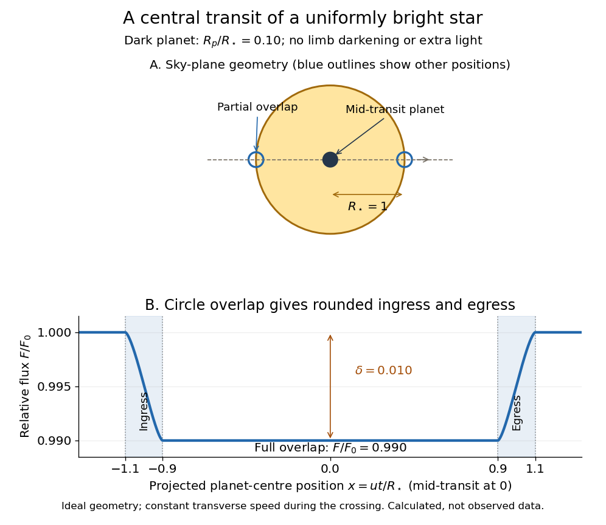

# Exoplanet transit photometry

↑ **Parent:** [Exoplanet atmospheric observatory](exoplanet-atmospheric-observatory.md)

[Exoplanet transit photometry](exoplanet-transit-photometry.md) measures the decrease in a [star](star.md)'s [observed radiative flux](observed-radiative-flux.md) during an [exoplanet transit](exoplanet-transit.md). Define $F_0$ as the unobscured [star](star.md)'s [observed radiative flux](observed-radiative-flux.md) and $F(t)$ as the value at time $t$. For a dark, opaque [exoplanet](exoplanet-split.md) crossing a uniformly bright circular stellar disc, a fully superimposed planetary disc blocks exactly the fraction

$$
\delta=\frac{F_0-F_{\rm full}}{F_0}=\frac{\pi R_p^2}{\pi R_\star^2}=\left(\frac{R_p}{R_\star}\right)^2.
$$

Here $R_p$ and $R_\star$ are the [planet](planet.md) and [star](star.md) [radii](radius.md). This [exoplanet transit depth](exoplanet-transit-depth.md) determines a [radius](radius.md) ratio, $R_p/R_\star=\sqrt\delta$; an absolute [planet](planet.md) [radius](radius.md) requires an independently estimated stellar [radius](radius.md). For $R_p/R_\star=0.10$, $\delta=0.010$: a one-percent dip, with $F_{\rm full}/F_0=0.990$. Halving the [radius](radius.md) ratio to $0.05$ reduces the [exoplanet transit depth](exoplanet-transit-depth.md) to $0.0025$, a quarter as much.

For the central [exoplanet transit](exoplanet-transit.md) illustrated below, the [transit impact parameter](transit-impact-parameter.md) is $b=0$. Write $k=R_p/R_\star<1$ and let $z$ be the projected centre-to-centre separation in units of $R_\star$. The [light curve](light-curve.md) is $F/F_0=1-A(z)/\pi$, where $A(z)$ is the overlap [area](surface-area.md) of [circles](circle.md) of [radii](radius.md) $1$ and $k$. There is no overlap when $z\ge1+k$; the planetary disc is fully inside when $z\le1-k$, giving $A=\pi k^2$. Between those limits, the overlap [area](surface-area.md) grows or shrinks continuously. Thus even a uniform [star](star.md) has curved ingress and egress, with a flat bottom only during full overlap. The illustration uses approximately constant transverse [velocity](velocity.md) over the short crossing, so $z=|u t|/R_\star$ with mid-transit at $t=0$. Analytic models also handle [limb darkening](limb-darkening.md). [Mandel and Agol (2002)](https://arxiv.org/abs/astro-ph/0210099).

**[Figure 1](#image-central-transit-a-radius-ratio-of-0-10-blocks-one-percent-of-a-uniform-star). Central transit: a radius ratio of 0.10 blocks one percent of a uniform star**.

The simple [exoplanet transit depth](exoplanet-transit-depth.md) formula assumes constant stellar brightness, no [limb darkening](limb-darkening.md) or [starspots](starspot.md), negligible light from the [exoplanet](exoplanet-split.md), and no [transit dilution](transit-dilution.md) by other light. It describes full overlap in a non-grazing [exoplanet transit](exoplanet-transit.md), requiring $b<1-k$ for a full-overlap interval. A grazing [exoplanet transit](exoplanet-transit.md) never hides the whole planetary disc against the [star](star.md), and [limb darkening](limb-darkening.md) weights different blocked [areas](surface-area.md) differently. Repeating dips are valuable evidence, but eclipsing [binary stars](binary-star.md) and [starspots](starspot.md) can imitate parts of the signal, so confirmation and joint modelling matter.

**Table of contents**

- [Transit survey completeness](transit-survey-completeness.md)
- [Exoplanet transit depth](exoplanet-transit-depth.md)
  - [Transit dilution](transit-dilution.md)
- [Starspot](starspot.md)
- [Transit-timing variation](transit-timing-variation.md)
  - [Near-resonant transit-timing superperiod](near-resonant-transit-timing-superperiod.md)
    - [Eccentricity-enhanced near-resonant transit-timing variation](eccentricity-enhanced-near-resonant-transit-timing-variation.md)
- [Simultaneous transit in a resonant chain](simultaneous-transit-in-a-resonant-chain.md)
- [Transit dimming by an optically thin orbital wire](transit-dimming-by-an-optically-thin-orbital-wire.md)
- [Exoplanet transit](exoplanet-transit.md)
  - [Geometric transit probability](geometric-transit-probability.md)
  - [Total duration of a circular planetary transit](total-duration-of-a-circular-planetary-transit.md)
    - [Transit contact-duration convention](transit-contact-duration-convention.md)
    - [Impact parameter from total transit duration](impact-parameter-from-total-transit-duration.md)
      - [Eccentric-orbit degeneracy in transit duration](eccentric-orbit-degeneracy-in-transit-duration.md)
    - [Stellar radius from transit duration and a linear mass-radius relation](stellar-radius-from-transit-duration-and-a-linear-mass-radius-relation.md)
  - [Transit impact parameter](transit-impact-parameter.md)
    - [Coplanar transit limit](coplanar-transit-limit.md)
  - [Transit duration of a small planet](transit-duration-of-a-small-planet.md)
    - [Hill-cloud transit mass estimate](hill-cloud-transit-mass-estimate.md)

## ↑ Ancestors (7)

1. [Exoplanet atmospheric observatory](exoplanet-atmospheric-observatory.md)
2. [Exoplanet atmosphere](exoplanet-atmosphere.md)
3. [Exoplanet](exoplanet-split.md)
4. [Astrophysics](astrophysics-split.md)
5. [Branches of physics](branches-of-physics.md)
6. [Physics](physics-split.md)
7. [Codex Wiki](split.md)

## ← Incoming links (15)

- [Aperture photometry](aperture-photometry.md)
- [Doppler spectroscopy](doppler-spectroscopy.md)
- [Exoplanet](exoplanet-split.md)
- [Exoplanet transit](exoplanet-transit.md)
- [Exoplanet transit photometry](exoplanet-transit-photometry.md)
- [Exposure-averaged light curve](exposure-averaged-light-curve.md)
- [Kepler space telescope](kepler-space-telescope.md)
- [Light curve](light-curve.md)
- [Linear limb-darkening law](linear-limb-darkening-law.md)
- [Methods of detecting exoplanets](methods-of-detecting-exoplanets.md)
- [Solution](past-exam-of-the-mathematics-course-of-the-university-of-cambridge/2015/iii/paper-59/1/c/i/solution.md)
- [Solution](past-exam-of-the-mathematics-course-of-the-university-of-cambridge/2015/iii/paper-59/4/i/solution.md)
- [Solution](past-exam-of-the-mathematics-course-of-the-university-of-cambridge/2019/iii/paper-315/3/c/solution.md)
- [Solution](past-exam-of-the-mathematics-course-of-the-university-of-cambridge/2019/iii/paper-315/4/e/solution.md)
- [Transit-radius contribution of a gaseous envelope](transit-radius-contribution-of-a-gaseous-envelope.md)
