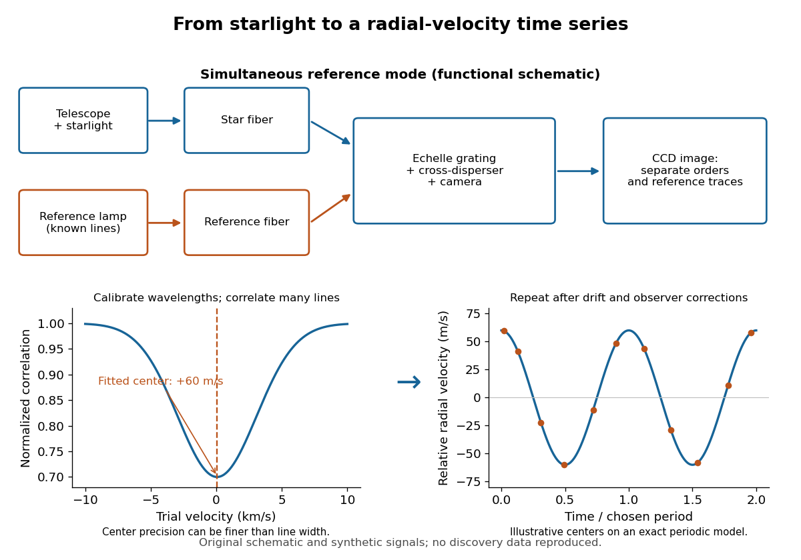

# Exoplanet

↑ **Parent:** [Astrophysics](astrophysics.md)  
ⓦ [Wiki](https://en.wikipedia.org/wiki/Exoplanet)

An [exoplanet](exoplanet.md) is a [planet](planetary-science.md#planet) outside the [Solar system](astrophysics.md#solar-system); here the focus is on [planets](planetary-science.md#planet) orbiting [stars](stellar-astrophysics.md#star) other than the [Sun](stellar-astrophysics.md#sun), including [pulsars](stellar-astrophysics.md#pulsar). Most [exoplanets](exoplanet.md) are detected indirectly: a [star](stellar-astrophysics.md#star)'s changing [Doppler shift](wave.md#doppler-effect) reveals its motion, or a small dip in its [light curve](astrophysics.md#light-curve) reveals an [exoplanet transit](#exoplanet-transit). The striking idea is that an unresolved point of light can tell us about an otherwise unseen world's [mass](classical-mechanics.md#mass), [radius](topology.md#radius), and [orbit](dynamical-systems.md#orbit-dynamical-system).

The measurements answer different questions. [Exoplanet transit photometry](#exoplanet-transit-photometry) primarily gives a [radius](topology.md#radius) ratio, while [Doppler spectroscopy](#doppler-spectroscopy) constrains [mass](classical-mechanics.md#mass) together with [orbital inclination](celestial-mechanics.md#orbital-inclination). Combining them with the host [star](stellar-astrophysics.md#star)'s properties gives a mean [mass density](fluid-mechanics.md#density), $\bar\rho_p=3M_p/(4\pi R_p^3)$, useful for [exoplanet interior](#exoplanet-interior) models. Even this combination does not uniquely determine composition: see [exoplanet interior-composition degeneracy](#exoplanet-interior-composition-degeneracy). [Transit spectroscopy](#transit-spectroscopy) and an [exoplanet secondary eclipse](#exoplanet-secondary-eclipse) then probe an [exoplanet atmosphere](#exoplanet-atmosphere).

The discovery history has two distinct milestones. In 1992 Aleksander Wolszczan and Dale Frail reported two [planet](planetary-science.md#planet)-mass companions to the [pulsar](stellar-astrophysics.md#pulsar) PSR B1257+12 from periodic changes in pulse arrival times; their paper also suggested an additional companion. These were the first confirmed [exoplanet](exoplanet.md) discoveries, around a [neutron star](stellar-astrophysics.md#neutron-star). [Wolszczan and Frail (1992)](https://www.nature.com/articles/355145a0). Wolszczan's contemporary conference account, archived by NASA, likewise distinguishes the two reported companions from a possible third. [Wolszczan (1992), NASA archive](https://ntrs.nasa.gov/citations/19920021993).

In 1995 Michel Mayor and Didier Queloz discovered 51 Pegasi b through [Doppler spectroscopy](#doppler-spectroscopy), the landmark first confirmed [exoplanet](exoplanet.md) around a [Sun](stellar-astrophysics.md#sun)-like [star](stellar-astrophysics.md#star). This was a [hot Jupiter](#hot-jupiter), not the first [exoplanet](exoplanet.md) of every kind: the earlier [pulsar](stellar-astrophysics.md#pulsar) discoveries belong to a different host category. [Mayor and Queloz (1995)](physics-bibliography.md#a-jupiter-mass-companion-to-a-solar-type-star-by-michel-mayor-and-didier-queloz). NASA's contemporary account describes the confirmation and the approximately four-day [orbital period](celestial-mechanics.md#orbital-period). [NASA account (December 1995)](https://science.nasa.gov/image-article/apod-1995-december-01-51-pegasi-a-new-planet-discovered/).

**Table of contents**

- [Exoplanet occurrence rate](#exoplanet-occurrence-rate)
- [Methods of detecting exoplanets](#methods-of-detecting-exoplanets)
- [Super-Earth](#super-earth)
- [HD 149026 b](#hd-149026-b)
- [Hot Neptune](#hot-neptune)
- [Hot Jupiter](#hot-jupiter)
  - [HD 209458 b](#hd-209458-b)
  - [HD 189733 b](#hd-189733-b)
- [Circumbinary planet](#circumbinary-planet)
  - [Equilibrium temperature of a circumbinary planet](#equilibrium-temperature-of-a-circumbinary-planet)
- [Exoplanet atmosphere](#exoplanet-atmosphere)
  - [Secondary planetary atmosphere](#secondary-planetary-atmosphere)
  - [Primary planetary atmosphere](#primary-planetary-atmosphere)
  - [Atmospheric pressure-temperature profile](#atmospheric-pressure-temperature-profile)
    - [Planetary troposphere](#planetary-troposphere)
      - [Tropopause](#tropopause)
    - [Square-root exponential atmospheric profile](#square-root-exponential-atmospheric-profile)
      - [Convective instability of a square-root exponential atmospheric profile](#convective-instability-of-a-square-root-exponential-atmospheric-profile)
  - [Lapse rate (atmosphere)](#lapse-rate-atmosphere)
  - [Irradiated planetary atmosphere](#irradiated-planetary-atmosphere)
    - [Greenhouse effect](#greenhouse-effect)
      - [Greenhouse gas](#greenhouse-gas)
        - [Greenhouse gas radiative efficiency](#greenhouse-gas-radiative-efficiency)
          - [Greenhouse-gas spectral overlap](#greenhouse-gas-spectral-overlap)
        - [Global warming potential](#global-warming-potential)
          - [Finite-horizon GWP lifetime sensitivity](#finite-horizon-gwp-lifetime-sensitivity)
          - [Mass conversion in global warming potential](#mass-conversion-in-global-warming-potential)
    - [Single-layer greenhouse model](#single-layer-greenhouse-model)
      - [Infrared emissivity inferred from a one-layer greenhouse model](#infrared-emissivity-inferred-from-a-one-layer-greenhouse-model)
    - [Planetary equilibrium temperature](#planetary-equilibrium-temperature)
      - [Planetary effective radiating temperature](#planetary-effective-radiating-temperature)
      - [Planetary effective emissivity](#planetary-effective-emissivity)
      - [Projected-area factor in planetary energy balance](#projected-area-factor-in-planetary-energy-balance)
    - [Semi-grey irradiated atmosphere](#semi-grey-irradiated-atmosphere)
      - [Irradiation temperature](#irradiation-temperature)
      - [Internal effective temperature of a planet](#internal-effective-temperature-of-a-planet)
      - [Inversion (meteorology)](#inversion-meteorology)
        - [Planetary stratosphere](#planetary-stratosphere)
        - [Inversion criterion with intrinsic planetary flux](#inversion-criterion-with-intrinsic-planetary-flux)
        - [Spectral-line emission from an atmospheric thermal inversion](#spectral-line-emission-from-an-atmospheric-thermal-inversion)
    - [Radiative-convective boundary](#radiative-convective-boundary)
      - [Radiative-convective equilibrium model](#radiative-convective-equilibrium-model)
      - [Convective stability of a constant-opacity irradiated atmosphere](#convective-stability-of-a-constant-opacity-irradiated-atmosphere)
      - [Radiative temperature gradient](#radiative-temperature-gradient)
      - [Adiabatic temperature gradient](#adiabatic-temperature-gradient)
        - [Moist adiabatic lapse rate](#moist-adiabatic-lapse-rate)
        - [Dry adiabatic lapse rate](#dry-adiabatic-lapse-rate)
          - [Adiabatic parcel gradient in a hydrostatic environment](#adiabatic-parcel-gradient-in-a-hydrostatic-environment)
  - [Exoplanet secondary eclipse](#exoplanet-secondary-eclipse)
    - [Occultation spectroscopy](#occultation-spectroscopy)
      - [Photon limit of an eclipse difference spectrum](#photon-limit-of-an-eclipse-difference-spectrum)
    - [Geometric albedo](#geometric-albedo)
      - [Reflected-light planetary phase curve](#reflected-light-planetary-phase-curve)
      - [Planetary phase integral](#planetary-phase-integral)
      - [Bond albedo](#bond-albedo)
      - [Lambertian surface](#lambertian-surface)
    - [Thermal eclipse depth](#thermal-eclipse-depth)
      - [Monotonicity of blackbody planet-star contrast](#monotonicity-of-blackbody-planet-star-contrast)
      - [Planet-star radius estimate in the Rayleigh-Jeans limit](#planet-star-radius-estimate-in-the-rayleigh-jeans-limit)
  - [Transit spectroscopy](#transit-spectroscopy)
    - [Exoplanet transmission spectrum](#exoplanet-transmission-spectrum)
      - [Stellar contamination of a transmission spectrum](#stellar-contamination-of-a-transmission-spectrum)
      - [Reference-pressure degeneracy in transmission spectroscopy](#reference-pressure-degeneracy-in-transmission-spectroscopy)
      - [Annulus model for transmission spectroscopy](#annulus-model-for-transmission-spectroscopy)
        - [Two-zone cloudy annulus transmission model](#two-zone-cloudy-annulus-transmission-model)
      - [Atmospheric scale height](#atmospheric-scale-height)
        - [Slant optical depth of an isothermal atmosphere](#slant-optical-depth-of-an-isothermal-atmosphere)
        - [Isothermal pressure-level transit radius](#isothermal-pressure-level-transit-radius)
        - [Mass of a thin hydrostatic atmosphere](#mass-of-a-thin-hydrostatic-atmosphere)
      - [Scattering slope of a transmission spectrum](#scattering-slope-of-a-transmission-spectrum)
        - [Logarithmic slope of total transit depth](#logarithmic-slope-of-total-transit-depth)
      - [Day-night terminator](#day-night-terminator)
        - [Two-limb transmission spectrum](#two-limb-transmission-spectrum)
  - [Exoplanet emission spectrum](#exoplanet-emission-spectrum)
    - [Brightness temperature](#brightness-temperature)
      - [Emission-pressure degeneracy of a brightness temperature](#emission-pressure-degeneracy-of-a-brightness-temperature)
  - [Exoplanet cloud](#exoplanet-cloud)
    - [Atmospheric condensate rainout](#atmospheric-condensate-rainout)
      - [Atmospheric cold trap](#atmospheric-cold-trap)
    - [Exoplanet cloud deck](#exoplanet-cloud-deck)
      - [Cloud-top pressure in an isothermal atmosphere](#cloud-top-pressure-in-an-isothermal-atmosphere)
        - [Cloud pressure degeneracy of a transmission feature](#cloud-pressure-degeneracy-of-a-transmission-feature)
    - [Haze](#haze)
  - [Exoplanet atmospheric dynamics](#exoplanet-atmospheric-dynamics)
    - [Day-night heat redistribution](#day-night-heat-redistribution)
      - [Stellar flux redistribution factor](#stellar-flux-redistribution-factor)
      - [Nightside equilibrium temperature](#nightside-equilibrium-temperature)
    - [Radiative relaxation time in a planetary atmosphere](#radiative-relaxation-time-in-a-planetary-atmosphere)
    - [Atmospheric advection time](#atmospheric-advection-time)
    - [Exoplanet thermal phase curve](#exoplanet-thermal-phase-curve)
    - [Atmospheric super-rotation](#atmospheric-super-rotation)
  - [Disequilibrium chemistry in an exoplanet atmosphere](#disequilibrium-chemistry-in-an-exoplanet-atmosphere)
    - [Atmospheric photochemistry](#atmospheric-photochemistry)
      - [Photochemical steady state](#photochemical-steady-state)
      - [Chapman ozone equilibrium](#chapman-ozone-equilibrium)
        - [Ozone layer](#ozone-layer)
    - [Eddy mixing time](#eddy-mixing-time)
      - [Vertical eddy diffusion coefficient](#vertical-eddy-diffusion-coefficient)
    - [Chemical quench level](#chemical-quench-level)
      - [Dependence of a quench diffusivity on mixing length](#dependence-of-a-quench-diffusivity-on-mixing-length)
      - [Horizontal chemical quenching](#horizontal-chemical-quenching)
      - [Quenched atmospheric mixing ratio](#quenched-atmospheric-mixing-ratio)
      - [Carbon monoxide–methane quenching](#carbon-monoxide-methane-quenching)
      - [Nitrogen–ammonia quenching](#nitrogen-ammonia-quenching)
  - [Atmospheric metallicity of a giant planet](#atmospheric-metallicity-of-a-giant-planet)
    - [Atmospheric carbon-to-oxygen ratio](#atmospheric-carbon-to-oxygen-ratio)
      - [Carbon partition and atmospheric water abundance](#carbon-partition-and-atmospheric-water-abundance)
  - [Exoplanet atmospheric observatory](#exoplanet-atmospheric-observatory)
    - [Atmospheric retrieval](#atmospheric-retrieval)
    - [Spitzer Space Telescope](#spitzer-space-telescope)
    - [Hubble Space Telescope](#hubble-space-telescope)
    - [James Webb Space Telescope](#james-webb-space-telescope)
      - [Near Infrared Imager and Slitless Spectrograph](#near-infrared-imager-and-slitless-spectrograph)
      - [NIRSpec](#nirspec)
      - [Mid-Infrared Instrument](#mid-infrared-instrument)
    - [Ariel space telescope](#ariel-space-telescope)
    - [Extremely Large Telescope](#extremely-large-telescope)
    - [Very Large Telescope](#very-large-telescope)
      - [CRIRES](#crires)
    - [Exoplanet direct imaging](#exoplanet-direct-imaging)
    - [Exoplanet transit photometry](#exoplanet-transit-photometry)
      - [Transit survey completeness](#transit-survey-completeness)
      - [Exoplanet transit depth](#exoplanet-transit-depth)
        - [Transit dilution](#transit-dilution)
      - [Starspot](#starspot)
      - [Transit-timing variation](#transit-timing-variation)
        - [Near-resonant transit-timing superperiod](#near-resonant-transit-timing-superperiod)
          - [Eccentricity-enhanced near-resonant transit-timing variation](#eccentricity-enhanced-near-resonant-transit-timing-variation)
      - [Simultaneous transit in a resonant chain](#simultaneous-transit-in-a-resonant-chain)
      - [Transit dimming by an optically thin orbital wire](#transit-dimming-by-an-optically-thin-orbital-wire)
      - [Exoplanet transit](#exoplanet-transit)
        - [Geometric transit probability](#geometric-transit-probability)
        - [Total duration of a circular planetary transit](#total-duration-of-a-circular-planetary-transit)
          - [Transit contact-duration convention](#transit-contact-duration-convention)
          - [Impact parameter from total transit duration](#impact-parameter-from-total-transit-duration)
            - [Eccentric-orbit degeneracy in transit duration](#eccentric-orbit-degeneracy-in-transit-duration)
          - [Stellar radius from transit duration and a linear mass-radius relation](#stellar-radius-from-transit-duration-and-a-linear-mass-radius-relation)
        - [Transit impact parameter](#transit-impact-parameter)
          - [Coplanar transit limit](#coplanar-transit-limit)
        - [Transit duration of a small planet](#transit-duration-of-a-small-planet)
          - [Hill-cloud transit mass estimate](#hill-cloud-transit-mass-estimate)
    - [Doppler spectroscopy](#doppler-spectroscopy)
      - [Iodine-cell Doppler calibration](#iodine-cell-doppler-calibration)
        - [Lick Observatory iodine-cell radial-velocity method](#lick-observatory-iodine-cell-radial-velocity-method)
      - [Bulk-density upper limit from a transit and an RV nondetection](#bulk-density-upper-limit-from-a-transit-and-an-rv-nondetection)
      - [Spectroscopic binary](#spectroscopic-binary)
      - [Minimum companion mass from radial velocity](#minimum-companion-mass-from-radial-velocity)
        - [Stellar-mass scaling of radial-velocity planet estimates](#stellar-mass-scaling-of-radial-velocity-planet-estimates)
        - [Radial-velocity sensitivity limit at fixed planet mass](#radial-velocity-sensitivity-limit-at-fixed-planet-mass)
      - [Barycentric velocity correction](#barycentric-velocity-correction)
      - [ELODIE spectrograph](#elodie-spectrograph)
      - [Discovery of 51 Pegasi b](#discovery-of-51-pegasi-b)
      - [Keplerian radial-velocity curve](#keplerian-radial-velocity-curve)
      - [Stellar reflex motion](#stellar-reflex-motion)
        - [Stellar radial-velocity semi-amplitude](#stellar-radial-velocity-semi-amplitude)
  - [Atmospheric escape](#atmospheric-escape)
    - [Nonthermal atmospheric escape](#nonthermal-atmospheric-escape)
    - [Jeans escape](#jeans-escape)
    - [Exosphere](#exosphere)
      - [Exobase](#exobase)
    - [Jeans escape parameter](#jeans-escape-parameter)
      - [Jeans escape flux](#jeans-escape-flux)
    - [Hydrodynamic escape](#hydrodynamic-escape)
      - [Energy-limited atmospheric escape](#energy-limited-atmospheric-escape)
- [Exoplanet habitability](#exoplanet-habitability)
  - [Circumstellar habitable zone](#circumstellar-habitable-zone)
    - [Runaway greenhouse](#runaway-greenhouse)
    - [Maximum greenhouse outer habitable-zone limit](#maximum-greenhouse-outer-habitable-zone-limit)
  - [Hycean planet](#hycean-planet)
  - [Exoplanet biosignature](#exoplanet-biosignature)
    - [Atmospheric biosignature gas](#atmospheric-biosignature-gas)
      - [Oxygen biosignature false positive](#oxygen-biosignature-false-positive)
  - [Atmospheric spectral-feature amplitude](#atmospheric-spectral-feature-amplitude)
    - [Temperature from a transmission-band amplitude](#temperature-from-a-transmission-band-amplitude)
- [Exoplanet interior](#exoplanet-interior)
  - [Incompressible planetary interior](#incompressible-planetary-interior)
    - [Uniform-density planetary pressure profile](#uniform-density-planetary-pressure-profile)
  - [Hydrostatic lower bound on planetary central pressure](#hydrostatic-lower-bound-on-planetary-central-pressure)
  - [Two-layer constant-density planet](#two-layer-constant-density-planet)
  - [Exoplanet interior-composition degeneracy](#exoplanet-interior-composition-degeneracy)
  - [Mass-radius relation](#mass-radius-relation)
    - [Mass-radius curve of solar-composition substellar objects](#mass-radius-curve-of-solar-composition-substellar-objects)
    - [Planetary mass-radius relation](#planetary-mass-radius-relation)
      - [Transit-radius contribution of a gaseous envelope](#transit-radius-contribution-of-a-gaseous-envelope)
      - [Hot-Jupiter radius inflation](#hot-jupiter-radius-inflation)
        - [Delayed cooling of an inflated giant planet](#delayed-cooling-of-an-inflated-giant-planet)
          - [Layered convection in a giant planet](#layered-convection-in-a-giant-planet)
        - [Heating of an inflated giant planet](#heating-of-an-inflated-giant-planet)
          - [Ohmic heating of a giant planet](#ohmic-heating-of-a-giant-planet)
- [Exoplanet bulk-composition ternary diagram](#exoplanet-bulk-composition-ternary-diagram)

## Exoplanet occurrence rate

↑ **Parent:** [Exoplanet](exoplanet.md)

The mean number of [planets](planetary-science.md#planet) per surveyed [star](stellar-astrophysics.md#star) in a specified parameter bin. It need not equal the fraction of [stars](stellar-astrophysics.md#star) hosting at least one such [planet](planetary-science.md#planet). Inferring it from transits requires accounting for [geometric transit probability](#geometric-transit-probability), [transit survey completeness](#transit-survey-completeness) and false positives.

## Methods of detecting exoplanets

↑ **Parent:** [Exoplanet](exoplanet.md)  
ⓦ [Wiki](https://en.wikipedia.org/wiki/Methods_of_detecting_exoplanets)

[Methods of detecting exoplanets](#methods-of-detecting-exoplanets) infer or resolve an [exoplanet](exoplanet.md) through its effects on the host [star](stellar-astrophysics.md#star)'s light or through its own light. The observable determines what can be learned:

- [Doppler spectroscopy](#doppler-spectroscopy) measures changes in a [star](stellar-astrophysics.md#star)'s line-of-sight [velocity](classical-mechanics.md#velocity) from its [spectral lines](stellar-astrophysics.md#spectral-line), constraining a companion's [mass](classical-mechanics.md#mass), [orbital period](celestial-mechanics.md#orbital-period), and [orbital eccentricity](celestial-mechanics.md#orbital-eccentricity), with an [orbital inclination](celestial-mechanics.md#orbital-inclination) ambiguity.
- [Exoplanet transit photometry](#exoplanet-transit-photometry) measures a repeating dip in the [star](stellar-astrophysics.md#star)'s [observed radiative flux](astrophysics.md#observed-radiative-flux), constraining the [exoplanet](exoplanet.md)'s [radius](topology.md#radius) relative to the [star](stellar-astrophysics.md#star) and its [orbital period](celestial-mechanics.md#orbital-period). It requires a suitably aligned [orbit](dynamical-systems.md#orbit-dynamical-system).
- [Astrometry](astronomy.md#astrometry) measures a [star](stellar-astrophysics.md#star)'s changing position on the sky from [stellar reflex motion](#stellar-reflex-motion); with adequate orbital coverage it can constrain [orbital inclination](celestial-mechanics.md#orbital-inclination) and the companion's true [mass](classical-mechanics.md#mass).
- [Gravitational microlensing](gravitational-lensing.md#gravitational-microlensing) detects a companion's perturbation of the temporary brightening of a background [star](stellar-astrophysics.md#star). Such alignments are usually not repeatable, and additional information is needed to turn fitted ratios into absolute [masses](classical-mechanics.md#mass) and separations.
- [Exoplanet direct imaging](#exoplanet-direct-imaging) spatially separates an [exoplanet](exoplanet.md)'s light from its host [star](stellar-astrophysics.md#star)'s light, enabling studies of an [exoplanet atmosphere](#exoplanet-atmosphere) and, over time, its [orbit](dynamical-systems.md#orbit-dynamical-system).

An [exoplanet secondary eclipse](#exoplanet-secondary-eclipse) measures the loss of the [exoplanet](exoplanet.md)'s light when it passes behind its [star](stellar-astrophysics.md#star), complementing [exoplanet transit photometry](#exoplanet-transit-photometry). A detection method also selects which systems are easiest to find: deeper [exoplanet transits](#exoplanet-transit) favour larger [radius](topology.md#radius) ratios, and larger [stellar radial-velocity semi-amplitudes](#stellar-radial-velocity-semi-amplitude) favour more massive companions, shorter [orbital periods](celestial-mechanics.md#orbital-period), and larger $\sin i$. These preferences must be accounted for when inferring the underlying [exoplanet](exoplanet.md) population.

## Super-Earth

↑ **Parent:** [Exoplanet](exoplanet.md)  
ⓦ [Wiki](https://en.wikipedia.org/wiki/Super-Earth)

A super-Earth is an [exoplanet](exoplanet.md) more massive than [Earth](planetary-science.md#earth) but below the ice-giant mass range. The label does not guarantee a rocky [exoplanet interior](#exoplanet-interior), a specific [radius](topology.md#radius), or habitability. Radius-based usage can overlap the sub-Neptune population.

## HD 149026 b

↑ **Parent:** [Exoplanet](exoplanet.md)  
ⓦ [Wiki](https://en.wikipedia.org/wiki/HD_149026_b)

## Hot Neptune

↑ **Parent:** [Exoplanet](exoplanet.md)  
ⓦ [Wiki](https://en.wikipedia.org/wiki/Hot_Neptune)

## Hot Jupiter

↑ **Parent:** [Exoplanet](exoplanet.md)  
ⓦ [Wiki](https://en.wikipedia.org/wiki/Hot_Jupiter)

### HD 209458 b

↑ **Parent:** [Hot Jupiter](#hot-jupiter)  
ⓦ [Wiki](https://en.wikipedia.org/wiki/HD_209458_b)

### HD 189733 b

↑ **Parent:** [Hot Jupiter](#hot-jupiter)  
ⓦ [Wiki](https://en.wikipedia.org/wiki/HD_189733_b)

## Circumbinary planet

↑ **Parent:** [Exoplanet](exoplanet.md)  
ⓦ [Wiki](https://en.wikipedia.org/wiki/Circumbinary_planet)

A circumbinary planet orbits both members of a [binary star](stellar-astrophysics.md#binary-star) rather than just one. If its orbital radius greatly exceeds the binary separation, the stellar contributions to irradiation add approximately as luminosities at a common distance.

### Equilibrium temperature of a circumbinary planet

↑ **Parent:** [Circumbinary planet](#circumbinary-planet)

For [blackbody](astrophysics.md#blackbody) stars of radii $R_A,R_B$ and [temperatures](temperature.md) $T_A,T_B$, a distant [circumbinary planet](#circumbinary-planet) with [Bond albedo](#bond-albedo) $A_B$ and uniform global reradiation has [planetary equilibrium temperature](#planetary-equilibrium-temperature)

$$
T_{\rm eq}^4=\frac{1-A_B}{4a^2}(R_A^2T_A^4+R_B^2T_B^4).
$$

This neglects internal cooling, eccentricity, and corrections from finite binary separation. The stars heat the planet through the sum of their absorbed bolometric fluxes, not an average of their [temperatures](temperature.md).

## Exoplanet atmosphere

↑ **Parent:** [Exoplanet](exoplanet.md)  
ⓦ [Wiki](https://en.wikipedia.org/wiki/Exoplanet_atmosphere)

An exoplanet atmosphere controls the planet's spectrum, heat redistribution, chemistry, clouds, and atmospheric escape.

### Secondary planetary atmosphere

↑ **Parent:** [Exoplanet atmosphere](#exoplanet-atmosphere)

A secondary planetary atmosphere is supplied or replenished after the original nebular-envelope stage, through outgassing, volatile delivery and processing. The present atmospheres of Earth, Venus and Mars are predominantly secondary. The distinction from a [primary planetary atmosphere](#primary-planetary-atmosphere) concerns origin, not merely current molecular weight.

### Primary planetary atmosphere

↑ **Parent:** [Exoplanet atmosphere](#exoplanet-atmosphere)

A primary planetary atmosphere is a retained gas envelope acquired from the protoplanetary nebula, commonly rich in [molecular hydrogen](chemical-substance.md#molecular-hydrogen) and [helium](chemical-substance.md#helium). The solar-system giant planets retain such envelopes, while escape and subsequent processing can substantially change their composition.

### Atmospheric pressure-temperature profile

↑ **Parent:** [Exoplanet atmosphere](#exoplanet-atmosphere)

#### Planetary troposphere

↑ **Parent:** [Atmospheric pressure-temperature profile](#atmospheric-pressure-temperature-profile)

The lower part of a planetary atmosphere where temperature generally decreases outward and [convection](convection.md) can carry intrinsic or surface heat. Its upper boundary is a [tropopause](#tropopause). Stellar irradiation, composition gradients and clouds affect the extent of this region; pressure alone does not universally identify it.

##### Tropopause

↑ **Parent:** [Planetary troposphere](#planetary-troposphere)

The transition above a [planetary troposphere](#planetary-troposphere), usually near a temperature minimum or the change to a weakly varying or outward-increasing temperature profile. The overlying [planetary stratosphere](#planetary-stratosphere) is stable against ordinary thermal [convection](convection.md). Its pressure is planet- and location-dependent.

#### Square-root exponential atmospheric profile

↑ **Parent:** [Atmospheric pressure-temperature profile](#atmospheric-pressure-temperature-profile)

For $P_0>0$, $\alpha\ne0$, $T\ge T_0$ and physical $T>0$, the [atmospheric pressure-temperature profile](#atmospheric-pressure-temperature-profile) $P=P_0\exp(\alpha\sqrt{T-T_0})$ is equivalent to

$$
T=T_0+\frac{\log^2(P/P_0)}{\alpha^2},\qquad \frac{\log(P/P_0)}{\alpha}\ge0.
$$

The branch restriction is essential: squaring does not create a second physical branch. Its [temperature gradient](heat.md#temperature-gradient) is $dT/d\log P=2\sqrt{T-T_0}/\alpha$. Thus, in [hydrostatic equilibrium](statistical-physics.md#hydrostatic-equilibrium), $\alpha<0$ gives an [atmospheric thermal inversion](#inversion-meteorology), while $\alpha>0$ gives outward cooling. At $T=T_0$ the inverse branch has zero [derivative](calculus.md#derivative); $\alpha=0$ gives constant [pressure](pressure.md) and cannot describe a nontrivial hydrostatic vertical interval.

##### Convective instability of a square-root exponential atmospheric profile

↑ **Parent:** [Square-root exponential atmospheric profile](#square-root-exponential-atmospheric-profile)

For a homogeneous [ideal gas](ideal-gas.md) of constant [specific-heat ratio](ideal-gas.md#heat-capacity-ratio) $\gamma>1$, the [Schwarzschild criterion](stellar-structure.md#schwarzschild-criterion) applied to the [square-root exponential atmospheric profile](#square-root-exponential-atmospheric-profile) gives

$$
\nabla=\frac{d\log T}{d\log P}=\frac{2\sqrt{T-T_0}}{\alpha T}>\nabla_{\rm ad}=\frac{\gamma-1}{\gamma}.
$$

For $T_0>0$ and $\alpha>0$, put $s=\sqrt{T-T_0}$ and $A=\nabla_{\rm ad}$. The [quadratic inequality](polynomial.md#quadratic-inequality) $A\alpha s^2-2s+A\alpha T_0<0$ has solutions precisely when $A\alpha\sqrt{T_0}<1$, between $s_\pm=[1\pm\sqrt{1-(A\alpha)^2T_0}]/(A\alpha)$. This is a local instability of the imposed [temperature gradient](heat.md#temperature-gradient); actual [convection](convection.md) adjusts that gradient and the prescribed profile need not survive.

### Lapse rate (atmosphere)

↑ **Parent:** [Exoplanet atmosphere](#exoplanet-atmosphere)  
ⓦ [Wiki](https://en.wikipedia.org/wiki/Lapse_rate)

The atmospheric lapse rate is the decrease of temperature with altitude, $\Gamma=-dT/dz$. In an ideal gas with constant gravity, a constant lapse rate produces a power-law relation between temperature and pressure.

### Irradiated planetary atmosphere

↑ **Parent:** [Exoplanet atmosphere](#exoplanet-atmosphere)

An irradiated planetary atmosphere receives stellar energy from above while internal heat emerges from below. Their competition creates radiative, convective, and sometimes thermally inverted regions.

#### Greenhouse effect

↑ **Parent:** [Irradiated planetary atmosphere](#irradiated-planetary-atmosphere)  
ⓦ [Wiki](https://en.wikipedia.org/wiki/Greenhouse_effect)

An atmosphere that absorbs and reemits thermal radiation can reduce outgoing energy at a given surface temperature, requiring a warmer surface to balance absorbed stellar energy. The [planetary equilibrium temperature](#planetary-equilibrium-temperature) refers to the radiation budget, not the resulting surface temperature. [Water](chemical-substance.md#water), [carbon dioxide](chemical-substance.md#carbon-dioxide) and clouds can alter this balance.

##### Greenhouse gas

↑ **Parent:** [Greenhouse effect](#greenhouse-effect)  
ⓦ [Wiki](https://en.wikipedia.org/wiki/Greenhouse_gas)

A greenhouse gas absorbs and emits planetary thermal radiation and therefore contributes to the [greenhouse effect](#greenhouse-effect). Its climatic impact depends on absorption spectrum, concentration, lifetime and chemical effects. [Carbon dioxide](chemical-substance.md#carbon-dioxide), [methane](chemical-substance.md#methane) and water vapour are important examples.

###### Greenhouse gas radiative efficiency

↑ **Parent:** [Greenhouse gas](#greenhouse-gas)

The incremental [radiative forcing](geophysics.md#radiative-forcing) per increment of a specified atmospheric gas burden. State whether the abundance unit is emitted [mass](classical-mechanics.md#mass), mole fraction or ppb, and specify the radiation-adjustment convention. For equal emitted masses in a fixed atmospheric air inventory, a per-ppb coefficient must be divided by the gas [molar mass](chemistry.md#molar-mass) before comparing efficiencies. Spectral overlap with existing absorption makes efficiency depend on the background state.

###### Greenhouse-gas spectral overlap

↑ **Parent:** [Greenhouse gas radiative efficiency](#greenhouse-gas-radiative-efficiency)

Overlap of a gas [absorption spectrum](physics.md#absorption-spectrum) with existing atmospheric absorption changes its incremental radiative effect. A strong band in an already opaque spectral interval can contribute less additional outgoing-flux reduction than a weaker band in a window. [Pressure broadening](stellar-astrophysics.md#pressure-broadening), altitude, [temperature](temperature.md) and the source spectrum also matter.

###### Global warming potential

↑ **Parent:** [Greenhouse gas](#greenhouse-gas)  
ⓦ [Wiki](https://en.wikipedia.org/wiki/Global_warming_potential)

Global warming potential compares the time-integrated radiative forcing of equal-mass emission pulses of a [greenhouse gas](#greenhouse-gas) and [carbon dioxide](chemical-substance.md#carbon-dioxide), over a stated time horizon $H$. It is not an instantaneous temperature ratio, and its numerical value depends on the horizon and included chemical and climatic responses.

###### Finite-horizon GWP lifetime sensitivity

↑ **Parent:** [Global warming potential](#global-warming-potential)

For a gas pulse with unchanged [greenhouse gas radiative efficiency](#greenhouse-gas-radiative-efficiency) and decay $e^{-t/\tau}$, its integrated forcing through $H$ is proportional to $\tau(1-e^{-H/\tau})$. Comparing two such lifetimes at fixed carbon-dioxide reference gives the ratio of these two factors. A fractional lifetime increase is not generally the same fractional GWP increase at finite $H$.

###### Mass conversion in global warming potential

↑ **Parent:** [Global warming potential](#global-warming-potential)

A [global warming potential](#global-warming-potential) compares equal-mass pulses. If $\epsilon_i$ is the [greenhouse gas radiative efficiency](#greenhouse-gas-radiative-efficiency) per ppb, an emitted [mass](classical-mechanics.md#mass) produces a mixing-ratio increment inversely proportional to [molar mass](chemistry.md#molar-mass) $M_i$. For two gases with exponential pulse removal, their GWP ratio at horizon $H$ is $(\epsilon_i/\epsilon_j)(M_j/M_i)\tau_i(1-e^{-H/\tau_i})/[\tau_j(1-e^{-H/\tau_j})]$. The common carbon-dioxide reference integral cancels. Comparing only the per-ppb coefficients would instead compare unequal emitted masses.

#### Single-layer greenhouse model

↑ **Parent:** [Irradiated planetary atmosphere](#irradiated-planetary-atmosphere)

A single-layer greenhouse model represents an atmosphere by one uniform layer that absorbs and emits a fraction of thermal radiation. With infrared emissivity $\epsilon$, the layer emits $\epsilon\sigma T_a^4$ both upward and downward.

##### Infrared emissivity inferred from a one-layer greenhouse model

↑ **Parent:** [Single-layer greenhouse model](#single-layer-greenhouse-model)

A surface black in the thermal infrared beneath a shortwave-transparent, isothermal grey layer has atmospheric balance $\epsilon_a\sigma T_s^4=2\epsilon_a\sigma T_a^4$. For nonzero layer emissivity, $T_a^4=T_s^4/2$. Direct surface transmission plus upward layer emission then gives $F_{\rm out}=(1-\epsilon_a/2)\sigma T_s^4$, proving the title. This model only permits $1/2\le\epsilon_{\rm eff}\le1$ for $0\le\epsilon_a\le1$. A real vertical opacity/temperature profile is not uniquely determined by this one fitted parameter.

#### Planetary equilibrium temperature

↑ **Parent:** [Irradiated planetary atmosphere](#irradiated-planetary-atmosphere)

For a planet of [Bond albedo](#bond-albedo) $A_B$ orbiting a [blackbody](astrophysics.md#blackbody) star of radius $R_*$ and temperature $T_*$, complete global redistribution and negligible internal heat give

$$
T_{\rm eq}^4=(1-A_B)T_*^4\frac{R_*^2}{4a^2}.
$$

Uniform dayside-only reradiation replaces $4a^2$ by $2a^2$. The [planetary equilibrium temperature](#planetary-equilibrium-temperature) describes absorbed stellar power; including an intrinsic cooling flux gives a total [effective temperature](stellar-structure.md#effective-temperature) $T_{\rm eff}^4=T_{\rm int}^4+T_{\rm eq}^4$, distinct from $T_{\rm eq}$. Neither quantity is necessarily the greenhouse-warmed surface temperature.

##### Planetary effective radiating temperature

↑ **Parent:** [Planetary equilibrium temperature](#planetary-equilibrium-temperature)

Define a planet's effective radiating temperature by its actual outgoing longwave flux, regardless of the surface temperature. In radiative equilibrium with solar irradiance $S_0$ and [Bond albedo](#bond-albedo) A, $\sigma T_{\rm eff}^4=(1-A)S_0/4$. A [greenhouse effect](#greenhouse-effect) changes the surface temperature needed to emit that flux. An effective emissivity relating OLR to surface temperature is a diagnostic of the atmosphere–surface system, not necessarily a material emissivity. Away from equilibrium, the outgoing-flux definition and the temperature inferred from absorbed sunlight need not agree.

##### Planetary effective emissivity

↑ **Parent:** [Planetary equilibrium temperature](#planetary-equilibrium-temperature)

The ratio of top-of-atmosphere outgoing thermal flux to the blackbody flux at a chosen representative surface temperature. In global equilibrium with a uniform surface, $\epsilon_{\rm eff}=(T_{\rm eq}/T_s)^4$. It parametrizes the relation between surface and radiating temperatures and need not equal the material [emissivity](heat.md#emissivity) of the surface or an atmospheric layer. An effective value below one is compatible with a black surface when colder atmospheric layers contribute to radiation escaping to space.

##### Projected-area factor in planetary energy balance

↑ **Parent:** [Planetary equilibrium temperature](#planetary-equilibrium-temperature)

A sphere intercepts a parallel stellar beam over projected area $\pi R_p^2$ and radiates over surface area $4\pi R_p^2$. Dividing total absorbed power by total surface area gives the factor one-quarter, independent of planet radius. Under uniform-temperature reradiation this implies $T=T_*\sqrt{R_*/(2a)}(1-A)^{1/4}$. Without heat redistribution it constrains the area mean of $T^4$, not the arithmetic mean of $T$.

#### Semi-grey irradiated atmosphere

↑ **Parent:** [Irradiated planetary atmosphere](#irradiated-planetary-atmosphere)

A semi-grey atmosphere uses separate mean visible and infrared opacities. Their ratio $\gamma=\kappa_{\rm vis}/\kappa_{\rm IR}$ controls where stellar energy is deposited.

##### Irradiation temperature

↑ **Parent:** [Semi-grey irradiated atmosphere](#semi-grey-irradiated-atmosphere)

The irradiation temperature is defined from the incident stellar flux, commonly by $T_{\rm irr}=T_*\sqrt{R_*/a}$ before redistribution and albedo factors are applied.

##### Internal effective temperature of a planet

↑ **Parent:** [Semi-grey irradiated atmosphere](#semi-grey-irradiated-atmosphere)

The internal effective temperature parametrizes the intrinsic cooling luminosity of a planet through $F_{\rm int}=\sigma T_{\rm int}^4$.

##### Inversion (meteorology)

↑ **Parent:** [Semi-grey irradiated atmosphere](#semi-grey-irradiated-atmosphere)  
ⓦ [Wiki](https://en.wikipedia.org/wiki/Inversion_(meteorology))

An atmospheric thermal inversion is a region where temperature increases outward. In a strongly irradiated atmosphere it can arise when shortwave opacity exceeds thermal infrared opacity and stellar energy is absorbed high in the atmosphere.

###### Planetary stratosphere

↑ **Parent:** [Inversion (meteorology)](#inversion-meteorology)

An upper atmospheric region above the [tropopause](#tropopause) in which shortwave heating can produce an [atmospheric thermal inversion](#inversion-meteorology). [Ozone](chemical-substance.md#ozone) on [Earth](planetary-science.md#earth), and [methane](chemical-substance.md#methane) and aerosols on giant planets, are examples of absorbers that help heat it. Its positive altitude [temperature gradient](heat.md#temperature-gradient) makes it stable against homogeneous-gas thermal [convection](convection.md).

###### Inversion criterion with intrinsic planetary flux

↑ **Parent:** [Inversion (meteorology)](#inversion-meteorology)

For the usual [semi-grey irradiated atmosphere](#semi-grey-irradiated-atmosphere) with downward thermal [optical depth](astrophysics.md#optical-depth) $\tau$, an inversion occurs where $f_rT_{\rm irr}^4(\gamma^2-1)e^{-\sqrt3\gamma\tau}>T_{\rm int}^4$, with $\gamma$ the visible-to-thermal [opacity](stellar-structure.md#opacity) ratio. At negligible intrinsic flux the threshold reduces to $\gamma>1$.

###### Spectral-line emission from an atmospheric thermal inversion

↑ **Parent:** [Inversion (meteorology)](#inversion-meteorology)

A strong-opacity line forms higher than the nearby continuum. Under the Eddington-Barbier approximation, an outward-decreasing temperature therefore makes an absorption line, while an [atmospheric thermal inversion](#inversion-meteorology) makes the line-forming layer hotter and reverses it into emission.

#### Radiative-convective boundary

↑ **Parent:** [Irradiated planetary atmosphere](#irradiated-planetary-atmosphere)  
ⓦ [Wiki](https://en.wikipedia.org/wiki/Radiative-convective_boundary)

The radiative-convective boundary is where radiative transport first requires a temperature gradient steeper than the adiabatic gradient, causing convection below.

##### Radiative-convective equilibrium model

↑ **Parent:** [Radiative-convective boundary](#radiative-convective-boundary)

This model solves a vertical [atmospheric pressure-temperature profile](#atmospheric-pressure-temperature-profile) consistent with heating, [radiative transfer](astrophysics.md#radiative-transfer) and a convective adjustment where the radiative gradient exceeds the [adiabatic temperature gradient](#adiabatic-temperature-gradient). Irradiation, intrinsic flux, gravity and [opacity](stellar-structure.md#opacity) determine the [radiative-convective boundary](#radiative-convective-boundary). A one-dimensional model describes a column or average rather than resolving all atmospheric winds.

##### Convective stability of a constant-opacity irradiated atmosphere

↑ **Parent:** [Radiative-convective boundary](#radiative-convective-boundary)

A constant radiative-diffusion coefficient and constant gravity give $T^4=T_0^4+4AP/g$. Thus $\nabla_{\rm rad}=AP/(gT^4)<1/4$ for $T_0>0$. A diatomic [ideal gas](ideal-gas.md) has [adiabatic temperature gradient](#adiabatic-temperature-gradient) $2/7$, so this idealized profile never becomes convective. A physical [radiative-convective boundary](#radiative-convective-boundary) requires additional [opacity](stellar-structure.md#opacity), flux, or thermodynamic variation.

##### Radiative temperature gradient

↑ **Parent:** [Radiative-convective boundary](#radiative-convective-boundary)

The radiative temperature gradient is the logarithmic pressure gradient $\nabla_{\rm rad}=d\log T/d\log P$ required to carry the flux by radiation. Convection begins when it exceeds the relevant adiabatic gradient.

##### Adiabatic temperature gradient

↑ **Parent:** [Radiative-convective boundary](#radiative-convective-boundary)

The adiabatic temperature gradient is $\nabla_{\rm ad}=(\partial\log T/\partial\log P)_s$. For a perfect gas with constant adiabatic index, $\nabla_{\rm ad}=(\gamma-1)/\gamma$.

###### Moist adiabatic lapse rate

↑ **Parent:** [Adiabatic temperature gradient](#adiabatic-temperature-gradient)

A saturated ascending air parcel releases [latent heat](thermodynamic-potential.md#latent-heat) as [water vapor](chemical-substance.md#water-vapor) condenses, offsetting part of its expansion cooling. Its [temperature](temperature.md) decreases less steeply than the [dry adiabatic lapse rate](#dry-adiabatic-lapse-rate), with the gradient depending on [temperature](temperature.md), [pressure](pressure.md), moisture and whether condensate remains in the parcel. It is not a universal constant equal to the typical environmental lapse rate.

###### Dry adiabatic lapse rate

↑ **Parent:** [Adiabatic temperature gradient](#adiabatic-temperature-gradient)

For a homogeneous dry [ideal gas](ideal-gas.md) in a hydrostatic adiabat, $dT/dz=-g/C_p$, where $z$ increases upwards and $C_p$ is the [specific heat capacity at constant pressure](heat.md#specific-heat-capacity-at-constant-pressure) per unit mass. It follows from $dT/dP=1/(\rho C_p)$ and [hydrostatic equilibrium](statistical-physics.md#hydrostatic-equilibrium). The altitude version of the [Schwarzschild criterion](stellar-structure.md#schwarzschild-criterion) is $dT/dz<-g/C_p$ for instability; equality is marginal. Moisture, composition gradients and nonideal equations of state modify the criterion.

###### Adiabatic parcel gradient in a hydrostatic environment

↑ **Parent:** [Dry adiabatic lapse rate](#dry-adiabatic-lapse-rate)

A dry parcel in rapid pressure balance with an ambient [ideal gas](ideal-gas.md) has $dT_g/dP=T_g\mathcal R/(PC_p)$. Ambient [hydrostatic equilibrium](statistical-physics.md#hydrostatic-equilibrium) gives $dP/dz=-Pg/(\mathcal RT_{\rm env})$, hence $dT_g/dz=-(g/C_p)T_g/T_{\rm env}$. At a temperature-matched launch point this equals the [dry adiabatic lapse rate](#dry-adiabatic-lapse-rate), supplying the local linear stability test. A substantially hotter parcel does not exactly follow the ambient density's hydrostatic adiabat.

### Exoplanet secondary eclipse

↑ **Parent:** [Exoplanet atmosphere](#exoplanet-atmosphere)

Secondary eclipses are one of the [methods of detecting exoplanets](#methods-of-detecting-exoplanets) and also probe planetary emission.

During secondary eclipse the planet passes behind its star. The lost system light measures the planet-star flux ratio from reflected starlight and planetary thermal emission.

#### Occultation spectroscopy

↑ **Parent:** [Exoplanet secondary eclipse](#exoplanet-secondary-eclipse)

The difference between [star](stellar-astrophysics.md#star)-plus-[planet](planetary-science.md#planet) light outside secondary eclipse and [star](stellar-astrophysics.md#star)-only light during eclipse isolates the [planet](planetary-science.md#planet)'s dayside spectrum. Thermal radiation probes its [temperature](temperature.md)-[pressure](pressure.md) structure and [opacity](stellar-structure.md#opacity), while optical reflected light probes scattering and albedo. Contrast and the subtraction of stellar photons limit sensitivity.

##### Photon limit of an eclipse difference spectrum

↑ **Parent:** [Occultation spectroscopy](#occultation-spectroscopy)

For a fractional feature amplitude $d$, equal independent in- and out-of-eclipse samples with $N_\gamma$ stellar photons each have fractional difference noise approximately $\sqrt{2/N_\gamma}$. The ideal significance is $d\sqrt{N_\gamma/2}$. Correlated systematics, stellar variability and unequal exposure budgets change this result.

#### Geometric albedo

↑ **Parent:** [Exoplanet secondary eclipse](#exoplanet-secondary-eclipse)  
ⓦ [Wiki](https://en.wikipedia.org/wiki/Geometric_albedo)

Geometric albedo compares a body's full-phase brightness with that of a flat, perfectly diffusing reference disc of the same cross-section.

##### Reflected-light planetary phase curve

↑ **Parent:** [Geometric albedo](#geometric-albedo)

The orbital variation of a planet's reflected stellar light as the visible illuminated area changes. In a simple spherical model, $F_p/F_*=A_g(R_p/a)^2\Phi(\alpha)$, where $\Phi(0)=1$ and $\alpha$ is the star-planet-observer angle. [Exoplanet clouds](#exoplanet-cloud) can alter the [geometric albedo](#geometric-albedo) and the angular scattering law; this observable differs from an [exoplanet thermal phase curve](#exoplanet-thermal-phase-curve).

##### Planetary phase integral

↑ **Parent:** [Geometric albedo](#geometric-albedo)

The phase integral converts a monochromatic [geometric albedo](#geometric-albedo) into the corresponding reflected power fraction. The bolometric [Bond albedo](#bond-albedo) is the incident-spectrum-weighted average of $q_\lambda A_{g,\lambda}$.

##### Bond albedo

↑ **Parent:** [Geometric albedo](#geometric-albedo)  
ⓦ [Wiki](https://en.wikipedia.org/wiki/Bond_albedo)

Bond albedo is the fraction of total incident power reflected in all directions and over all wavelengths.

##### Lambertian surface

↑ **Parent:** [Geometric albedo](#geometric-albedo)

This idealized surface follows [Lambertian reflectance](optics.md#lambertian-reflectance), with projected-area dependence governed by [Lambert's cosine law](optics.md#lambert-s-cosine-law).

A Lambertian surface has direction-independent radiance. A perfectly reflecting Lambertian patch receiving normal flux $F$ emits specific intensity $I=F/\pi$ into its outward hemisphere.

#### Thermal eclipse depth

↑ **Parent:** [Exoplanet secondary eclipse](#exoplanet-secondary-eclipse)

For [blackbody](astrophysics.md#blackbody) star and planet, define the planet-star contrast

$$
r_\lambda=\frac{F_{p,\lambda}}{F_{*,\lambda}}=\left(\frac{R_p}{R_*}\right)^2\frac{B_\lambda(T_p)}{B_\lambda(T_*)}.
$$

A complete [exoplanet secondary eclipse](#exoplanet-secondary-eclipse) removes the planet's light from the combined out-of-eclipse light. Its exact normalized depth is $d_\lambda=r_\lambda/(1+r_\lambda)$. The common approximation $d_\lambda\simeq r_\lambda$ requires $r_\lambda\ll1$. This thermal model omits reflected light and spatial variations.

##### Monotonicity of blackbody planet-star contrast

↑ **Parent:** [Thermal eclipse depth](#thermal-eclipse-depth)

For [blackbodies](astrophysics.md#blackbody) with $T_p<T_s$, the contrast $r_\lambda=(R_p/R_s)^2(e^{x_s}-1)/(e^{x_p}-1)$ increases with wavelength, where $x_i=hc/(\lambda k_BT_i)$. Indeed $d\log r/d\log\lambda=G(x_p)-G(x_s)>0$, with $G(x)=x/(1-e^{-x})$ increasing for $x>0$ because $1-(1+x)e^{-x}>0$. The contrast approaches $(R_p/R_s)^2T_p/T_s$ in the [Rayleigh-Jeans law](astrophysics.md#rayleigh-jeans-law) limit. This behavior differs from the peaked absolute [blackbody](astrophysics.md#blackbody) flux.

##### Planet-star radius estimate in the Rayleigh-Jeans limit

↑ **Parent:** [Thermal eclipse depth](#thermal-eclipse-depth)

For [blackbody](astrophysics.md#blackbody) star and planet observed at one common [wavelength](wave-equation.md#wavelength) sufficiently long for the [Rayleigh-Jeans law](astrophysics.md#rayleigh-jeans-law) to hold for both,

$$
f_\lambda=\frac{F_{p,\lambda}}{F_{*,\lambda}}=\left(\frac{R_p}{R_*}\right)^2\frac{T_p}{T_*},\qquad R_p=R_*\sqrt{f_\lambda T_*/T_p}.
$$

This follows by substituting $B_\lambda=2ck_BT/\lambda^4$ in the [thermal eclipse depth](#thermal-eclipse-depth). A [radiative flux](astrophysics.md#radiative-flux) ratio alone does not determine the [radius](topology.md#radius) without a planetary [brightness temperature](#brightness-temperature) and a stellar [temperature](temperature.md). Spectral peaks interpreted with [Wien's displacement law](astrophysics.md#wien-s-displacement-law) must refer to $F_\lambda$, not $F_\nu$ or $\lambda F_\lambda$.

### Transit spectroscopy

↑ **Parent:** [Exoplanet atmosphere](#exoplanet-atmosphere)

[Transit spectroscopy](#transit-spectroscopy) infers the properties of an [exoplanet atmosphere](#exoplanet-atmosphere) from the wavelength dependence of an [exoplanet transit](#exoplanet-transit). Its measured product is an [exoplanet transmission spectrum](#exoplanet-transmission-spectrum), while an [annulus model for transmission spectroscopy](#annulus-model-for-transmission-spectroscopy) connects the spectrum to atmospheric [optical depth](astrophysics.md#optical-depth). The observing technique is described by [NASA](https://science.nasa.gov/exoplanets/how-we-find-and-characterize/).

#### Exoplanet transmission spectrum

↑ **Parent:** [Transit spectroscopy](#transit-spectroscopy)

An exoplanet transmission spectrum measures the wavelength-dependent area blocked as starlight passes tangentially through the atmosphere during transit.

##### Stellar contamination of a transmission spectrum

↑ **Parent:** [Exoplanet transmission spectrum](#exoplanet-transmission-spectrum)

##### Reference-pressure degeneracy in transmission spectroscopy

↑ **Parent:** [Exoplanet transmission spectrum](#exoplanet-transmission-spectrum)

##### Annulus model for transmission spectroscopy

↑ **Parent:** [Exoplanet transmission spectrum](#exoplanet-transmission-spectrum)

Take a planet with opaque radius $R_p$ and an atmosphere of thickness $z\ll R_p$, projected against a uniform stellar disc of radius $R_\star$. If the atmospheric annulus has one representative slant [optical depth](astrophysics.md#optical-depth) $\tau_\lambda$, its additional transit depth is

$$
\delta_\lambda=A(1-e^{-\tau_\lambda}),
\qquad
A=\frac{(R_p+z)^2-R_p^2}{R_\star^2}\simeq\frac{2R_pz}{R_\star^2}.
$$

The general [exoplanet transmission spectrum](#exoplanet-transmission-spectrum) instead uses an integral over impact parameter $b$,

$$
\delta_\lambda=\frac2{R_\star^2}\int_{R_p}^{\infty}b[1-e^{-\tau_\lambda(b)}]\,db.
$$

The annulus model replaces this varying slant opacity by an effective constant. The atmospheric signal scales with optical depth when [optically thin](astrophysics.md#optically-thin-medium) and saturates at the annular area when opaque.

###### Two-zone cloudy annulus transmission model

↑ **Parent:** [Annulus model for transmission spectroscopy](#annulus-model-for-transmission-spectroscopy)

An [exoplanet cloud deck](#exoplanet-cloud-deck) divides the projected atmospheric annulus into cloudy and clear radial zones. Their contributions to the [exoplanet transmission spectrum](#exoplanet-transmission-spectrum) add as projected areas multiplied by $1-e^{-\tau_\lambda}$ for each zone's slant [optical depth](astrophysics.md#optical-depth).

##### Atmospheric scale height

↑ **Parent:** [Exoplanet transmission spectrum](#exoplanet-transmission-spectrum)

This is the atmospheric instance of a [scale height](statistical-physics.md#scale-height).

For an isothermal ideal-gas atmosphere, $H=k_BT/(\mu m_Hg)$. A strong transmission feature spanning $N_H$ scale heights has approximate transit-depth amplitude $2R_pN_HH/R_*^2$.

###### Slant optical depth of an isothermal atmosphere

↑ **Parent:** [Atmospheric scale height](#atmospheric-scale-height)

For an isothermal thin atmosphere with [number density](statistical-physics.md#number-density) $n(z)=n_0e^{-z/H}$ and extinction cross-section $\sigma_\lambda$, a tangent ray near radius $R_p+z$ has height $z+\ell^2/(2R_p)$ at distance $\ell$ along the ray. The resulting [Gaussian integral](integral.md#gaussian-integral) gives slant [optical depth](astrophysics.md#optical-depth)

$$
\tau_\lambda(z)\simeq\sigma_\lambda n(z)\sqrt{2\pi R_pH}.
$$

The effective transit height is near $\tau_\lambda\sim1$, so $z(\lambda)=H\log\sigma_\lambda+\mathrm{constant}$ if composition is constant. This explains the [scattering slope of a transmission spectrum](#scattering-slope-of-a-transmission-spectrum).

###### Isothermal pressure-level transit radius

↑ **Parent:** [Atmospheric scale height](#atmospheric-scale-height)

If an isothermal thin atmosphere has surface radius $R_p$, surface pressure $P_0$, and nearly constant gravity, the radius of a pressure level $P$ is

$$
R(P)=R_p+H\log\frac{P_0}{P},
\qquad
H=\frac{k_BT}{\mu m_Hg}.
$$

###### Mass of a thin hydrostatic atmosphere

↑ **Parent:** [Atmospheric scale height](#atmospheric-scale-height)

The column mass between pressures $P_0$ and $P_{\rm top}$ is $(P_0-P_{\rm top})/g$. A thin atmosphere over a spherical planet therefore has

$$
M_{\rm atm}\simeq\frac{4\pi R_p^2(P_0-P_{\rm top})}{g}
\simeq\frac{4\pi R_p^4P_0}{GM_p}
$$

when its top pressure is negligible.

##### Scattering slope of a transmission spectrum

↑ **Parent:** [Exoplanet transmission spectrum](#exoplanet-transmission-spectrum)

If extinction scales as $\sigma\propto\lambda^\gamma$, an isothermal hydrostatic atmosphere has $dR_p/d\log\lambda=\gamma H$. The measured continuum slope can therefore estimate atmospheric temperature when gravity and mean molecular mass are known.

###### Logarithmic slope of total transit depth

↑ **Parent:** [Scattering slope of a transmission spectrum](#scattering-slope-of-a-transmission-spectrum)

For $\delta=A+B(1-e^{-\tau})$ and $\tau\propto\lambda^{-p}$, the logarithmic slope is $-pB\tau e^{-\tau}/\delta$. The opaque planetary baseline generally dilutes the slope. In the [optically thin](astrophysics.md#optically-thin-medium) limit, the atmospheric excess $\delta-A$ has logarithmic slope $-p$.

##### Day-night terminator

↑ **Parent:** [Exoplanet transmission spectrum](#exoplanet-transmission-spectrum)

The day-night terminator is the boundary between the illuminated and dark hemispheres of a planet. During transit, stellar rays probe morning and evening limbs that can have different temperatures, clouds, and compositions.

###### Two-limb transmission spectrum

↑ **Parent:** [Day-night terminator](#day-night-terminator)

If the morning and evening limbs have effective radii $R_m(\lambda)$ and $R_e(\lambda)$ and each occupies half the annulus, the transit area is $\pi[R_m^2(\lambda)+R_e^2(\lambda)]/2$.

### Exoplanet emission spectrum

↑ **Parent:** [Exoplanet atmosphere](#exoplanet-atmosphere)  
ⓦ [Wiki](https://en.wikipedia.org/wiki/Exoplanet_emission_spectrum)

An exoplanet emission spectrum is the wavelength-dependent thermal radiation emerging from the planet. Vertical temperature gradients turn opacity differences into absorption or emission features.

#### Brightness temperature

↑ **Parent:** [Exoplanet emission spectrum](#exoplanet-emission-spectrum)  
ⓦ [Wiki](https://en.wikipedia.org/wiki/Brightness_temperature)

The brightness temperature at a frequency or wavelength is the temperature for which a blackbody has the measured specific intensity there: $I_\nu=B_\nu(T_b)$. It need not equal a physical temperature shared by the entire emitting object.

##### Emission-pressure degeneracy of a brightness temperature

↑ **Parent:** [Brightness temperature](#brightness-temperature)

A [brightness temperature](#brightness-temperature) equates a measured intensity with a [Planck function](astrophysics.md#planck-function); it does not determine its contribution pressure. In [hydrostatic equilibrium](statistical-physics.md#hydrostatic-equilibrium), $\tau_\lambda(P)=\int_0^P\kappa_\lambda\,dP'/g$. Estimating $P\sim g/\kappa_\lambda$ therefore needs gravity and [opacity](stellar-structure.md#opacity), as well as a model of the contribution function. Different pressures can produce the same band brightness.

### Exoplanet cloud

↑ **Parent:** [Exoplanet atmosphere](#exoplanet-atmosphere)

An exoplanet cloud is a suspended condensate aerosol that scatters or absorbs radiation. Its particle sizes, composition, vertical extent, and horizontal coverage shape transmission, reflection, and thermal-emission spectra.

#### Atmospheric condensate rainout

↑ **Parent:** [Exoplanet cloud](#exoplanet-cloud)

Condensation followed by gravitational settling removes chemical elements from an atmospheric layer. The remaining gas may be in local [chemical equilibrium](chemical-potential.md#chemical-equilibrium) with a depleted elemental inventory, while the column is not a closed equilibrium system.

##### Atmospheric cold trap

↑ **Parent:** [Atmospheric condensate rainout](#atmospheric-condensate-rainout)

A sufficiently cold layer condenses a volatile or refractory carrier and limits its transport to higher layers. [Water](chemical-substance.md#water) depletion above the terrestrial tropopause and titanium-bearing condensates in some [hot Jupiter](#hot-jupiter) models illustrate this process.

#### Exoplanet cloud deck

↑ **Parent:** [Exoplanet cloud](#exoplanet-cloud)

An exoplanet cloud deck is an optically thick cloud layer whose top pressure fixes the deepest level visible over a wavelength interval. A high deck can truncate a transmission spectrum and mute molecular features.

##### Cloud-top pressure in an isothermal atmosphere

↑ **Parent:** [Exoplanet cloud deck](#exoplanet-cloud-deck)

With constant gravity and [mean molecular weight](ideal-gas.md#mean-molecular-weight), [hydrostatic equilibrium](statistical-physics.md#hydrostatic-equilibrium) gives $P_c=P_s\exp(-H_c/h)$, where $h$ is the [atmospheric scale height](#atmospheric-scale-height). A flat [exoplanet transmission spectrum](#exoplanet-transmission-spectrum) alone does not determine $H_c$ or a unique cloud-top [pressure](pressure.md).

###### Cloud pressure degeneracy of a transmission feature

↑ **Parent:** [Cloud-top pressure in an isothermal atmosphere](#cloud-top-pressure-in-an-isothermal-atmosphere)

With constant [atmospheric scale height](#atmospheric-scale-height) $H$, a molecular band at height $\Delta z$ above the measured continuum satisfies $P_{\rm band}=P_{\rm cont}e^{-\Delta z/H}$. If an opaque [exoplanet cloud deck](#exoplanet-cloud-deck) sets that continuum, then $P_c\simeq P_{\rm cont}$; the band [pressure](pressure.md) is not the cloud [pressure](pressure.md). If the clear band height would be $NH$ above a clear continuum at $P_0$ and the cloud reduces the visible feature to $mH$, then

$$
P_c=P_0e^{-(N-m)}.
$$

Without the clear-atmosphere band opacity or $N$, the measured feature amplitude alone cannot locate the cloud top. This follows directly by subtracting the two hydrostatic height relations.

#### Haze

↑ **Parent:** [Exoplanet cloud](#exoplanet-cloud)  
ⓦ [Wiki](https://en.wikipedia.org/wiki/Haze)

Atmospheric haze consists of small suspended particles, often produced photochemically. A haze can flatten molecular features or produce a wavelength-dependent scattering slope.

### Exoplanet atmospheric dynamics

↑ **Parent:** [Exoplanet atmosphere](#exoplanet-atmosphere)

Exoplanet atmospheric dynamics includes day-night circulation, zonal jets, waves, vortices, storms, and heat redistribution under irradiation, rotation, drag, and magnetic effects.

#### Day-night heat redistribution

↑ **Parent:** [Exoplanet atmospheric dynamics](#exoplanet-atmospheric-dynamics)

Day-night heat redistribution transports absorbed stellar energy from an irradiated hemisphere to a dark hemisphere through atmospheric or oceanic motion. Its efficiency controls the thermal phase-curve amplitude and nightside temperature of a synchronously rotating planet.

##### Stellar flux redistribution factor

↑ **Parent:** [Day-night heat redistribution](#day-night-heat-redistribution)

This factor converts substellar incident flux into the representative flux used in an atmospheric model. Uniform global averaging gives $f_r=1/4$; dayside averaging gives $1/2$ if albedo is treated separately. The convention must be stated when defining an [irradiation temperature](#irradiation-temperature).

##### Nightside equilibrium temperature

↑ **Parent:** [Day-night heat redistribution](#day-night-heat-redistribution)

If a fraction $\epsilon$ of total absorbed stellar power reaches the night side, blackbody balance gives

$$
T_n=T_*\sqrt{\frac{R_*}{a}}
\left[\frac{\epsilon(1-A_B)}2\right]^{1/4}.
$$

#### Radiative relaxation time in a planetary atmosphere

↑ **Parent:** [Exoplanet atmospheric dynamics](#exoplanet-atmospheric-dynamics)

A column near [pressure](pressure.md) $p$ contains mass per area of order $p/g$. Linearizing its [blackbody](astrophysics.md#blackbody) cooling around [temperature](temperature.md) $T$ gives the estimate

$$
\tau_{\rm rad}\sim\frac{c_pp}{4g\sigma_{\rm SB}T^3},
$$

where $c_p$ is [specific heat capacity at constant pressure](heat.md#specific-heat-capacity-at-constant-pressure). This estimate omits details of wavelength-dependent [radiative transfer](astrophysics.md#radiative-transfer), but captures faster relaxation in hotter and lower-pressure atmospheric layers.

#### Atmospheric advection time

↑ **Parent:** [Exoplanet atmospheric dynamics](#exoplanet-atmospheric-dynamics)

The atmospheric advection time over length $L$ at wind speed $U$ is $\tau_{\rm adv}\sim L/U$. [Day-night heat redistribution](#day-night-heat-redistribution) tends to be efficient when this time and the relevant wave-adjustment time are shorter than the [radiative relaxation time in a planetary atmosphere](#radiative-relaxation-time-in-a-planetary-atmosphere).

#### Exoplanet thermal phase curve

↑ **Parent:** [Exoplanet atmospheric dynamics](#exoplanet-atmospheric-dynamics)

An exoplanet thermal phase curve measures infrared brightness throughout the orbit. Its amplitude constrains [day-night heat redistribution](#day-night-heat-redistribution), while its maximum's displacement from secondary eclipse constrains the offset of the hottest atmospheric region. Wavelength-dependent [opacity](stellar-structure.md#opacity) makes different channels probe different pressures.

#### Atmospheric super-rotation

↑ **Parent:** [Exoplanet atmospheric dynamics](#exoplanet-atmospheric-dynamics)  
ⓦ [Wiki](https://en.wikipedia.org/wiki/Atmospheric_super-rotation)

Atmospheric superrotation is an eastward equatorial jet whose angular momentum per unit mass exceeds that of the underlying solid body at the equator. Hot-Jupiter waves can transport angular momentum into the equatorial region and maintain such a jet.

### Disequilibrium chemistry in an exoplanet atmosphere

↑ **Parent:** [Exoplanet atmosphere](#exoplanet-atmosphere)

Atmospheric chemistry is out of equilibrium when reaction times exceed transport or photochemical times. Vertical quenching, ultraviolet photochemistry, and atmospheric escape can then maintain abundances far from local thermochemical equilibrium.

#### Atmospheric photochemistry

↑ **Parent:** [Disequilibrium chemistry in an exoplanet atmosphere](#disequilibrium-chemistry-in-an-exoplanet-atmosphere)

Atmospheric photochemistry begins when a molecule absorbs a photon and dissociates or ionizes. The products can drive reaction networks whose steady abundances differ strongly from thermochemical equilibrium.

##### Photochemical steady state

↑ **Parent:** [Atmospheric photochemistry](#atmospheric-photochemistry)

A photochemical steady state has production and loss rates balanced for each short-lived species even though individual photochemical reactions continue.

##### Chapman ozone equilibrium

↑ **Parent:** [Atmospheric photochemistry](#atmospheric-photochemistry)

The Chapman ozone mechanism combines oxygen photodissociation, three-body ozone formation, ozone photodissociation, and the reaction between atomic oxygen and ozone. Under local steady state and dominant photolytic ozone loss,

$$
[{\rm O}_3]\simeq[{\rm O}_2]
\left(\frac{K_2J_1[{\rm M}]}{K_4J_3}\right)^{1/2}.
$$

###### Ozone layer

↑ **Parent:** [Chapman ozone equilibrium](#chapman-ozone-equilibrium)  
ⓦ [Wiki](https://en.wikipedia.org/wiki/Ozone_layer)

An ozone layer is an atmospheric altitude range with enhanced ozone abundance. Oxygen-dissociating ultraviolet radiation is strongest aloft while three-body formation is fastest at greater density, so their competition can concentrate ozone at intermediate altitude.

#### Eddy mixing time

↑ **Parent:** [Disequilibrium chemistry in an exoplanet atmosphere](#disequilibrium-chemistry-in-an-exoplanet-atmosphere)

The eddy mixing time over one atmospheric scale height is $\tau_{\rm mix}\simeq H^2/K_{zz}$, where $K_{zz}$ is the vertical eddy diffusion coefficient.

##### Vertical eddy diffusion coefficient

↑ **Parent:** [Eddy mixing time](#eddy-mixing-time)

The vertical eddy diffusion coefficient parametrizes turbulent transport in an atmosphere by a diffusive flux proportional to an abundance gradient. Over distance $L$, the corresponding [eddy mixing time](#eddy-mixing-time) is $L^2/K_{zz}$. Its units are area per time, so $1\,\mathrm{m^2\,s^{-1}}=10^4\,\mathrm{cm^2\,s^{-1}}$.

#### Chemical quench level

↑ **Parent:** [Disequilibrium chemistry in an exoplanet atmosphere](#disequilibrium-chemistry-in-an-exoplanet-atmosphere)

A chemical quench level is where a reaction time equals the atmospheric transport time. Above it, transport is faster and carries an approximately fixed deeper abundance faster than local chemistry can restore equilibrium.

##### Dependence of a quench diffusivity on mixing length

↑ **Parent:** [Chemical quench level](#chemical-quench-level)

For a vertical [eddy diffusivity](turbulence.md#eddy-diffusivity) $K_{zz}$, mixing over a length $\ell$ takes $\tau_{\rm mix}\sim\ell^2/K_{zz}$. The condition that transport outrun a [chemical relaxation time](chemical-potential.md#chemical-relaxation-time) therefore gives $K_{zz}\gtrsim\ell^2/\tau_{\rm chem}$. Taking $\ell=0.1H$ instead of one [atmospheric scale height](#atmospheric-scale-height) $H$ changes this estimate by a factor of one hundred. The [atmospheric scale height](#atmospheric-scale-height) itself depends on both temperature and gravity.

##### Horizontal chemical quenching

↑ **Parent:** [Chemical quench level](#chemical-quench-level)

[Atmospheric advection time](#atmospheric-advection-time) shorter than the [chemical relaxation time](chemical-potential.md#chemical-relaxation-time) allows winds to carry a composition into regions where it differs from local [thermochemical equilibrium](thermodynamic-potential.md#thermochemical-equilibrium). In a [hot Jupiter](#hot-jupiter), this can transport dayside carbon chemistry into the cooler nightside.

##### Quenched atmospheric mixing ratio

↑ **Parent:** [Chemical quench level](#chemical-quench-level)

Above a [chemical quench level](#chemical-quench-level), rapid eddy mixing can keep a species' number mixing ratio $f_A$ approximately fixed at its deeper value, provided condensation, photochemical loss, and molecular diffusion remain negligible. The species' [number density](statistical-physics.md#number-density) is then $n_A=f_Ap/(k_BT)$; constant mixing ratio does not imply constant [number density](statistical-physics.md#number-density). In an isothermal atmosphere, $n_A$ decreases exponentially with altitude on the [atmospheric scale height](#atmospheric-scale-height).

<h5 id="carbon-monoxide-methane-quenching">Carbon monoxide–methane quenching</h5>

↑ **Parent:** [Chemical quench level](#chemical-quench-level)

Carbon monoxide–methane quenching freezes the CO-to-CH4 abundance ratio near the level where their interconversion time first exceeds the vertical mixing time.

<h5 id="nitrogen-ammonia-quenching">Nitrogen–ammonia quenching</h5>

↑ **Parent:** [Chemical quench level](#chemical-quench-level)

Nitrogen–ammonia quenching similarly preserves a deeper N2-to-NH3 ratio above the level where chemical conversion becomes slower than atmospheric mixing.

### Atmospheric metallicity of a giant planet

↑ **Parent:** [Exoplanet atmosphere](#exoplanet-atmosphere)

Atmospheric metallicity measures enrichment in elements heavier than hydrogen and helium relative to the host star. Solar-System giant planets suggest decreasing enrichment with increasing planetary mass, although clouds, condensation, and formation history complicate comparisons.

#### Atmospheric carbon-to-oxygen ratio

↑ **Parent:** [Atmospheric metallicity of a giant planet](#atmospheric-metallicity-of-a-giant-planet)

The atmospheric carbon-to-oxygen ratio compares the elemental abundances of carbon and oxygen in the atmosphere. It influences molecular composition under [chemical equilibrium](chemical-potential.md#chemical-equilibrium), but condensation, [disequilibrium chemistry in an exoplanet atmosphere](#disequilibrium-chemistry-in-an-exoplanet-atmosphere), and incomplete spectral coverage complicate its inference from molecular bands.

##### Carbon partition and atmospheric water abundance

↑ **Parent:** [Atmospheric carbon-to-oxygen ratio](#atmospheric-carbon-to-oxygen-ratio)

In hot hydrogen-rich [thermochemical equilibrium](thermodynamic-potential.md#thermochemical-equilibrium), much carbon can be bound in [carbon monoxide](chemical-substance.md#carbon-monoxide), consuming oxygen that is unavailable for [water](chemical-substance.md#water). At a C/O ratio near or above one, water can be strongly depleted. Cooler [methane](chemical-substance.md#methane)-dominated chemistry can release more oxygen for water at the same elemental inventory. Pressure, quenching, dissociation and [atmospheric photochemistry](#atmospheric-photochemistry) can modify this temperature-dependent partition.

### Exoplanet atmospheric observatory

↑ **Parent:** [Exoplanet atmosphere](#exoplanet-atmosphere)

An exoplanet atmospheric observatory characterizes planetary spectra through transit, eclipse, phase-curve, high-dispersion, or direct-imaging observations.

#### Atmospheric retrieval

↑ **Parent:** [Exoplanet atmospheric observatory](#exoplanet-atmospheric-observatory)

An atmospheric retrieval fits a parametrized [radiative transfer](astrophysics.md#radiative-transfer) model to an [exoplanet transmission spectrum](#exoplanet-transmission-spectrum) or [exoplanet emission spectrum](#exoplanet-emission-spectrum). Temperature, abundances, clouds and reference radius/pressure can trade off against one another. Posterior precision within one model is not proof that its structural assumptions are unique.

#### Spitzer Space Telescope

↑ **Parent:** [Exoplanet atmospheric observatory](#exoplanet-atmospheric-observatory)  
ⓦ [Wiki](https://en.wikipedia.org/wiki/Spitzer_Space_Telescope)

The Spitzer Space Telescope provided infrared observations of [exoplanet secondary eclipses](#exoplanet-secondary-eclipse) and [exoplanet thermal phase curves](#exoplanet-thermal-phase-curve). Its original mission included infrared spectroscopy; its warm mission retained the 3.6 and 4.5 micrometre imaging bands.

#### Hubble Space Telescope

↑ **Parent:** [Exoplanet atmospheric observatory](#exoplanet-atmospheric-observatory)  
ⓦ [Wiki](https://en.wikipedia.org/wiki/Hubble_Space_Telescope)

The Hubble Space Telescope provides ultraviolet, visible, and near-infrared transit and eclipse spectroscopy and established many early detections of atoms, aerosols, and atmospheric escape.

#### James Webb Space Telescope

↑ **Parent:** [Exoplanet atmospheric observatory](#exoplanet-atmospheric-observatory)  
ⓦ [Wiki](https://en.wikipedia.org/wiki/James_Webb_Space_Telescope)

The James Webb Space Telescope combines a 6.5-metre aperture with stable near- and mid-infrared spectroscopy. Its instruments measure transit, eclipse, and phase-curve spectra across multiple molecular bands.

##### Near Infrared Imager and Slitless Spectrograph

↑ **Parent:** [James Webb Space Telescope](#james-webb-space-telescope)

The NIRISS single-object slitless spectroscopy mode measures time-series spectra from $0.6$ to $2.8\,\mu\mathrm m$. It supports [exoplanet transmission spectra](#exoplanet-transmission-spectrum) and eclipse observations, as described in [the instrument guide](https://jwst-docs.stsci.edu/jwst-near-infrared-imager-and-slitless-spectrograph/niriss-observing-modes/niriss-single-object-slitless-spectroscopy).

##### NIRSpec

↑ **Parent:** [James Webb Space Telescope](#james-webb-space-telescope)  
ⓦ [Wiki](https://en.wikipedia.org/wiki/NIRSpec)

NIRSpec provides multiple spectroscopic modes within $0.6$–$5.3\,\mu\mathrm m$. Its time-series modes can measure [exoplanet transmission spectra](#exoplanet-transmission-spectrum) and [exoplanet secondary eclipses](#exoplanet-secondary-eclipse); individual settings have narrower coverage. See [NASA's instrument overview](https://science.nasa.gov/mission/webb/nirspec/).

##### Mid-Infrared Instrument

↑ **Parent:** [James Webb Space Telescope](#james-webb-space-telescope)  
ⓦ [Wiki](https://en.wikipedia.org/wiki/Mid-Infrared_Instrument)

MIRI's low-resolution spectroscopy includes a slitless time-series mode for [exoplanet](exoplanet.md) observations. Its useful coverage includes the $5$–$12\,\mu\mathrm m$ region, with longer-wavelength limits dependent on calibration and sensitivity. See [the instrument guide](https://jwst-docs.stsci.edu/jwst-mid-infrared-instrument/miri-observing-modes/miri-low-resolution-spectroscopy).

#### Ariel space telescope

↑ **Parent:** [Exoplanet atmospheric observatory](#exoplanet-atmospheric-observatory)

Ariel is an ESA mission designed to survey the visible and infrared atmospheres of about one thousand planets through transit and eclipse spectroscopy.

#### Extremely Large Telescope

↑ **Parent:** [Exoplanet atmospheric observatory](#exoplanet-atmospheric-observatory)  
ⓦ [Wiki](https://en.wikipedia.org/wiki/Extremely_Large_Telescope)

The Extremely Large Telescope combines a 39-metre-class aperture, adaptive optics, direct imaging, and high-dispersion spectroscopy to characterize giant and terrestrial exoplanets.

#### Very Large Telescope

↑ **Parent:** [Exoplanet atmospheric observatory](#exoplanet-atmospheric-observatory)  
ⓦ [Wiki](https://en.wikipedia.org/wiki/Very_Large_Telescope)

##### CRIRES

↑ **Parent:** [Very Large Telescope](#very-large-telescope)  
ⓦ [Wiki](https://en.wikipedia.org/wiki/CRIRES)

CRIRES is a high-resolution infrared spectrograph. Its upgraded form supports molecular spectroscopy of [exoplanet atmospheres](#exoplanet-atmosphere) and measurements based on the [Doppler effect](wave.md#doppler-effect). See [ESO's instrument overview](https://www.eso.org/public/teles-instr/paranal-observatory/vlt/vlt-instr/crires%2B/).

#### Exoplanet direct imaging

↑ **Parent:** [Exoplanet atmospheric observatory](#exoplanet-atmospheric-observatory)

Exoplanet direct imaging spatially separates planetary light from host-star light. It is most sensitive to young, hot, self-luminous giant planets on wide orbits around nearby stars.

#### Exoplanet transit photometry

↑ **Parent:** [Exoplanet atmospheric observatory](#exoplanet-atmospheric-observatory)

[Exoplanet transit photometry](#exoplanet-transit-photometry) measures the decrease in a [star](stellar-astrophysics.md#star)'s [observed radiative flux](astrophysics.md#observed-radiative-flux) during an [exoplanet transit](#exoplanet-transit). Define $F_0$ as the unobscured [star](stellar-astrophysics.md#star)'s [observed radiative flux](astrophysics.md#observed-radiative-flux) and $F(t)$ as the value at time $t$. For a dark, opaque [exoplanet](exoplanet.md) crossing a uniformly bright circular stellar disc, a fully superimposed planetary disc blocks exactly the fraction

$$
\delta=\frac{F_0-F_{\rm full}}{F_0}=\frac{\pi R_p^2}{\pi R_\star^2}=\left(\frac{R_p}{R_\star}\right)^2.
$$

Here $R_p$ and $R_\star$ are the [planet](planetary-science.md#planet) and [star](stellar-astrophysics.md#star) [radii](topology.md#radius). This [exoplanet transit depth](#exoplanet-transit-depth) determines a [radius](topology.md#radius) ratio, $R_p/R_\star=\sqrt\delta$; an absolute [planet](planetary-science.md#planet) [radius](topology.md#radius) requires an independently estimated stellar [radius](topology.md#radius). For $R_p/R_\star=0.10$, $\delta=0.010$: a one-percent dip, with $F_{\rm full}/F_0=0.990$. Halving the [radius](topology.md#radius) ratio to $0.05$ reduces the [exoplanet transit depth](#exoplanet-transit-depth) to $0.0025$, a quarter as much.

For the central [exoplanet transit](#exoplanet-transit) illustrated below, the [transit impact parameter](#transit-impact-parameter) is $b=0$. Write $k=R_p/R_\star<1$ and let $z$ be the projected centre-to-centre separation in units of $R_\star$. The [light curve](astrophysics.md#light-curve) is $F/F_0=1-A(z)/\pi$, where $A(z)$ is the overlap [area](differential-geometry.md#surface-area) of [circles](topology.md#circle) of [radii](topology.md#radius) $1$ and $k$. There is no overlap when $z\ge1+k$; the planetary disc is fully inside when $z\le1-k$, giving $A=\pi k^2$. Between those limits, the overlap [area](differential-geometry.md#surface-area) grows or shrinks continuously. Thus even a uniform [star](stellar-astrophysics.md#star) has curved ingress and egress, with a flat bottom only during full overlap. The illustration uses approximately constant transverse [velocity](classical-mechanics.md#velocity) over the short crossing, so $z=|u t|/R_\star$ with mid-transit at $t=0$. Analytic models also handle [limb darkening](radiometry.md#limb-darkening). [Mandel and Agol (2002)](https://arxiv.org/abs/astro-ph/0210099).

**[Figure 1](#image-central-transit-a-radius-ratio-of-0-10-blocks-one-percent-of-a-uniform-star). Central transit: a radius ratio of 0.10 blocks one percent of a uniform star**.

The simple [exoplanet transit depth](#exoplanet-transit-depth) formula assumes constant stellar brightness, no [limb darkening](radiometry.md#limb-darkening) or [starspots](#starspot), negligible light from the [exoplanet](exoplanet.md), and no [transit dilution](#transit-dilution) by other light. It describes full overlap in a non-grazing [exoplanet transit](#exoplanet-transit), requiring $b<1-k$ for a full-overlap interval. A grazing [exoplanet transit](#exoplanet-transit) never hides the whole planetary disc against the [star](stellar-astrophysics.md#star), and [limb darkening](radiometry.md#limb-darkening) weights different blocked [areas](differential-geometry.md#surface-area) differently. Repeating dips are valuable evidence, but eclipsing [binary stars](stellar-astrophysics.md#binary-star) and [starspots](#starspot) can imitate parts of the signal, so confirmation and joint modelling matter.

##### Transit survey completeness

↑ **Parent:** [Exoplanet transit photometry](#exoplanet-transit-photometry)

The probability that a genuinely transiting [planet](planetary-science.md#planet) with specified parameters is recovered by a survey and passes its selection procedure. It includes [light curve](astrophysics.md#light-curve) noise, observing gaps, search algorithms and vetting. It differs from [geometric transit probability](#geometric-transit-probability); synthetic-transit injection and recovery can estimate it.

##### Exoplanet transit depth

↑ **Parent:** [Exoplanet transit photometry](#exoplanet-transit-photometry)

The fractional decrease in [observed radiative flux](astrophysics.md#observed-radiative-flux) during an [exoplanet transit](#exoplanet-transit), relative to the out-of-transit baseline. For a uniform [star](stellar-astrophysics.md#star), a dark [planet](planetary-science.md#planet), full disc overlap, and no [transit dilution](#transit-dilution), the [exoplanet transit depth](#exoplanet-transit-depth) is $(R_p/R_\star)^2$. For a nonuniform [star](stellar-astrophysics.md#star) it depends on the blocked [specific intensity](radiometry.md#spectral-radiance) as well as the [radius](topology.md#radius) ratio.

###### Transit dilution

↑ **Parent:** [Exoplanet transit depth](#exoplanet-transit-depth)

Constant extra light makes an [exoplanet transit](#exoplanet-transit) appear shallower. If the host [star](stellar-astrophysics.md#star) supplies out-of-transit [observed radiative flux](astrophysics.md#observed-radiative-flux) $F_\star$ and an unresolved source supplies $F_c$, let $D=F_c/F_\star$. Then $\delta_{\rm obs}=\delta_{\rm host}/(1+D)$. For $D=1$, a true [exoplanet transit depth](#exoplanet-transit-depth) of $0.010$ appears as $0.005$; ignoring [transit dilution](#transit-dilution) gives a [radius](topology.md#radius) ratio $\sqrt{0.005}\simeq0.07071$ instead of $0.10$, under the same uniform-disc assumptions.

##### Starspot

↑ **Parent:** [Exoplanet transit photometry](#exoplanet-transit-photometry)  
ⓦ [Wiki](https://en.wikipedia.org/wiki/Starspot)

A [starspot](#starspot) is a relatively cool, dark region on a [star](stellar-astrophysics.md#star)'s surface associated with a [magnetic field](magnetic-field.md). [Starspots](#starspot) change the [light curve](astrophysics.md#light-curve) as the [star](stellar-astrophysics.md#star) rotates. A [planet](planetary-science.md#planet) crossing a [starspot](#starspot) blocks less light than it would from an unspotted region, producing a local upward anomaly during an [exoplanet transit](#exoplanet-transit); unocculted [starspots](#starspot) can instead deepen the normalized [exoplanet transit depth](#exoplanet-transit-depth). They can also distort [spectral lines](stellar-astrophysics.md#spectral-line) and imitate a [Doppler spectroscopy](#doppler-spectroscopy) signal.

##### Transit-timing variation

↑ **Parent:** [Exoplanet transit photometry](#exoplanet-transit-photometry)  
ⓦ [Wiki](https://en.wikipedia.org/wiki/Transit-timing_variation)

A departure of transit arrival times from a constant-period ephemeris can reveal gravitational interactions with other bodies. Dynamical fits may constrain an [exoplanet](exoplanet.md) mass independently of transit depth, providing a mass to combine with radius for [exoplanet interior](#exoplanet-interior) models.

###### Near-resonant transit-timing superperiod

↑ **Parent:** [Transit-timing variation](#transit-timing-variation)

For two nearly circular [Kepler orbits](celestial-mechanics.md#kepler-orbit) near a first-order $(j+1):j$ period ratio, the slow [resonant argument](celestial-mechanics.md#resonant-argument) circulates on the displayed superperiod when [longitude of periapsis](celestial-mechanics.md#longitude-of-periapsis) precession is negligible. If $P_2/P_1=((j+1)/j)(1+\Delta)$, then $P_t=P_1(1+\Delta)/(j|\Delta|)$. Within [resonant-argument libration](celestial-mechanics.md#resonant-argument-libration), this circulation formula is replaced by an amplitude-dependent libration period.

###### Eccentricity-enhanced near-resonant transit-timing variation

↑ **Parent:** [Near-resonant transit-timing superperiod](#near-resonant-transit-timing-superperiod)

A first-order [resonant orbital perturbation](planetary-science.md#resonant-orbital-perturbation) changes the [semi-major axis](celestial-mechanics.md#semi-major-axis) and therefore the [mean motion](celestial-mechanics.md#mean-motion). Integrating the sinusoidal mean-motion variation over the [near-resonant transit-timing superperiod](#near-resonant-transit-timing-superperiod) gives a mean-longitude amplitude proportional to $\mu_2e/\Delta^2$. Converting phase to transit time gives the displayed amplitude ratio. It assumes small perturbations, circulating [resonant argument](celestial-mechanics.md#resonant-argument), effectively fixed free [orbital eccentricity](celestial-mechanics.md#orbital-eccentricity), and dominance of this enhanced term over direct phase and forced-eccentricity contributions. The formal divergence as $\Delta\to0$ signals failure of this expansion, not infinitely large transit times.

##### Simultaneous transit in a resonant chain

↑ **Parent:** [Exoplanet transit photometry](#exoplanet-transit-photometry)

In leading mean-conjunction geometry a common observer phase $x$ for two [resonant arguments](celestial-mechanics.md#resonant-argument) requires $qx=\phi_1$ and $nx=\phi_2$ modulo $2\pi$. With $d=\gcd(q,n)$, the exact modular criterion is

$$
\frac{n\phi_1-q\phi_2}{d}\in2\pi\mathbb Z.
$$

Necessity follows by subtracting the two congruences after multiplication; sufficiency follows from the integer linear combinations of $q$ and $n$, whose set is $d\mathbb Z$. For exterior centres $\pi$ and interior centres $0,\pi,0$ at orders one to three, only $q=n=2$ satisfies it. This is phase compatibility, not a guarantee of an observed [exoplanet transit](#exoplanet-transit): timing, observer orientation, [resonant-argument libration](celestial-mechanics.md#resonant-argument-libration) widths and true-versus-mean longitude must also be considered.

##### Transit dimming by an optically thin orbital wire

↑ **Parent:** [Exoplanet transit photometry](#exoplanet-transit-photometry)

For an [edge-on orbit](celestial-mechanics.md#edge-on-orbit) crossing the centre of a uniformly bright stellar disk at distance $r\gg R_\star$, projected speed is $h/r$ and chord time is $2R_\star r/h$. A steady [cross-sectional-area current](celestial-mechanics.md#cross-sectional-area-current) $J_\sigma=2fh$ therefore places area $4fR_\star r$ in front of the [star](stellar-astrophysics.md#star), giving

$$
\frac{\Delta F}{F_\star}=\frac4\pi\frac r{R_\star}f.
$$

This requires a geometrically narrow, [optically thin](astrophysics.md#optically-thin-medium) wire with negligible overlap. A noncentral chord, [limb darkening](radiometry.md#limb-darkening), finite angular extent and large [optical depth](astrophysics.md#optical-depth) change the estimate; it cannot predict dimming greater than one.

##### Exoplanet transit

↑ **Parent:** [Exoplanet transit photometry](#exoplanet-transit-photometry)

An [exoplanet](exoplanet.md) passes in front of its host [star](stellar-astrophysics.md#star) as seen by an observer and blocks part of the stellar flux. [Exoplanet transit photometry](#exoplanet-transit-photometry) infers geometry and radii from the resulting light curve. A true alignment involves the [true anomaly](celestial-mechanics.md#true-anomaly), not generally the [mean anomaly](celestial-mechanics.md#mean-anomaly).

###### Geometric transit probability

↑ **Parent:** [Exoplanet transit](#exoplanet-transit)

The probability that an isotropically oriented [circular orbit](classical-mechanics.md#circular-orbit) produces an [exoplanet transit](#exoplanet-transit), assuming $a>R_\star+R_p$. Uniformity of $|\cos i|$ gives the displayed result. [Orbital eccentricity](celestial-mechanics.md#orbital-eccentricity), a restriction to full rather than grazing crossings, or a non-isotropic orientation distribution changes the expression.

###### Total duration of a circular planetary transit

↑ **Parent:** [Exoplanet transit](#exoplanet-transit)

The first-to-fourth-contact duration of an [exoplanet transit](#exoplanet-transit) by a spherical opaque [planet](planetary-science.md#planet) of [radius](topology.md#radius) ratio $k=R_p/R_\star$ on a [circular orbit](classical-mechanics.md#circular-orbit). The [transit impact parameter](#transit-impact-parameter) is $b=(a/R_\star)\cos i$. The formula includes finite planet size and orbital curvature; it reduces to the [transit duration of a small planet](#transit-duration-of-a-small-planet) when $k\to0$ and $R_\star/a\ll1$. It describes contact geometry, not a uniquely specified light-curve threshold in the presence of [limb darkening](radiometry.md#limb-darkening).

###### Transit contact-duration convention

↑ **Parent:** [Total duration of a circular planetary transit](#total-duration-of-a-circular-planetary-transit)

The total duration $T_{14}$ runs from first to fourth contact; the fully superimposed duration $T_{23}$ runs from second to third contact. Circular-orbit formulas contain $1+k$ for the former and $1-k$ for the latter. Confusing the two changes inferred impact parameter, even if the period and transit depth are unchanged.

###### Impact parameter from total transit duration

↑ **Parent:** [Total duration of a circular planetary transit](#total-duration-of-a-circular-planetary-transit)

For a circular orbit, define $k=R_p/R_\star$, $A=a/R_\star$ and $s=\sin(\pi T_{14}/P)$. Inverting contact geometry gives $b^2=[(1+k)^2-A^2s^2]/(1-s^2)$. The inferred value is conditional on the stellar scale, the total-duration convention and the orbital model; it must satisfy $0\leq b<1+k$. A non-grazing complete crossing additionally has $b<1-k$.

###### Eccentric-orbit degeneracy in transit duration

↑ **Parent:** [Impact parameter from total transit duration](#impact-parameter-from-total-transit-duration)

The orbital speed near transit differs from the circular value by approximately $(1+e\sin\omega)/\sqrt{1-e^2}$. At otherwise fixed geometry, duration is shortened by the inverse of this factor. Without eccentricity and periapsis constraints, a measured duration need not select one unique impact parameter.

###### Stellar radius from transit duration and a linear mass-radius relation

↑ **Parent:** [Total duration of a circular planetary transit](#total-duration-of-a-circular-planetary-transit)

Assume [Kepler's third law](mathematical-physics.md#kepler-s-third-law), a negligible planet [mass](classical-mechanics.md#mass), and $M_\star/M_\odot=R_\star/R_\odot$. Define $A_\odot=[(GM)_\odot P^2/(4\pi^2)]^{1/3}/R_\odot$. The [total duration of a circular planetary transit](#total-duration-of-a-circular-planetary-transit) determines $a/R_\star$, giving the displayed [stellar radius](stellar-astrophysics.md#stellar-radius). Unknown [orbital eccentricity](celestial-mechanics.md#orbital-eccentricity), [transit dilution](#transit-dilution) or a different stellar mass-radius calibration introduces additional uncertainty.

###### Transit impact parameter

↑ **Parent:** [Exoplanet transit](#exoplanet-transit)

The minimum projected planet-star separation during an [exoplanet transit](#exoplanet-transit), divided by the stellar radius. It determines the stellar chord length and hence the [transit duration of a small planet](#transit-duration-of-a-small-planet).

###### Coplanar transit limit

↑ **Parent:** [Transit impact parameter](#transit-impact-parameter)

For two exactly coplanar [circular orbits](classical-mechanics.md#circular-orbit) around the same [star](stellar-astrophysics.md#star), [transit impact parameters](#transit-impact-parameter) scale as [semi-major axis](celestial-mechanics.md#semi-major-axis), hence as $P^{2/3}$. Any overlap by the outer [planet](planetary-science.md#planet) requires $b_2<1+k_2$. In the point-planet limit the period ratio is bounded by $b_1^{-3/2}$. Tangency has zero duration, so this is a geometric supremum; practical detection also requires sufficient [signal-to-noise ratio](electrical-engineering.md#signal-to-noise-ratio) and survey coverage.

###### Transit duration of a small planet

↑ **Parent:** [Exoplanet transit](#exoplanet-transit)

For a small [planet](planetary-science.md#planet) on a nearly circular [Kepler orbit](celestial-mechanics.md#kepler-orbit), a stellar chord at normalized [transit impact parameter](#transit-impact-parameter) $b$ has length $2R_\star\sqrt{1-b^2}$. Dividing by transverse orbital speed $2\pi a/P$ gives the duration. A central transit has the longest duration within this approximation. Eliminating $a$ with [Kepler's third law](mathematical-physics.md#kepler-s-third-law) yields $P/D^3\ge\pi^2G\rho_\star/3$ for known mean stellar [mass density](fluid-mechanics.md#density). Finite planet radius, appreciable [orbital eccentricity](celestial-mechanics.md#orbital-eccentricity), and $R_\star/a$ corrections change the bound.

###### Hill-cloud transit mass estimate

↑ **Parent:** [Transit duration of a small planet](#transit-duration-of-a-small-planet)

For an opaque or detectably extinguishing spherical debris cloud of radius $R_c=\eta R_H$ much larger than the stellar radius, a central [exoplanet transit](#exoplanet-transit) lasts approximately $2R_c/(na)$. Combining this with the [Hill radius](celestial-mechanics.md#hill-radius) gives the displayed mass estimate. For cloud impact distance $s$, replace $R_c$ by $\sqrt{R_c^2-s^2}$: the central formula then gives a lower mass estimate unless the chord geometry is known.

#### Doppler spectroscopy

↑ **Parent:** [Exoplanet atmospheric observatory](#exoplanet-atmospheric-observatory)  
ⓦ [Wiki](https://en.wikipedia.org/wiki/Doppler_spectroscopy)

[Doppler spectroscopy](#doppler-spectroscopy) detects an [exoplanet](exoplanet.md) through the host [star](stellar-astrophysics.md#star)'s changing [Doppler shift](wave.md#doppler-effect). Both bodies orbit their shared [astronomical barycenter](classical-mechanics.md#barycenter-astronomy): the [star](stellar-astrophysics.md#star) undergoes [stellar reflex motion](#stellar-reflex-motion) even when the [exoplanet](exoplanet.md) itself is unseen. Its [velocity](classical-mechanics.md#velocity) along the line of sight shifts its [spectral lines](stellar-astrophysics.md#spectral-line); at speeds small compared with the [speed of light](special-relativity.md#speed-of-light), $\Delta\lambda/\lambda\simeq v_r/c$, with positive $v_r$ for recession. Repeated measurements can fit a [Kepler orbit](celestial-mechanics.md#kepler-orbit), rather than merely detect one shifted spectrum. [Starspots](#starspot) and other changes in stellar [spectral lines](stellar-astrophysics.md#spectral-line) must be distinguished from actual orbital motion.

For one companion in an isolated [two-body problem](celestial-mechanics.md#two-body-problem), the [stellar radial-velocity semi-amplitude](#stellar-radial-velocity-semi-amplitude) is

$$
K=\left(\frac{2\pi G}{P}\right)^{1/3}\frac{M_p\sin i}{(M_\star+M_p)^{2/3}}\frac{1}{\sqrt{1-e^2}}.
$$

Here $G$ is the [gravitational constant](newton-s-law-of-universal-gravitation.md#gravitational-constant), $P$ the [orbital period](celestial-mechanics.md#orbital-period), $e$ the [orbital eccentricity](celestial-mechanics.md#orbital-eccentricity), and $M_\star,M_p$ the [star](stellar-astrophysics.md#star) and [exoplanet](exoplanet.md) [masses](classical-mechanics.md#mass). The [orbital inclination](celestial-mechanics.md#orbital-inclination) $i$ is measured relative to the sky plane: $i=0$ is face-on and $i=90^\circ$ is an [edge-on orbit](celestial-mechanics.md#edge-on-orbit). The exact [binary mass function](stellar-astrophysics.md#binary-mass-function) measured from the fitted [orbit](dynamical-systems.md#orbit-dynamical-system) is

$$
f=\frac{PK^3(1-e^2)^{3/2}}{2\pi G}=\frac{M_p^3\sin^3i}{(M_\star+M_p)^2}.
$$

With known $M_\star$ and $M_p\ll M_\star$, this is usually reported as $M_p\sin i$. Taking $\sin i=1$ gives the minimum companion [mass](classical-mechanics.md#mass); a smaller [orbital inclination](celestial-mechanics.md#orbital-inclination) allows a larger [mass](classical-mechanics.md#mass). A detected [exoplanet transit](#exoplanet-transit) constrains $i$ close to $90^\circ$ for a compact [planet](planetary-science.md#planet) orbiting well outside the [star](stellar-astrophysics.md#star)'s surface, substantially resolving this ambiguity. Combining [Doppler spectroscopy](#doppler-spectroscopy) and [exoplanet transit photometry](#exoplanet-transit-photometry) then supplies a [mass](classical-mechanics.md#mass) and [radius](topology.md#radius) for [exoplanet interior](#exoplanet-interior) studies.

For a computed circular example, let $q=M_p/M_\star=0.001$ and choose a relative orbital [speed](classical-mechanics.md#speed) $V_{\rm rel}=100\,\mathrm{km\,s^{-1}}$: this is the speed of the [planet](planetary-science.md#planet) relative to the [star](stellar-astrophysics.md#star), not its speed about the [astronomical barycenter](classical-mechanics.md#barycenter-astronomy). [Conservation of momentum](momentum.md#momentum-conservation) gives

$$
V_\star=\frac{q}{1+q}V_{\rm rel}=99.9001\,\mathrm{m\,s^{-1}},\qquad V_p=\frac{1}{1+q}V_{\rm rel}=99.9001\,\mathrm{km\,s^{-1}}.
$$

The barycentric [velocities](classical-mechanics.md#velocity) point in opposite directions, so their [speeds](classical-mechanics.md#speed) add to $V_{\rm rel}$. Here $e=0$ and $K=V_\star\sin i$: $K=99.9001\,\mathrm{m\,s^{-1}}$ at $i=90^\circ$, $49.9500\,\mathrm{m\,s^{-1}}$ at $i=30^\circ$, and zero at $i=0$. The [star](stellar-astrophysics.md#star) still orbits in the face-on case, but its orbital [velocity](classical-mechanics.md#velocity) has no line-of-sight component. The plotted circular signal is $v_r(t)-\gamma=K\sin(2\pi t/P)$ for a chosen phase origin and constant system [velocity](classical-mechanics.md#velocity) $\gamma$.

**[Figure 2](#image-a-planet-makes-its-star-orbit-too-inclination-changes-the-measured-velocity-amplitude). A planet makes its star orbit too: inclination changes the measured velocity amplitude**.

##### Iodine-cell Doppler calibration

↑ **Parent:** [Doppler spectroscopy](#doppler-spectroscopy)

An [iodine](chemical-substance.md#iodine) cell places reference absorption on the same beam as stellar lines. A template and known cell transmission constrain stellar shift and instrumental line shape together. The observed spectrum is modelled by multiplying the stellar and cell spectra before instrumental [convolution](fourier-analysis.md#convolution).

###### Lick Observatory iodine-cell radial-velocity method

↑ **Parent:** [Iodine-cell Doppler calibration](#iodine-cell-doppler-calibration)

At [Lick Observatory](astrophysics.md#lick-observatory), the Hamilton [spectrograph](optical-instrument.md#spectrograph) records starlight with an imprinted [iodine](chemical-substance.md#iodine) reference. The reference tracks instrumental [wavelength](wave-equation.md#wavelength) and profile changes during the science exposure. Barycentric correction and a time series of relative stellar shifts then support a dynamical companion model.

##### Bulk-density upper limit from a transit and an RV nondetection

↑ **Parent:** [Doppler spectroscopy](#doppler-spectroscopy)

A transit [radius](topology.md#radius) $R_p$ and an inclination-constrained [mass](classical-mechanics.md#mass) upper limit $M_{\max}$ imply $\bar\rho_p<M_{\max}/(4\pi R_p^3/3)$. The inferred [density](fluid-mechanics.md#density) bound depends on the adopted stellar [radius](topology.md#radius), transit dilution, orbital model and how the velocity detection threshold is defined. A nondetection threshold without a likelihood model does not by itself specify a confidence level.

##### Spectroscopic binary

↑ **Parent:** [Doppler spectroscopy](#doppler-spectroscopy)

A stellar binary identified through periodic Doppler shifts of spectral lines. A single-lined low-inclination binary can share a small projected velocity amplitude with an edge-on planetary system; the companion luminosity, line shapes and independent inclination constraints help distinguish them.

##### Minimum companion mass from radial velocity

↑ **Parent:** [Doppler spectroscopy](#doppler-spectroscopy)

For a companion of negligible [mass](classical-mechanics.md#mass) compared with its host, $M_p\sin i=K[P/(2\pi G)]^{1/3}M_\star^{2/3}\sqrt{1-e^2}$. The observable supplies a projected [mass](classical-mechanics.md#mass); the minimum at a specified eccentricity occurs for an edge-on orbit. A [exoplanet transit](#exoplanet-transit) can constrain inclination, while low-inclination stars or brown dwarfs can otherwise mimic a lower-[mass](classical-mechanics.md#mass) companion. The exact relation retains $(M_\star+M_p)^{2/3}$ in the denominator.

###### Stellar-mass scaling of radial-velocity planet estimates

↑ **Parent:** [Minimum companion mass from radial velocity](#minimum-companion-mass-from-radial-velocity)

At fixed observed period and semi-amplitude, $M_p\sin i\propto M_\star^{2/3}$ and $a\propto M_\star^{1/3}$. At fixed [planet](planetary-science.md#planet) [mass](classical-mechanics.md#mass) and amplitude threshold, the largest circular orbit instead scales as $M_\star^{-1}$. A revised stellar [radius](topology.md#radius) affects transit-derived [planet](planetary-science.md#planet) radii but not these leading dynamical relations.

###### Radial-velocity sensitivity limit at fixed planet mass

↑ **Parent:** [Minimum companion mass from radial velocity](#minimum-companion-mass-from-radial-velocity)

For a circular low-[mass](classical-mechanics.md#mass) companion and a semi-amplitude threshold $K_{\min}$, $a_{\max}=GM_p^2\sin^2i/(M_\star K_{\min}^2)$. The edge-on case is the largest geometrically accessible distance. Adequate baseline and cadence are separate requirements, and a full peak-to-peak detection threshold is twice the corresponding semi-amplitude.

##### Barycentric velocity correction

↑ **Parent:** [Doppler spectroscopy](#doppler-spectroscopy)

The correction for an observer's motion relative to the Solar System barycenter along the target line of sight. Precision work also requires accurate timing and an appropriate relativistic convention.

##### ELODIE spectrograph

↑ **Parent:** [Doppler spectroscopy](#doppler-spectroscopy)  
ⓦ [Wiki](https://en.wikipedia.org/wiki/ELODIE_spectrograph)

Built by [André Baranne](astronomy.md#andre-baranne), [Michel Mayor](astronomy.md#michel-mayor), [Didier Queloz](astronomy.md#didier-queloz) and colleagues, the ELODIE [fiber-fed spectrograph](optical-instrument.md#fiber-fed-spectrograph) carried light from Haute-Provence's 1.93-metre telescope through [optical fibers](optical-instrument.md#optical-fiber). Its [echelle grating](physical-optics.md#echelle-grating) dispersed light in high [diffraction orders](physical-optics.md#diffraction-order); an [optical prism](geometrical-optics.md#prism-optics) and [grism](optical-instrument.md#grism) [cross-disperser](optical-instrument.md#cross-disperser) separated them perpendicularly on a [charge-coupled device](optical-instrument.md#charge-coupled-device). This [cross-dispersed echelle spectrograph](optical-instrument.md#cross-dispersed-echelle-spectrograph) achieved [spectral resolving power](optical-instrument.md#spectral-resolving-power) $R=42000$. A simultaneous [thorium](chemical-substance.md#thorium) reference tracked [instrumental drift](physics.md#instrumental-drift). [Wavelength calibration](physics.md#wavelength-calibration) mapped detector positions to [wavelengths](wave-equation.md#wavelength); [spectral cross-correlation](physics.md#spectral-cross-correlation) combined many [spectral lines](stellar-astrophysics.md#spectral-line) into a fitted profile. A [barycentric velocity correction](#barycentric-velocity-correction) removed the observer's motion.[Baranne et al. (1996), abstract; section 3.1 and figure 6; section 3.7](physics-bibliography.md#elodie-a-spectrograph-for-accurate-radial-velocity-measurements-by-andre-baranne-and-others)

**[Figure 3](#image-elodie-measurement-chain-and-synthetic-radial-velocity-readout). ELODIE measurement chain and synthetic radial-velocity readout**. Original schematic; the correlation profile and periodic signal are synthetic.

Why can a [spectrograph](optical-instrument.md#spectrograph) measure a [Doppler shift](wave.md#doppler-effect) much smaller than one [spectral resolution element](optical-instrument.md#spectral-resolution-element)? Resolution concerns separating neighbouring features, whereas locating the centre of a known profile uses information across that profile and across many [spectral lines](stellar-astrophysics.md#spectral-line). For a chosen example, at $\lambda=500\,\mathrm{nm}$ a recession [velocity](classical-mechanics.md#velocity) of $60\,\mathrm{m\,s^{-1}}$ gives

$$
\Delta\lambda\simeq\lambda\frac{v_r}{c}=1.00069\times10^{-4}\,\mathrm{nm}.
$$

At $R=42000$, one [spectral resolution element](optical-instrument.md#spectral-resolution-element) corresponds to $c/R\simeq7.14\,\mathrm{km\,s^{-1}}$, about $119$ times larger. A well measured centre can move by a small fraction of that width. More [photons](quantum-mechanics.md#photon) and more useful [spectral lines](stellar-astrophysics.md#spectral-line) improve the estimate, but do not remove [wavelength calibration](physics.md#wavelength-calibration) errors or [stellar activity](stellar-astrophysics.md#stellar-activity).

A simple mathematical picture of [spectral cross-correlation](physics.md#spectral-cross-correlation) makes the readout concrete. Define $x=c\log(\lambda/\lambda_0)$, with fixed reference [wavelength](wave-equation.md#wavelength) $\lambda_0$, and let $d(x)$ be continuum-normalized line absorption. For small [velocities](classical-mechanics.md#velocity), a common [Doppler shift](wave.md#doppler-effect) approximately translates $d(x)$. A positive absorption mask $m(x)$ then gives

$$
C(u)=\int d(x)m(x-u)\,dx.
$$

If $d(x)=m(x-v_r)$, the maximum occurs at $u=v_r$; a convention correlating the received [observed radiative flux](astrophysics.md#observed-radiative-flux) instead produces a dip. A fitted correlation centre is an effective collective line position, not a claim that each individual [spectral line](stellar-astrophysics.md#spectral-line) has been resolved into a narrower feature. The lamp tracks [instrumental drift](physics.md#instrumental-drift), while the [barycentric velocity correction](#barycentric-velocity-correction) removes the observer's changing line-of-sight [velocity](classical-mechanics.md#velocity); neither removes changes in the [star](stellar-astrophysics.md#star) itself.

##### Discovery of 51 Pegasi b

↑ **Parent:** [Doppler spectroscopy](#doppler-spectroscopy)

[Michel Mayor](astronomy.md#michel-mayor) and [Didier Queloz](astronomy.md#didier-queloz) began observing 51 Pegasi in September 1994 and revisited its repeating [Doppler spectroscopy](#doppler-spectroscopy) signal in 1995. Their circular fit used 35 measurements: [orbital period](celestial-mechanics.md#orbital-period) $4.2293\pm0.0011$ days, [stellar radial-velocity semi-amplitude](#stellar-radial-velocity-semi-amplitude) $59\pm3\,\mathrm{m\,s^{-1}}$, and residual scatter $13\,\mathrm{m\,s^{-1}}$ after epoch-dependent [velocity](classical-mechanics.md#velocity) offsets. Apparently stable comparison [stars](stellar-astrophysics.md#star) checked the instrumental zero point. Low chromospheric [stellar activity](stellar-astrophysics.md#stellar-activity) and an inferred roughly 30-day [stellar rotation](stellar-astrophysics.md#stellar-rotation) period argued against [starspots](#starspot); [light curves](astrophysics.md#light-curve) and the [spectral line bisector](stellar-astrophysics.md#spectral-line-bisector) tested [stellar pulsation](stellar-astrophysics.md#stellar-pulsation). These checks favoured orbital motion but had finite sensitivity. The reported $M_p\sin i=0.47\pm0.02$ [Jupiter masses](planetary-science.md#jupiter-mass) was not a true [mass](classical-mechanics.md#mass). Stronger upper bounds used stellar-spin information and assumed spin–orbit alignment, limiting a nearly face-on [binary star](stellar-astrophysics.md#binary-star) interpretation conditionally.[Mayor and Queloz (1995), pp. 356–358, figures 2–4, table 1, and alternative interpretations; scan: [https://wwelsh.sdsu.edu/CLASSES/ASTR510/PAPERS/Mayor-Queloz_51Peg.pdf](https://wwelsh.sdsu.edu/CLASSES/ASTR510/PAPERS/Mayor-Queloz_51Peg.pdf)](physics-bibliography.md#a-jupiter-mass-companion-to-a-solar-type-star-by-michel-mayor-and-didier-queloz)

The [hot Jupiter](#hot-jupiter) matters both for [planetary migration](planetary-science.md#planetary-migration) and for how [exoplanets](exoplanet.md) are found. At fixed small companion [mass](classical-mechanics.md#mass), [orbital inclination](celestial-mechanics.md#orbital-inclination) and [orbital eccentricity](celestial-mechanics.md#orbital-eccentricity), the [stellar radial-velocity semi-amplitude](#stellar-radial-velocity-semi-amplitude) scales as $K\propto P^{-1/3}$. Comparing chosen [orbital periods](celestial-mechanics.md#orbital-period) of $4$ days and $12$ years gives an amplitude ratio of about $10.3$: a close companion can be much easier to detect and complete many [orbits](dynamical-systems.md#orbit-dynamical-system) during one observing season. Finding a giant [planet](planetary-science.md#planet) close to its [star](stellar-astrophysics.md#star) also asks how its present [orbit](dynamical-systems.md#orbit-dynamical-system) relates to where it formed. [Doppler spectroscopy](#doppler-spectroscopy) supplies a dynamical constraint; it does not by itself establish a formation pathway or measure the [exoplanet](exoplanet.md)'s [radius](topology.md#radius).

##### Keplerian radial-velocity curve

↑ **Parent:** [Doppler spectroscopy](#doppler-spectroscopy)

A repeating [Doppler shift](wave.md#doppler-effect) contains more than an amplitude. For an isolated [two-body problem](celestial-mechanics.md#two-body-problem), let $\nu$ be the [true anomaly](celestial-mechanics.md#true-anomaly), $\omega_\star$ the stellar [argument of periapsis](celestial-mechanics.md#argument-of-periapsis), $\tau$ the periapsis time and $\gamma$ the constant system line-of-sight [velocity](classical-mechanics.md#velocity). The companion's [argument of periapsis](celestial-mechanics.md#argument-of-periapsis) differs by $\pi$ from $\omega_\star$, so mixing the two conventions reverses the orbital signal. With positive [velocity](classical-mechanics.md#velocity) for recession, choose the stellar line-of-sight coordinate positive away from the observer. [Kepler's equation](celestial-mechanics.md#kepler-s-equation) supplies the clock:

$$
M=\frac{2\pi(t-\tau)}P=E-e\sin E,\qquad
\cos\nu=\frac{\cos E-e}{1-e\cos E},\qquad
\sin\nu=\frac{\sqrt{1-e^2}\sin E}{1-e\cos E}.
$$

Here $M$ is the [mean anomaly](celestial-mechanics.md#mean-anomaly) and $E$ the [eccentric anomaly](celestial-mechanics.md#eccentric-anomaly). The time coordinate is uniform in $M$, not in $\nu$: an eccentric [Kepler orbit](celestial-mechanics.md#kepler-orbit) runs fastest near periapsis.

To derive the [velocity](classical-mechanics.md#velocity) law without guessing a sinusoid, write the stellar orbital coordinates as $X=a_\star(\cos E-e)$ and $Y=a_\star\sqrt{1-e^2}\sin E$. Project to

$$
z=(X\sin\omega_\star+Y\cos\omega_\star)\sin i,\qquad
\frac{dE}{dt}=\frac{2\pi/P}{1-e\cos E}.
$$

Differentiating $z$ and substituting the [true anomaly](celestial-mechanics.md#true-anomaly) identities gives

$$
v_r-\gamma=\dot z=K[\cos(\nu+\omega_\star)+e\cos\omega_\star],\qquad
K=\frac{2\pi a_\star\sin i}{P\sqrt{1-e^2}}.
$$

The constant $e\cos\omega_\star$ term makes the time average of the orbital [velocity](classical-mechanics.md#velocity) zero: $z$ returns to its original value after one [orbital period](celestial-mechanics.md#orbital-period). For $e=0$ this reduces to a sinusoid with an arbitrary phase origin; periapsis itself is then undefined. For $e>0$, the largest and smallest [velocities](classical-mechanics.md#velocity) are $\gamma+K(e\cos\omega_\star\pm1)$, so $K$ is still half the peak-to-peak range, although the extrema need not be symmetric about $\gamma$.

For an original worked example, choose $M_\star=1\,M_\odot$, $P=10$ days, $K=50\,\mathrm{m\,s^{-1}}$, $e=0.4$ and $\omega_\star=60^\circ$. Taking one day as $86400\,\mathrm s$ and $G=6.67430\times10^{-11}\,\mathrm{m^3\,kg^{-1}\,s^{-2}}$, the [binary mass function](stellar-astrophysics.md#binary-mass-function) is $f=1.98270\times10^{20}\,\mathrm{kg}$. Its units check directly: $[PK^3/G]=\mathrm{kg}$. With adopted [solar mass](stellar-astrophysics.md#solar-mass) $M_\odot=1.98847\times10^{30}\,\mathrm{kg}$ and [Jupiter mass](planetary-science.md#jupiter-mass) $M_J=1.89813\times10^{27}\,\mathrm{kg}$, solving the exact [binary mass function](stellar-astrophysics.md#binary-mass-function) gives

| [Orbital inclination](celestial-mechanics.md#orbital-inclination) $i$ | Companion [mass](classical-mechanics.md#mass) $M_p/M_J$ | $90^\circ$ | $0.485930$ | $30^\circ$ | $0.972160$ | $10^\circ$ | $2.802479$ |
| --- | --- | --- | --- | --- | --- | --- | --- |

All three systems have the same chosen $P,K,e,\omega_\star,\tau$ and therefore the same [Doppler spectroscopy](#doppler-spectroscopy) time series, despite different true [masses](classical-mechanics.md#mass). Exactly what remains fixed is $M_p\sin i/(M_\star+M_p)^{2/3}$; $M_p\sin i$ alone is only the small-companion approximation. The $90^\circ$ value is the minimum [mass](classical-mechanics.md#mass). For this example the extrema are $+60$ and $-40\,\mathrm{m\,s^{-1}}$ relative to $\gamma$, and the periapsis value is $+35\,\mathrm{m\,s^{-1}}$. This is a chosen eccentric system, not a reconstruction of 51 Pegasi b.

**[Figure 4](#image-a-chosen-eccentric-radial-velocity-curve-and-the-exact-mass-inclination-ambiguity). A chosen eccentric radial-velocity curve and the exact mass–inclination ambiguity**. The left panel compares eccentric and circular models with the same period and semi-amplitude. Every mass and inclination on the right gives the eccentric model on the left for the stated fixed stellar mass.

##### Stellar reflex motion

↑ **Parent:** [Doppler spectroscopy](#doppler-spectroscopy)

The motion of a [star](stellar-astrophysics.md#star) around the [astronomical barycenter](classical-mechanics.md#barycenter-astronomy) caused by an orbiting companion. In an isolated [two-body problem](celestial-mechanics.md#two-body-problem) with relative [semi-major axis](celestial-mechanics.md#semi-major-axis) $a$, the stellar [semi-major axis](celestial-mechanics.md#semi-major-axis) is $a_\star=M_pa/(M_\star+M_p)$. [Doppler spectroscopy](#doppler-spectroscopy) measures its line-of-sight [velocity](classical-mechanics.md#velocity) and [astrometry](astronomy.md#astrometry) measures its projected position on the sky.

###### Stellar radial-velocity semi-amplitude

↑ **Parent:** [Stellar reflex motion](#stellar-reflex-motion)

Half the peak-to-peak line-of-sight orbital [velocity](classical-mechanics.md#velocity) range of a [star](stellar-astrophysics.md#star) in a single-companion [Kepler orbit](celestial-mechanics.md#kepler-orbit). It equals $K=2\pi a_\star\sin i/[P\sqrt{1-e^2}]$, where $a_\star$ is the stellar barycentric [semi-major axis](celestial-mechanics.md#semi-major-axis), $P$ the [orbital period](celestial-mechanics.md#orbital-period), $i$ the sky-plane [orbital inclination](celestial-mechanics.md#orbital-inclination), and $e$ the [orbital eccentricity](celestial-mechanics.md#orbital-eccentricity). The [Doppler spectroscopy](#doppler-spectroscopy) formula follows from [Kepler's third law](mathematical-physics.md#kepler-s-third-law) for the relative [orbit](dynamical-systems.md#orbit-dynamical-system), $a^3=G(M_\star+M_p)P^2/(4\pi^2)$.

### Atmospheric escape

↑ **Parent:** [Exoplanet atmosphere](#exoplanet-atmosphere)  
ⓦ [Wiki](https://en.wikipedia.org/wiki/Atmospheric_escape)

Atmospheric escape removes gas from a planet through thermal motion, hydrodynamic outflow, photochemistry, and interactions with stellar radiation and plasma.

#### Nonthermal atmospheric escape

↑ **Parent:** [Atmospheric escape](#atmospheric-escape)

Nonthermal atmospheric escape supplies particle energy through processes other than the local thermal distribution. Examples include dissociation producing fast atoms, ion pickup by a stellar-wind electric field, and sputtering caused by impacting energetic particles. [Radiation pressure](pressure.md#radiation-pressure) can also accelerate material in an extended [exosphere](#exosphere).

#### Jeans escape

↑ **Parent:** [Atmospheric escape](#atmospheric-escape)

Jeans escape is collisionless [atmospheric escape](#atmospheric-escape) by particles in the high-speed tail of a thermal distribution at the [exobase](#exobase). The [Jeans escape parameter](#jeans-escape-parameter) $\lambda=GMm/(k_BTr_e)$ controls the exponential suppression, and the [Jeans escape flux](#jeans-escape-flux) is proportional to $(1+\lambda)e^{-\lambda}$. There is no exact positive-temperature threshold below which the tail vanishes. For $\lambda$ of order a few or smaller, a purely hydrostatic tail model can fail and [hydrodynamic atmospheric escape](#hydrodynamic-escape) becomes important.

#### Exosphere

↑ **Parent:** [Atmospheric escape](#atmospheric-escape)  
ⓦ [Wiki](https://en.wikipedia.org/wiki/Exosphere)

The exosphere is the dilute outer atmospheric region in which a particle can travel a substantial distance without a [collision](classical-mechanics.md#collision). Its lower boundary, the [exobase](#exobase), is near equality of the [mean free path](ideal-gas.md#mean-free-path) and the local [atmospheric scale height](#atmospheric-scale-height). Escaping and gravitationally bound trajectories can coexist.

##### Exobase

↑ **Parent:** [Exosphere](#exosphere)

The exobase marks the transition between a collisional atmosphere and its [exosphere](#exosphere). For a neutral, approximately hydrostatic [ideal gas](ideal-gas.md), take [mean free path](ideal-gas.md#mean-free-path) $\ell\simeq1/(n\sigma_c)$ and [atmospheric scale height](#atmospheric-scale-height) $H=k_BT/(mg)$. The criterion $\ell\sim H$ gives

$$
n_e\sim\frac1{\sigma_c H},\qquad P_e\sim\frac{mg}{\sigma_c}.
$$

An order-one collision convention can change this coefficient. The [pressure](pressure.md) is not universal: the [collision cross-section](classical-mechanics.md#collision-cross-section), composition, local gravity, and ionization must be specified. A strongly escaping, non-hydrostatic atmosphere requires an appropriate density-gradient length instead of a hydrostatic $H$.

#### Jeans escape parameter

↑ **Parent:** [Atmospheric escape](#atmospheric-escape)

For particles of mass $m$ at radius $r$ and temperature $T$, the Jeans escape parameter is

$$
\lambda=\frac{GM_pm}{k_BTr}.
$$

Large $\lambda$ gives weak tail escape, while order-unity $\lambda$ indicates hydrodynamic blow-off.

##### Jeans escape flux

↑ **Parent:** [Jeans escape parameter](#jeans-escape-parameter)

For exobase number density $n_e$ and $v_{\rm th}=\sqrt{2k_BT/m}$, the collisionless Jeans number flux is

$$
\Phi_J=\frac{n_ev_{\rm th}}{2\sqrt\pi}(1+\lambda)e^{-\lambda}.
$$

#### Hydrodynamic escape

↑ **Parent:** [Atmospheric escape](#atmospheric-escape)  
ⓦ [Wiki](https://en.wikipedia.org/wiki/Hydrodynamic_escape)

Hydrodynamic atmospheric escape is a collisional transonic outflow in which bulk gas carries multiple species away. It replaces the hydrostatic Jeans-tail description when gravity is weak compared with thermal energy.

##### Energy-limited atmospheric escape

↑ **Parent:** [Hydrodynamic escape](#hydrodynamic-escape)

Energy-limited atmospheric escape equates a fraction $\eta$ of absorbed high-energy stellar power to the gravitational work needed to remove gas. Ignoring tidal and cooling corrections gives $\dot M=\eta\pi R_{\rm EUV}^2F_{\rm EUV}R_p/(GM_p)$.

## Exoplanet habitability

↑ **Parent:** [Exoplanet](exoplanet.md)  
ⓦ [Wiki](https://en.wikipedia.org/wiki/Exoplanet_habitability)

Exoplanet habitability concerns whether planetary conditions could sustain liquid water and life, while recognizing that observability and habitability are distinct questions.

### Circumstellar habitable zone

↑ **Parent:** [Exoplanet habitability](#exoplanet-habitability)  
ⓦ [Wiki](https://en.wikipedia.org/wiki/Circumstellar_habitable_zone)

The circumstellar habitable zone is the orbital range in which a specified planet and atmosphere can maintain surface liquid water. Its boundaries depend on stellar spectrum, albedo, greenhouse physics, clouds, planetary mass, and atmospheric inventory.

#### Runaway greenhouse

↑ **Parent:** [Circumstellar habitable zone](#circumstellar-habitable-zone)  
ⓦ [Wiki](https://en.wikipedia.org/wiki/Runaway_greenhouse)

A runaway greenhouse occurs when outgoing longwave radiation reaches a limiting value while absorbed stellar energy is larger, causing ocean evaporation and rapid surface warming.

#### Maximum greenhouse outer habitable-zone limit

↑ **Parent:** [Circumstellar habitable zone](#circumstellar-habitable-zone)

At the maximum-greenhouse limit, adding carbon dioxide no longer warms efficiently because condensation and Rayleigh scattering offset its greenhouse effect. This defines a common conservative outer habitable-zone boundary.

### Hycean planet

↑ **Parent:** [Exoplanet habitability](#exoplanet-habitability)  
ⓦ [Wiki](https://en.wikipedia.org/wiki/Hycean_planet)

A Hycean planet is a proposed sub-Neptune with a hydrogen-rich atmosphere above a liquid-water ocean. The category is a model hypothesis rather than evidence of habitation.

### Exoplanet biosignature

↑ **Parent:** [Exoplanet habitability](#exoplanet-habitability)

This is the remote planetary specialization of a [biosignature](biology.md#biosignature).

An exoplanet biosignature is an observable gas, surface feature, temporal variation, or chemical disequilibrium whose biological explanation survives plausible abiotic alternatives and environmental context.

#### Atmospheric biosignature gas

↑ **Parent:** [Exoplanet biosignature](#exoplanet-biosignature)

An atmospheric gas or gas combination whose abundance and environmental context can support a biological interpretation. Detectability, a plausible production flux and exclusion of significant abiotic alternatives matter together. Modern-Earth [molecular oxygen](chemical-substance.md#molecular-oxygen) and [nitrous oxide](chemical-substance.md#nitrous-oxide) have predominantly biological sources, but an [oxygen biosignature false positive](#oxygen-biosignature-false-positive) illustrates why extrapolation to another planet requires context.

##### Oxygen biosignature false positive

↑ **Parent:** [Atmospheric biosignature gas](#atmospheric-biosignature-gas)

Nonbiological [molecular oxygen](chemical-substance.md#molecular-oxygen) can accumulate when photochemistry and planetary redox sinks allow it, for example after water photolysis and hydrogen loss. [Ozone](chemical-substance.md#ozone) produced from that oxygen is not independent proof of a biological source. The stellar spectrum, water inventory, atmospheric escape and other gases constrain these interpretations.

### Atmospheric spectral-feature amplitude

↑ **Parent:** [Exoplanet habitability](#exoplanet-habitability)

For transmission through $N_H$ scale heights, a useful estimate is

$$
\Delta D\simeq\frac{2R_pN_HH}{R_*^2}.
$$

Small host stars, low gravity, high temperature, and low mean molecular mass make atmospheric features larger.

#### Temperature from a transmission-band amplitude

↑ **Parent:** [Atmospheric spectral-feature amplitude](#atmospheric-spectral-feature-amplitude)

For a thin hydrostatic [isothermal atmosphere](statistical-physics.md#isothermal-atmosphere), $\Delta D\simeq2R_pN_HH/R_\star^2$ and $H=k_BT/(\mu m_ug)$. Hence $T\simeq\mu m_ug\Delta D R_\star^2/(2k_BR_pN_H)$. A measured [exoplanet transmission spectrum](#exoplanet-transmission-spectrum) amplitude constrains $N_HH$, so gravity, mean molecular mass and the number $N_H$ of sampled [atmospheric scale heights](#atmospheric-scale-height) are additional inputs. In a clear fixed-composition model, $N_H\simeq\log(\kappa_{\rm band}/\kappa_{\rm cont})$; clouds or abundance gradients can change it.

## Exoplanet interior

↑ **Parent:** [Exoplanet](exoplanet.md)

An exoplanet interior is inferred from mass, radius, age, irradiation, and atmospheric composition. Distinct mixtures of metal, rock, water, and hydrogen-helium can share the same bulk mass and radius.

### Incompressible planetary interior

↑ **Parent:** [Exoplanet interior](#exoplanet-interior)

An idealized self-gravitating interior with constant [mass density](fluid-mechanics.md#density). Negligible surface pressure and spherical [hydrostatic equilibrium](statistical-physics.md#hydrostatic-equilibrium) give $M=4\pi\rho R^3/3$ and the [uniform-density planetary pressure profile](#uniform-density-planetary-pressure-profile). It is the $n=0$ [polytrope](astrophysical-fluid-dynamics.md#polytrope) interpretation, rather than a literal substitution into $P=K\rho^{1+1/n}$. It approximates weak compression and misses real compositional stratification.

#### Uniform-density planetary pressure profile

↑ **Parent:** [Incompressible planetary interior](#incompressible-planetary-interior)

For a spherical [incompressible planetary interior](#incompressible-planetary-interior), $M(r)=4\pi\rho r^3/3$ gives $dP/dr=-4\pi G\rho^2r/3$. With $P(R)=0$, $P(r)=2\pi G\rho^2(R^2-r^2)/3$. The surface gravity $g_s=4\pi G\rho R/3$ then yields $P_c=3g_s^2/(8\pi G)$. Add an imposed surface pressure to the entire profile if needed.

### Hydrostatic lower bound on planetary central pressure

↑ **Parent:** [Exoplanet interior](#exoplanet-interior)

The [hydrostatic pressure support equation](stellar-structure.md#hydrostatic-pressure-support-equation) in enclosed-mass coordinate is $dP/dm=-Gm/(4\pi r^4)$. Since $r(m)\le R$, integration from surface pressure zero to the centre gives

$$
P_c=\int_0^M\frac{Gm}{4\pi r(m)^4}\,dm\ge\frac{GM^2}{8\pi R^4}.
$$

If [mass density](fluid-mechanics.md#density) decreases outward, the mean density within $r$ is at least the global mean, so $r(m)\le R(m/M)^{1/3}$. This improves the bound to

$$
P_c\ge\frac{3GM^2}{8\pi R^4},
$$

with equality for uniform [mass density](fluid-mechanics.md#density). Centrally concentrated planets need larger central [pressure](pressure.md) to support their inner mass.

### Two-layer constant-density planet

↑ **Parent:** [Exoplanet interior](#exoplanet-interior)

A two-layer constant-density planet has a uniform core density $\rho_1$ and uniform mantle density $\rho_2$. Hydrostatic pressure follows by integrating $dP/dr=-G\rho(r)M(r)/r^2$ separately in each layer and matching pressure at their boundary.

### Exoplanet interior-composition degeneracy

↑ **Parent:** [Exoplanet interior](#exoplanet-interior)

The interior-composition degeneracy is the failure of mass and radius alone to determine unique layer mass fractions. Atmospheric mean molecular mass and composition, stellar abundances, tidal response, and thermal evolution add independent constraints.

### Mass-radius relation

↑ **Parent:** [Exoplanet interior](#exoplanet-interior)  
ⓦ [Wiki](https://en.wikipedia.org/wiki/Mass-radius_relation)

A mass-radius relation compares the characteristic radius of a class of self-gravitating objects with mass. Its form records the equation of state and composition.

#### Mass-radius curve of solar-composition substellar objects

↑ **Parent:** [Mass-radius relation](#mass-radius-relation)

For a specified age and irradiation, a [hydrogen](chemical-substance.md#hydrogen)–[helium](chemical-substance.md#helium) sequence rises at low mass, has radii near Jupiter's across giant planets and [brown dwarfs](stellar-astrophysics.md#brown-dwarf), and declines as [electron degeneracy pressure](quantum-ideal-gas-statistics.md#electron-degeneracy-pressure) becomes important. Above the [hydrogen-burning minimum mass](stellar-astrophysics.md#hydrogen-burning-minimum-mass), sustained fusion supports a rising low-mass stellar branch.

#### Planetary mass-radius relation

↑ **Parent:** [Mass-radius relation](#mass-radius-relation)

A planetary mass-radius relation compares the sizes of bodies at a given mass. Rock compression, volatile layers, gaseous envelopes, thermal entropy, irradiation, and electron degeneracy produce distinct branches and substantial composition degeneracy.

##### Transit-radius contribution of a gaseous envelope

↑ **Parent:** [Planetary mass-radius relation](#planetary-mass-radius-relation)

A low-[mean molecular weight](ideal-gas.md#mean-molecular-weight) hydrogen-helium envelope can add a large [radius](topology.md#radius) while adding a small fraction of the [mass](classical-mechanics.md#mass). The [exoplanet transit photometry](#exoplanet-transit-photometry) radius is the altitude where tangential [optical depth](astrophysics.md#optical-depth) becomes order unity, so [temperature](temperature.md), [opacity](stellar-structure.md#opacity), and [exoplanet clouds](#exoplanet-cloud) can move the measured radius above the deep material radius. Atmospheric loss and cooling change this contribution over time.

##### Hot-Jupiter radius inflation

↑ **Parent:** [Planetary mass-radius relation](#planetary-mass-radius-relation)

Hot-Jupiter radius inflation is the anomalously large radius of many strongly irradiated gas giants relative to isolated cooling models. Delayed cooling and energy deposition by tides, atmospheric circulation, or electrical currents are leading contributions.

###### Delayed cooling of an inflated giant planet

↑ **Parent:** [Hot-Jupiter radius inflation](#hot-jupiter-radius-inflation)

Delayed cooling preserves a young giant planet's large radius by reducing the escape of internal [energy](energy.md). Enhanced atmospheric [opacity](stellar-structure.md#opacity), an irradiation-maintained outer radiative blanket, and composition gradients that inhibit [convection](convection.md) can slow [Kelvin-Helmholtz contraction](stellar-astrophysics.md#kelvin-helmholtz-mechanism). These mechanisms retain existing heat rather than supplying a new deep heat source.

###### Layered convection in a giant planet

↑ **Parent:** [Delayed cooling of an inflated giant planet](#delayed-cooling-of-an-inflated-giant-planet)

A stabilizing composition gradient can suppress large overturning motions while permitting [double-diffusive convection](convection.md#double-diffusive-convection) in small layers separated by interfaces. If heat loss is less efficient than in a single well-mixed adiabat, the planet retains more entropy and contracts more slowly. This is a proposed delayed-cooling contribution to [hot-Jupiter radius inflation](#hot-jupiter-radius-inflation), with an effectiveness that depends on the gradient and layer structure.

###### Heating of an inflated giant planet

↑ **Parent:** [Hot-Jupiter radius inflation](#hot-jupiter-radius-inflation)

A giant planet can also remain inflated when power is deposited sufficiently deep to alter its internal energy budget. Candidate sources include [tidal heating](planetary-science.md#tidal-heating), [Joule heating](electric-charge.md#joule-heating) by wind-driven currents, and dissipation of circulation-driven mechanical energy. The depth and efficiency of deposition matter, as discussed in [models of hot-Jupiter heating](https://arxiv.org/abs/1501.02087).

###### Ohmic heating of a giant planet

↑ **Parent:** [Heating of an inflated giant planet](#heating-of-an-inflated-giant-planet)

Atmospheric winds across a magnetic field can induce electric currents. Their [Ohmic heating](electric-charge.md#joule-heating) converts mechanical energy into heat, at local rate $q=\mathbf J\cdot\mathbf E=J^2/\sigma$ in the simplest resistive description. To maintain [hot-Jupiter radius inflation](#hot-jupiter-radius-inflation), current paths and deposited heat must influence the deep interior; dissipation restricted to optically thin upper layers need not maintain the planet's entropy.

## Exoplanet bulk-composition ternary diagram

↑ **Parent:** [Exoplanet](exoplanet.md)

A bulk-composition ternary diagram represents the mass fractions of three planetary components at a point whose barycentric coordinates sum to one.

## ↑ Ancestors (4)

1. [Astrophysics](astrophysics.md)
2. [Branches of physics](physics.md#branches-of-physics)
3. [Physics](physics.md)
4. [Codex Wiki](README.md)

## ← Incoming links (21)

- [Aleksander Wolszczan](astronomy.md#aleksander-wolszczan)
- [Didier Queloz](astronomy.md#didier-queloz)
- [Discovery of 51 Pegasi b](#discovery-of-51-pegasi-b)
- [Doppler spectroscopy](#doppler-spectroscopy)
- [Exoplanet](exoplanet.md)
- [Exoplanet transit](#exoplanet-transit)
- [Exoplanet transit photometry](#exoplanet-transit-photometry)
- [Illumination of a synchronously rotating moon](planetary-science.md#illumination-of-a-synchronously-rotating-moon)
- [Kepler space telescope](physics.md#kepler-space-telescope)
- [Light curve](astrophysics.md#light-curve)
- [Methods of detecting exoplanets](#methods-of-detecting-exoplanets)
- [Michel Mayor](astronomy.md#michel-mayor)
- [Mid-Infrared Instrument](#mid-infrared-instrument)
- [Nobel Prize in Physics in 2019](nobel-prize-in-physics.md#nobel-prize-in-physics-in-2019)
- [Solution](past-exam-of-the-mathematics-course-of-the-university-of-cambridge/2017/iii/paper-315.md#1/a/iv/solution)
- [Solution](past-exam-of-the-mathematics-course-of-the-university-of-cambridge/2017/iii/paper-315.md#4/f/solution)
- [Plate tectonics](geophysics.md#plate-tectonics)
- [Super-Earth](#super-earth)
- [Synchronous rotation](planetary-science.md#synchronous-rotation)
- [Tidal heating](planetary-science.md#tidal-heating)
- [Transit-timing variation](#transit-timing-variation)
