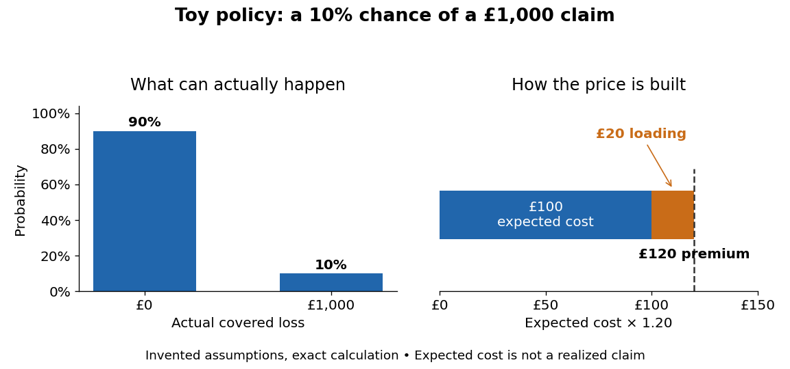
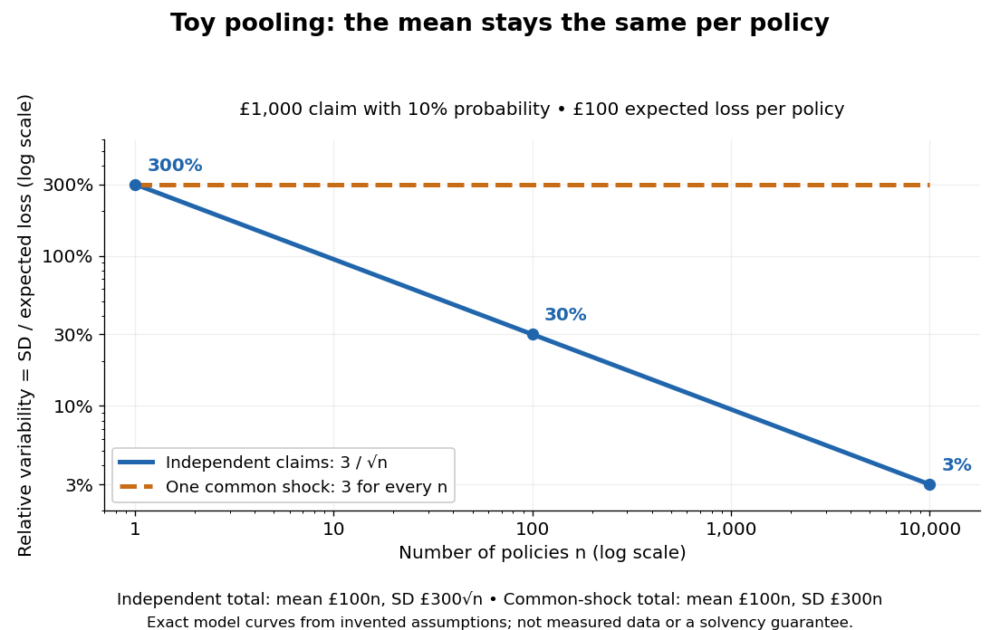

# Expected value premium principle

↑ **Parent:** [Actuarial statistics](actuarial-statistics-split.md)

The [expected value premium principle](expected-value-premium-principle.md) charges the [expected value](expected-value.md) of the covered loss plus a proportional margin. For a nonnegative [random variable](random-variable-split.md) $L$ with finite [expected value](expected-value.md), and a fixed dimensionless loading $\theta\ge0$, it sets

$$
\Pi(L)=(1+\theta)\mathbb E[L]
=\underbrace{\mathbb E[L]}_{\text{expected claim cost}}
+\underbrace{\theta\mathbb E[L]}_{\text{loading amount}}.
$$

Here $\theta=0$ gives the expected claim cost alone; $\theta>0$ gives a positive margin when $\mathbb E[L]>0$. The loading is a fraction of the [expected value](expected-value.md), not of the largest possible [claim size](claim-size.md). Specify the covered period and use a consistent monetary valuation date. The rule itself does not determine $\theta$. [Matthias Winkel, Actuarial Science II, §16.1, Definition 68 and Example 70](https://www.stats.ox.ac.uk/~winkel/bs4b11.pdf).

Consider an explicitly toy one-year policy: it pays £1,000 with [probability](probability.md) $p=0.1$, and zero otherwise. Write $L=1000B$, where $B$ has the [Bernoulli distribution](bernoulli-distribution.md) with parameter $p$. The [expected value](expected-value.md) is $1000(0.1)=£100$. A loading $\theta=0.2$ adds £20, making the premium £120. Neither the £100 [expected value](expected-value.md) nor the £120 premium is a possible realized claim: the actual payment is £0 or £1,000. The first diagram separates these quantities. All numerical examples and both diagrams here are exact consequences of invented assumptions, not measured insurance data.

**[Figure 1](#image-toy-bernoulli-policy-two-possible-losses-and-an-expected-cost-plus-loading). Toy Bernoulli policy: two possible losses and an expected cost plus loading**.

Why pay £120 for a loss whose [expected value](expected-value.md) is only £100? Conditional on the insurer meeting its obligation, the policyholder replaces an uncertain £1,000 bill with a known £120 payment. The insurer can combine many such policies, so a few claims are funded by premiums from the whole pool. Winkel develops this motivation and the importance of [independence](independent-random-variables.md) in §15.2 of [Actuarial Science II](https://www.stats.ox.ac.uk/~winkel/bs4b11.pdf).

To see the pooling mechanism precisely, suppose there are $n$ toy policies with mutually [independent](independent-random-variables.md) [Bernoulli random variables](bernoulli-distribution.md) $B_1,\ldots,B_n$, each of parameter $0.1$. Every [claim size](claim-size.md) is £1,000, with at most one claim per policy. The [aggregate claims model](aggregate-claims-model.md) is

$$
S_n=1000\sum_{i=1}^{n}B_i,
\qquad \sum_{i=1}^{n}B_i\sim\operatorname{Binomial}(n,0.1).
$$

Using [linearity of expectation](linearity-of-expectation.md) and addition of [variances](variance-split.md) for [independent](independent-random-variables.md) [random variables](random-variable-split.md), the [expected value](expected-value.md) and [standard deviation](standard-deviation.md) of this [binomial distribution](binomial-distribution.md) aggregate are

$$
\mathbb E[S_n]=100n,\qquad
\operatorname{Var}(S_n)=1000^2n(0.1)(0.9)=90000n,\qquad
\operatorname{SD}(S_n)=300\sqrt n.
$$

Thus 100 policies have expected aggregate claims £10,000 and aggregate [standard deviation](standard-deviation.md) £3,000; 10,000 policies have expected aggregate claims £1,000,000 and aggregate [standard deviation](standard-deviation.md) £30,000. Total uncertainty grows, but much more slowly than the [expected value](expected-value.md). Per policy, $S_n/n$ has [expected value](expected-value.md) £100 and [standard deviation](standard-deviation.md) $£300/\sqrt n$. Equivalently, the aggregate [coefficient of variation](coefficient-of-variation.md), its [standard deviation](standard-deviation.md) divided by its positive [expected value](expected-value.md), is

$$
\frac{\operatorname{SD}(S_n)}{\mathbb E[S_n]}
=\sqrt{\frac{1-p}{np}}=\frac{3}{\sqrt n}.
$$

It falls from $300\%$ for one policy to $30\%$ for 100 policies and $3\%$ for 10,000. This is the useful beauty of independent pooling: an erratic individual cost becomes a comparatively stable average cost. The [law of large numbers](law-of-large-numbers.md) describes the corresponding convergence of the average toward its [expected value](expected-value.md).

**[Figure 2](#image-toy-claim-pooling-relative-variability-falls-with-independence-but-survives-a-common-shock). Toy claim pooling: relative variability falls with independence but survives a common shock**.

At the same fixed loading $\theta=0.2$, total premium is $\Pi(S_n)=120n$, with expected surplus before other outgoings $120n-100n=20n$. The loading margin divided by the aggregate [standard deviation](standard-deviation.md) is $20n/(300\sqrt n)=\sqrt n/15$. This ratio rises with $n$ under our [independence](independent-random-variables.md) assumption; it is not a specified loss [probability](probability.md). For $n=100$, premiums total £12,000, but 13 claims cost £13,000. The one-year [probability](probability.md) that claims exceed collected premiums is exactly

$$
\Pr(S_{100}>12000)
=\sum_{k=13}^{100}\binom{100}{k}(0.1)^k(0.9)^{100-k}
\approx0.19818.
$$

A positive loading therefore leaves about a $19.8\%$ chance of a one-year claims deficit in this toy pool. A claims deficit need not mean insolvency if capital is available. This calculation assumes premiums are collected before claims and ignores expenses and investment income; it is not an [ultimate ruin probability](ultimate-ruin-probability.md).

The [expected value premium principle](expected-value-premium-principle.md) also has a revealing limitation. With a common fixed $\theta$, [linearity of expectation](linearity-of-expectation.md) gives $\Pi(L_1+L_2)=\Pi(L_1)+\Pi(L_2)$ even without [independence](independent-random-variables.md). Pooling therefore does not automatically reduce the premium per policy under this rule, and two losses with the same [expected value](expected-value.md) receive the same premium regardless of their [variance](variance-split.md) or large-loss [probabilities](probability.md). Any decision to change the loading after pooling requires information beyond the formula.

Dependence can remove the stability benefit. For arbitrary [square-integrable](square-integrable-function.md) losses, the aggregate [variance](variance-split.md) includes their [covariances](covariance.md):

$$
\operatorname{Var}\left(\sum_{i=1}^n L_i\right)
=\sum_{i=1}^n\operatorname{Var}(L_i)
+2\sum_{i<j}\operatorname{Cov}(L_i,L_j).
$$

In the extreme toy common-shock model, every policy has $L_i=1000B$ for the same [Bernoulli random variable](bernoulli-distribution.md) $B$. Each policy still has [expected value](expected-value.md) £100, so total premium is still $120n$, but $S_n=1000nB$ has [standard deviation](standard-deviation.md) $300n$ and [coefficient of variation](coefficient-of-variation.md) $3$ for every $n$. With [probability](probability.md) $0.1$, all policies claim together and losses exceed premiums by $880n$. The second diagram compares this model with [independent](independent-random-variables.md) pooling. Real shared events can invalidate [independence](independent-random-variables.md); Winkel uses flood claims as an example in [§15.2 of Actuarial Science II](https://www.stats.ox.ac.uk/~winkel/bs4b11.pdf). The common-shock curve is an illustrative limiting model, not a fit to flood data.

The earlier $n^{-1/2}$ relative-variability calculation needs finite [variance](variance-split.md) and the stated model of [independent and identically distributed random variables](independent-and-identically-distributed-random-variables.md). A finite [expected value](expected-value.md) alone suffices to define the premium but does not imply finite [variance](variance-split.md). The rule makes no promise of solvency: losses, available capital and the timing of payments must be modelled separately. In the [classical risk model](classical-risk-model.md), claim arrival rate $\lambda$ and mean [claim size](claim-size.md) $\mu$ give premium rate $c=(1+\theta)\lambda\mu$; [relative safety loading](relative-safety-loading.md) is then $\theta$. That model tracks capital through time and asks for [ultimate ruin probability](ultimate-ruin-probability.md), a different question from calculating an expected margin. [Rob Kaas's Modern Actuarial Risk Theory formula sheet, page 2, Ruin theory](https://www1feb-uva.nl/ke/act/people/kaas/Recap123456.pdf). Under [quota share reinsurance](quota-share-reinsurance.md), the reinsurer can apply the [expected value premium principle](expected-value-premium-principle.md) to its ceded fraction $(1-\alpha)S$ using its own loading, which need not equal the direct insurer's loading.

## ↑ Ancestors (5)

1. [Actuarial statistics](actuarial-statistics-split.md)
2. [Probability and statistics](probability-and-statistics-split.md)
3. [Area of mathematics](area-of-mathematics.md)
4. [Mathematics](mathematics-split.md)
5. [Codex Wiki](split.md)

## ← Incoming links (2)

- [Expected value premium principle](expected-value-premium-principle.md)
- [Solution](past-exam-of-the-mathematics-course-of-the-university-of-cambridge/2008/iii/paper-43/2/solution.md)
