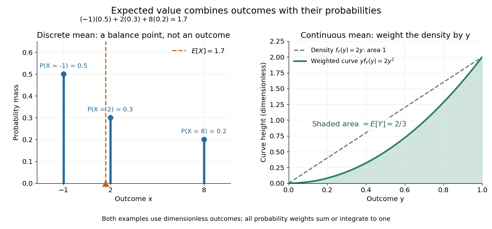

# Expected value

↑ **Parent:** [Probability theory](probability-theory.md)  
ⓦ [Wiki](https://en.wikipedia.org/wiki/Expected_value)

An [expected value](expected-value.md) is the [probability](probability-theory.md#probability)-weighted [arithmetic mean](arithmetic.md#arithmetic-mean) of a [real-valued random variable](random-variable.md). On a [probability space](probability-space.md) $(\Omega,\mathcal F,\mathbb P)$, its general definition is the [Lebesgue integral](measure-theory.md#lebesgue-integral)

$$
\mathbb E[X]=\int_\Omega X\,d\mathbb P=\int_{\mathbb R}x\,d\mu_X(x),
$$

where $\mu_X$ is the [probability distribution](probability-distribution.md) of $X$. For an [integrable random variable](#integrable-random-variable), this is a finite [real number](arithmetic.md#real-number). With a [probability mass function](probability-distribution.md#probability-mass-function) $p_X$, use $\sum_x xp_X(x)$; with a [probability density function](continuous-probability-distribution.md#probability-density-function) $f_X$, use $\int_{\mathbb R}xf_X(x)\,dx$. These are two ways of computing the same weighted average, rather than different definitions for different experiments.

For example, suppose $X$ takes the values $-1,2,8$ with [probabilities](probability-theory.md#probability) $1/2,3/10,1/5$. Then

$$
\boxed{\mathbb E[X]=(-1)\frac12+2\frac3{10}+8\frac15=\frac{17}{10}=1.7.}
$$

The most likely outcome is $-1$, and $1.7$ is not a possible outcome at all. The [expected value](expected-value.md) summarizes all outcomes and their weights; it need not predict the result of one trial. Geometrically, placing [masses](classical-mechanics.md#mass) equal to the [probability masses](probability-distribution.md#probability-mass) at the outcome positions gives a [center of mass](classical-mechanics.md#center-of-mass) at $1.7$, since $\sum_xp_X(x)(x-1.7)=0$. This balance-point interpretation also explains the connection to a [weighted arithmetic mean](arithmetic.md#weighted-arithmetic-mean). [Orloff and Bloom, expected value: probability weights and center of mass](https://ocw.mit.edu/courses/18-05-introduction-to-probability-and-statistics-spring-2022/mit18_05_s22_class04-prep-b.pdf).

For the dimensionless [random variable](random-variable.md) $Y$ with [probability density function](continuous-probability-distribution.md#probability-density-function) $f_Y(y)=2y$ on $[0,1]$, the [expected value](expected-value.md) is $\mathbb E[Y]=\int_0^1y(2y)\,dy=2/3$. Integrating the [probability density function](continuous-probability-distribution.md#probability-density-function) itself gives one; to compute the [expected value](expected-value.md), multiply by the outcome first. [Orloff and Bloom, expectation for continuous random variables](https://ocw.mit.edu/courses/18-05-introduction-to-probability-and-statistics-spring-2022/mit18_05_s22_class06-prep-a.pdf).

**[Figure 1](#image-expected-value-balances-probability-masses-or-integrates-outcomes-weighted-by-a-probability-density-function). Expected value balances probability masses, or integrates outcomes weighted by a probability density function**. The left panel's dashed line marks $1.7$, even though the only possible outcomes are $-1,2,8$. In the right panel, the shaded [area](differential-geometry.md#surface-area) under $y f_Y(y)=2y^2$ is $2/3$; the [area](differential-geometry.md#surface-area) under the dashed [probability density function](continuous-probability-distribution.md#probability-density-function) is one. Both examples use dimensionless outcomes.

Why is this useful? [Linearity of expectation](#linearity-of-expectation) lets us compute an average total by adding average contributions, even for [dependent random variables](random-variable.md#statistical-dependence). And for [independent and identically distributed](random-variable.md#independent-and-identically-distributed-random-variables) [integrable random variables](#integrable-random-variable), the [strong law of large numbers](convergence-of-random-variables.md#strong-law-of-large-numbers) says their [sample mean](variance.md#sample-mean) approaches their common [expected value](expected-value.md) [almost surely](convergence-of-random-variables.md#almost-sure-convergence). The theorem supplies the link to repeated observations; the weighted-average definition itself does not promise that any particular finite run will be close to the [expected value](expected-value.md).

There is a useful historical connection to valuing uncertain rewards. In his 1657 _De ratiociniis in ludo aleae_, [Christiaan Huygens](mathematics.md#christiaan-huygens) assigns the value $(a+b)/2$ to equally likely rewards $a,b$, and $(pa+qb)/(p+q)$ when they have $p,q$ equally likely chances. These are the finite weighted-average formulas for [expected value](expected-value.md). His opening discussion asks how to divide the stakes when a game stops before completion, connecting [probability](probability-theory.md#probability) to a concrete question about an unfinished contest. [Huygens, De ratiociniis in ludo aleae, 1657; reprint of the 1714 English translation, introduction and Propositions I–III](https://math.dartmouth.edu/~doyle/docs/huygens/huygens.pdf).

**Table of contents**

- [Law of the unconscious statistician](#law-of-the-unconscious-statistician)
- [Outer expectation](#outer-expectation)
- [Expectation of a product of independent random variables](#expectation-of-a-product-of-independent-random-variables)
- [Mean-zero function](#mean-zero-function)
- [Integrable random variable](#integrable-random-variable)
- [Moment](#moment)
  - [Raw moment](#raw-moment)
  - [Fourth moment](#fourth-moment)
  - [Moment determinacy](#moment-determinacy)
  - [Second moment](#second-moment)
  - [Absolute moment](#absolute-moment)
  - [Central moment](#central-moment)
    - [Skewness](#skewness)
- [Variance](variance.md)
  - [Population variance](variance.md#population-variance)
  - [Fano factor](variance.md#fano-factor)
  - [Coefficient of variation](variance.md#coefficient-of-variation)
  - [Variance as the minimum mean squared error of a constant](variance.md#variance-as-the-minimum-mean-squared-error-of-a-constant)
  - [Conditional variance](variance.md#conditional-variance)
    - [Average conditional variance decreases with more information](variance.md#average-conditional-variance-decreases-with-more-information)
  - [Variance additivity for independent random variables](variance.md#variance-additivity-for-independent-random-variables)
    - [L2 convergence of averages of independent variables with bounded second moments](variance.md#l2-convergence-of-averages-of-independent-variables-with-bounded-second-moments)
  - [Variance of a sum](variance.md#variance-of-a-sum)
  - [Dependent uniform sampling variance lower bound](variance.md#dependent-uniform-sampling-variance-lower-bound)
  - [Standard deviation](variance.md#standard-deviation)
  - [Covariance](variance.md#covariance)
    - [Law of total covariance](variance.md#law-of-total-covariance)
    - [Strict positive covariance with an increasing payoff](variance.md#strict-positive-covariance-with-an-increasing-payoff)
    - [Conditional covariance](variance.md#conditional-covariance)
    - [Sample correlation coefficient](variance.md#sample-correlation-coefficient)
      - [Sample correlation matrix](variance.md#sample-correlation-matrix)
    - [Complex covariance](variance.md#complex-covariance)
      - [Pseudo-covariance](variance.md#pseudo-covariance)
    - [Linearity of covariance](variance.md#linearity-of-covariance)
    - [Uncorrelated random variables](variance.md#uncorrelated-random-variables)
      - [Bernoulli independence from zero covariance](variance.md#bernoulli-independence-from-zero-covariance)
    - [Covariance matrix](variance.md#covariance-matrix)
      - [Covariance ellipse](variance.md#covariance-ellipse)
      - [Correlation matrix](variance.md#correlation-matrix)
      - [Equicorrelation covariance matrix](variance.md#equicorrelation-covariance-matrix)
      - [Mahalanobis distance](variance.md#mahalanobis-distance)
      - [Compound-symmetry covariance](variance.md#compound-symmetry-covariance)
      - [Rank-one covariance spike](variance.md#rank-one-covariance-spike)
      - [Sample mean and covariance](variance.md#sample-mean-and-covariance)
        - [Uncentered empirical second-moment matrix](variance.md#uncentered-empirical-second-moment-matrix)
        - [Sample mean](variance.md#sample-mean)
        - [Sample covariance matrix](variance.md#sample-covariance-matrix)
          - [Rank of a centered sample covariance matrix](variance.md#rank-of-a-centered-sample-covariance-matrix)
          - [Sample covariance](variance.md#sample-covariance)
          - [Effective rank of a covariance matrix](variance.md#effective-rank-of-a-covariance-matrix)
            - [Gaussian sample-covariance operator-norm bound](variance.md#gaussian-sample-covariance-operator-norm-bound)
      - [Precision matrix](variance.md#precision-matrix)
        - [Gaussian conditional variance from precision](variance.md#gaussian-conditional-variance-from-precision)
        - [Conditional regression coefficients from a Gaussian precision matrix](variance.md#conditional-regression-coefficients-from-a-gaussian-precision-matrix)
        - [Profile likelihood for a Gaussian precision matrix](variance.md#profile-likelihood-for-a-gaussian-precision-matrix)
        - [Gaussian sampling from a precision Cholesky factor](variance.md#gaussian-sampling-from-a-precision-cholesky-factor)
        - [CLIME precision-matrix estimator](variance.md#clime-precision-matrix-estimator)
        - [Graphical Lasso](variance.md#graphical-lasso)
          - [Graphical Lasso column regression](variance.md#graphical-lasso-column-regression)
          - [Graphical-Lasso Karush-Kuhn-Tucker conditions](variance.md#graphical-lasso-karush-kuhn-tucker-conditions)
      - [Pearson correlation coefficient](variance.md#pearson-correlation-coefficient)
        - [Conditional correlation](variance.md#conditional-correlation)
        - [Partial correlation](variance.md#partial-correlation)
        - [Perfect positive correlation](variance.md#perfect-positive-correlation)
          - [Terminal proportionality identifies bounded stock volatility](variance.md#terminal-proportionality-identifies-bounded-stock-volatility)
          - [Terminal correlation does not identify adapted stock volatility](variance.md#terminal-correlation-does-not-identify-adapted-stock-volatility)
        - [Serial correlation](variance.md#serial-correlation)
        - [Intraclass correlation coefficient](variance.md#intraclass-correlation-coefficient)
  - [Popoviciu's inequality on variances](variance.md#popoviciu-s-inequality-on-variances)
- [Indicator random variable](#indicator-random-variable)
- [Tail-sum formula](#tail-sum-formula)
  - [Integer-valued hypothesis in the tail-sum formula](#integer-valued-hypothesis-in-the-tail-sum-formula)
  - [Expected value of a capped nonnegative random variable](#expected-value-of-a-capped-nonnegative-random-variable)
- [Linearity of expectation](#linearity-of-expectation)
  - [Expectation of an absolutely summable random series](#expectation-of-an-absolutely-summable-random-series)
- [Variance of a sample mean](#variance-of-a-sample-mean)
- [Tail integral formula for moments](#tail-integral-formula-for-moments)
  - [Tail integral formula for expectation](#tail-integral-formula-for-expectation)
  - [Second moment bound from a clipped Gaussian tail](#second-moment-bound-from-a-clipped-gaussian-tail)

## Law of the unconscious statistician

↑ **Parent:** [Expected value](expected-value.md)  
ⓦ [Wiki](https://en.wikipedia.org/wiki/Law_of_the_unconscious_statistician)

The [law of the unconscious statistician](#law-of-the-unconscious-statistician) computes the [expected value](expected-value.md) of a [measurable function](measure-theory.md#measurable-function) of a [random variable](random-variable.md) directly from the original [probability distribution](probability-distribution.md). If $g(X)$ is an [integrable random variable](#integrable-random-variable), then

$$
\mathbb E[g(X)]=\int_{\mathbb R}g(x)\,d\mu_X(x).
$$

Use $\sum_xg(x)p_X(x)$ for a [probability mass function](probability-distribution.md#probability-mass-function), or $\int_{\mathbb R}g(x)f_X(x)\,dx$ for a [probability density function](continuous-probability-distribution.md#probability-density-function). There is no need to derive the [probability distribution](probability-distribution.md) of $g(X)$ first. The identity is the integration rule for a [pushforward measure](measure.md#pushforward-measure), and also holds with an infinite value when $g$ is nonnegative. [Tsitsiklis, Introduction to Probability, Lecture 5: the expected value rule](https://ocw.mit.edu/courses/res-6-012-introduction-to-probability-spring-2018/pages/part-i-the-fundamentals/).

For $X$ taking $-1,2,8$ with [probabilities](probability-theory.md#probability) $1/2,3/10,1/5$, choosing $g(x)=x^2$ gives $\mathbb E[X^2]=\tfrac12+4\tfrac3{10}+64\tfrac15=14.5$. Its [variance](variance.md) is therefore $14.5-1.7^2=11.61$. Squaring the [expected value](expected-value.md) would instead give $2.89$, because squaring does not commute with averaging.

## Outer expectation

↑ **Parent:** [Expected value](expected-value.md)

For a bounded possibly nonmeasurable real function $Z$ on a [probability space](probability-space.md), its outer expectation is the infimum of [expected values](expected-value.md) of measurable majorants. Its inner expectation is $\mathbb E_*Z=-\mathbb E^*(-Z)$. They agree with the usual [expected value](expected-value.md) for measurable $Z$. This permits function-space [convergence in distribution](convergence-of-random-variables.md#convergence-in-distribution) for an [empirical distribution process](probability-distribution.md#empirical-distribution-process) whose paths are not Borel-measurable in a nonseparable norm topology: both expectations of each bounded continuous test functional must approach its ordinary expectation under the tight measurable limiting law.

## Expectation of a product of independent random variables

↑ **Parent:** [Expected value](expected-value.md)

For independent integrable variables, $\mathbb E\prod_iX_i=\prod_i\mathbb E X_i$. [Tonelli theorem](measure-theory.md#tonelli-theorem) first gives $\mathbb E\prod_i|X_i|=\prod_i\mathbb E|X_i|<\infty$; then [Fubini's theorem](measure-theory.md#fubini-s-theorem) factors the signed joint integral.

## Mean-zero function

↑ **Parent:** [Expected value](expected-value.md)

A mean-zero function has [expectation](expected-value.md) zero with respect to the specified [probability measure](probability-space.md#probability-measure). On a [finite set](set.md#finite-set) with uniform measure this means $\sum_xf(x)=0$. A [balanced subset indicator](additive-combinatorics.md#balanced-indicator-function-of-a-finite-subset) is an example. In [Fourier analysis on a finite group](additive-combinatorics.md#fourier-analysis-on-a-finite-group), this is equivalent to vanishing of the component at the [trivial representation](representation-theory.md#trivial-representation).

## Integrable random variable

↑ **Parent:** [Expected value](expected-value.md)

A real or complex [random variable](random-variable.md) $X$ is integrable when $\mathbb E|X|<\infty$. This is [integrability](measure-theory.md#integrability) with respect to its [probability measure](probability-space.md#probability-measure), and ensures that its [expected value](expected-value.md) is finite. A bounded [random variable](random-variable.md) is always an [integrable random variable](#integrable-random-variable); so is the example taking $-1,2,8$, for which $\mathbb E|X|=2.7$.

For a real [random variable](random-variable.md), put $X_+=\max(X,0)$ and $X_-=\max(-X,0)$, its [positive part](function.md#positive-part-of-a-real-valued-function) and [negative part](function.md#negative-part-of-a-real-valued-function). Each has a nonnegative [Lebesgue integral](measure-theory.md#lebesgue-integral), possibly infinite. The expression $\mathbb E[X]=\mathbb E[X_+]-\mathbb E[X_-]$ is defined when at least one of these two [expected values](expected-value.md) is finite; if both are infinite, the [expected value](expected-value.md) is undefined. [Integrability](measure-theory.md#integrability) makes both finite. A nonnegative [random variable](random-variable.md) can have [expected value](expected-value.md) $+\infty$, even though it is not an [integrable random variable](#integrable-random-variable).

The standard [Cauchy distribution](probability-distribution.md#cauchy-distribution) is a useful warning. With its [probability density function](continuous-probability-distribution.md#probability-density-function) $f(x)=1/[\pi(1+x^2)]$, the positive contribution is $\int_0^Rxf(x)\,dx=\log(1+R^2)/(2\pi)$, which tends to infinity; the negative contribution has the same magnitude. Integrating symmetrically over $[-R,R]$ gives zero for each $R$, but this cancellation does not define an [expected value](expected-value.md). The [Cauchy sample mean has an unchanged distribution](probability-distribution.md#cauchy-sample-mean-has-an-unchanged-distribution), showing why the [integrability](measure-theory.md#integrability) hypothesis in the [strong law of large numbers](convergence-of-random-variables.md#strong-law-of-large-numbers) matters.

For an [integrable random variable](#integrable-random-variable), [conditional expectation](measure-theory.md#conditional-expectation) preserves [integrability](measure-theory.md#integrability), and [linearity of expectation](#linearity-of-expectation) can safely combine finite averages without forming $\infty-\infty$.

## Moment

↑ **Parent:** [Expected value](expected-value.md)  
ⓦ [Wiki](https://en.wikipedia.org/wiki/Moment_(mathematics))

The $n$th raw moment of a random variable $X$ is $\mathbb E[X^n]$ when this expectation exists.

More generally, a [moment](#moment) is an integral weighted by a power of a coordinate against a measure or density; raw, central, and standardized moments are distinguished by the coordinate and normalization used.

### Raw moment

↑ **Parent:** [Moment](#moment)

The $r$th raw moment of a [random variable](random-variable.md) $X$ is $\mathbb E[X^r]$, when it exists. A [central moment](#central-moment) instead uses $\mathbb E[(X-\mathbb E[X])^r]$.

### Fourth moment

↑ **Parent:** [Moment](#moment)

The [fourth moment](#fourth-moment) is $\mathbb E[X^4]$. Its finiteness is equivalent to square integrability of $X^2$. For centered variables, dividing it by the squared [variance](variance.md) gives [kurtosis](probability-distribution.md#kurtosis).

### Moment determinacy

↑ **Parent:** [Moment](#moment)

A [probability distribution](probability-distribution.md) is moment-determinate if its moments uniquely specify it among [probability distributions](probability-distribution.md). A [moment-generating function](probability-distribution.md#moment-generating-function) finite in a neighbourhood of zero is a sufficient condition. The [standard normal distribution](probability-distribution.md#standard-normal-distribution) is moment-determinate.

### Second moment

↑ **Parent:** [Moment](#moment)

The second [moment](#moment) of a real [random variable](random-variable.md) is $\mathbb E[X^2]$. Its [variance](variance.md) is $\mathbb E[X^2]-(\mathbb EX)^2$ when these quantities are finite.

### Absolute moment

↑ **Parent:** [Moment](#moment)

The absolute moment of order $p>0$ of a [random variable](random-variable.md) $X$ is $\mathbb E[|X|^p]$ when this expectation is finite.

### Central moment

↑ **Parent:** [Moment](#moment)  
ⓦ [Wiki](https://en.wikipedia.org/wiki/Central_moment)

The $n$th central moment is $\mathbb E[(X-\mathbb EX)^n]$. The first central moment is zero and the second is the [variance](variance.md).

#### Skewness

↑ **Parent:** [Central moment](#central-moment)  
ⓦ [Wiki](https://en.wikipedia.org/wiki/Skewness)

Skewness is the standardized third central [moment](#moment) of a [probability distribution](probability-distribution.md). A symmetric distribution with finite third [moment](#moment) has zero skewness. Cosmology also uses the reduced skewness $S_3=\langle\delta^3\rangle/\sigma^4$, which differs from the standardized skewness by a factor of $\sigma$.

## Variance

↑ **Parent:** [Expected value](expected-value.md)

[This section is present in another page, follow this link to view it.](variance.md)

## Indicator random variable

↑ **Parent:** [Expected value](expected-value.md)

An [indicator random variable](#indicator-random-variable) is the [indicator function](measure-theory.md#indicator-function) of an [event](probability-space.md#event) $A$ in a [probability space](probability-space.md): $\mathbf1_A$ is one when $A$ occurs and zero otherwise. It has a [Bernoulli distribution](discrete-probability-distribution.md#bernoulli-distribution) with parameter $p=\mathbb P(A)$, so $\mathbb E[\mathbf1_A]=p$ and $\operatorname{Var}(\mathbf1_A)=p(1-p)$. Even an [event](probability-space.md#event) described without numbers becomes a numerical [random variable](random-variable.md) in this way.

For a finite collection of [events](probability-space.md#event), their [indicator random variables](#indicator-random-variable) add up to the number that occur. [Linearity of expectation](#linearity-of-expectation) therefore turns an average count into a sum of [probabilities](probability-theory.md#probability), without requiring [independence](random-variable.md#independent-random-variables). The [fixed point count of a uniform random permutation](combinatorics.md#fixed-point-count-of-a-uniform-random-permutation) provides an example where the indicators are [dependent random variables](random-variable.md#statistical-dependence).

## Tail-sum formula

↑ **Parent:** [Expected value](expected-value.md)

The [tail-sum formula](#tail-sum-formula) expresses an [expected value](expected-value.md) as the [area](differential-geometry.md#surface-area) under a [survival function](survival-analysis.md#survival-function). For every nonnegative [random variable](random-variable.md) $Y$,

$$
\boxed{\mathbb E[Y]=\int_0^\infty\mathbb P(Y>t)\,dt.}
$$

This [Lebesgue integral](measure-theory.md#lebesgue-integral) and the [expected value](expected-value.md) may both be $+\infty$; a [probability density function](continuous-probability-distribution.md#probability-density-function) is unnecessary. For a [random variable](random-variable.md) $N$ taking values in the [nonnegative integers](arithmetic.md#natural-number), the corresponding [sum](arithmetic.md#sum) is

$$
\boxed{\mathbb E[N]=\sum_{k=1}^\infty\mathbb P(N\geq k)=\sum_{k=0}^\infty\mathbb P(N>k).}
$$

The [events](probability-space.md#event) $\{N>k\}$ and $\{N\geq k+1\}$ coincide because $N$ takes [integer](integer.md) values. Thus the strict [sum](arithmetic.md#sum) starts at zero, while the inclusive [sum](arithmetic.md#sum) starts at one.[Expected Value, §2 Additional Properties, Right Distribution Function: nonnegative tail integral and integer-valued tail sums](mathematics-bibliography.md#random-probability-mathematical-statistics-stochastic-processes-by-kyle-siegrist)

For an original example, let the [probability mass function](probability-distribution.md#probability-mass-function) of $N$ be

$$
\mathbb P(N=0)=\frac15,\qquad\mathbb P(N=1)=\frac3{10},\qquad\mathbb P(N=3)=\frac12.
$$

Its [expected value](expected-value.md) computed directly is $0(1/5)+1(3/10)+3(1/2)=9/5=1.8$. The strict [tail probabilities](probability-theory.md#tail-probability) at thresholds $0,1,2,3$ are $4/5,1/2,1/2,0$: their [sum](arithmetic.md#sum) is again $1.8$. There is no [probability mass](probability-distribution.md#probability-mass) at two, yet the [event](probability-space.md#event) $\{N>2\}$ still has [probability](probability-theory.md#probability) $1/2$. The [survival function](survival-analysis.md#survival-function) has heights $4/5,1/2,1/2$ on the successive [intervals](real-analysis.md#interval-mathematics) $[0,1),[1,2),[2,3)$; each [interval](real-analysis.md#interval-mathematics) has length one, so its [integral](integral.md) is the same [sum](arithmetic.md#sum).

**[Figure 2](#image-the-same-expected-value-from-probability-masses-and-survival-columns). The same expected value from probability masses and survival columns**. The exact constructed [probability mass function](probability-distribution.md#probability-mass-function) assigns $1/5,3/10,1/2$ to $0,1,3$. The $3/10$ contribution appears in one survival column, while the $1/2$ contribution appears in three. Filled endpoints give the strict [survival function](survival-analysis.md#survival-function) at its jumps; open endpoints show the preceding height. The shaded [area](differential-geometry.md#surface-area) is $3/10+3(1/2)=1.8$.

The indexing matters numerically. Starting the inclusive [sum](arithmetic.md#sum) at zero adds $\mathbb P(N\geq0)=1$, giving $2.8$ for this example. Starting the strict [sum](arithmetic.md#sum) at one omits $\mathbb P(N>0)=4/5$, giving $1$. For a general nonnegative [random variable](random-variable.md), replacing $>$ with $\geq$ inside the [integral](integral.md) is harmless: the difference is $\mathbb P(Y=t)$, nonzero at only a [countable set](cardinal-number.md#countable-set) of thresholds. For each positive [integer](integer.md) $m$, at most $m$ thresholds can have [probability mass](probability-distribution.md#probability-mass) at least $1/m$; their [countable union](set.md#countable-union) contains all thresholds with positive [probability mass](probability-distribution.md#probability-mass) and has [Lebesgue measure](measure-theory.md#lebesgue-measure) zero. This reasoning concerns an [integral](integral.md), not equality of the two [survival function](survival-analysis.md#survival-function) conventions at every [point](geometry-and-topology.md#point-geometry).

For a continuous original example, take the [uniform distribution](continuous-probability-distribution.md#continuous-uniform-distribution) on the [interval](real-analysis.md#interval-mathematics) $[0,4]$. Its [survival function](survival-analysis.md#survival-function) is $S(t)=1-t/4$ for $0\leq t\leq4$ and zero for $t>4$. The [area](differential-geometry.md#surface-area) is a [triangle](euclidean-geometry.md#triangle) of base four and height one:

$$
\mathbb E[Y]=\int_0^4\left(1-\frac t4\right)dt=2.
$$

Directly integrating against the [probability density function](continuous-probability-distribution.md#probability-density-function) gives the same [expected value](expected-value.md), $\int_0^4 y(1/4)\,dy=2$. The [integral](integral.md) of the [probability density function](continuous-probability-distribution.md#probability-density-function) alone is one; it is the [survival function](survival-analysis.md#survival-function) whose [area](differential-geometry.md#surface-area) is the [expected value](expected-value.md).

**[Figure 3](#image-a-uniform-density-has-total-probability-one-and-survival-area-two). A uniform density has total probability one and survival area two**. Exact curves for the [uniform distribution](continuous-probability-distribution.md#continuous-uniform-distribution) on $[0,4]$. The [probability density function](continuous-probability-distribution.md#probability-density-function) has [integral](integral.md) one, while the [survival function](survival-analysis.md#survival-function) has [integral](integral.md) two. Splitting the survival [area](differential-geometry.md#surface-area) at $t=2$ gives $1.5$ before the cap and $0.5$ beyond it, the [expected values](expected-value.md) of $\min(Y,2)$ and the [positive part](function.md#positive-part-of-a-real-valued-function) $(Y-2)_+$, respectively.

The proof counts layers of each outcome. For a realized value $y\geq0$, the [indicator function](measure-theory.md#indicator-function) $\mathbf1_{\{y>t\}}$ equals one over an [interval](real-analysis.md#interval-mathematics) of length $y$, so

$$
Y=\int_0^\infty\mathbf1_{\{Y>t\}}\,dt,\qquad
\mathbb E[Y]=\int_0^\infty\mathbb E[\mathbf1_{\{Y>t\}}]dt=\int_0^\infty\mathbb P(Y>t)dt.
$$

[Tonelli theorem](measure-theory.md#tonelli-theorem) permits the interchange because the [indicator function](measure-theory.md#indicator-function) is nonnegative; no finite [expected value](expected-value.md) is assumed. Similarly, an outcome $N=n$ contributes one [indicator random variable](#indicator-random-variable) for each of the $n$ [events](probability-space.md#event) $\{N\geq k\}$ that occur:

$$
N=\sum_{k=1}^\infty\mathbf1_{\{N\geq k\}},\qquad
\mathbb E[N]=\sum_{k=1}^\infty\mathbb E[\mathbf1_{\{N\geq k\}}]=\sum_{k=1}^\infty\mathbb P(N\geq k).
$$

Again [Tonelli theorem](measure-theory.md#tonelli-theorem) applies to the nonnegative [sum](arithmetic.md#sum), or equivalently the [monotone convergence theorem](measure-theory.md#monotone-convergence-theorem) applies to its [partial sums](sequence-and-series.md#partial-sum). This exchanges counting layers within each outcome with averaging across outcomes. The existing [integer-valued hypothesis in the tail-sum formula](#integer-valued-hypothesis-in-the-tail-sum-formula) explains what changes when the values are not [integers](integer.md); the [tail integral formula for moments](#tail-integral-formula-for-moments) weights the layers to obtain higher [moments](#moment).

For an [integrable random variable](#integrable-random-variable) $X$ that can have either sign, apply the nonnegative formula separately to its [positive part](function.md#positive-part-of-a-real-valued-function) $X_+=\max(X,0)$ and [negative part](function.md#negative-part-of-a-real-valued-function) $X_-=\max(-X,0)$:

$$
\mathbb E[X]=\int_0^\infty\mathbb P(X>t)dt-\int_0^\infty\mathbb P(X<-t)dt.
$$

[Integrability](measure-theory.md#integrability) makes both [integrals](integral.md) finite. More generally the difference defines an extended [expected value](expected-value.md) when at least one is finite; if both are infinite, subtraction does not define an [expected value](expected-value.md).[Expected Value, §2 Additional Properties, A General Definition: positive and negative parts and the condition on their expectations](mathematics-bibliography.md#random-probability-mathematical-statistics-stochastic-processes-by-kyle-siegrist)

[Tail probabilities](probability-theory.md#tail-probability) are often easier to measure or bound than a whole [probability density function](continuous-probability-distribution.md#probability-density-function). For a device's [survival time](survival-analysis.md#survival-time), the [survival function](survival-analysis.md#survival-function) records the [probability](probability-theory.md#probability) of still operating at each threshold; its [integral](integral.md) gives the mean operating time. A finite observation window naturally gives the [expected value of a capped nonnegative random variable](#expected-value-of-a-capped-nonnegative-random-variable). For a mathematical bound, $\mathbb P(Y>t)\leq e^{-t/2}$ for all $t\geq0$ implies $\mathbb E[Y]\leq\int_0^\infty e^{-t/2}dt=2$. The [tail-sum formula](#tail-sum-formula) turns control of a whole family of [events](probability-space.md#event) into control of an average.

### Integer-valued hypothesis in the tail-sum formula

↑ **Parent:** [Tail-sum formula](#tail-sum-formula)

For a nonnegative integer-valued variable, $X=\sum_{m\ge0}\mathbf1_{\{X>m\}}$ and the [tail-sum formula](#tail-sum-formula) gives $\mathbb E X=\sum_{m\ge0}\mathbb P(X>m)$. For arbitrary positive real values, that integer-indexed sum equals $\mathbb E\lceil X\rceil$ instead. Two independent constants equal to $3/2$ demonstrate that the product of such tail sums need not equal the tail sum of their product: the two sides are four and three.

### Expected value of a capped nonnegative random variable

↑ **Parent:** [Tail-sum formula](#tail-sum-formula)

For a nonnegative [random variable](random-variable.md) $Y$ and a fixed cap $a\geq0$, the [tail-sum formula](#tail-sum-formula) gives

$$
\mathbb E[\min(Y,a)]=\int_0^a\mathbb P(Y>t)dt,\qquad
\mathbb E[(Y-a)_+]=\int_a^\infty\mathbb P(Y>t)dt.
$$

Below the cap, the [events](probability-space.md#event) $\{\min(Y,a)>t\}$ and $\{Y>t\}$ coincide; at and above the cap, the former [event](probability-space.md#event) is empty. For the second identity, the [positive part](function.md#positive-part-of-a-real-valued-function) $(Y-a)_+$ exceeds $t\geq0$ precisely when $Y>a+t$. Thus the two [integrals](integral.md) divide the [area](differential-geometry.md#surface-area) under the [survival function](survival-analysis.md#survival-function), just as $Y=\min(Y,a)+(Y-a)_+$ divides each outcome. The capped [expected value](expected-value.md) is always finite, while the excess [expected value](expected-value.md) may be infinite.

For the [uniform distribution](continuous-probability-distribution.md#continuous-uniform-distribution) on the [interval](real-analysis.md#interval-mathematics) $[0,4]$ and cap $a=2$, the capped [expected value](expected-value.md) is $\int_0^2(1-t/4)dt=3/2$ and the excess [expected value](expected-value.md) is $\int_2^4(1-t/4)dt=1/2$. Directly averaging the capped values also gives $\int_0^2y(1/4)dy+2\mathbb P(Y>2)=1/2+1=3/2$. Capping therefore measures a different average from the uncapped [expected value](expected-value.md) two, even when both are finite.

## Linearity of expectation

↑ **Parent:** [Expected value](expected-value.md)

For [integrable random variables](#integrable-random-variable) $X_1,\ldots,X_n$ on the same [probability space](probability-space.md) and fixed [real numbers](arithmetic.md#real-number) $a_1,\ldots,a_n$, [linearity of expectation](#linearity-of-expectation) states

$$
\mathbb E\!\left[\sum_{i=1}^n a_iX_i\right]=\sum_{i=1}^n a_i\mathbb E[X_i].
$$

The [random variables](random-variable.md) can be [dependent random variables](random-variable.md#statistical-dependence). The formula follows by the [linearity of integration](integral.md#linearity-of-integration); a finite [linear combination](vector-space.md#linear-combination) of [integrable random variables](#integrable-random-variable) remains [integrable](measure-theory.md#integrability). For example, if $X$ takes $-1,2,8$ with [probabilities](probability-theory.md#probability) $1/2,3/10,1/5$, then $X$ and $2X$ are [dependent random variables](random-variable.md#statistical-dependence), yet $\mathbb E[X+2X]=3\mathbb E[X]=5.1$.

An especially useful application counts how many [events](probability-space.md#event) occur. Put $I_i=\mathbf1_{A_i}$, an [indicator random variable](#indicator-random-variable), and $N=\sum_iI_i$. Since $\mathbb E[I_i]=\mathbb P(A_i)$, we get $\mathbb E[N]=\sum_i\mathbb P(A_i)$. There is no need to compute the whole [probability distribution](probability-distribution.md) of $N$, or to assume [independence](random-variable.md#independent-random-variables). For a [uniform random permutation](combinatorics.md#uniform-random-permutation) of $n\geq1$ objects, each object stays fixed with [probability](probability-theory.md#probability) $1/n$, so the [fixed point count of a uniform random permutation](combinatorics.md#fixed-point-count-of-a-uniform-random-permutation) has [expected value](expected-value.md) one for every $n$. [Lehman, Leighton and Meyer, Mathematics for Computer Science, §18.5: linearity and sums of indicators](https://ocw.mit.edu/courses/6-042j-mathematics-for-computer-science-spring-2015/mit6_042js15_textbook.pdf).

[Linearity of expectation](#linearity-of-expectation) concerns [addition](arithmetic.md#addition) and multiplication by fixed [scalars](vector-space.md#scalar). Products instead satisfy $\mathbb E[XY]=\mathbb E[X]\mathbb E[Y]$ under the hypotheses of [expectation of a product of independent random variables](#expectation-of-a-product-of-independent-random-variables). For the example above, $\mathbb E[X^2]=14.5$, whereas $(\mathbb E[X])^2=2.89$. Applying a nonlinear [function](function.md) before averaging can therefore change the answer substantially; use the [law of the unconscious statistician](#law-of-the-unconscious-statistician) to compute that average.

### Expectation of an absolutely summable random series

↑ **Parent:** [Linearity of expectation](#linearity-of-expectation)

If [random variables](random-variable.md) $X_i$ satisfy $\sum_iE|X_i|<\infty$, then $\sum_iX_i$ converges absolutely [almost surely](convergence-of-random-variables.md#almost-sure-convergence), is integrable, and its [expected value](expected-value.md) equals $\sum_iE[X_i]$. Indeed, the [monotone convergence theorem](measure-theory.md#monotone-convergence-theorem) gives $E[\sum_i|X_i|]=\sum_iE|X_i|<\infty$, so that nonnegative sum is finite [almost surely](convergence-of-random-variables.md#almost-sure-convergence). It dominates every finite partial sum in absolute value; the [dominated convergence theorem](measure-theory.md#dominated-convergence-theorem) then justifies passing the [limit](calculus.md#limit-of-a-function) through the [expected value](expected-value.md). No [independence](random-variable.md#independent-random-variables) is required.

For example, if $|X_i|\le Mq^i$ for a fixed $M$ and $0<q<1$, the [geometric series](sequence-and-series.md#geometric-series) bound proves the hypothesis directly. This is useful when repeated observations are multiplied by geometrically shrinking distances or weights.

## Variance of a sample mean

↑ **Parent:** [Expected value](expected-value.md)

Let $X_1,\ldots,X_n$ be an [IID sample](random-variable.md#independent-and-identically-distributed-random-variables) of real-valued [random variables](random-variable.md) with finite [expected value](expected-value.md) $\mu$ and finite [variance](variance.md) $\sigma^2$, where $n\geq1$. Its [sample mean](variance.md#sample-mean) $\overline X=n^{-1}\sum_iX_i$ satisfies

$$
\boxed{\mathbb E[\overline X]=\mu,\qquad\operatorname{Var}(\overline X)=\frac{\sigma^2}{n}.}
$$

[Linearity of expectation](#linearity-of-expectation) gives the first identity. The [variance of a sum](variance.md#variance-of-a-sum) and vanishing cross [covariances](variance.md#covariance) give $\operatorname{Var}(\sum_iX_i)=n\sigma^2$; scaling by $1/n$ scales the [variance](variance.md) by $1/n^2$. [Pairwise independent random variables](random-variable.md#pairwise-independent-random-variables) with the same [expected value](expected-value.md) and [variance](variance.md) suffice for these identities, even without full [independence](random-variable.md#independent-random-variables). Grinstead and Snell state the corresponding finite-variance independent-trials result.[§6.2, Theorems 6.7–6.9, printed pp. 259–260: scaling variance and sums of independent trials](mathematics-bibliography.md#introduction-to-probability-by-charles-m-grinstead-and-j-laurie-snell)

The [standard deviation](variance.md#standard-deviation) of the [sample mean](variance.md#sample-mean) is $\sigma/\sqrt n$. Four times as many observations halve this scale; they do not divide it by four. In the fair [Bernoulli distribution](discrete-probability-distribution.md#bernoulli-distribution) example, $\sigma=1/2$, so sample sizes $4$ and $64$ give standard deviations $1/4$ and $1/16$, respectively. The [common-coin averaging](random-variable.md#common-coin-averaging) example shows why merely repeating observations with a common marginal law does not justify this calculation.

[Chebyshev's inequality](probability-inequality.md#chebyshev-s-inequality) turns the [variance](variance.md) identity into a probability bound: for $\varepsilon>0$,

$$
\mathbb P(|\overline X-\mu|\geq\varepsilon)\leq\frac{\sigma^2}{n\varepsilon^2}.
$$

This proves [convergence in probability](convergence-of-random-variables.md#convergence-in-probability) of the [sample mean](variance.md#sample-mean) to $\mu$ in this finite-variance setting, a form of the [weak law of large numbers](convergence-of-random-variables.md#weak-law-of-large-numbers). It is an upper bound, so values above one convey no improvement over the universal [probability](probability-theory.md#probability) bound one. [Cauchy sample mean stability](probability-distribution.md#cauchy-sample-mean-has-an-unchanged-distribution) lies outside these hypotheses.

## Tail integral formula for moments

↑ **Parent:** [Expected value](expected-value.md)

For $q>0$ and a [random variable](random-variable.md) $X$ with finite absolute $q$th moment, [Tonelli theorem](measure-theory.md#tonelli-theorem) gives

$$
\mathbb E|X|^q=q\int_0^\infty t^{q-1}\mathbb P(|X|\geq t)\,dt.
$$

### Tail integral formula for expectation

↑ **Parent:** [Tail integral formula for moments](#tail-integral-formula-for-moments)

For a nonnegative [random variable](random-variable.md), $Y=\int_0^\infty\mathbf1_{\{Y>t\}}dt$ pointwise, including when $Y=\infty$. [Tonelli's theorem](measure-theory.md#tonelli-theorem) permits taking [expectation](expected-value.md) under the integral and proves the formula in the extended nonnegative reals. This relates finiteness of a [Brownian exit time](brownian-motion.md#brownian-exit-time) [expectation](expected-value.md) to integrability of its survival probability.

### Second moment bound from a clipped Gaussian tail

↑ **Parent:** [Tail integral formula for moments](#tail-integral-formula-for-moments)

If $\mathbb P(|Z|\geq t)\leq A e^{-bt^2}$ for $A\geq1$ and $b>0$, then $\mathbb E Z^2\leq(1+\log A)/b$. Indeed the [tail integral formula for moments](#tail-integral-formula-for-moments) gives $\mathbb E Z^2\leq\int_0^\infty\min(1,Ae^{-bu})\,du$; split at $u=(\log A)/b$. Clipping at one improves the constant compared with integrating the exponential bound alone.

## ↑ Ancestors (5)

1. [Probability theory](probability-theory.md)
2. [Probability and statistics](probability-and-statistics.md)
3. [Area of mathematics](mathematics.md#area-of-mathematics)
4. [Mathematics](mathematics.md)
5. [Codex Wiki](README.md)

## ← Incoming links (563)

- [Absolute-error loss](statistical-inference.md#absolute-error-loss)
- [Adjustment coefficient for shape-two Erlang claims](actuarial-statistics.md#adjustment-coefficient-for-shape-two-erlang-claims)
- [Adjustment coefficient with independent claim expenses](actuarial-statistics.md#adjustment-coefficient-with-independent-claim-expenses)
- [Amortized analysis](theoretical-computer-science.md#amortized-analysis)
- [Angular momentum of a radial function times a linear polynomial](quantum-mechanics.md#angular-momentum-of-a-radial-function-times-a-linear-polynomial)
- [Barely-supercritical largest-component expectation](random-graph.md#barely-supercritical-largest-component-expectation)
- [Bayesian model evidence](bayesian-statistics.md#bayesian-model-evidence)
- [Bernoulli distribution](discrete-probability-distribution.md#bernoulli-distribution)
- [Bernoulli process](stochastic-process.md#bernoulli-process)
- [Bernstein polynomial](functional-analysis.md#bernstein-polynomial)
- [Bias correction after an inverse transformation](statistical-modelling.md#bias-correction-after-an-inverse-transformation)
- [Biased random walk](random-walk.md#biased-random-walk)
- [Birthday probability for hash outputs](computer-science.md#birthday-probability-for-hash-outputs)
- [Boltzmann distribution](thermodynamics.md#boltzmann-distribution)
- [Boltzmann distribution in a four-state system](thermodynamics.md#boltzmann-distribution-in-a-four-state-system)
- [Boltzmann distribution ratios and energy reference](thermodynamics.md#boltzmann-distribution-ratios-and-energy-reference)
- [Boltzmann distribution temperature limits in a finite system](thermodynamics.md#boltzmann-distribution-temperature-limits-in-a-finite-system)
- [Boole's inequality](probability-inequality.md#boole-s-inequality)
- [Branching process conditioned on extinction](galton-watson-process.md#branching-process-conditioned-on-extinction)
- [Bühlmann credibility premium](actuarial-statistics.md#buhlmann-credibility-premium)
- [Calibrated two-wire charge centroid](particle-detection.md#calibrated-two-wire-charge-centroid)
- [Cameron-Martin theorem for a Gaussian measure](gaussian-process.md#cameron-martin-theorem-for-a-gaussian-measure)
- [Cantelli inequality](probability-inequality.md#cantelli-inequality)
- [Capped geometric waiting time](discrete-probability-distribution.md#capped-geometric-waiting-time)
- [Capture-recapture model](statistical-modelling.md#capture-recapture-model)
- [Caro-Wei bound](graph-theory.md#caro-wei-bound)
- [Categorical distribution](discrete-probability-distribution.md#categorical-distribution)
- [Centered truncation of a Wigner matrix](probability-theory.md#centered-truncation-of-a-wigner-matrix)
- [Central limit theorem](convergence-of-random-variables.md#central-limit-theorem)
- [Characteristic function](characteristic-function.md)
- [Characteristic-function derivatives from finite absolute moments](characteristic-function.md#characteristic-function-derivatives-from-finite-absolute-moments)
- [Characteristic functions of symmetric sign sums](characteristic-function.md#characteristic-functions-of-symmetric-sign-sums)
- [Chebyshev's inequality](probability-inequality.md#chebyshev-s-inequality)
- [Claim count distribution](actuarial-statistics.md#claim-count-distribution)
- [Common-coin averaging](random-variable.md#common-coin-averaging)
- [Complex visibility](astrophysics.md#complex-visibility)
- [Concentration inequality](probability-inequality.md#concentration-inequality)
- [Conditional expectation choice invariant](algorithm.md#conditional-expectation-choice-invariant)
- [Conditional expectation preserving a distribution](measure-theory.md#conditional-expectation-preserving-a-distribution)
- [Conditional expectations cut example](algorithm.md#conditional-expectations-cut-example)
- [Conditional expectations for maximum cut](algorithm.md#conditional-expectations-for-maximum-cut)
- [Conditional variance](variance.md#conditional-variance)
- [Constant intensity does not imply independence](probability-theory.md#constant-intensity-does-not-imply-independence)
- [Constant nonzero drift is impossible on a finite Markov chain](markov-chain.md#constant-nonzero-drift-is-impossible-on-a-finite-markov-chain)
- [Continuity of a characteristic function](characteristic-function.md#continuity-of-a-characteristic-function)
- [Control variates](monte-carlo-method.md#control-variates)
- [Convergence in L1](convergence-of-random-variables.md#convergence-in-l1)
- [Convergence of random variables](convergence-of-random-variables.md)
- [Convolution](fourier-analysis.md#convolution)
- [Convolution of a Cauchy distribution and a uniform distribution](probability-distribution.md#convolution-of-a-cauchy-distribution-and-a-uniform-distribution)
- [Cost of trials until the first success](probability-theory.md#cost-of-trials-until-the-first-success)
- [Covariance](variance.md#covariance)
- [Covariance induced by a shared latent variable](random-variable.md#covariance-induced-by-a-shared-latent-variable)
- [Credibility estimate](actuarial-statistics.md#credibility-estimate)
- [Credibility factor](actuarial-statistics.md#credibility-factor)
- [Cumulant](probability-distribution.md#cumulant)
- [Curie–Weiss model](spin-model.md#curie-weiss-model)
- [Decision-tree query cost](theoretical-computer-science.md#decision-tree-query-cost)
- [Deterministic claims maximize the adjustment coefficient at fixed mean and loading](actuarial-statistics.md#deterministic-claims-maximize-the-adjustment-coefficient-at-fixed-mean-and-loading)
- [Differential entropy of a Gaussian law](information-entropy.md#differential-entropy-of-a-gaussian-law)
- [Diffusion occupation time](stochastic-calculus.md#diffusion-occupation-time)
- [Discrete Gaussian white noise](time-series.md#discrete-gaussian-white-noise)
- [Discrete probability distribution](discrete-probability-distribution.md)
- [Discrete random variable](random-variable.md#discrete-random-variable)
- [Discrete-time Markov chain](markov-chain.md#discrete-time-markov-chain)
- [Discrete uniform distribution](discrete-probability-distribution.md#discrete-uniform-distribution)
- [Discrete uniform moments on an integer interval](discrete-probability-distribution.md#discrete-uniform-moments-on-an-integer-interval)
- [Doppler cooling](atomic-physics.md#doppler-cooling)
- [Dubins upcrossing inequality](martingale.md#dubins-upcrossing-inequality)
- [Effective bandwidth](queueing-theory.md#effective-bandwidth)
- [Efron–Stein inequality](probability-inequality.md#efron-stein-inequality)
- [Empirical distribution function](probability-distribution.md#empirical-distribution-function)
- [Empirical Rademacher complexity](foundations-of-mathematics.md#empirical-rademacher-complexity)
- [End-to-end distance of a polymer chain](polymer.md#end-to-end-distance-of-a-polymer-chain)
- [Entropy rate and coding length](information-theory.md#entropy-rate-and-coding-length)
- [Entry count of a continuous-time Markov chain](continuous-time-markov-chain.md#entry-count-of-a-continuous-time-markov-chain)
- [Equality in Cantelli's inequality](probability-inequality.md#equality-in-cantelli-s-inequality)
- [Equality in Chebyshev's inequality](probability-inequality.md#equality-in-chebyshev-s-inequality)
- [Equality in Markov's inequality](probability-inequality.md#equality-in-markov-s-inequality)
- [Equipartition theorem](canonical-ensemble.md#equipartition-theorem)
- [Exact bootstrap distribution for three observations](statistical-modelling.md#exact-bootstrap-distribution-for-three-observations)
- [Expectation of an absolutely summable random series](#expectation-of-an-absolutely-summable-random-series)
- [Expectation value](quantum-system.md#expectation-value)
- [Expected cover time of a cycle](probability-and-statistics.md#expected-cover-time-of-a-cycle)
- [Expected finite-horizon occupation time](continuous-time-markov-chain.md#expected-finite-horizon-occupation-time)
- [Expected generation size in a Galton-Watson process](galton-watson-process.md#expected-generation-size-in-a-galton-watson-process)
- [Expected payoff](game-theory.md#expected-payoff)
- [Expected return](mathematical-finance.md#expected-return)
- [Expected utility](utility-function.md#expected-utility)
- [Expected utility hypothesis](utility-function.md#expected-utility-hypothesis)
- [Expected value](expected-value.md)
- [Expected value of a capped nonnegative random variable](#expected-value-of-a-capped-nonnegative-random-variable)
- [Expected value premium principle](actuarial-statistics.md#expected-value-premium-principle)
- [Exponential Markov bound](probability-inequality.md#exponential-markov-bound)
- [Fernique's theorem](gaussian-process.md#fernique-s-theorem)
- [Financial return](mathematical-finance.md#financial-return)
- [Finite mean matters in Wald's equation](probability-theory.md#finite-mean-matters-in-wald-s-equation)
- [Finite population correction](discrete-probability-distribution.md#finite-population-correction)
- [Finite-population radioactive decay](physics.md#finite-population-radioactive-decay)
- [First moment method](probability-inequality.md#first-moment-method)
- [Five-state harmonic absorption example](markov-chain.md#five-state-harmonic-absorption-example)
- [Fixed point count of a uniform random permutation](combinatorics.md#fixed-point-count-of-a-uniform-random-permutation)
- [Fractional Brownian motion](gaussian-process.md#fractional-brownian-motion)
- [Fractional-power offspring generating function](galton-watson-process.md#fractional-power-offspring-generating-function)
- [Galton-Watson process](galton-watson-process.md)
- [Gamma impulse solution for linearly increasing diffusivity](diffusion-equation.md#gamma-impulse-solution-for-linearly-increasing-diffusivity)
- [Gamma prior for an inverse-gamma scale](continuous-probability-distribution.md#gamma-prior-for-an-inverse-gamma-scale)
- [Gamma scale inverse-gamma conjugacy](exponential-family.md#gamma-scale-inverse-gamma-conjugacy)
- [Gaussian integral](integral.md#gaussian-integral)
- [Gaussian Johnson–Lindenstrauss transform](metric-embedding.md#gaussian-johnson-lindenstrauss-transform)
- [Gaussian random variable in a Banach space](gaussian-process.md#gaussian-random-variable-in-a-banach-space)
- [Gaussian random vector](probability-and-statistics.md#gaussian-random-vector)
- [Genetic map](genetics.md#genetic-map)
- [Geometric continuation after an initial tie](discrete-probability-distribution.md#geometric-continuation-after-an-initial-tie)
- [Geometric distribution](discrete-probability-distribution.md#geometric-distribution)
- [Geometric-offspring critical branching process](galton-watson-process.md#geometric-offspring-critical-branching-process)
- [Geometric return count before absorption](discrete-probability-distribution.md#geometric-return-count-before-absorption)
- [Geometric success deadline](discrete-probability-distribution.md#geometric-success-deadline)
- [Haldane mapping function](genetics.md#haldane-mapping-function)
- [Haploid selection recurrence](biology.md#haploid-selection-recurrence)
- [Hardy-Weinberg principle](genetics.md#hardy-weinberg-principle)
- [Harmonic function for a Markov chain](markov-chain.md#harmonic-function-for-a-markov-chain)
- [Hash function](computer-science.md#hash-function)
- [Hash table resizing](data-structure.md#hash-table-resizing)
- [Hasselmann stochastic climate model](geophysics.md#hasselmann-stochastic-climate-model)
- [Hellinger bound for differences of expectations](f-divergence.md#hellinger-bound-for-differences-of-expectations)
- [Heterogeneous individual claims model](actuarial-statistics.md#heterogeneous-individual-claims-model)
- [Hoeffding inequality](probability-inequality.md#hoeffding-inequality)
- [Hoeffding lemma](probability-inequality.md#hoeffding-lemma)
- [Hölder's inequality](real-analysis.md#holder-s-inequality)
- [Hyperexponential distribution](probability-distribution.md#hyperexponential-distribution)
- [Hypergeometric distribution](discrete-probability-distribution.md#hypergeometric-distribution)
- [IID does not imply finite moments](random-variable.md#iid-does-not-imply-finite-moments)
- [Independent and identically distributed random variables](random-variable.md#independent-and-identically-distributed-random-variables)
- [Independent assortment](genetics.md#independent-assortment)
- [Independent minimum and gap of two exponential variables](probability-theory.md#independent-minimum-and-gap-of-two-exponential-variables)
- [Independent-moment magnetic response](statistical-physics.md#independent-moment-magnetic-response)
- [Independent permissive gates in an ion channel](membrane-potential.md#independent-permissive-gates-in-an-ion-channel)
- [Independent random variables](random-variable.md#independent-random-variables)
- [Independent spin Barnett response](electromagnetism.md#independent-spin-barnett-response)
- [Influence function](robust-statistics.md#influence-function)
- [Information entropy](information-entropy.md)
- [Information entropy dominates min-entropy](information-entropy.md#information-entropy-dominates-min-entropy)
- [Information projection](information-theory.md#information-projection)
- [Information projection and rare sample means](information-theory.md#information-projection-and-rare-sample-means)
- [Information projection on three outcomes](information-theory.md#information-projection-on-three-outcomes)
- [Information theory](information-theory.md)
- [Integrable random variable](#integrable-random-variable)
- [Integrated circuit cost per good die](electrical-circuit.md#integrated-circuit-cost-per-good-die)
- [Integrated cumulative distribution function on a bounded interval](probability-distribution.md#integrated-cumulative-distribution-function-on-a-bounded-interval)
- [Integrated tail distribution](probability-distribution.md#integrated-tail-distribution)
- [Intensity measure of a point process](probability-theory.md#intensity-measure-of-a-point-process)
- [Inverse error function](integral.md#inverse-error-function)
- [Inverse Gaussian distribution](exponential-family.md#inverse-gaussian-distribution)
- [Inverse-Wishart distribution](probability-theory.md#inverse-wishart-distribution)
- [Ionotropic receptor](protein.md#ionotropic-receptor)
- [Ising ring bond correlation](spin-model.md#ising-ring-bond-correlation)
- [Jensen's inequality](real-analysis.md#jensen-s-inequality)
- [Kullback-Leibler divergence](f-divergence.md#kullback-leibler-divergence)
- [Kurtosis](probability-distribution.md#kurtosis)
- [L1 contraction of conditional expectation](measure-theory.md#l1-contraction-of-conditional-expectation)
- [Lamb-Mössbauer factor](mossbauer-effect.md#lamb-mossbauer-factor)
- [Laplace distribution](continuous-probability-distribution.md#laplace-distribution)
- [Lateral mobility of membrane proteins](cell-membrane.md#lateral-mobility-of-membrane-proteins)
- [Law of large numbers](convergence-of-random-variables.md#law-of-large-numbers)
- [Law of the unconscious statistician](#law-of-the-unconscious-statistician)
- [Law of total expectation](measure-theory.md#law-of-total-expectation)
- [Lebesgue integral](measure-theory.md#lebesgue-integral)
- [Limb darkening](radiometry.md#limb-darkening)
- [Lincoln-Petersen estimator](statistical-modelling.md#lincoln-petersen-estimator)
- [Linear probability score](statistical-inference.md#linear-probability-score)
- [Linear search comparison count](algorithm.md#linear-search-comparison-count)
- [Linearity of expectation](#linearity-of-expectation)
- [Location-scale form of the logistic distribution](statistical-modelling.md#location-scale-form-of-the-logistic-distribution)
- [Logarithmic loss](foundations-of-mathematics.md#logarithmic-loss)
- [Logarithmic-regime giant component](random-graph.md#logarithmic-regime-giant-component)
- [Logarithmic scoring rule](statistical-inference.md#logarithmic-scoring-rule)
- [Loss function](foundations-of-mathematics.md#loss-function)
- [Lossless two-channel thickness scattering model](optics.md#lossless-two-channel-thickness-scattering-model)
- [Lubell mass](extremal-set-theory.md#lubell-mass)
- [Luria-Delbrück experiment](genetics.md#luria-delbruck-experiment)
- [Lyapunov moment inequality](probability-inequality.md#lyapunov-moment-inequality)
- [Macrostate](statistical-physics.md#macrostate)
- [Marked-set connectivity threshold](random-graph.md#marked-set-connectivity-threshold)
- [Markov's inequality](probability-inequality.md#markov-s-inequality)
- [Mating assortment contrast](biology.md#mating-assortment-contrast)
- [Maximum entropy distribution on the nonnegative integers](information-entropy.md#maximum-entropy-distribution-on-the-nonnegative-integers)
- [Maximum of a downward-biased random walk](random-walk.md#maximum-of-a-downward-biased-random-walk)
- [Mean displacement](classical-mechanics.md#mean-displacement)
- [Mean-estimation minimax lower bound for continuous densities](statistical-inference.md#mean-estimation-minimax-lower-bound-for-continuous-densities)
- [Mean logarithmic energy decrement](neutron.md#mean-logarithmic-energy-decrement)
- [Mean residual life](survival-analysis.md#mean-residual-life)
- [Mean-square displacement of an isotropic planar random walk](random-walk.md#mean-square-displacement-of-an-isotropic-planar-random-walk)
- [Mean squared displacement](brownian-motion.md#mean-squared-displacement)
- [Mean velocity of a kinetic distribution](kinetic-theory.md#mean-velocity-of-a-kinetic-distribution)
- [Measure space](measure.md#measure-space)
- [Mendelian segregation](genetics.md#mendelian-segregation)
- [Method of conditional probabilities](algorithm.md#method-of-conditional-probabilities)
- [Misclassification risk](foundations-of-mathematics.md#misclassification-risk)
- [Moment equations of a linear birth-death process](continuous-time-markov-chain.md#moment-equations-of-a-linear-birth-death-process)
- [Morgan (unit)](genetics.md#morgan-unit)
- [Multi-period dividend pricing identity](mathematical-finance.md#multi-period-dividend-pricing-identity)
- [Multinomial distribution](discrete-probability-distribution.md#multinomial-distribution)
- [Multiplicative upcrossing supermartingale](martingale.md#multiplicative-upcrossing-supermartingale)
- [Natural conjugate credibility identity](exponential-family.md#natural-conjugate-credibility-identity)
- [Nearest neighbour density estimation](nonparametric-statistics.md#nearest-neighbour-density-estimation)
- [Negative binomial distribution](discrete-probability-distribution.md#negative-binomial-distribution)
- [Nested measurements](design-of-experiments.md#nested-measurements)
- [Nested Monte Carlo](monte-carlo-method.md#nested-monte-carlo)
- [Neutrino event classification model](particle-detection.md#neutrino-event-classification-model)
- [Neutron activation buildup and decay](neutron.md#neutron-activation-buildup-and-decay)
- [Normal approximation to a compound Poisson aggregate](actuarial-statistics.md#normal-approximation-to-a-compound-poisson-aggregate)
- [Occupation of an interacting localized electron level](bloch-s-theorem.md#occupation-of-an-interacting-localized-electron-level)
- [Occupation time of a continuous-time Markov chain](continuous-time-markov-chain.md#occupation-time-of-a-continuous-time-markov-chain)
- [Offspring distribution of a branching process](galton-watson-process.md#offspring-distribution-of-a-branching-process)
- [Ornstein-Uhlenbeck process](gaussian-process.md#ornstein-uhlenbeck-process)
- [Ornstein-Uhlenbeck stationary initialization](gaussian-process.md#ornstein-uhlenbeck-stationary-initialization)
- [Ornstein-Uhlenbeck transition distribution](gaussian-process.md#ornstein-uhlenbeck-transition-distribution)
- [Oscillation of a bounded centered iid random walk](stochastic-process.md#oscillation-of-a-bounded-centered-iid-random-walk)
- [Outer expectation](#outer-expectation)
- [Pafnuty Chebyshev](mathematics.md#pafnuty-chebyshev)
- [Page fault rate](virtual-memory.md#page-fault-rate)
- [Pareto moment threshold](continuous-probability-distribution.md#pareto-moment-threshold)
- [Pareto top shares and the 80/20 rule](continuous-probability-distribution.md#pareto-top-shares-and-the-80-20-rule)
- [Parity construction of pairwise independent bits](probability-theory.md#parity-construction-of-pairwise-independent-bits)
- [Particle number](physics.md#particle-number)
- [Solution](past-exam-of-the-mathematical-and-computational-biology-course-of-the-university-of-cambridge/2024/paper-1.md#a1/b/solution)
- [Solution](past-exam-of-the-mathematical-and-computational-biology-course-of-the-university-of-cambridge/2024/paper-1.md#a1/e/solution)
- [Solution](past-exam-of-the-mathematical-and-computational-biology-course-of-the-university-of-cambridge/2024/paper-1.md#c5/a/solution)
- [Solution](past-exam-of-the-mathematical-and-computational-biology-course-of-the-university-of-cambridge/2024/paper-1.md#c5/d/solution)
- [Solution](past-exam-of-the-mathematical-and-computational-biology-course-of-the-university-of-cambridge/2024/paper-1.md#d7/a/solution)
- [Solution](past-exam-of-the-mathematical-and-computational-biology-course-of-the-university-of-cambridge/2024/paper-2.md#b4/c/solution)
- [Solution](past-exam-of-the-mathematical-and-computational-biology-course-of-the-university-of-cambridge/2025/paper-1.md#2/a/solution)
- [Solution](past-exam-of-the-mathematical-and-computational-biology-course-of-the-university-of-cambridge/2025/paper-1.md#2/d/solution)
- [Solution](past-exam-of-the-mathematical-and-computational-biology-course-of-the-university-of-cambridge/2025/paper-1.md#4/a/solution)
- [Solution](past-exam-of-the-mathematical-and-computational-biology-course-of-the-university-of-cambridge/2025/paper-1.md#4/b/solution)
- [Solution](past-exam-of-the-mathematical-and-computational-biology-course-of-the-university-of-cambridge/2025/paper-1.md#4/g/solution)
- [Solution](past-exam-of-the-mathematical-and-computational-biology-course-of-the-university-of-cambridge/2025/paper-1.md#5/c/solution)
- [Solution](past-exam-of-the-mathematical-and-computational-biology-course-of-the-university-of-cambridge/2025/paper-1.md#6/c/solution)
- [Solution](past-exam-of-the-mathematical-and-computational-biology-course-of-the-university-of-cambridge/2025/paper-2.md#5/d/solution)
- [Solution](past-exam-of-the-mathematics-course-of-the-university-of-cambridge/2001/ia/paper-2.md#10f/solution)
- [Solution](past-exam-of-the-mathematics-course-of-the-university-of-cambridge/2001/iii/paper-23.md#1/b/solution)
- [Solution](past-exam-of-the-mathematics-course-of-the-university-of-cambridge/2001/iii/paper-33.md#3/solution)
- [Solution](past-exam-of-the-mathematics-course-of-the-university-of-cambridge/2001/iii/paper-33.md#4/solution)
- [Solution](past-exam-of-the-mathematics-course-of-the-university-of-cambridge/2001/iii/paper-41.md#3/iii/solution)
- [Solution](past-exam-of-the-mathematics-course-of-the-university-of-cambridge/2002/ia/paper-2.md#10f/a/solution)
- [Solution](past-exam-of-the-mathematics-course-of-the-university-of-cambridge/2002/ia/paper-2.md#10f/c/solution)
- [Solution](past-exam-of-the-mathematics-course-of-the-university-of-cambridge/2002/ia/paper-2.md#12f/c/solution)
- [Solution](past-exam-of-the-mathematics-course-of-the-university-of-cambridge/2002/ia/paper-2.md#3f/solution)
- [Solution](past-exam-of-the-mathematics-course-of-the-university-of-cambridge/2002/iii/paper-29.md#3/solution)
- [Solution](past-exam-of-the-mathematics-course-of-the-university-of-cambridge/2002/iii/paper-35.md#3/solution)
- [Solution](past-exam-of-the-mathematics-course-of-the-university-of-cambridge/2002/iii/paper-35.md#4/a/solution)
- [Solution](past-exam-of-the-mathematics-course-of-the-university-of-cambridge/2002/iii/paper-57.md#4/solution)
- [Solution](past-exam-of-the-mathematics-course-of-the-university-of-cambridge/2003/iii/paper-12.md#1/i/solution)
- [Solution](past-exam-of-the-mathematics-course-of-the-university-of-cambridge/2003/iii/paper-12.md#2/solution)
- [Solution](past-exam-of-the-mathematics-course-of-the-university-of-cambridge/2003/iii/paper-12.md#3/i/solution)
- [Solution](past-exam-of-the-mathematics-course-of-the-university-of-cambridge/2003/iii/paper-29.md#1/a/solution)
- [Solution](past-exam-of-the-mathematics-course-of-the-university-of-cambridge/2003/iii/paper-29.md#2/solution)
- [Solution](past-exam-of-the-mathematics-course-of-the-university-of-cambridge/2003/iii/paper-32.md#1/a/i/solution)
- [Solution](past-exam-of-the-mathematics-course-of-the-university-of-cambridge/2003/iii/paper-42.md#1/ii/solution)
- [Solution](past-exam-of-the-mathematics-course-of-the-university-of-cambridge/2004/iii/paper-11.md#4/solution)
- [Solution](past-exam-of-the-mathematics-course-of-the-university-of-cambridge/2004/iii/paper-43.md#1/i/solution)
- [Solution](past-exam-of-the-mathematics-course-of-the-university-of-cambridge/2005/iii/paper-12.md#4/solution)
- [Solution](past-exam-of-the-mathematics-course-of-the-university-of-cambridge/2005/iii/paper-44.md#4/b/solution)
- [Solution](past-exam-of-the-mathematics-course-of-the-university-of-cambridge/2005/iii/paper-44.md#4/d/solution)
- [Solution](past-exam-of-the-mathematics-course-of-the-university-of-cambridge/2006/ia/paper-2.md#12f/solution)
- [Solution](past-exam-of-the-mathematics-course-of-the-university-of-cambridge/2006/ia/paper-2.md#9f/solution)
- [Solution](past-exam-of-the-mathematics-course-of-the-university-of-cambridge/2006/iii/paper-30.md#2/solution)
- [Solution](past-exam-of-the-mathematics-course-of-the-university-of-cambridge/2006/iii/paper-43.md#2/solution)
- [Solution](past-exam-of-the-mathematics-course-of-the-university-of-cambridge/2006/iii/paper-43.md#3/solution)
- [Solution](past-exam-of-the-mathematics-course-of-the-university-of-cambridge/2006/iii/paper-43.md#4/solution)
- [Solution](past-exam-of-the-mathematics-course-of-the-university-of-cambridge/2006/iii/paper-51.md#1/a/solution)
- [Solution](past-exam-of-the-mathematics-course-of-the-university-of-cambridge/2006/iii/paper-51.md#2/solution)
- [Solution](past-exam-of-the-mathematics-course-of-the-university-of-cambridge/2006/iii/paper-59.md#4/solution)
- [Solution](past-exam-of-the-mathematics-course-of-the-university-of-cambridge/2006/iii/paper-60.md#4/a/solution)
- [Solution](past-exam-of-the-mathematics-course-of-the-university-of-cambridge/2006/iii/paper-69.md#3/a/solution)
- [Solution](past-exam-of-the-mathematics-course-of-the-university-of-cambridge/2007/ia/paper-2.md#3f/solution)
- [Solution](past-exam-of-the-mathematics-course-of-the-university-of-cambridge/2007/ia/paper-2.md#9f/solution)
- [Solution](past-exam-of-the-mathematics-course-of-the-university-of-cambridge/2007/iii/paper-35.md#5/solution)
- [Solution](past-exam-of-the-mathematics-course-of-the-university-of-cambridge/2007/iii/paper-45.md#1/solution)
- [Solution](past-exam-of-the-mathematics-course-of-the-university-of-cambridge/2007/iii/paper-80.md#3/b/i/solution)
- [Solution](past-exam-of-the-mathematics-course-of-the-university-of-cambridge/2007/iii/paper-80.md#3/b/ii/solution)
- [Solution](past-exam-of-the-mathematics-course-of-the-university-of-cambridge/2008/ia/paper-2.md#4f/solution)
- [Solution](past-exam-of-the-mathematics-course-of-the-university-of-cambridge/2008/iii/paper-14.md#1/solution)
- [Solution](past-exam-of-the-mathematics-course-of-the-university-of-cambridge/2008/iii/paper-34.md#3/b/solution)
- [Solution](past-exam-of-the-mathematics-course-of-the-university-of-cambridge/2008/iii/paper-34.md#4/a/solution)
- [Solution](past-exam-of-the-mathematics-course-of-the-university-of-cambridge/2008/iii/paper-34.md#4/c/solution)
- [Solution](past-exam-of-the-mathematics-course-of-the-university-of-cambridge/2008/iii/paper-35.md#4/solution)
- [Solution](past-exam-of-the-mathematics-course-of-the-university-of-cambridge/2008/iii/paper-42.md#3/solution)
- [Solution](past-exam-of-the-mathematics-course-of-the-university-of-cambridge/2008/iii/paper-43.md#1/c/solution)
- [Solution](past-exam-of-the-mathematics-course-of-the-university-of-cambridge/2008/iii/paper-83.md#2/solution)
- [Solution](past-exam-of-the-mathematics-course-of-the-university-of-cambridge/2009/ia/paper-2.md#11f/solution)
- [Solution](past-exam-of-the-mathematics-course-of-the-university-of-cambridge/2009/ia/paper-2.md#9f/a/solution)
- [Solution](past-exam-of-the-mathematics-course-of-the-university-of-cambridge/2009/iii/paper-15.md#3/ii/solution)
- [Solution](past-exam-of-the-mathematics-course-of-the-university-of-cambridge/2009/iii/paper-31.md#1/solution)
- [Solution](past-exam-of-the-mathematics-course-of-the-university-of-cambridge/2009/iii/paper-31.md#5/solution)
- [Solution](past-exam-of-the-mathematics-course-of-the-university-of-cambridge/2009/iii/paper-38.md#5/ii/solution)
- [Solution](past-exam-of-the-mathematics-course-of-the-university-of-cambridge/2010/ia/paper-2.md#3f/a/solution)
- [Solution](past-exam-of-the-mathematics-course-of-the-university-of-cambridge/2010/ia/paper-2.md#9f/c/solution)
- [Solution](past-exam-of-the-mathematics-course-of-the-university-of-cambridge/2010/iii/paper-28.md#1/b/ii/solution)
- [Solution](past-exam-of-the-mathematics-course-of-the-university-of-cambridge/2010/iii/paper-28.md#1/c/i/solution)
- [Solution](past-exam-of-the-mathematics-course-of-the-university-of-cambridge/2010/iii/paper-28.md#1/c/iii/solution)
- [Solution](past-exam-of-the-mathematics-course-of-the-university-of-cambridge/2010/iii/paper-28.md#2/a/i/solution)
- [Solution](past-exam-of-the-mathematics-course-of-the-university-of-cambridge/2010/iii/paper-36.md#1/d/solution)
- [Solution](past-exam-of-the-mathematics-course-of-the-university-of-cambridge/2010/iii/paper-38.md#1/solution)
- [Solution](past-exam-of-the-mathematics-course-of-the-university-of-cambridge/2010/iii/paper-38.md#2/solution)
- [Solution](past-exam-of-the-mathematics-course-of-the-university-of-cambridge/2010/iii/paper-38.md#3/b/solution)
- [Solution](past-exam-of-the-mathematics-course-of-the-university-of-cambridge/2010/iii/paper-38.md#3/solution)
- [Solution](past-exam-of-the-mathematics-course-of-the-university-of-cambridge/2010/iii/paper-38.md#4/a/solution)
- [Solution](past-exam-of-the-mathematics-course-of-the-university-of-cambridge/2010/iii/paper-38.md#4/b/solution)
- [Solution](past-exam-of-the-mathematics-course-of-the-university-of-cambridge/2010/iii/paper-38.md#4/solution)
- [Solution](past-exam-of-the-mathematics-course-of-the-university-of-cambridge/2011/ii/paper-3.md#5j/solution)
- [Solution](past-exam-of-the-mathematics-course-of-the-university-of-cambridge/2012/ia/paper-2.md#11f/ii/solution)
- [Solution](past-exam-of-the-mathematics-course-of-the-university-of-cambridge/2012/ia/paper-2.md#12f/solution)
- [Solution](past-exam-of-the-mathematics-course-of-the-university-of-cambridge/2012/iii/paper-36.md#3/c/solution)
- [Solution](past-exam-of-the-mathematics-course-of-the-university-of-cambridge/2012/iii/paper-36.md#4/a/solution)
- [Solution](past-exam-of-the-mathematics-course-of-the-university-of-cambridge/2012/iii/paper-36.md#4/c/solution)
- [Solution](past-exam-of-the-mathematics-course-of-the-university-of-cambridge/2012/iii/paper-36.md#4/d/solution)
- [Solution](past-exam-of-the-mathematics-course-of-the-university-of-cambridge/2012/iii/paper-40.md#1/b/solution)
- [Solution](past-exam-of-the-mathematics-course-of-the-university-of-cambridge/2012/iii/paper-40.md#1/c/solution)
- [Solution](past-exam-of-the-mathematics-course-of-the-university-of-cambridge/2012/iii/paper-40.md#2/b/solution)
- [Solution](past-exam-of-the-mathematics-course-of-the-university-of-cambridge/2012/iii/paper-40.md#3/solution)
- [Solution](past-exam-of-the-mathematics-course-of-the-university-of-cambridge/2012/iii/paper-40.md#4/solution)
- [Solution](past-exam-of-the-mathematics-course-of-the-university-of-cambridge/2012/iii/paper-9.md#1/i/solution)
- [Solution](past-exam-of-the-mathematics-course-of-the-university-of-cambridge/2012/iii/paper-9.md#4/ii/solution)
- [Solution](past-exam-of-the-mathematics-course-of-the-university-of-cambridge/2013/iii/paper-10.md#2/solution)
- [Solution](past-exam-of-the-mathematics-course-of-the-university-of-cambridge/2013/iii/paper-28.md#1/a/solution)
- [Solution](past-exam-of-the-mathematics-course-of-the-university-of-cambridge/2013/iii/paper-28.md#2/a/solution)
- [Solution](past-exam-of-the-mathematics-course-of-the-university-of-cambridge/2013/iii/paper-28.md#2/solution)
- [Solution](past-exam-of-the-mathematics-course-of-the-university-of-cambridge/2013/iii/paper-28.md#3/solution)
- [Solution](past-exam-of-the-mathematics-course-of-the-university-of-cambridge/2013/iii/paper-28.md#4/b/i/solution)
- [Solution](past-exam-of-the-mathematics-course-of-the-university-of-cambridge/2013/iii/paper-28.md#4/b/iv/solution)
- [Solution](past-exam-of-the-mathematics-course-of-the-university-of-cambridge/2013/iii/paper-37.md#1/i/solution)
- [Solution](past-exam-of-the-mathematics-course-of-the-university-of-cambridge/2013/iii/paper-37.md#1/ii/solution)
- [Solution](past-exam-of-the-mathematics-course-of-the-university-of-cambridge/2013/iii/paper-39.md#2/d/solution)
- [Solution](past-exam-of-the-mathematics-course-of-the-university-of-cambridge/2013/iii/paper-39.md#3/d/solution)
- [Solution](past-exam-of-the-mathematics-course-of-the-university-of-cambridge/2013/iii/paper-39.md#4/c/solution)
- [Solution](past-exam-of-the-mathematics-course-of-the-university-of-cambridge/2014/ia/paper-2.md#3f/solution)
- [Solution](past-exam-of-the-mathematics-course-of-the-university-of-cambridge/2014/ia/paper-2.md#4f/solution)
- [Solution](past-exam-of-the-mathematics-course-of-the-university-of-cambridge/2014/iii/paper-26.md#1/1/solution)
- [Solution](past-exam-of-the-mathematics-course-of-the-university-of-cambridge/2014/iii/paper-31.md#1/b/solution)
- [Solution](past-exam-of-the-mathematics-course-of-the-university-of-cambridge/2014/iii/paper-31.md#2/a/solution)
- [Solution](past-exam-of-the-mathematics-course-of-the-university-of-cambridge/2014/iii/paper-31.md#2/b/solution)
- [Solution](past-exam-of-the-mathematics-course-of-the-university-of-cambridge/2014/iii/paper-34.md#2/solution)
- [Solution](past-exam-of-the-mathematics-course-of-the-university-of-cambridge/2014/iii/paper-35.md#2/b/solution)
- [Solution](past-exam-of-the-mathematics-course-of-the-university-of-cambridge/2014/iii/paper-35.md#2/e/1/solution)
- [Solution](past-exam-of-the-mathematics-course-of-the-university-of-cambridge/2014/iii/paper-35.md#2/e/3/solution)
- [Solution](past-exam-of-the-mathematics-course-of-the-university-of-cambridge/2014/iii/paper-35.md#2/g/solution)
- [Solution](past-exam-of-the-mathematics-course-of-the-university-of-cambridge/2014/iii/paper-39.md#2/solution)
- [Solution](past-exam-of-the-mathematics-course-of-the-university-of-cambridge/2014/iii/paper-39.md#4/solution)
- [Solution](past-exam-of-the-mathematics-course-of-the-university-of-cambridge/2015/ia/paper-2.md#11f/solution)
- [Solution](past-exam-of-the-mathematics-course-of-the-university-of-cambridge/2015/ia/paper-2.md#9f/solution)
- [Solution](past-exam-of-the-mathematics-course-of-the-university-of-cambridge/2015/iii/paper-34.md#1/a/solution)
- [Solution](past-exam-of-the-mathematics-course-of-the-university-of-cambridge/2015/iii/paper-34.md#1/b/solution)
- [Solution](past-exam-of-the-mathematics-course-of-the-university-of-cambridge/2015/iii/paper-34.md#1/c/solution)
- [Solution](past-exam-of-the-mathematics-course-of-the-university-of-cambridge/2015/iii/paper-34.md#2/a/solution)
- [Solution](past-exam-of-the-mathematics-course-of-the-university-of-cambridge/2015/iii/paper-34.md#2/b/solution)
- [Solution](past-exam-of-the-mathematics-course-of-the-university-of-cambridge/2015/iii/paper-34.md#3/solution)
- [Solution](past-exam-of-the-mathematics-course-of-the-university-of-cambridge/2015/iii/paper-34.md#4/solution)
- [Solution](past-exam-of-the-mathematics-course-of-the-university-of-cambridge/2015/iii/paper-35.md#3/g/solution)
- [Solution](past-exam-of-the-mathematics-course-of-the-university-of-cambridge/2015/iii/paper-37.md#1/a/i/solution)
- [Solution](past-exam-of-the-mathematics-course-of-the-university-of-cambridge/2015/iii/paper-37.md#1/a/iii/solution)
- [Solution](past-exam-of-the-mathematics-course-of-the-university-of-cambridge/2015/iii/paper-37.md#2/a/solution)
- [Solution](past-exam-of-the-mathematics-course-of-the-university-of-cambridge/2015/iii/paper-37.md#2/c/solution)
- [Solution](past-exam-of-the-mathematics-course-of-the-university-of-cambridge/2015/iii/paper-37.md#5/b/solution)
- [Solution](past-exam-of-the-mathematics-course-of-the-university-of-cambridge/2015/iii/paper-37.md#6/i/d/solution)
- [Solution](past-exam-of-the-mathematics-course-of-the-university-of-cambridge/2016/iii/paper-110.md#3/solution)
- [Solution](past-exam-of-the-mathematics-course-of-the-university-of-cambridge/2016/iii/paper-112.md#3/ii/solution)
- [Solution](past-exam-of-the-mathematics-course-of-the-university-of-cambridge/2016/iii/paper-112.md#3/iii/solution)
- [Solution](past-exam-of-the-mathematics-course-of-the-university-of-cambridge/2016/iii/paper-112.md#4/solution)
- [Solution](past-exam-of-the-mathematics-course-of-the-university-of-cambridge/2016/iii/paper-209.md#1/c/solution)
- [Solution](past-exam-of-the-mathematics-course-of-the-university-of-cambridge/2016/iii/paper-209.md#2/a/solution)
- [Solution](past-exam-of-the-mathematics-course-of-the-university-of-cambridge/2016/iii/paper-210.md#1/c/solution)
- [Solution](past-exam-of-the-mathematics-course-of-the-university-of-cambridge/2016/iii/paper-210.md#2/a/solution)
- [Solution](past-exam-of-the-mathematics-course-of-the-university-of-cambridge/2016/iii/paper-210.md#2/d/solution)
- [Solution](past-exam-of-the-mathematics-course-of-the-university-of-cambridge/2016/iii/paper-210.md#4/a/solution)
- [Solution](past-exam-of-the-mathematics-course-of-the-university-of-cambridge/2016/iii/paper-210.md#4/c/solution)
- [Solution](past-exam-of-the-mathematics-course-of-the-university-of-cambridge/2016/iii/paper-210.md#4/d/solution)
- [Solution](past-exam-of-the-mathematics-course-of-the-university-of-cambridge/2016/iii/paper-213.md#1/i/solution)
- [Solution](past-exam-of-the-mathematics-course-of-the-university-of-cambridge/2017/ia/paper-2.md#10f/a/solution)
- [Solution](past-exam-of-the-mathematics-course-of-the-university-of-cambridge/2017/ia/paper-2.md#11f/b/solution)
- [Solution](past-exam-of-the-mathematics-course-of-the-university-of-cambridge/2017/ia/paper-2.md#12f/a/solution)
- [Solution](past-exam-of-the-mathematics-course-of-the-university-of-cambridge/2017/ia/paper-2.md#12f/b/solution)
- [Solution](past-exam-of-the-mathematics-course-of-the-university-of-cambridge/2017/ia/paper-2.md#3f/solution)
- [Solution](past-exam-of-the-mathematics-course-of-the-university-of-cambridge/2017/ia/paper-2.md#4f/ii/solution)
- [Solution](past-exam-of-the-mathematics-course-of-the-university-of-cambridge/2017/ia/paper-2.md#9f/a/solution)
- [Solution](past-exam-of-the-mathematics-course-of-the-university-of-cambridge/2017/ib/paper-3.md#16b/c/solution)
- [Solution](past-exam-of-the-mathematics-course-of-the-university-of-cambridge/2017/iii/paper-210.md#1/solution)
- [Solution](past-exam-of-the-mathematics-course-of-the-university-of-cambridge/2017/iii/paper-210.md#2/solution)
- [Solution](past-exam-of-the-mathematics-course-of-the-university-of-cambridge/2017/iii/paper-214.md#3/b/solution)
- [Solution](past-exam-of-the-mathematics-course-of-the-university-of-cambridge/2017/iii/paper-214.md#3/c/solution)
- [Solution](past-exam-of-the-mathematics-course-of-the-university-of-cambridge/2017/iii/paper-215.md#1/c/solution)
- [Solution](past-exam-of-the-mathematics-course-of-the-university-of-cambridge/2017/iii/paper-215.md#4/b/solution)
- [Solution](past-exam-of-the-mathematics-course-of-the-university-of-cambridge/2017/iii/paper-216.md#4/a/solution)
- [Solution](past-exam-of-the-mathematics-course-of-the-university-of-cambridge/2017/iii/paper-345.md#2/solution)
- [Solution](past-exam-of-the-mathematics-course-of-the-university-of-cambridge/2018/ii/paper-1.md#6c/c/solution)
- [Solution](past-exam-of-the-mathematics-course-of-the-university-of-cambridge/2018/iii/paper-110.md#4/solution)
- [Solution](past-exam-of-the-mathematics-course-of-the-university-of-cambridge/2018/iii/paper-201.md#1/a/solution)
- [Solution](past-exam-of-the-mathematics-course-of-the-university-of-cambridge/2018/iii/paper-201.md#1/b/solution)
- [Solution](past-exam-of-the-mathematics-course-of-the-university-of-cambridge/2018/iii/paper-201.md#1/c/solution)
- [Solution](past-exam-of-the-mathematics-course-of-the-university-of-cambridge/2018/iii/paper-201.md#1/d/solution)
- [Solution](past-exam-of-the-mathematics-course-of-the-university-of-cambridge/2018/iii/paper-201.md#2/b/solution)
- [Solution](past-exam-of-the-mathematics-course-of-the-university-of-cambridge/2018/iii/paper-201.md#3/c/solution)
- [Solution](past-exam-of-the-mathematics-course-of-the-university-of-cambridge/2018/iii/paper-201.md#4/a/solution)
- [Solution](past-exam-of-the-mathematics-course-of-the-university-of-cambridge/2018/iii/paper-207.md#1/a/i/solution)
- [Solution](past-exam-of-the-mathematics-course-of-the-university-of-cambridge/2018/iii/paper-207.md#6/v/solution)
- [Solution](past-exam-of-the-mathematics-course-of-the-university-of-cambridge/2018/iii/paper-210.md#1/solution)
- [Solution](past-exam-of-the-mathematics-course-of-the-university-of-cambridge/2018/iii/paper-210.md#2/solution)
- [Solution](past-exam-of-the-mathematics-course-of-the-university-of-cambridge/2018/iii/paper-210.md#4/solution)
- [Solution](past-exam-of-the-mathematics-course-of-the-university-of-cambridge/2018/iii/paper-216.md#4/a/solution)
- [Solution](past-exam-of-the-mathematics-course-of-the-university-of-cambridge/2018/iii/paper-216.md#6/b/solution)
- [Solution](past-exam-of-the-mathematics-course-of-the-university-of-cambridge/2018/iii/paper-312.md#1/i/solution)
- [Solution](past-exam-of-the-mathematics-course-of-the-university-of-cambridge/2018/iii/paper-338.md#3/a/i/solution)
- [Solution](past-exam-of-the-mathematics-course-of-the-university-of-cambridge/2019/ii/paper-1.md#30k/c/ii/solution)
- [Solution](past-exam-of-the-mathematics-course-of-the-university-of-cambridge/2019/ii/paper-3.md#2h/solution)
- [Solution](past-exam-of-the-mathematics-course-of-the-university-of-cambridge/2019/iii/paper-109.md#1/solution)
- [Solution](past-exam-of-the-mathematics-course-of-the-university-of-cambridge/2019/iii/paper-350.md#3/a/solution)
- [Solution](past-exam-of-the-mathematics-course-of-the-university-of-cambridge/2019/iii/paper-350.md#3/c/solution)
- [Solution](past-exam-of-the-mathematics-course-of-the-university-of-cambridge/2020/ii/paper-1.md#31j/c/solution)
- [Solution](past-exam-of-the-mathematics-course-of-the-university-of-cambridge/2020/ii/paper-4.md#6b/iii/solution)
- [Solution](past-exam-of-the-mathematics-course-of-the-university-of-cambridge/2021/ia/paper-2.md#4f/solution)
- [Solution](past-exam-of-the-mathematics-course-of-the-university-of-cambridge/2022/ia/paper-2.md#4f/solution)
- [Solution](past-exam-of-the-mathematics-course-of-the-university-of-cambridge/2023/ii/paper-1.md#17h/b/i/solution)
- [Solution](past-exam-of-the-mathematics-course-of-the-university-of-cambridge/2023/ii/paper-1.md#30k/d/solution)
- [Solution](past-exam-of-the-mathematics-course-of-the-university-of-cambridge/2023/ii/paper-1.md#3i/a/solution)
- [Solution](past-exam-of-the-mathematics-course-of-the-university-of-cambridge/2023/ii/paper-1.md#6c/solution)
- [Solution](past-exam-of-the-mathematics-course-of-the-university-of-cambridge/2023/ii/paper-2.md#37a/b/solution)
- [Solution](past-exam-of-the-mathematics-course-of-the-university-of-cambridge/2023/ii/paper-2.md#37a/d/solution)
- [Solution](past-exam-of-the-mathematics-course-of-the-university-of-cambridge/2023/ii/paper-4.md#13j/iii/solution)
- [Solution](past-exam-of-the-mathematics-course-of-the-university-of-cambridge/2023/iii/paper-205.md#1/b/i/solution)
- [Solution](past-exam-of-the-mathematics-course-of-the-university-of-cambridge/2023/iii/paper-216.md#3/d/solution)
- [Solution](past-exam-of-the-mathematics-course-of-the-university-of-cambridge/2023/iii/paper-224.md#1/b/solution)
- [Solution](past-exam-of-the-mathematics-course-of-the-university-of-cambridge/2023/iii/paper-335.md#2/ii/solution)
- [Solution](past-exam-of-the-mathematics-course-of-the-university-of-cambridge/2024/iii/paper-124.md#4/ii/solution)
- [Solution](past-exam-of-the-mathematics-course-of-the-university-of-cambridge/2024/iii/paper-207.md#1/e/ii/solution)
- [Solution](past-exam-of-the-mathematics-course-of-the-university-of-cambridge/2024/iii/paper-218.md#1/a/solution)
- [Solution](past-exam-of-the-mathematics-course-of-the-university-of-cambridge/2026/iii/paper-201.md#5/b/solution)
- [Solution](past-exam-of-the-mathematics-course-of-the-university-of-cambridge/2026/iii/paper-201.md#6/e/solution)
- [Solution](past-exam-of-the-mathematics-course-of-the-university-of-cambridge/2026/iii/paper-224.md#4/a/solution)
- [Solution](past-exam-of-the-mathematics-course-of-the-year-1-of-the-natural-sciences-course-of-the-university-of-cambridge/2004/paper-1.md#5/b/ii/solution)
- [Solution](past-exam-of-the-mathematics-course-of-the-year-1-of-the-natural-sciences-course-of-the-university-of-cambridge/2005/paper-1.md#4/a/iii/solution)
- [Solution](past-exam-of-the-mathematics-course-of-the-year-1-of-the-natural-sciences-course-of-the-university-of-cambridge/2006/paper-2.md#8/b/i/solution)
- [Solution](past-exam-of-the-mathematics-course-of-the-year-1-of-the-natural-sciences-course-of-the-university-of-cambridge/2006/paper-2.md#8/b/iii/solution)
- [Solution](past-exam-of-the-mathematics-course-of-the-year-1-of-the-natural-sciences-course-of-the-university-of-cambridge/2006/paper-2.md#8/c/ii/solution)
- [Solution](past-exam-of-the-mathematics-course-of-the-year-1-of-the-natural-sciences-course-of-the-university-of-cambridge/2009/paper-1.md#12/a/ii/solution)
- [Solution](past-exam-of-the-mathematics-course-of-the-year-1-of-the-natural-sciences-course-of-the-university-of-cambridge/2009/paper-2.md#17/a/solution)
- [Solution](past-exam-of-the-mathematics-course-of-the-year-1-of-the-natural-sciences-course-of-the-university-of-cambridge/2011/paper-2.md#17/b/solution)
- [Solution](past-exam-of-the-mathematics-course-of-the-year-1-of-the-natural-sciences-course-of-the-university-of-cambridge/2012/paper-1.md#18/a/iii/solution)
- [Solution](past-exam-of-the-mathematics-course-of-the-year-1-of-the-natural-sciences-course-of-the-university-of-cambridge/2013/paper-2.md#11/b/solution)
- [Solution](past-exam-of-the-mathematics-course-of-the-year-1-of-the-natural-sciences-course-of-the-university-of-cambridge/2014/paper-1.md#18/a/solution)
- [Solution](past-exam-of-the-mathematics-course-of-the-year-1-of-the-natural-sciences-course-of-the-university-of-cambridge/2014/paper-1.md#18/c/solution)
- [Solution](past-exam-of-the-mathematics-course-of-the-year-1-of-the-natural-sciences-course-of-the-university-of-cambridge/2014/paper-2.md#11/b/solution)
- [Solution](past-exam-of-the-mathematics-course-of-the-year-1-of-the-natural-sciences-course-of-the-university-of-cambridge/2016/paper-1.md#16/a/v/solution)
- [Solution](past-exam-of-the-mathematics-course-of-the-year-1-of-the-natural-sciences-course-of-the-university-of-cambridge/2016/paper-1.md#16/a/vi/solution)
- [Solution](past-exam-of-the-mathematics-course-of-the-year-1-of-the-natural-sciences-course-of-the-university-of-cambridge/2016/paper-2.md#16/a/ii/solution)
- [Solution](past-exam-of-the-mathematics-course-of-the-year-1-of-the-natural-sciences-course-of-the-university-of-cambridge/2017/paper-1.md#16/c/iii/solution)
- [Solution](past-exam-of-the-mathematics-course-of-the-year-1-of-the-natural-sciences-course-of-the-university-of-cambridge/2017/paper-2.md#14/a/solution)
- [Solution](past-exam-of-the-mathematics-course-of-the-year-1-of-the-natural-sciences-course-of-the-university-of-cambridge/2017/paper-2.md#14/b/iii/solution)
- [Solution](past-exam-of-the-mathematics-course-of-the-year-1-of-the-natural-sciences-course-of-the-university-of-cambridge/2018/paper-1.md#16/e/solution)
- [Solution](past-exam-of-the-mathematics-course-of-the-year-1-of-the-natural-sciences-course-of-the-university-of-cambridge/2018/paper-1.md#16/f/solution)
- [Solution](past-exam-of-the-mathematics-course-of-the-year-1-of-the-natural-sciences-course-of-the-university-of-cambridge/2018/paper-1.md#16/g/solution)
- [Solution](past-exam-of-the-mathematics-course-of-the-year-1-of-the-natural-sciences-course-of-the-university-of-cambridge/2018/paper-2.md#10/b/solution)
- [Solution](past-exam-of-the-mathematics-course-of-the-year-1-of-the-natural-sciences-course-of-the-university-of-cambridge/2019/paper-2.md#14/d/iii/solution)
- [Solution](past-exam-of-the-mathematics-course-of-the-year-1-of-the-natural-sciences-course-of-the-university-of-cambridge/2020/paper-1.md#16/a/v/solution)
- [Solution](past-exam-of-the-mathematics-course-of-the-year-1-of-the-natural-sciences-course-of-the-university-of-cambridge/2021/paper-2.md#14/a/iv/solution)
- [Solution](past-exam-of-the-mathematics-course-of-the-year-1-of-the-natural-sciences-course-of-the-university-of-cambridge/2022/paper-1.md#16/d/solution)
- [Solution](past-exam-of-the-mathematics-course-of-the-year-1-of-the-natural-sciences-course-of-the-university-of-cambridge/2023/paper-1.md#16/g/solution)
- [Solution](past-exam-of-the-mathematics-course-of-the-year-1-of-the-natural-sciences-course-of-the-university-of-cambridge/2024/paper-2.md#14/a/iii/solution)
- [Solution](past-exam-of-the-mathematics-course-of-the-year-1-of-the-natural-sciences-course-of-the-university-of-cambridge/2025/paper-1.md#14/b/solution)
- [Solution](past-exam-of-the-optics-and-electrodynamics-course-of-the-university-of-cambridge/2021.md#section-b/b5/a/solution)
- [Pearson correlation coefficient](variance.md#pearson-correlation-coefficient)
- [Persistence of unsampled graph components](random-graph.md#persistence-of-unsampled-graph-components)
- [Photon statistics](quantum-optics.md#photon-statistics)
- [Planar rotational diffusion](thermodynamics.md#planar-rotational-diffusion)
- [Point process](probability-theory.md#point-process)
- [Poisson binomial distribution](discrete-probability-distribution.md#poisson-binomial-distribution)
- [Poisson characterization by independent binomial splitting](poisson-process.md#poisson-characterization-by-independent-binomial-splitting)
- [Poisson defect yield](electrical-circuit.md#poisson-defect-yield)
- [Poisson process](poisson-process.md)
- [Poisson thinning](poisson-process.md#poisson-thinning)
- [Population risk](foundations-of-mathematics.md#population-risk)
- [Posterior expectation by Laplace approximation](bayesian-statistics.md#posterior-expectation-by-laplace-approximation)
- [Posterior mean](bayesian-statistics.md#posterior-mean)
- [Posterior mean from adjacent mixed Poisson probabilities](discrete-probability-distribution.md#posterior-mean-from-adjacent-mixed-poisson-probabilities)
- [Prior mean](bayesian-statistics.md#prior-mean)
- [Probabilistic use of Hölder's inequality](real-analysis.md#probabilistic-use-of-holder-s-inequality)
- [Probability generating function of an independent sum](probability-distribution.md#probability-generating-function-of-an-independent-sum)
- [Probability inequality](probability-inequality.md)
- [Probability theory](probability-theory.md)
- [Proper scoring rule](statistical-inference.md#proper-scoring-rule)
- [Pythagorean inequality for information projection](information-theory.md#pythagorean-inequality-for-information-projection)
- [Quantum theory of optical coherence](quantum-optics.md#quantum-theory-of-optical-coherence)
- [Queue population](queueing-theory.md#queue-population)
- [Quota share reinsurance](actuarial-statistics.md#quota-share-reinsurance)
- [Radioactive activity](physics.md#radioactive-activity)
- [Random sum of independent claims](actuarial-statistics.md#random-sum-of-independent-claims)
- [Random variable](random-variable.md)
- [Random walk](random-walk.md)
- [Raw moment recursion for a compound Poisson distribution](actuarial-statistics.md#raw-moment-recursion-for-a-compound-poisson-distribution)
- [Rayleigh moments](continuous-probability-distribution.md#rayleigh-moments)
- [Recombination fraction](genetics.md#recombination-fraction)
- [Release-expansion thermometry](atomic-physics.md#release-expansion-thermometry)
- [Reparameterization gradient](bayesian-statistics.md#reparameterization-gradient)
- [Resistor-capacitor equilibrium noise](electrical-engineering.md#resistor-capacitor-equilibrium-noise)
- [Retained compound Poisson aggregate](actuarial-statistics.md#retained-compound-poisson-aggregate)
- [Retained stop loss moments for an exponential aggregate](actuarial-statistics.md#retained-stop-loss-moments-for-an-exponential-aggregate)
- [Return period](extreme-value-theory.md#return-period)
- [Risk-neutral pricing](mathematical-finance.md#risk-neutral-pricing)
- [Risk-neutral probability in a binomial market](mathematical-finance.md#risk-neutral-probability-in-a-binomial-market)
- [Sample mean under simple random sampling](statistical-inference.md#sample-mean-under-simple-random-sampling)
- [Sample median](probability-distribution.md#sample-median)
- [Scoring rule](statistical-inference.md#scoring-rule)
- [Secant-slope existence criterion for an adjustment coefficient](actuarial-statistics.md#secant-slope-existence-criterion-for-an-adjustment-coefficient)
- [Second-moment bound for positivity](probability-inequality.md#second-moment-bound-for-positivity)
- [Second moment method](probability-inequality.md#second-moment-method)
- [Sedimentation scale height](brownian-motion.md#sedimentation-scale-height)
- [Separate chaining](data-structure.md#separate-chaining)
- [Shared-uniform counterexample to the second Borel-Cantelli lemma](probability-theory.md#shared-uniform-counterexample-to-the-second-borel-cantelli-lemma)
- [Sharp power-call inequality](fundamental-theorem-of-asset-pricing.md#sharp-power-call-inequality)
- [Shot noise counting model](electrical-engineering.md#shot-noise-counting-model)
- [Simple random sampling](statistical-inference.md#simple-random-sampling)
- [Simple random walk](random-walk.md#simple-random-walk)
- [Simple random walk on the integer line](random-walk.md#simple-random-walk-on-the-integer-line)
- [Simple uniform hashing](data-structure.md#simple-uniform-hashing)
- [Slepian's lemma](gaussian-process.md#slepian-s-lemma)
- [Spin inversion symmetry](spin-model.md#spin-inversion-symmetry)
- [Stationary increments](stochastic-process.md#stationary-increments)
- [Stationary initialization of an ARMA(1,1) state](time-series.md#stationary-initialization-of-an-arma-1-1-state)
- [Statistical ensemble](thermodynamics.md#statistical-ensemble)
- [Statistical functional](statistical-inference.md#statistical-functional)
- [Statistical mechanics](statistical-physics.md#statistical-mechanics)
- [Statistical physics](statistical-physics.md)
- [Stochastic process](stochastic-process.md)
- [Stop loss variance minimization principle](actuarial-statistics.md#stop-loss-variance-minimization-principle)
- [Strictly proper scoring rule](statistical-inference.md#strictly-proper-scoring-rule)
- [Strong law of large numbers](convergence-of-random-variables.md#strong-law-of-large-numbers)
- [Strongly measurable function](measure-theory.md#strongly-measurable-function)
- [Symmetry-breaking order of limits](statistical-physics.md#symmetry-breaking-order-of-limits)
- [Synaptic vesicle](neuroscience.md#synaptic-vesicle)
- [Tail probability](probability-theory.md#tail-probability)
- [Tail-sum formula](#tail-sum-formula)
- [Tangent of a uniform angle has a Cauchy distribution](probability-distribution.md#tangent-of-a-uniform-angle-has-a-cauchy-distribution)
- [Thermal noise spectral convention](electrical-engineering.md#thermal-noise-spectral-convention)
- [Thin-foil scattering counts](atomic-physics.md#thin-foil-scattering-counts)
- [Thrashing (computer science)](virtual-memory.md#thrashing-computer-science)
- [Three-level discount equilibrium with geometric annual counts](actuarial-statistics.md#three-level-discount-equilibrium-with-geometric-annual-counts)
- [Two-channel scattering with flux normalization](wave-function.md#two-channel-scattering-with-flux-normalization)
- [Uncentered empirical second-moment matrix](variance.md#uncentered-empirical-second-moment-matrix)
- [Uniform distribution with an atom at zero](probability-distribution.md#uniform-distribution-with-an-atom-at-zero)
- [Uniform labelled tree generation](tree-graph-theory.md#uniform-labelled-tree-generation)
- [Universal hash family](computer-science.md#universal-hash-family)
- [Upcrossing count](martingale.md#upcrossing-count)
- [Variance](variance.md)
- [Variance of a sample mean](#variance-of-a-sample-mean)
- [Variance of hypothetical means](actuarial-statistics.md#variance-of-hypothetical-means)
- [Variance of nested measurements](design-of-experiments.md#variance-of-nested-measurements)
- [Variance tensorization](probability-inequality.md#variance-tensorization)
- [Wald's equation](probability-theory.md#wald-s-equation)
- [Weak law of large numbers](convergence-of-random-variables.md#weak-law-of-large-numbers)
- [Weakly stationary process](time-series.md#weakly-stationary-process)
- [Wire-address position model](particle-detection.md#wire-address-position-model)
- [X-ray effective area](astrophysics.md#x-ray-effective-area)
- [Zero-capital survival probability](actuarial-statistics.md#zero-capital-survival-probability)
