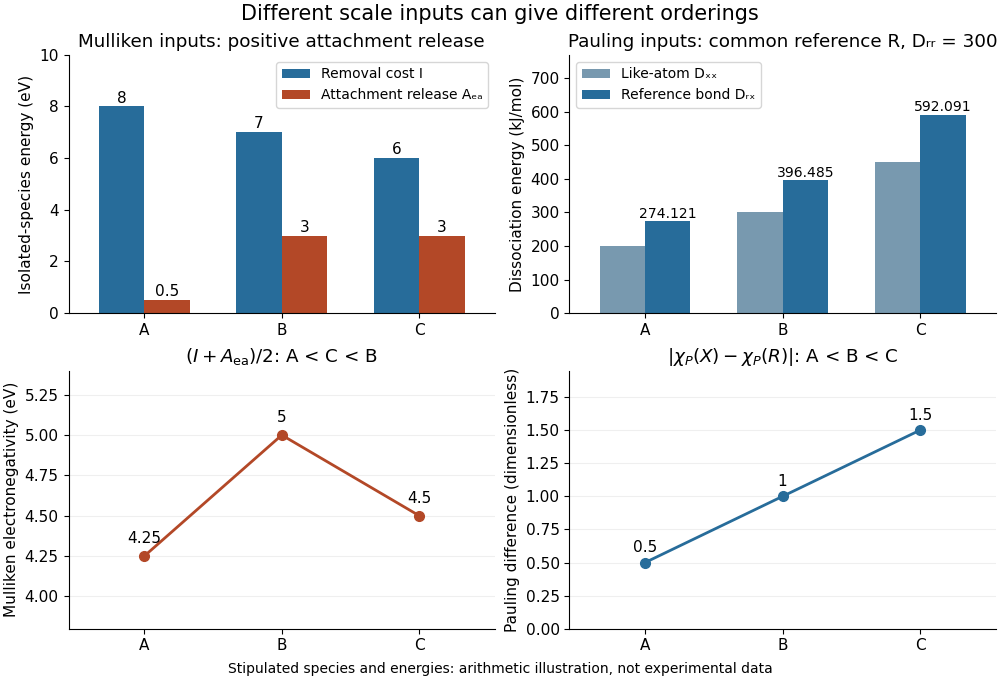

# Experimental inputs to electronegativity scales

↑ **Parent:** [Electronegativity](electronegativity-split.md)

The contrast between [Pauling electronegativity](pauling-electronegativity.md) and [Mulliken electronegativity](mulliken-electronegativity.md) becomes clearer by following the measurements into the formulas. A [Pauling bond-energy excess](pauling-bond-energy-excess.md) compares three compatible [bond-dissociation energies](bond-dissociation-energy.md); [Mulliken electronegativity](mulliken-electronegativity.md) takes the [arithmetic mean](arithmetic-mean.md) of an [ionization energy](ionization-energy.md) and an [electron affinity](electron-affinity.md). The former asks how much stronger an unlike-atom [chemical bond](chemical-bond-split.md) is than a stipulated baseline; the latter combines two different isolated-species [energy](energy-split.md) gaps.

Actual readouts precede those model choices. In the [nitrogen dissociation threshold from fragment images](nitrogen-dissociation-threshold-from-fragment-images.md), fitted squared image radii versus assigned excitation [energies](energy-split.md) reveal a threshold after accounting for the product [quantum states](quantum-state.md). In the [chlorine](chlorine.md) [photodetachment threshold](photodetachment-threshold.md) experiment, mass-selected [anions](anion.md) overlap a tunable [laser](laser-split.md), and neutral-atom counts reveal the onset of [electron](electron.md) detachment. Opposite [laser](laser-split.md) directions control the [Doppler shift](doppler-effect.md). That second threshold supplies an [electron affinity](electron-affinity.md), not an [electronegativity](electronegativity-split.md); the [Mulliken scale](mulliken-electronegativity.md) still needs an independent [ionization energy](ionization-energy.md).[§1, recoil-energy/image-radius equation; §3.2, Figure 5, squared image sizes versus term energies; §3.2, threshold channel assignment](accurate-measurements-of-the-bond-dissociation-energies-of-14n2-14n15n-and-15n2-by-liya-lu-and-others.md)[§2, printed pp. 2–4, Figure 1: mass selection and neutral counting; §2.1, direction reversal](isotope-shift-in-the-electron-affinity-of-chlorine-by-u-berzinsh-and-others.md)

For an original arithmetic comparison, stipulate isolated-species $I=(8,7,6)\,\mathrm{eV}$ and positive attachment-release $A_{\rm ea}=(0.5,3,3)\,\mathrm{eV}$ for fictitious species $A,B,C$. Their [Mulliken electronegativities](mulliken-electronegativity.md) are $(4.25,5,4.5)\,\mathrm{eV}$. The largest [ionization energy](ionization-energy.md) belongs to $A$, while the largest [Mulliken electronegativity](mulliken-electronegativity.md) belongs to $B$: accepting an [electron](electron.md) matters as well as retaining one. Using signed attachment [energies](energy-split.md) $(-0.5,-3,-3)\,\mathrm{eV}$ in $(I-\Delta E_{\rm attach})/2$ gives exactly the same results.

**[Figure 4](#image-electronegativity-scale-inputs-and-orderings). Stipulated inputs to Mulliken electronegativity and arithmetic-baseline Pauling electronegativity: different energies, units and orderings**.

Independently stipulate $D_{RR}=300$ and $D_{XX}=(200,300,450)\,\mathrm{kJ\,mol^{-1}}$ for $X=A,B,C$, with unlike-atom values

$$
D_{RX}=\frac{D_{RR}+D_{XX}}{2}+96.485\,s_X^2\,\mathrm{kJ\,mol^{-1}},\qquad
(s_A,s_B,s_C)=(0.5,1,1.5).
$$

Thus $D_{RX}=(274.12125,396.485,592.09125)\,\mathrm{kJ\,mol^{-1}}$, and the [Pauling scale](pauling-electronegativity.md) differences from $R$ are $(0.5,1,1.5)$. If all three fictitious species are placed above $R$ on that scale, their ordering is $A<B<C$, whereas the stipulated [Mulliken scale](mulliken-electronegativity.md) gives $A<C<B$. The [bond-dissociation energies](bond-dissociation-energy.md) and isolated-species [energies](energy-split.md) were invented independently: this demonstrates what the formulas do, not a measured disagreement for actual [chemical elements](chemical-element.md). A unit conversion cannot force these two input models to agree.

## ↑ Ancestors (4)

1. [Electronegativity](electronegativity-split.md)
2. [Chemical bond](chemical-bond-split.md)
3. [Chemistry](chemistry-split.md)
4. [Codex Wiki](split.md)
