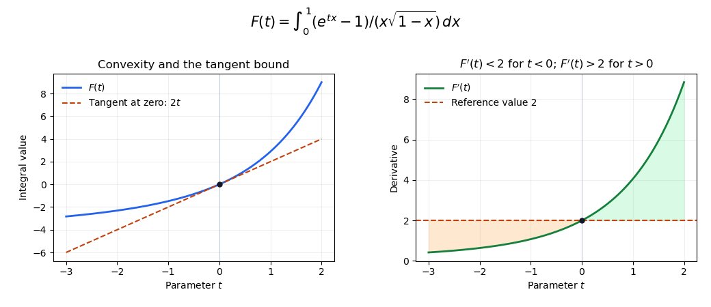

# Exponential integral with a square-root endpoint singularity

↑ **Parent:** [Dominated differentiation under the integral sign](dominated-differentiation-under-the-integral-sign.md)

For every real $t$, the [mean value theorem](mean-value-theorem.md) bounds $|e^{tx}-1|\leq |t|xe^{|t|}$ on $0<x<1$. Hence the apparent singularity at zero cancels, and the remaining bound $|t|e^{|t|}/\sqrt{1-x}$ is [Lebesgue integrable](lebesgue-integrable-function.md). On a bounded parameter interval $|t|\leq M$, every positive-order parameter [derivative](derivative.md) of the integrand is bounded in absolute value by $e^M/\sqrt{1-x}$. Repeated [dominated differentiation under the integral sign](dominated-differentiation-under-the-integral-sign.md) therefore proves that $F$ is a [smooth function](smooth-function.md), with

$$
F^{(k)}(t)=\int_0^1\frac{x^{k-1}e^{tx}}{\sqrt{1-x}}\,dx\quad(k\geq1).
$$

In particular, $F(0)=0$, $F'(0)=2$, and $F''(t)>0$. Thus $F$ is [strictly convex](strictly-convex-function.md), lies above its tangent $2t$ at zero, and satisfies $F'(t)>2$ for $t>0$ and $F'(t)<2$ for $t<0$. The inequalities follow directly as well by comparing $e^{tx}$ to one. The substitution $x=1-s^2$ removes the square-root endpoint singularity for numerical integration:

$$
F(t)=2\int_0^1\frac{e^{t(1-s^2)}-1}{1-s^2}\,ds,\qquad
F'(t)=2\int_0^1e^{t(1-s^2)}\,ds.
$$

**[Figure 7](#image-convexity-and-derivative-bounds-for-the-exponential-endpoint-integral). Convexity and derivative bounds for the exponential endpoint integral**. The derivative is below two for negative parameters and above two for positive parameters. The integral lies above its tangent at zero. Substitution removes the endpoint singularity before numerical quadrature.

## ↑ Ancestors (6)

1. [Dominated differentiation under the integral sign](dominated-differentiation-under-the-integral-sign.md)
2. [Differentiation under the integral sign](differentiation-under-the-integral-sign.md)
3. [Analysis](analysis-split.md)
4. [Area of mathematics](area-of-mathematics.md)
5. [Mathematics](mathematics-split.md)
6. [Codex Wiki](split.md)

## ← Incoming links (1)

- [Solution](past-exam-of-the-integration-course-of-the-university-of-oxford/2017/3/a/iii/solution.md)
