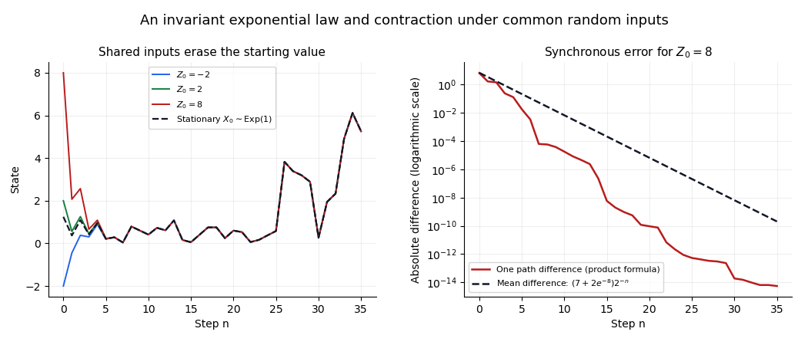

# Exponential invariant law of a random affine recursion

↑ **Parent:** [Random affine recursion](random-affine-recursion.md)

Let $U_n$ have the [uniform distribution](continuous-uniform-distribution.md) on $[0,1]$ and let $E_n$ have an [exponential distribution](exponential-distribution.md) of rate $\lambda>0$, with all these inputs independent. The [random affine recursion](random-affine-recursion.md) $X_n=U_n(X_{n-1}+E_n)$ has an invariant exponential law of the same rate. Indeed, for independent exponential $X,E$, [beta-gamma independence](beta-gamma-independence.md) says that $V=X/(X+E)$ is uniform and independent of $W=X+E$. Thus an independent uniform $U$ gives $UW$ the same law as $VW=X$.

For any deterministic real initial value $c$, couple the recursion to a stationary copy. [Synchronous contraction of a random affine recursion](synchronous-contraction-of-a-random-affine-recursion.md) gives an expected difference $2^{-n}\mathbb E|c-X_0|\leq2^{-n}(|c|+\lambda^{-1})$. Hence the one-time laws converge to $\operatorname{Exp}(\lambda)$, independently of $c$. An invariant initialization keeps every one-time law unchanged while the chain continues to fluctuate.

**[Figure 1](#image-shared-random-inputs-contract-the-affine-recursion-toward-its-invariant-exponential-law). Shared random inputs contract the affine recursion toward its invariant exponential law**. Original calculations and simulations. The accompanying proof establishes the limiting result; finitely many simulated paths illustrate it.

## ↑ Ancestors (7)

1. [Random affine recursion](random-affine-recursion.md)
2. [Markov process](markov-process-split.md)
3. [Probability theory](probability-theory-split.md)
4. [Probability and statistics](probability-and-statistics-split.md)
5. [Area of mathematics](area-of-mathematics.md)
6. [Mathematics](mathematics-split.md)
7. [Codex Wiki](split.md)

## ← Incoming links (2)

- [Solution](past-exam-of-the-probability-course-of-the-university-of-oxford/2017/1/a/iii/solution.md)
- [Solution](past-exam-of-the-probability-course-of-the-university-of-oxford/2017/1/b/iii/solution.md)
