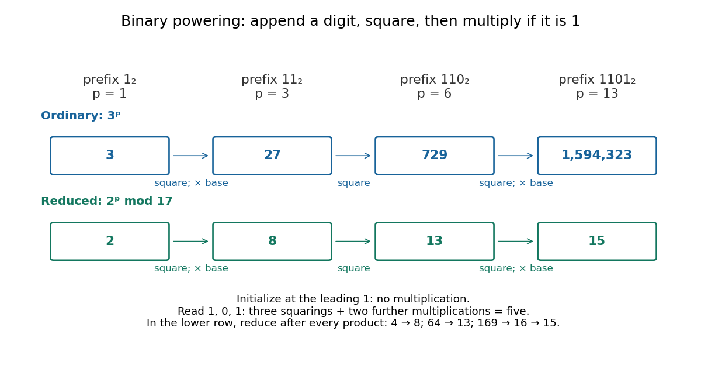

# Exponentiation by squaring

↑ **Parent:** [Number theory](number-theory-split.md)  
ⓦ [Wiki](https://en.wikipedia.org/wiki/Exponentiation_by_squaring)

Exponentiation by squaring computes an [integer](integer.md) power by reading the exponent's [binary expansion](binary-expansion.md). Appending a [binary digit](binary-digit.md) $b$ to a prefix of value $p$ replaces $p$ by $2p+b$, so the corresponding power changes by

$$
a^{2p+b}=(a^p)^2a^b,\qquad b\in\{0,1\}.
$$

Each new digit requires one squaring and, only for digit one, one further [multiplication](multiplication.md). The number of digits grows with the [logarithm](logarithm.md) of the exponent, making this useful for [modular exponentiation](modular-exponentiation.md), [primality testing](primality-testing.md), and powers of [matrices](matrix.md) using [matrix multiplication](matrix-multiplication.md).[Section 3.4, pp. 65–66: binary-prefix recurrence and repeated-squaring algorithm; p. 67: primality-testing application](a-computational-introduction-to-number-theory-and-algebra-by-victor-shoup.md)

For a concrete calculation, $13=(1101)_2=8+4+1$, so $3^{13}=3^8\cdot3^4\cdot3$. The **optimized left-to-right [algorithm](algorithm.md) used here** instead keeps one accumulated power: initialize $r=3$ from the leading digit one, then process only the remaining digits $1,0,1$:

$$
\begin{aligned}
1&:\quad r=3,\\
11&:\quad r=3^2\cdot3=27,\\
110&:\quad r=27^2=729,\\
1101&:\quad r=729^2\cdot3=531441\cdot3=1594323.
\end{aligned}
$$

Thus **$3^{13}=1594323$**, using three squarings and two further [multiplications](multiplication.md), instead of twelve successive [multiplications](multiplication.md) starting at $3$.

**[Figure 23](#image-reading-the-same-binary-expansion-computes-3-13-and-2-13-bmod17). Reading the same binary expansion computes $3^{13}$ and $2^{13}\bmod17$**. Each appended [binary digit](binary-digit.md) changes the prefix value by $p\mapsto2p+b$. The ordinary-power row grows to $1594323$; the [modular exponentiation](modular-exponentiation.md) row stores only remainders $2,8,13,15$. Both traces use three squarings and two further [multiplications](multiplication.md).

For a general positive [integer](integer.md) $n=(b_{\ell-1}\cdots b_0)_2$ with leading digit $b_{\ell-1}=1$, set $r=a$ and, for $i=\ell-2,\ldots,0$, first replace $r$ by $r^2$, then multiply it by $a$ if $b_i=1$. Return $r$. This explicitly skips the leading digit's otherwise unnecessary operations on one. [A Computational Introduction to Number Theory and Algebra by Victor Shoup](a-computational-introduction-to-number-theory-and-algebra-by-victor-shoup.md) (Section 3.4, pp. 65–66) presents the version initialized at one and processing every digit; the optimization here makes the counting convention unambiguous.

The [loop invariant](loop-invariant.md) is **$r=a^p$, where $p$ is the value of the digits already read**. Initially $p=1$ and $r=a$. If the next digit is $b$, then squaring and optionally multiplying give $r'=a^{2p+b}$, exactly the next prefix. At termination $p=n$. This proof uses [associativity](associative-property.md) of [multiplication](multiplication.md); it works in any [monoid](monoid.md), including [matrices](matrix.md) with the [identity matrix](identity-matrix.md) as [identity element](identity-element.md), and needs no [commutativity](commutativity.md) between different bases.

For $n=0$, return the [identity element](identity-element.md) without performing a [multiplication](multiplication.md). This is the empty-product convention $a^0=1$; if $a=0$, the [algorithm](algorithm.md) therefore returns one for $0^0$ by convention, rather than resolving its meaning in every mathematical setting. Negative [integer](integer.md) exponents require an [inverse element](inverse-element.md): compute $(a^{-1})^{-n}$, counting the inversion separately. Over the [integers](integer.md), such an inverse generally leaves the [integers](integer.md), and a zero base has no inverse.

**Table of contents**

- [Binary powering multiplication count](binary-powering-multiplication-count.md)
- [Modular exponentiation](modular-exponentiation.md)
  - [Bit cost of modular exponentiation](bit-cost-of-modular-exponentiation.md)

## ↑ Ancestors (4)

1. [Number theory](number-theory-split.md)
2. [Area of mathematics](area-of-mathematics.md)
3. [Mathematics](mathematics-split.md)
4. [Codex Wiki](split.md)

## ← Incoming links (5)

- [Binary powering multiplication count](binary-powering-multiplication-count.md)
- [Bit cost of modular exponentiation](bit-cost-of-modular-exponentiation.md)
- [Exponent reduction for units](exponent-reduction-for-units.md)
- [Modular exponentiation](modular-exponentiation.md)
- [Pépin's test](pepin-s-test.md)
