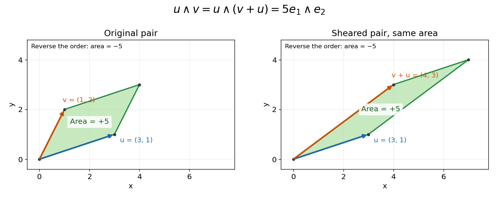

# Exterior product

↑ **Parent:** [Exterior algebra](exterior-algebra.md)

The [exterior product](exterior-product.md), also called the [wedge product](exterior-product.md), combines oriented elements through the multiplication

$$
\Lambda^pV\otimes\Lambda^qV\longrightarrow\Lambda^{p+q}V.
$$

For two [vectors](vector.md), it is [bilinear](bilinear-map.md) and alternating:

$$
(au+bv)\wedge w=a(u\wedge w)+b(v\wedge w),\qquad
u\wedge(av+bw)=a(u\wedge v)+b(u\wedge w),\qquad
u\wedge u=0.
$$

These rules imply $v\wedge u=-u\wedge v$. They distinguish the [exterior product](exterior-product.md) from both the symmetric [dot product](dot-product.md) and the unconstrained [tensor product](tensor-product.md).[§9B, Definition 9.27 and Theorem 9.30, printed pp. 347–348: alternation and the sign of a swap](linear-algebra-done-right-by-sheldon-axler-4th-edition.md)

In an oriented orthonormal plane, write $u=(a,b)$ and $v=(c,d)$. Expanding in its [standard basis](standard-basis.md) gives

$$
u\wedge v=(ad-bc)e_1\wedge e_2.
$$

The [determinant](determinant.md) $ad-bc$ is the signed area of the [parallelogram](parallelogram.md) formed by the two inputs. Its [absolute value](absolute-value.md) is the ordinary area. Reversing the input order reverses the sign; parallel inputs produce zero.

For the original example $u=(3,1)$ and $v=(1,2)$,

$$
u\wedge v=\boxed{5e_1\wedge e_2},\qquad
v\wedge u=-5e_1\wedge e_2.
$$

Replacing $v$ by $v+u=(4,3)$ changes the shape but preserves the product: $3\cdot3-1\cdot4=5$. Both [parallelograms](parallelogram.md) have the same oriented area element. If $v=2u$, the [exterior product](exterior-product.md) is zero, since $u\wedge(2u)=2(u\wedge u)=0$.

**[Figure 4](#image-an-exterior-product-records-signed-area-and-survives-a-shear). An exterior product records signed area and survives a shear**. Original [parallelograms](parallelogram.md) generated by $u=(3,1)$ with $v=(1,2)$ and with $v+u=(4,3)$. Both have signed area $5$ in the chosen Cartesian orientation. Reversing the order of the two input [vectors](vector.md) gives $-5$. The vertices and arrows are illustrative geometry, rather than measured data.

The same rule adds directions in higher dimensions. With $w=(2,-1,1)$ and the three-dimensional inputs under [bivector](bivector.md),

$$
u\wedge v\wedge w
=\det\begin{pmatrix}1&0&2\\2&1&-1\\0&3&1\end{pmatrix}
e_1\wedge e_2\wedge e_3
=16e_1\wedge e_2\wedge e_3.
$$

Its [coefficient](coefficient.md) is the [oriented volume](oriented-volume.md) of the three-dimensional [parallelepiped](parallelepiped.md). Repeating or linearly depending on earlier inputs collapses the volume, giving zero.

For [homogeneous elements of a graded algebra](homogeneous-element-of-a-graded-algebra.md) of degrees $p,q$, the general commutation rule is

$$
\alpha\wedge\beta=(-1)^{pq}\beta\wedge\alpha.
$$

Swapping a [bivector](bivector.md) with another [bivector](bivector.md) therefore produces a positive sign, since $pq=4$. It is the number of individual vector swaps that controls the sign, not a rule that every pair of objects must anticommute.

## ↑ Ancestors (7)

1. [Exterior algebra](exterior-algebra.md)
2. [Multilinear algebra](multilinear-algebra-split.md)
3. [Linear algebra](linear-algebra-split.md)
4. [Algebra](algebra-split.md)
5. [Area of mathematics](area-of-mathematics.md)
6. [Mathematics](mathematics-split.md)
7. [Codex Wiki](split.md)

## ← Incoming links (27)

- [Bivector](bivector.md)
- [Cartan curvature matrix equation](cartan-curvature-matrix-equation.md)
- [Exterior algebra](exterior-algebra.md)
- [Exterior product](exterior-product.md)
- [Hochschild-Kostant-Rosenberg theorem](hochschild-kostant-rosenberg-theorem.md)
- [Homogeneous element of a graded algebra](homogeneous-element-of-a-graded-algebra.md)
- [Metric volume form](metric-volume-form.md)
- [Solution](past-exam-of-the-mathematics-course-of-the-university-of-cambridge/2001/iii/paper-56/1/solution.md)
- [Solution](past-exam-of-the-mathematics-course-of-the-university-of-cambridge/2004/iii/paper-14/3/solution.md)
- [Solution](past-exam-of-the-mathematics-course-of-the-university-of-cambridge/2007/iii/paper-15/2/b/solution.md)
- [Solution](past-exam-of-the-mathematics-course-of-the-university-of-cambridge/2008/iii/paper-65/1/solution.md)
- [Solution](past-exam-of-the-mathematics-course-of-the-university-of-cambridge/2009/iii/paper-59/1/d/solution.md)
- [Solution](past-exam-of-the-mathematics-course-of-the-university-of-cambridge/2010/iii/paper-1/3/solution.md)
- [Solution](past-exam-of-the-mathematics-course-of-the-university-of-cambridge/2010/iii/paper-1/4/b/solution.md)
- [Solution](past-exam-of-the-mathematics-course-of-the-university-of-cambridge/2010/iii/paper-10/3/solution.md)
- [Solution](past-exam-of-the-mathematics-course-of-the-university-of-cambridge/2010/iii/paper-13/2/solution.md)
- [Solution](past-exam-of-the-mathematics-course-of-the-university-of-cambridge/2013/iii/paper-17/2/solution.md)
- [Solution](past-exam-of-the-mathematics-course-of-the-university-of-cambridge/2013/iii/paper-50/1/solution.md)
- [Solution](past-exam-of-the-mathematics-course-of-the-university-of-cambridge/2013/iii/paper-50/2/solution.md)
- [Solution](past-exam-of-the-mathematics-course-of-the-university-of-cambridge/2014/iii/paper-15/5/solution.md)
- [Solution](past-exam-of-the-mathematics-course-of-the-university-of-cambridge/2015/iii/paper-56/2/solution.md)
- [Solution](past-exam-of-the-mathematics-course-of-the-university-of-cambridge/2017/iii/paper-128/6/solution.md)
- [Plücker embedding](plucker-embedding.md)
- [Polynomial polyvector field](polynomial-polyvector-field.md)
- [Simple bivector](simple-bivector.md)
- [Symmetric-part ambiguity in Maurer-Cartan coefficients](symmetric-part-ambiguity-in-maurer-cartan-coefficients.md)
- [Tensor product of the standard representation with its exterior square](tensor-product-of-the-standard-representation-with-its-exterior-square.md)
