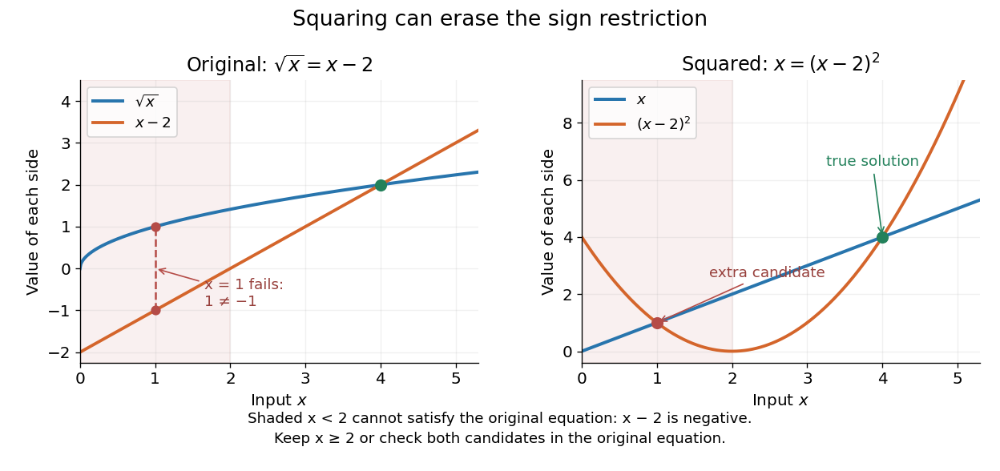

# Extraneous solution

↑ **Parent:** [Equation](equation.md)

An [extraneous solution](extraneous-solution.md) satisfies a transformed [equation](equation.md) but fails the original [equation](equation.md) or its restrictions. The term describes a candidate generated during the calculation, rather than a true solution that can be kept in the final [solution set](solution-set.md).

Consider the real [equation](equation.md)

$$
\sqrt{x}=x-2.
$$

The [square root](square-root.md) requires $x\geq0$. Because the [square root](square-root.md) is nonnegative, any solution must also have $x-2\geq0$, so $x\geq2$. Squaring gives

$$
x=(x-2)^2
\quad\Longleftrightarrow\quad
x^2-5x+4=0
\quad\Longleftrightarrow\quad
(x-1)(x-4)=0.
$$

The squared [equation](equation.md) has candidates $x=1$ and $x=4$. At $x=4$, the original equality is $2=2$. At $x=1$, it is $1=-1$, which fails: this candidate is an [extraneous solution](extraneous-solution.md). Thus the original [solution set](solution-set.md) is exactly $\{4\}$.

**[Figure 2](#image-squaring-removes-a-sign-distinction-and-creates-a-second-intersection-at-x-1-which-fails-the-original-equation). Squaring removes a sign distinction and creates a second intersection at $x=1$, which fails the original equation**.

On the restricted [domain of a function](domain-of-a-function.md) $x\geq2$, both original sides are nonnegative, so squaring is reversible there and the two [equations](equation.md) are equivalent. Retaining the sign restriction or checking every candidate in the original [equation](equation.md) achieves the same final [solution set](solution-set.md). The general need to check candidates after raising both sides to a power is explained in [College Algebra 2e, §2.6: Solving Radical Equations](https://openstax.org/books/college-algebra-2e/pages/2-6-other-types-of-equations).

## ↑ Ancestors (5)

1. [Equation](equation.md)
2. [Algebra](algebra-split.md)
3. [Area of mathematics](area-of-mathematics.md)
4. [Mathematics](mathematics-split.md)
5. [Codex Wiki](split.md)

## ← Incoming links (3)

- [Equation](equation.md)
- [Extraneous solution](extraneous-solution.md)
- [Solution set](solution-set.md)
