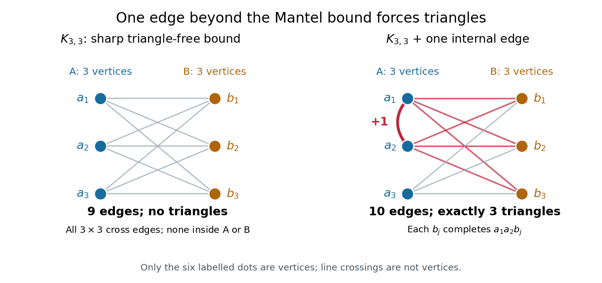
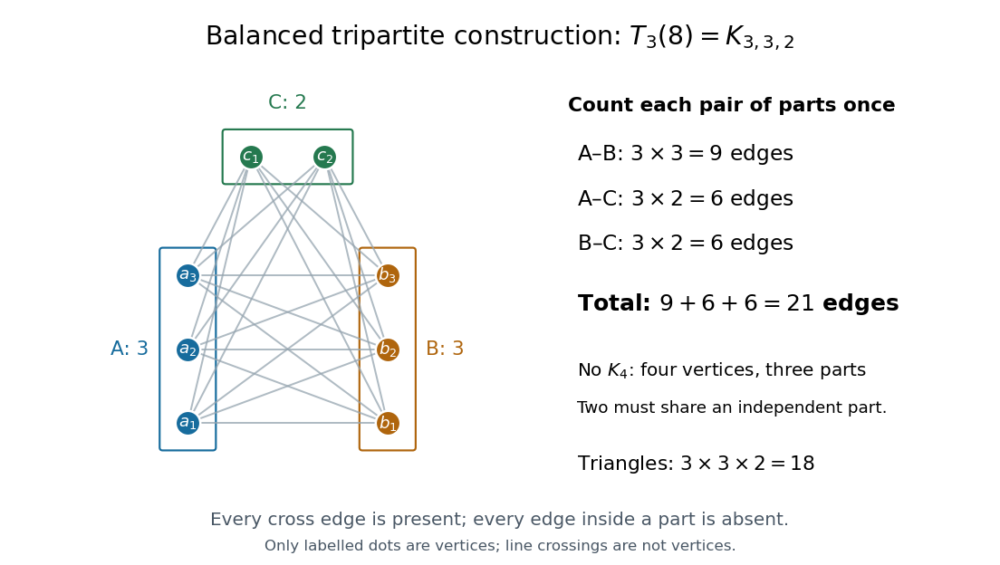

# Extremal graph theory

↑ **Parent:** [Graph theory](graph-theory.md)  
ⓦ [Wiki](https://en.wikipedia.org/wiki/Extremal_graph_theory)

**Table of contents**

- [Supersaturation](#supersaturation)
  - [Clique supersaturation by sampling](#clique-supersaturation-by-sampling)
- [Extremal number](#extremal-number)
  - [Extremal graph for disjoint cliques](#extremal-graph-for-disjoint-cliques)
  - [Monotonicity of the normalized extremal number](#monotonicity-of-the-normalized-extremal-number)
  - [Mantel theorem](#mantel-theorem)
    - [Triangle lower bound one edge above the Mantel threshold](#triangle-lower-bound-one-edge-above-the-mantel-threshold)
- [Turán's theorem](#turan-s-theorem)
  - [Edit-distance stability for clique-free graphs](#edit-distance-stability-for-clique-free-graphs)
    - [Bipartite stability from few odd cycles](#bipartite-stability-from-few-odd-cycles)
  - [Turán graph](#turan-graph)
    - [Triangle support line between bipartite and tripartite Turan graphs](#triangle-support-line-between-bipartite-and-tripartite-turan-graphs)
  - [Zykov symmetrization](#zykov-symmetrization)
    - [Edge-triangle symmetrization](#edge-triangle-symmetrization)
  - [Quadratic Turan edge bound](#quadratic-turan-edge-bound)
  - [Rhombus-free edge bound](#rhombus-free-edge-bound)
    - [Triangular prism graph](#triangular-prism-graph)
- [Erdős-Stone theorem](#erdos-stone-theorem)
  - [Logarithmic Erdős-Stone theorem](#logarithmic-erdos-stone-theorem)
    - [Logarithmic clique blow-up from minimum degree](#logarithmic-clique-blow-up-from-minimum-degree)
    - [Random obstruction to larger clique blow-ups](#random-obstruction-to-larger-clique-blow-ups)
  - [High-minimum-degree multipartite stability subgraph](#high-minimum-degree-multipartite-stability-subgraph)
    - [Minimum degree of an extremal forbidden-subgraph graph](#minimum-degree-of-an-extremal-forbidden-subgraph-graph)
- [Kővári–Sós–Turán theorem](#kovari-sos-turan-theorem)

## Supersaturation

↑ **Parent:** [Extremal graph theory](extremal-graph-theory.md)

Supersaturation strengthens an extremal existence theorem by forcing many copies of a forbidden graph when the edge count exceeds its extremal threshold by a fixed density. For a fixed clique, the [Erdős-Stone theorem](#erdos-stone-theorem) and averaging over bounded-size random vertex subsets give a positive multiple of $n^{|V(F)|}$ copies.

### Clique supersaturation by sampling

↑ **Parent:** [Supersaturation](#supersaturation)

Choose a fixed sample size $m$ for which the normalized [Turan theorem](#turan-s-theorem) bound lies below the given density by a positive margin. The expected [edge](graph-theory.md#edge-of-a-graph) count in a random $m$-vertex subset then forces a positive proportion of subsets to contain a forbidden-size [clique](graph-theory.md#clique-graph-theory). Each [clique](graph-theory.md#clique-graph-theory) belongs to a known number of subsets, so double counting gives a positive constant times $n^{r+1}$ [cliques](graph-theory.md#clique-graph-theory).

## Extremal number

↑ **Parent:** [Extremal graph theory](extremal-graph-theory.md)

The extremal number $\operatorname{ex}(n,H)$ is the largest number of edges in an $n$-vertex graph containing no subgraph isomorphic to $H$.

### Extremal graph for disjoint cliques

↑ **Parent:** [Extremal number](#extremal-number)

For fixed positive integers $r,s$ and sufficiently large $n$, the unique extremal [graph](graph.md) forbidding $s$ vertex-disjoint copies of the [complete graph](graph-theory.md#complete-graph) $K_{r+1}$ is the [join of graphs](graph-theory.md#join-graph-theory) $K_{s-1}+T_r(n-s+1)$, up to [isomorphic graphs](graph.md#graph-isomorphism). Each forbidden [clique](graph-theory.md#clique-graph-theory) would require a distinct [vertex](graph.md#vertex-graph-theory) of $K_{s-1}$.

### Monotonicity of the normalized extremal number

↑ **Parent:** [Extremal number](#extremal-number)

For every fixed graph $H$, the sequence

$$
\frac{\operatorname{ex}(n,H)}{\binom n2}
$$

is nonincreasing once $n\geq2$. Indeed, choose a uniformly random $m$-vertex [induced subgraph](graph-theory.md#induced-subgraph) of an extremal $H$-free graph on $n$ vertices. It remains $H$-free and has expected edge count

$$
\operatorname{ex}(n,H)\frac{\binom m2}{\binom n2},
$$

which cannot exceed $\operatorname{ex}(m,H)$.

### Mantel theorem

↑ **Parent:** [Extremal number](#extremal-number)

The [complete bipartite graph](bipartite-graph.md#complete-bipartite-graph) $K_{3,3}$ has [vertex sets](graph.md#vertex-set) $A=\{a_1,a_2,a_3\}$ and $B=\{b_1,b_2,b_3\}$, with every [edge](graph-theory.md#edge-of-a-graph) between $A$ and $B$ and none inside either part. Its six [vertices](graph.md#vertex-graph-theory) support $3\cdot3=9$ [edges](graph-theory.md#edge-of-a-graph) and no [triangles in a graph](graph.md#triangle-in-a-graph): among any three [vertices](graph.md#vertex-graph-theory), two belong to the same [independent set](graph-theory.md#independent-set-graph-theory) and have no joining [edge](graph-theory.md#edge-of-a-graph).

**[Figure 1](#image-the-sharp-nine-edge-triangle-free-graph-k-3-3-and-the-three-triangles-in-a-graph-created-by-adding-a-1a-2). The sharp nine-edge triangle-free graph $K_{3,3}$ and the three triangles in a graph created by adding $a_1a_2$**.

Add the single [edge](graph-theory.md#edge-of-a-graph) $a_1a_2$. Each $b_j$ is a [common neighbour](graph-theory.md#common-neighbour) of its endpoints, producing the [triangle in a graph](graph.md#triangle-in-a-graph) $a_1a_2b_j$. These are exactly the three new [triangles in a graph](graph.md#triangle-in-a-graph), because every [triangle in a graph](graph.md#triangle-in-a-graph) must use the only [edge](graph-theory.md#edge-of-a-graph) inside a part. The new count is ten [edges](graph-theory.md#edge-of-a-graph); nine was the last possible count without a [triangle in a graph](graph.md#triangle-in-a-graph) on six [vertices](graph.md#vertex-graph-theory).

In general, every [simple graph](graph.md#simple-graph) with a [finite set](set.md#finite-set) of $n\geq0$ [vertices](graph.md#vertex-graph-theory) that is [triangle-free](graph.md#triangle-free-graph) has at most

$$
m\leq\left\lfloor\frac{n^2}{4}\right\rfloor
$$

[edges](graph-theory.md#edge-of-a-graph). This is the $r=2$ case of [Turán's theorem](#turan-s-theorem), with forbidden [clique](graph-theory.md#clique-graph-theory) $K_3$. Equality holds exactly for the balanced [complete bipartite graph](bipartite-graph.md#complete-bipartite-graph) $K_{\lfloor n/2\rfloor,\lceil n/2\rceil}$, up to [graph isomorphism](graph.md#graph-isomorphism); empty parts are allowed for $n<2$.[third electronic edition (2005), §7.1, printed p. 165, Theorem 7.1.1 and the definition of Turán graphs, specialized to the forbidden graph K3](mathematics-bibliography.md#graph-theory-by-reinhard-diestel)

The [floor function](calculus.md#floor-function) gives the exact [integer](integer.md) bound. Splitting $n$ [vertices](graph.md#vertex-graph-theory) into two [independent sets](graph-theory.md#independent-set-graph-theory) of sizes $a$ and $n-a$, and putting in every cross [edge](graph-theory.md#edge-of-a-graph), gives

$$
a(n-a)=\frac{n^2}{4}-\left(a-\frac n2\right)^2.
$$

The count is largest when $a$ is an [integer](integer.md) nearest $n/2$. For $n=2k$ it is $k^2$; for $n=2k+1$ it is $k(k+1)$. Both equal $\lfloor n^2/4\rfloor$. This proves attainability for every $n$, including the empty [graph](graph.md).

A short proof of the upper bound uses [degrees of vertices](graph-theory.md#degree-graph-theory). In a [triangle-free graph](graph.md#triangle-free-graph), the endpoints $u,v$ of an [edge](graph-theory.md#edge-of-a-graph) have disjoint [vertex neighbourhoods](graph.md#vertex-neighbourhood): a [common neighbour](graph-theory.md#common-neighbour) would complete a [triangle in a graph](graph.md#triangle-in-a-graph). Thus $d(u)+d(v)\leq n$. Summing over [edges](graph-theory.md#edge-of-a-graph) counts $d(v)$ once for each of the $d(v)$ [edges](graph-theory.md#edge-of-a-graph) incident to $v$, giving

$$
\sum_{v\in V}d(v)^2=\sum_{uv\in E}(d(u)+d(v))\leq nm.
$$

For $n>0$, the [Cauchy-Schwarz inequality](probability-and-statistics.md#cauchy-schwarz-inequality) and [handshaking lemma](combinatorics.md#degree-sum-formula) yield

$$
4m^2=\left(\sum_{v\in V}d(v)\right)^2\leq n\sum_{v\in V}d(v)^2\leq n^2m.
$$

If $m>0$, division gives $m\leq n^2/4$; $m=0$ is immediate. Since $m$ is an [integer](integer.md), apply the [floor function](calculus.md#floor-function). The case $n=0$ is immediate too. This proves the bound; the full equality characterization follows from [Turán's theorem](#turan-s-theorem).

The useful reversal is that more than $\lfloor n^2/4\rfloor$ [edges](graph-theory.md#edge-of-a-graph) force a [triangle in a graph](graph.md#triangle-in-a-graph), whatever their placement. A global count certifies a local pattern. The extremizer is [bipartite](bipartite-graph.md), but a [triangle-free graph](graph.md#triangle-free-graph) need not be [bipartite](bipartite-graph.md): a five-[vertex](graph.md#vertex-graph-theory) [graph cycle](graph-theory.md#cycle-in-a-graph) has five [edges](graph-theory.md#edge-of-a-graph), below the bound of six. Historically, [Willem Mantel](mathematics.md#willem-mantel) posed the triangle-exclusion question in 1907.[Robbert Fokkink, Wie weet wie Willem Wijthoff was?, Nieuw Archief voor Wiskunde 5/17(4), December 2016, printed p. 279, Wythoffs bewijs van de stelling van Mantel: attribution of problem 28 in 1907](mathematics-bibliography.md#wie-weet-wie-willem-wijthoff-was-by-robbert-fokkink)

#### Triangle lower bound one edge above the Mantel threshold

↑ **Parent:** [Mantel theorem](#mantel-theorem)

Every graph on $2n$ vertices with at least $n^2+1$ edges contains at least $n$ triangles. An induction deletes the endpoints of an edge lying in no triangle; if every edge lies in a triangle, the [edge-triangle incidence bound](graph.md#edge-triangle-incidence-bound) is already sufficient.

<h2 id="turan-s-theorem">Turán's theorem</h2>

↑ **Parent:** [Extremal graph theory](extremal-graph-theory.md)  
ⓦ [Wiki](https://en.wikipedia.org/wiki/Turán's_theorem)

How many [edges](graph-theory.md#edge-of-a-graph) can we retain while excluding a prescribed [clique](graph-theory.md#clique-graph-theory)? For [integers](integer.md) $r\geq1$ and $n\geq0$, every [simple graph](graph.md#simple-graph) on $n$ [vertices](graph.md#vertex-graph-theory) containing no [complete subgraph](graph-theory.md#clique-graph-theory) $K_{r+1}$ satisfies

$$
e(G)\leq t_r(n):=e(T_r(n)).
$$

Equality holds exactly for the [Turán graph](#turan-graph) $T_r(n)$, up to [graph isomorphism](graph.md#graph-isomorphism). Thus the [extremal number](#extremal-number) is $\operatorname{ex}(n,K_{r+1})=t_r(n)$.[third electronic edition (2005), §7.1, printed p. 165, Theorem 7.1.1; replace the source's forbidden-clique parameter r by r+1](mathematics-bibliography.md#graph-theory-by-reinhard-diestel)

For example, $T_3(8)$ has [independent sets](graph-theory.md#independent-set-graph-theory) of sizes $3,3,2$ and $21$ [edges](graph-theory.md#edge-of-a-graph), as counted in [Turán graph](#turan-graph). It contains [triangles in a graph](graph.md#triangle-in-a-graph), but no four-[vertex](graph.md#vertex-graph-theory) [clique](graph-theory.md#clique-graph-theory). Consequently any [simple graph](graph.md#simple-graph) on eight [vertices](graph.md#vertex-graph-theory) with $22$ [edges](graph-theory.md#edge-of-a-graph) contains $K_4$, while $21$ [edges](graph-theory.md#edge-of-a-graph) alone do not force one. Excluding larger [cliques](graph-theory.md#clique-graph-theory) permits denser [graphs](graph.md); [Mantel theorem](#mantel-theorem) is precisely the first nontrivial case.

A short proof outline uses [Zykov symmetrization](#zykov-symmetrization). If an extremizer is not a [complete multipartite graph](graph-theory.md#complete-multipartite-graph), it has [vertices](graph.md#vertex-graph-theory) $x,y,z$ with $xy,xz$ absent and $yz$ present. If either $y$ or $z$ has larger [vertex degree](graph-theory.md#degree-graph-theory) than $x$, clone that [vertex](graph.md#vertex-graph-theory) in place of $x$. Otherwise replace both $y,z$ by nonadjacent clones of $x$, gaining $2d(x)-d(y)-d(z)+1>0$ [edges](graph-theory.md#edge-of-a-graph). Both contradict extremality; balancing the resulting at most $r$ parts gives $T_r(n)$.[third electronic edition (2005), §7.1, printed pp. 166–167, vertex duplication and second proof of Theorem 7.1.1](mathematics-bibliography.md#graph-theory-by-reinhard-diestel)

The [vertex cloning in a graph](graph.md#vertex-cloning-in-a-graph) step preserves [clique](graph-theory.md#clique-graph-theory) exclusion because any [clique](graph-theory.md#clique-graph-theory) using a clone can substitute its original [vertex](graph.md#vertex-graph-theory); nonadjacent clones cannot occur together in a [clique](graph-theory.md#clique-graph-theory). At most $r$ parts can be nonempty, since selecting one [vertex](graph.md#vertex-graph-theory) from each gives a [clique](graph-theory.md#clique-graph-theory). If fewer than $r$ parts are nonempty and one has at least two [vertices](graph.md#vertex-graph-theory), splitting it creates more [edges](graph-theory.md#edge-of-a-graph), so it cannot be extremal. For $r=1$ the bound is zero. For $r\geq n$, the [Turán graph](#turan-graph) is $K_n$, and the bound is the total $\binom n2$ possible [edges](graph-theory.md#edge-of-a-graph).

### Edit-distance stability for clique-free graphs

↑ **Parent:** [Turán's theorem](#turan-s-theorem)

A clique-free [graph](graph.md) near the [Turan theorem](#turan-s-theorem) [edge](graph-theory.md#edge-of-a-graph) bound is close to a complete multipartite [graph](graph.md). Choose a maximum-degree [vertex](graph.md#vertex-graph-theory), split its neighbourhood from the remaining [vertices](graph.md#vertex-graph-theory), and apply induction inside the neighbourhood. The degree bound implies that missing cross [edges](graph-theory.md#edge-of-a-graph) are at least twice the number of [edges](graph-theory.md#edge-of-a-graph) inside the remaining class. This inequality controls all three types of edits and gives the constant three.

#### Bipartite stability from few odd cycles

↑ **Parent:** [Edit-distance stability for clique-free graphs](#edit-distance-stability-for-clique-free-graphs)

Fix an odd cycle length. If the [graph](graph.md) has [edge](graph-theory.md#edge-of-a-graph) density at least $1/2-\epsilon$ and sufficiently few copies of that cycle, [odd-cycle copies from positive triangle density](probabilistic-combinatorics.md#odd-cycle-copies-from-positive-triangle-density) forces few [triangles in a graph](graph.md#triangle-in-a-graph). The [triangle removal lemma](probabilistic-combinatorics.md#triangle-removal-lemma) deletes at most $\epsilon\binom n2$ [edges](graph-theory.md#edge-of-a-graph), after which the clique-free edit bound applies with two parts. Absorbing its linear rounding error into the density margin gives the displayed bound for large order.

<h3 id="turan-graph">Turán graph</h3>

↑ **Parent:** [Turán's theorem](#turan-s-theorem)  
ⓦ [Wiki](https://en.wikipedia.org/wiki/Turán_graph)

The Turán graph $T_r(n)$ is a [complete multipartite graph](graph-theory.md#complete-multipartite-graph) with $r$ [independent sets](graph-theory.md#independent-set-graph-theory) of sizes differing by at most one, with every cross [edge](graph-theory.md#edge-of-a-graph) present. Empty parts are allowed when $r>n$.[third electronic edition (2005), §7.1, printed p. 165, definition of Turán graphs and convention for empty partition sets](mathematics-bibliography.md#graph-theory-by-reinhard-diestel)

**[Figure 2](#image-the-turan-graph-t-3-8-has-three-independent-sets-of-sizes-3-3-2-giving-21-edges-and-no-four-vertex-clique). The Turán graph $T_3(8)$ has three independent sets of sizes $3,3,2$, giving $21$ edges and no four-vertex clique**.

In this example, the [independent sets](graph-theory.md#independent-set-graph-theory) are $A=\{a_1,a_2,a_3\}$, $B=\{b_1,b_2,b_3\}$ and $C=\{c_1,c_2\}$. Count the [edges](graph-theory.md#edge-of-a-graph) between each pair of parts:

$$
t_3(8)=3\cdot3+3\cdot2+3\cdot2=9+6+6=21.
$$

Any four [vertices](graph.md#vertex-graph-theory) put at least two in the same [independent set](graph-theory.md#independent-set-graph-theory), by the [pigeonhole principle](combinatorics.md#pigeonhole-principle), so they cannot form $K_4$. Conversely, every choice of one [vertex](graph.md#vertex-graph-theory) from each part is a [triangle in a graph](graph.md#triangle-in-a-graph), giving $3\cdot3\cdot2=18$ [triangles in a graph](graph.md#triangle-in-a-graph). [Clique](graph-theory.md#clique-graph-theory) exclusion here does not mean [triangle-free](graph.md#triangle-free-graph).

For the exact count, [Euclidean division](integer.md#euclidean-division) writes $n=rq+s$, where $q=\lfloor n/r\rfloor$ uses the [floor function](calculus.md#floor-function) and $s=n\bmod r$ is the [remainder](integer.md#remainder), with $0\leq s<r$. There are $s$ parts of size $q+1$ and $r-s$ of size $q$. For any part sizes $a_1,\ldots,a_r$ summing to $n$, count cross [edges](graph-theory.md#edge-of-a-graph) by expanding the square:

$$
e(K_{a_1,\ldots,a_r})=\sum_{i<j}a_i a_j=\frac12\left(n^2-\sum_{i=1}^r a_i^2\right).
$$

Therefore

$$
t_r(n)=\frac12\left[n^2-s(q+1)^2-(r-s)q^2\right]
=\left(1-\frac1r\right)\frac{n^2}{2}-\frac{s(r-s)}{2r}.
$$

For $n=8,r=3$, we have $q=2,s=2$, giving $(64-2\cdot9-1\cdot4)/2=21$. The [Quadratic Turan edge bound](#quadratic-turan-edge-bound) gives $64/3$ instead: the exact correction subtracts $1/3$.

Balancing is an [integer](integer.md) optimization with a simple reason. If two part sizes satisfy $a\geq b+2$, moving one [vertex](graph.md#vertex-graph-theory) from the larger part to the smaller decreases their contribution to the [sum of squares](arithmetic.md#sum-of-squares) by

$$
a^2+b^2-(a-1)^2-(b+1)^2=2(a-b-1)>0,
$$

so it increases the [edge](graph-theory.md#edge-of-a-graph) count by $a-b-1$. For eight [vertices](graph.md#vertex-graph-theory), parts $4,2,2$ give $20$ [edges](graph-theory.md#edge-of-a-graph); moving one [vertex](graph.md#vertex-graph-theory) produces $3,3,2$ and $21$ [edges](graph-theory.md#edge-of-a-graph). The most symmetric permitted sizes pack the most cross [edges](graph-theory.md#edge-of-a-graph), which explains the sharp construction in [Turán's theorem](#turan-s-theorem).

#### Triangle support line between bipartite and tripartite Turan graphs

↑ **Parent:** [Turán graph](#turan-graph)

For $n\geq3$, put $e_i=e(T_i(n))$, $t_3=k_3(T_3(n))$, and $c_n=(e_3-e_2)/t_3$. Every [graph](graph.md) on $n$ [vertices](graph.md#vertex-graph-theory) satisfies

$$
e(G)-c_n k_3(G)\leq e_2.
$$

Thus an [edge](graph-theory.md#edge-of-a-graph) count $e_2+\theta(e_3-e_2)$ forces at least $\theta t_3$ [triangles in a graph](graph.md#triangle-in-a-graph). This is an exact finite bound, with the rounding in the [Turán graph](#turan-graph) retained. To prove it, use [edge-triangle symmetrization](#edge-triangle-symmetrization). The inequality $c_n\geq2/n$ allows merging the two smallest classes when there are at least four classes. With three classes, fixing the middle class makes the objective affine in the product of the other two sizes; either merge them or balance them. Only $T_2(n)$ and $T_3(n)$ need remain.

### Zykov symmetrization

↑ **Parent:** [Turán's theorem](#turan-s-theorem)

Zykov symmetrization replaces one of two nonadjacent vertices by a clone of the other. Cloning the vertex of larger degree does not decrease the edge count and does not create a larger clique. Iteration reduces the extremal problem for clique-free graphs to complete multipartite graphs.

#### Edge-triangle symmetrization

↑ **Parent:** [Zykov symmetrization](#zykov-symmetrization)

For each real $c$, some maximizer of $e(G)-c k_3(G)$ among [graphs](graph.md) on $n$ [vertices](graph.md#vertex-graph-theory) is [complete multipartite graph](graph-theory.md#complete-multipartite-graph). Among maximizers maximize $\sum_v d(v)^2$. Cloning either of two nonadjacent [vertices](graph.md#vertex-graph-theory) preserves the objective, since maximality forces their local contributions $d(v)-c e(G[N(v)])$ to agree. If their [vertex neighbourhoods](graph.md#vertex-neighbourhood) differ, the sum of the two changes in the squared-[degree of a vertex](graph-theory.md#degree-graph-theory) objective is twice the size of their symmetric difference, a contradiction. Nonadjacency therefore partitions the [vertices](graph.md#vertex-graph-theory) into classes with identical [vertex neighbourhoods](graph.md#vertex-neighbourhood).

### Quadratic Turan edge bound

↑ **Parent:** [Turán's theorem](#turan-s-theorem)

Every $n$-vertex graph containing no $K_{r+1}$ satisfies

$$
e(G)\leq\left(1-\frac1r\right)\frac{n^2}{2}.
$$

### Rhombus-free edge bound

↑ **Parent:** [Turán's theorem](#turan-s-theorem)

A graph-theoretic rhombus is two triangles sharing an edge. Every rhombus-free graph on $n\geq4$ vertices has at most

$$
e(T_2(n))=\left\lfloor\frac{n^2}{4}\right\rfloor
$$

edges. If the graph is triangle-free this is Turán's theorem. Otherwise remove a triangle: every remaining vertex has at most one neighbor in it, and induction bounds the edge count by  
$\lfloor(n-3)^2/4\rfloor+n\leq\lfloor n^2/4\rfloor$.

#### Triangular prism graph

↑ **Parent:** [Rhombus-free edge bound](#rhombus-free-edge-bound)

The triangular prism has six vertices and nine edges. Each edge lies in at most one triangle, so it has no rhombus; its two triangles show that it is not $K_{3,3}=T_2(6)$.

This is the [prism graph](graph-theory.md#prism-graph) built from two triangles.

<h2 id="erdos-stone-theorem">Erdős-Stone theorem</h2>

↑ **Parent:** [Extremal graph theory](extremal-graph-theory.md)  
ⓦ [Wiki](https://en.wikipedia.org/wiki/Erdős-Stone_theorem)

For every graph $H$ with chromatic number $r+1$,

$$
\operatorname{ex}(n,H)=\left(1-\frac1r+o(1)\right)\binom n2.
$$

<h3 id="logarithmic-erdos-stone-theorem">Logarithmic Erdős-Stone theorem</h3>

↑ **Parent:** [Erdős-Stone theorem](#erdos-stone-theorem)

An [edge](graph-theory.md#edge-of-a-graph) density exceeding the [Turan theorem](#turan-s-theorem) threshold for $K_{r+1}$ by a fixed positive amount forces a balanced $K_{r+1}(t)$ subgraph with logarithmic part size. Combine [clique supersaturation by sampling](#clique-supersaturation-by-sampling) with the [dense clique family blow-up lemma](graph.md#dense-clique-family-blow-up-lemma). Dense binomial random [graphs](graph.md) show that the logarithmic order is optimal for a uniform density guarantee.

#### Logarithmic clique blow-up from minimum degree

↑ **Parent:** [Logarithmic Erdős-Stone theorem](#logarithmic-erdos-stone-theorem)

A fixed positive excess over the [Turan theorem](#turan-s-theorem) threshold forces logarithmic balanced [complete multipartite graphs](graph-theory.md#complete-multipartite-graph). There is an elementary induction using [common neighbourhood from bipartite density](bipartite-graph.md#common-neighbourhood-from-bipartite-density): first obtain a logarithmic $r$-partite subgraph from the induction hypothesis, and select disjoint transversal $r$-cliques in it. Each such clique has at least $r\varepsilon n$ [common neighbours](graph-theory.md#common-neighbour), by the [union bound](probability-inequality.md#boole-s-inequality) on non-neighbour sets. Apply the bipartite common-neighbour count to these cliques as left-side objects. Their selected union and a large common neighbourhood form the extra part.

#### Random obstruction to larger clique blow-ups

↑ **Parent:** [Logarithmic Erdős-Stone theorem](#logarithmic-erdos-stone-theorem)

In a [binomial random graph](graph-theory.md#binomial-random-graph) with fixed [edge](graph-theory.md#edge-of-a-graph) probability below one, the displayed first-moment bound tends to zero for $t=C\log n$ and sufficiently large fixed $C$. At the same time the [edge](graph-theory.md#edge-of-a-graph) density concentrates near $p$. Thus a positive fixed density cannot force balanced complete multipartite subgraphs whose part size grows faster than logarithmically.

### High-minimum-degree multipartite stability subgraph

↑ **Parent:** [Erdős-Stone theorem](#erdos-stone-theorem)

For fixed positive integers $r,t$, a [graph](graph.md) $G$ on $n$ [vertices](graph.md#vertex-graph-theory) with $e(G)=(1-1/r+o(1))n^2/2$ and no [balanced complete multipartite blow-up](graph-theory.md#balanced-complete-multipartite-blow-up) $K_{r+1}(t)$ contains an $r$-partite [subgraph](graph-theory.md#subgraph) $H$ with $n-o(n)$ [vertices](graph.md#vertex-graph-theory), balanced classes of size $n/r+o(n)$, and [minimum degree of a graph](graph-theory.md#minimum-degree-of-a-graph) $\delta(H)=(1-1/r+o(1))n$.

One proof first removes a vanishing fraction of [vertices](graph.md#vertex-graph-theory) of low [degree of a vertex](graph-theory.md#degree-graph-theory), finds a slowly growing $K_r(L)$ by the [Erdős-Stone theorem](#erdos-stone-theorem), and assigns almost every remaining [vertex](graph.md#vertex-graph-theory) to a root class in which it has fewer than $t$ [neighbours of a vertex](graph-theory.md#neighbour-of-a-vertex). After discarding a further vanishing fraction, a $K_{t,t}$ inside an assigned class would extend to $K_{r+1}(t)$ using the root classes. Thus internal [edges](graph-theory.md#edge-of-a-graph) and missing cross-class [edges](graph-theory.md#edge-of-a-graph) both number $o(n^2)$. Removing the [vertices](graph.md#vertex-graph-theory) with unusually many missing cross-class [edges](graph-theory.md#edge-of-a-graph) gives the stated [minimum degree of a graph](graph-theory.md#minimum-degree-of-a-graph).

#### Minimum degree of an extremal forbidden-subgraph graph

↑ **Parent:** [High-minimum-degree multipartite stability subgraph](#high-minimum-degree-multipartite-stability-subgraph)

If a fixed [graph](graph.md) $F$ has [chromatic number](graph-coloring.md#chromatic-number) $r+1$, every extremal $F$-free [graph](graph.md) $G$ on $n$ [vertices](graph.md#vertex-graph-theory) has [minimum degree of a graph](graph-theory.md#minimum-degree-of-a-graph) $(1-1/r+o(1))n$. Use a [high-minimum-degree multipartite stability subgraph](#high-minimum-degree-multipartite-stability-subgraph) $H$: replacing any [vertex](graph.md#vertex-graph-theory) by one adjacent to all but one class of $H$ preserves $F$-freeness. Any supposed new copy of $F$ can replace the new [vertex](graph.md#vertex-graph-theory) by an unused [common neighbour](graph-theory.md#common-neighbour) in the omitted class. Extremality therefore gives the lower bound on every [degree of a vertex](graph-theory.md#degree-graph-theory); the [Erdős-Stone theorem](#erdos-stone-theorem) gives the upper bound on the average [degree of a vertex](graph-theory.md#degree-graph-theory).

<h2 id="kovari-sos-turan-theorem">Kővári–Sós–Turán theorem</h2>

↑ **Parent:** [Extremal graph theory](extremal-graph-theory.md)  
ⓦ [Wiki](https://en.wikipedia.org/wiki/Kővári–Sós–Turán_theorem)

For each fixed positive integer $t$,

$$
\operatorname{ex}(n,K_{t,t})=O\left(n^{2-1/t}\right).
$$

The standard proof counts $t$-element subsets of [graph neighbourhoods](graph-theory.md#graph-neighbourhood) in a bipartite subgraph. If one side has degrees $d_y$, the absence of $K_{t,t}$ gives

$$
\sum_y\binom{d_y}{t}\leq(t-1)\binom nt.
$$

[convexity](real-analysis.md#convex-function) then bounds the number of edges.

## ↑ Ancestors (5)

1. [Graph theory](graph-theory.md)
2. [Foundations of mathematics](foundations-of-mathematics.md)
3. [Area of mathematics](mathematics.md#area-of-mathematics)
4. [Mathematics](mathematics.md)
5. [Codex Wiki](README.md)

## ← Incoming links (3)

- [Colour-critical vertex](graph-coloring.md#colour-critical-vertex)
- [Extremal hypergraph theory](hypergraph.md#extremal-hypergraph-theory)
- [Solution](past-exam-of-the-mathematics-course-of-the-university-of-cambridge/2005/ii/paper-4.md#17f/solution)
