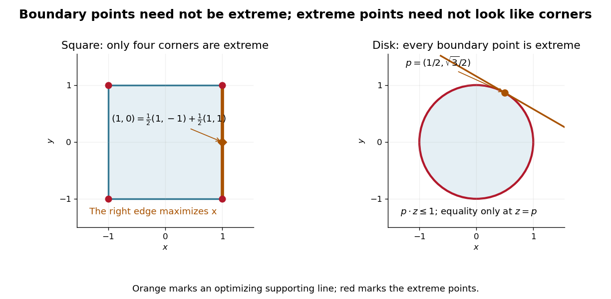

# Extreme point

↑ **Parent:** [Convex set](convex-set-split.md)  
ⓦ [Wiki](https://en.wikipedia.org/wiki/Extreme_point)

An [extreme point](extreme-point.md) of a [convex set](convex-set-split.md) is a [point](point-geometry.md) that cannot be made by genuinely mixing two different [points](point-geometry.md) of the [set](set-split.md). For a [convex set](convex-set-split.md) $C$ in a real [vector space](vector-space-split.md), the condition on $p\in C$ is

$$
p=(1-t)y+tz,\qquad y,z\in C,\quad0<t<1
\quad\Longrightarrow\quad y=z=p.
$$

Thus $p$ lies on no open [line segment](line-segment.md) between two distinct [points](point-geometry.md) of $C$. It is enough to exclude [midpoint](midpoint.md) representations: if $p$ lies inside a [line segment](line-segment.md), two nearby [points](point-geometry.md) on opposite sides have [midpoint](midpoint.md) $p$.[§6, Definition 6.6, printed p. 37: extremal points of closed convex sets](convex-geometry-bme-course-bmete94am22.md)

The [square](square.md) $[-1,1]^2$ has just four [extreme points](extreme-point.md), at $(\pm1,\pm1)$. In a [convex combination](convex-combination.md) giving a corner, each [coordinate](coordinate-linear-algebra.md) is already at its largest or smallest allowed value, forcing both input [points](point-geometry.md) to agree with that corner. In contrast, the boundary [point](point-geometry.md) $(1,0)$ is not extreme:

$$
(1,0)=\frac12(1,-1)+\frac12(1,1).
$$

It is the [midpoint](midpoint.md) of two other [points](point-geometry.md) on the same edge. An interior [point](point-geometry.md) also admits a small [line segment](line-segment.md) through it.

The [unit disk](unit-disk.md) $D=\{z\in\mathbb R^2:\|z\|_2\leq1\}$ has a different shape: every [point](point-geometry.md) on its [unit circle](complex-unit-circle.md) is extreme. For a [unit vector](unit-vector.md) $p$, the [Cauchy-Schwarz inequality](cauchy-schwarz-inequality.md) gives

$$
p\cdot z\leq\|p\|_2\|z\|_2\leq1\qquad(z\in D),
$$

and equality is possible only at $z=p$. If a [convex combination](convex-combination.md) equals $p$, applying this [linear functional](linear-functional.md) forces both ingredients to attain that equality. Both must therefore be $p$. Extremality need not look like a sharp corner.

**[Figure 3](#image-the-square-and-unit-disk-distinguish-boundary-from-extreme-points). The square and unit disk distinguish boundary from extreme points**. Original planar examples. The red marks are [extreme points](extreme-point.md): four corners for the [square](square.md), the whole [unit circle](complex-unit-circle.md) for the [unit disk](unit-disk.md). Every [point](point-geometry.md) on the square's orange edge maximizes $x$, including its nonextreme [midpoint](midpoint.md). For the disk, the orange [supporting line](supporting-line.md) for $p\cdot z$ touches only $p$.

These [points](point-geometry.md) help describe all allowable mixtures. Every $(x,y)\in[-1,1]^2$ is a [convex combination](convex-combination.md) of its four corners, with the weight on $(a,b)\in\{-1,1\}^2$ equal to $(1+ax)(1+by)/4$. For the [unit disk](unit-disk.md), write $z=rp$, with $0\leq r\leq1$ and $p$ a [unit vector](unit-vector.md); at zero choose any $p$. Then

$$
z=\frac{1+r}{2}p+\frac{1-r}{2}(-p).
$$

Two [extreme points](extreme-point.md) suffice for that mixture. The [Krein-Milman theorem](krein-milman-theorem.md) gives a much broader reconstruction: a nonempty [compact convex set](compact-convex-set.md) in a [locally convex space](locally-convex-space.md) whose [topology](topology-split.md) is [Hausdorff](hausdorff-space.md) is the [closed convex hull](closed-convex-hull.md) of its [extreme points](extreme-point.md).

[Mark Krein](mark-krein.md) and [David Milman](david-milman.md) published their reconstruction theorem in 1940. Milman's colleagues describe that result and its subsequent use as a method of representing [convex sets](convex-set-split.md) through their [extreme points](extreme-point.md).[David Milman (1912–1982), printed p. 4: 1940 collaboration with M. G. Krein, the reconstruction theorem and subsequent method; citation 3 refers to their original paper](david-milman-1912-1982-by-israel-gohberg-and-others.md)

**Table of contents**

- [Exposed point](exposed-point.md)
- [Extreme point that is not an exposed point](extreme-point-that-is-not-an-exposed-point.md)
- [Extreme points of real sequence-space unit balls](extreme-points-of-real-sequence-space-unit-balls.md)
- [Extreme points of a real continuous-function unit ball](extreme-points-of-a-real-continuous-function-unit-ball.md)
  - [Clopen sign approximation in the real Cantor unit ball](clopen-sign-approximation-in-the-real-cantor-unit-ball.md)
- [Extreme-point criterion for the L-infinity unit ball](extreme-point-criterion-for-the-l-infinity-unit-ball.md)

## ↑ Ancestors (5)

1. [Convex set](convex-set-split.md)
2. [Mathematical optimization](mathematical-optimization-split.md)
3. [Area of mathematics](area-of-mathematics.md)
4. [Mathematics](mathematics-split.md)
5. [Codex Wiki](split.md)

## ← Incoming links (39)

- [Alternating-cycle perturbation of a doubly stochastic matrix](alternating-cycle-perturbation-of-a-doubly-stochastic-matrix.md)
- [Birkhoff-von Neumann theorem](birkhoff-von-neumann-theorem.md)
- [Capped simplex](capped-simplex.md)
- [Choquet theorem](choquet-theorem.md)
- [Convex combinations in a triangle](convex-combinations-in-a-triangle.md)
- [Convex feasible region for a resource budget](convex-feasible-region-for-a-resource-budget.md)
- [Exposed point](exposed-point.md)
- [Extreme point](extreme-point.md)
- [Extreme point that is not an exposed point](extreme-point-that-is-not-an-exposed-point.md)
- [Extreme points of real sequence-space unit balls](extreme-points-of-real-sequence-space-unit-balls.md)
- [Extreme points of the density-operator state space](extreme-points-of-the-density-operator-state-space.md)
- [Extreme points of the dual unit ball of C(K)](extreme-points-of-the-dual-unit-ball-of-c-k.md)
- [Face of a convex set](face-of-a-convex-set.md)
- [Fantope](fantope.md)
- [Integer-matrix vertex coordinate bound](integer-matrix-vertex-coordinate-bound.md)
- [Milman's converse to the Krein-Milman theorem](milman-s-converse-to-the-krein-milman-theorem.md)
- [Minimal compact face argument](minimal-compact-face-argument.md)
- [Normalized integer Farkas infeasibility gap](normalized-integer-farkas-infeasibility-gap.md)
- [Optimal face of a linear program](optimal-face-of-a-linear-program.md)
- [Solution](past-exam-of-the-mathematics-course-of-the-university-of-cambridge/2002/iii/paper-34/2/solution.md)
- [Solution](past-exam-of-the-mathematics-course-of-the-university-of-cambridge/2002/iii/paper-6/4/ii/solution.md)
- [Solution](past-exam-of-the-mathematics-course-of-the-university-of-cambridge/2003/iii/paper-37/2/solution.md)
- [Solution](past-exam-of-the-mathematics-course-of-the-university-of-cambridge/2003/iii/paper-6/2/solution.md)
- [Solution](past-exam-of-the-mathematics-course-of-the-university-of-cambridge/2006/iii/paper-6/2/solution.md)
- [Solution](past-exam-of-the-mathematics-course-of-the-university-of-cambridge/2007/iii/paper-8/2/ii/solution.md)
- [Solution](past-exam-of-the-mathematics-course-of-the-university-of-cambridge/2009/iii/paper-53/1/b/solution.md)
- [Solution](past-exam-of-the-mathematics-course-of-the-university-of-cambridge/2009/iii/paper-8/4/a/solution.md)
- [Solution](past-exam-of-the-mathematics-course-of-the-university-of-cambridge/2013/iii/paper-7/2/solution.md)
- [Solution](past-exam-of-the-mathematics-course-of-the-university-of-cambridge/2014/iii/paper-6/3/solution.md)
- [Solution](past-exam-of-the-mathematics-course-of-the-university-of-cambridge/2014/iii/paper-8/4/solution.md)
- [Solution](past-exam-of-the-mathematics-course-of-the-university-of-cambridge/2015/iii/paper-6/3/solution.md)
- [Solution](past-exam-of-the-mathematics-course-of-the-university-of-cambridge/2016/ib/paper-4/20h/b/solution.md)
- [Solution](past-exam-of-the-mathematics-course-of-the-university-of-cambridge/2018/iii/paper-106/3/c/solution.md)
- [Solution](past-exam-of-the-mathematics-course-of-the-university-of-cambridge/2019/ib/paper-3/21h/a/solution.md)
- [Solution](past-exam-of-the-mathematics-course-of-the-university-of-cambridge/2019/iii/paper-339/1/a/solution.md)
- [Solution](past-exam-of-the-mathematics-course-of-the-university-of-cambridge/2019/iii/paper-339/1/b/solution.md)
- [Solution](past-exam-of-the-mathematics-course-of-the-university-of-cambridge/2023/ib/paper-3/19h/b/solution.md)
- [Threshold Choquet representation in L-infinity](threshold-choquet-representation-in-l-infinity.md)
- [Vertex of a polytope](vertex-of-a-polytope.md)
