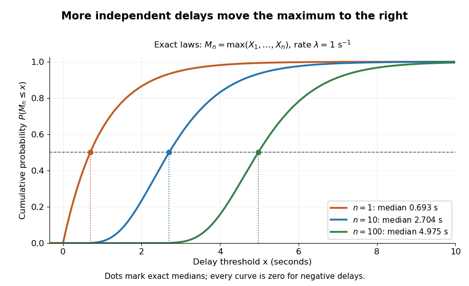
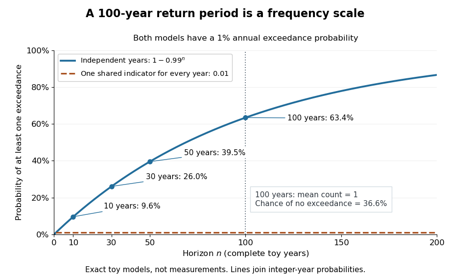
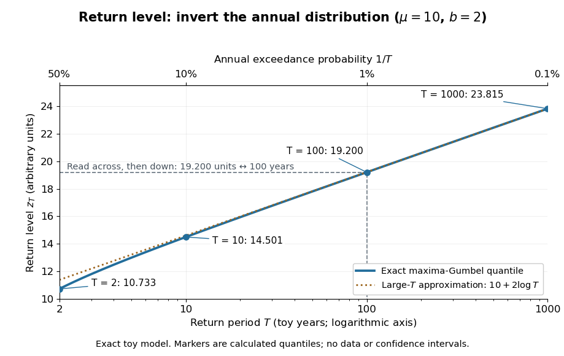
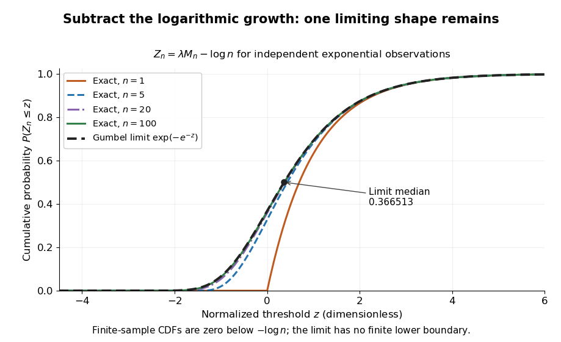

# Extreme value theory

↑ **Parent:** [Probability theory](probability-theory.md)  
ⓦ [Wiki](https://en.wikipedia.org/wiki/Extreme_value_theory)

[Extreme value theory](extreme-value-theory.md) studies limiting [probability distributions](probability-distribution.md) of normalized [sample maxima](probability-theory.md#sample-maximum) and related extremes. The standard limits for maxima include the [Fréchet distribution](#frechet-distribution), [negative Weibull distribution](#negative-weibull-distribution), and [Gumbel distribution](#gumbel-distribution).

The question is often practical: if a batch finishes only when its slowest task finishes, its completion time is a [sample maximum](probability-theory.md#sample-maximum). A typical individual delay or a [sample mean](variance.md#sample-mean) does not answer that question. The [central limit theorem](convergence-of-random-variables.md#central-limit-theorem) describes suitably normalized sums and [sample means](variance.md#sample-mean) under its assumptions; it does not give a limit law for [sample maxima](probability-theory.md#sample-maximum). [Extreme value theory](extreme-value-theory.md) instead describes how the largest observation changes as the number of opportunities for a large observation grows.

For [independent and identically distributed random variables](random-variable.md#independent-and-identically-distributed-random-variables) $X_1,X_2,\ldots$ with [distribution function](probability-distribution.md#cumulative-distribution-function) $F$, define the [sample maximum](probability-theory.md#sample-maximum)

$$
M_n=\max_{1\leq i\leq n}X_i.
$$

The [event](probability-space.md#event) $M_n\leq x$ means that every observation is at most $x$, so [independence](random-variable.md#independent-random-variables) gives

$$
\mathbb P(M_n\leq x)=\prod_{i=1}^n\mathbb P(X_i\leq x)=F(x)^n.
$$

[Extreme value theory](extreme-value-theory.md) asks whether there are constants $a_n>0$ and $c_n\in\mathbb R$ for which $(M_n-c_n)/a_n$ has [convergence in distribution](convergence-of-random-variables.md#convergence-in-distribution) to a [non-degenerate probability distribution](probability-distribution.md#non-degenerate-probability-distribution). Equivalently, $F(c_n+a_nz)^n$ must tend to a limiting [distribution function](probability-distribution.md#cumulative-distribution-function) at its continuity points. The [extremal types theorem](#extremal-types-theorem) says that any such limit belongs, up to a change of location and positive scale, to the [Gumbel distribution](#gumbel-distribution), [Fréchet distribution](#frechet-distribution), or [negative Weibull distribution](#negative-weibull-distribution). It does not guarantee that a limit exists for every $F$. [Smith and Weissman, Extreme Values, Section 1.2.1: the three types theorem](https://rls.sites.oasis.unc.edu/s834-2023/ExtremeValues.pdf).

The [maximum of independent exponential random variables](#maximum-of-independent-exponential-random-variables) gives a particularly transparent worked example: its center grows as $(\log n)/\lambda$, and its fluctuations have a [Gumbel distribution](#gumbel-distribution) limit on the scale $1/\lambda$. Here and below $\log$ denotes the [natural logarithm](calculus.md#natural-logarithm). This normalization depends on the [exponential distribution](continuous-probability-distribution.md#exponential-distribution). Other [survival functions](survival-analysis.md#survival-function) can lead to the [Fréchet distribution](#frechet-distribution) or [negative Weibull distribution](#negative-weibull-distribution), with different constants $a_n,c_n$; the [Gumbel distribution](#gumbel-distribution) and the exponential example's normalization are not universal.

[Independence](random-variable.md#independent-random-variables) is essential to the product calculation. If instead $X_1=X_2=\cdots=X$ for one rate-$\lambda$ [exponential random variable](continuous-probability-distribution.md#exponential-distribution), then $M_n=X$ for every $n$. Its [distribution function](probability-distribution.md#cumulative-distribution-function) stays $1-e^{-\lambda x}$ for $x\geq0$ and zero below zero, and its [median](probability-distribution.md#median) stays $(\log2)/\lambda$. Perfect dependence creates no logarithmic growth: repeating the same [random variable](random-variable.md) supplies no new chance of a larger value.

A historical starting point is R. A. Fisher and L. H. C. Tippett's 1928 paper on limiting laws of the largest or smallest sample member, published in volume 24, issue 2, pages 180–190 of the Proceedings of the Cambridge Philosophical Society. Its abstract studies the possible limiting forms and emphasizes that approach to a limit can be slow. [Fisher and Tippett (1928), Limiting forms of the frequency distribution of the largest or smallest member of a sample: publisher metadata and abstract](https://www.cambridge.org/core/journals/mathematical-proceedings-of-the-cambridge-philosophical-society/article/abs/limiting-forms-of-the-frequency-distribution-of-the-largest-or-smallest-member-of-a-sample/7BE8DE65FCDFC3ABECFE1054DFB56CB5).

**Table of contents**

- [Maximum of independent exponential random variables](#maximum-of-independent-exponential-random-variables)
- [Hill estimator](#hill-estimator)
- [Extremal types theorem](#extremal-types-theorem)
- [Max-stable distribution](#max-stable-distribution)
- [Return period](#return-period)
  - [Return level](#return-level)
    - [Return level plot](#return-level-plot)
- [Generalized Pareto distribution](#generalized-pareto-distribution)
  - [Orthogonal shape and scale for a generalized Pareto distribution](#orthogonal-shape-and-scale-for-a-generalized-pareto-distribution)
  - [Peaks-over-threshold method](#peaks-over-threshold-method)
    - [Declustering of extremes](#declustering-of-extremes)
  - [Pickands-Balkema-de Haan theorem](#pickands-balkema-de-haan-theorem)
- [Gumbel distribution](#gumbel-distribution)
  - [Moving Gumbel cutoff in an inverse-power tail](#moving-gumbel-cutoff-in-an-inverse-power-tail)
  - [Gumbel limit for gamma maxima](#gumbel-limit-for-gamma-maxima)
  - [Gumbel auxiliary function](#gumbel-auxiliary-function)
- [Negative Weibull distribution](#negative-weibull-distribution)
- [Fréchet distribution](#frechet-distribution)
- [Maximum domain of attraction](#maximum-domain-of-attraction)
  - [Logarithmic-tail Fréchet normalization](#logarithmic-tail-frechet-normalization)
  - [Von Mises conditions for extreme values](#von-mises-conditions-for-extreme-values)

## Maximum of independent exponential random variables

↑ **Parent:** [Extreme value theory](extreme-value-theory.md)

Let $n\geq1$ be an [integer](integer.md) and let $X_1,\ldots,X_n$ be [independent and identically distributed random variables](random-variable.md#independent-and-identically-distributed-random-variables) with an [exponential distribution](continuous-probability-distribution.md#exponential-distribution) of rate $\lambda>0$. Their [sample maximum](probability-theory.md#sample-maximum) $M_n$ is nonnegative. Substituting the [exponential distribution](continuous-probability-distribution.md#exponential-distribution)'s [cumulative distribution function](probability-distribution.md#cumulative-distribution-function) into the [distribution functions of independent minima and maxima](probability-theory.md#distribution-functions-of-independent-minima-and-maxima) gives the exact law

$$
\mathbb P(M_n\leq x)=
\begin{cases}
(1-e^{-\lambda x})^n,&x\geq0,\\
0,&x<0.
\end{cases}
$$

For example, at $x=(\log2)/\lambda$ each observation is below the threshold with [probability](probability-theory.md#probability) $1/2$, but all $n$ observations are below it with [probability](probability-theory.md#probability) $2^{-n}$. Thus an individual observation's [median](probability-distribution.md#median) becomes an increasingly unlikely upper bound for the whole batch. The general [order statistic](probability-theory.md#order-statistic) density in Siegrist's treatment, with $k=n$, also gives this law on [integration](integral.md). [Siegrist, Random Services: exponential order statistics](https://www.randomservices.org/random/sample/OrderStatistics.html).

Solving $(1-e^{-\lambda x})^n=p$ gives the exact [quantile function](probability-distribution.md#quantile-function), for $0<p<1$,

$$
q_n(p)=-\frac1\lambda\log(1-p^{1/n}),\qquad
m_n=q_n(1/2)=-\frac1\lambda\log(1-2^{-1/n}).
$$

In a toy model with $\lambda=1\,\mathrm{s}^{-1}$, the [median](probability-distribution.md#median) maximum is $0.693147$ seconds for $n=1$, $2.703555$ seconds for $n=10$, and $4.975147$ seconds for $n=100$. All three use the exact [distribution function](probability-distribution.md#cumulative-distribution-function); the increase comes from taking a [maximum](set.md#maximum-of-a-subset-of-a-total-order) over more observations. The $n=2$ case connects to the existing [maximum of two exponentials as a scaled sum](continuous-probability-distribution.md#maximum-of-two-exponentials-as-a-scaled-sum).

**[Figure 1](#image-exact-cumulative-distribution-functions-of-exponential-sample-maxima-with-rate-one-per-second-and-median-markers). Exact cumulative distribution functions of exponential sample maxima, with rate one per second and median markers**.

The [Gumbel distribution](#gumbel-distribution) explains the logarithmic shift visible here: after subtracting $(\log n)/\lambda$ and measuring deviations in units of $1/\lambda$, the [distribution functions](probability-distribution.md#cumulative-distribution-function) approach one fixed shape. The next derivation makes that [convergence in distribution](convergence-of-random-variables.md#convergence-in-distribution) explicit.

## Hill estimator

↑ **Parent:** [Extreme value theory](extreme-value-theory.md)

For $1\leq k<n$ and a positive threshold $t=X_{(n-k)}$, the [Hill estimator](#hill-estimator) averages the logarithmic ratios of the top $k$ [order statistics](probability-theory.md#order-statistic) to $t$. For a [Fréchet distribution](#frechet-distribution) domain with shape $\alpha$, it estimates the reciprocal tail index $1/\alpha$. At an untied threshold it equals the [empirical distribution function](probability-distribution.md#empirical-distribution-function) plug-in tail integral $\int_t^\infty(1-F_n(x))/(1-F_n(t))\,dx/x$. At a tied threshold the plug-in denominator counts strictly larger observations and the identity needs adjustment. Fixed $k$ does not by itself yield a consistent tail-index estimate.

## Extremal types theorem

↑ **Parent:** [Extreme value theory](extreme-value-theory.md)

Every non-degenerate limit in [convergence in distribution](convergence-of-random-variables.md#convergence-in-distribution) of positively scaled and centered [sample maxima](probability-theory.md#sample-maximum) is a [max-stable distribution](#max-stable-distribution). Up to positive affine transformations its law is the [Gumbel distribution](#gumbel-distribution), a [Fréchet distribution](#frechet-distribution) with positive shape parameter, or a [negative Weibull distribution](#negative-weibull-distribution) with positive shape parameter. This classifies possible limits, without asserting that every [distribution function](probability-distribution.md#cumulative-distribution-function) admits a limiting normalization.

## Max-stable distribution

↑ **Parent:** [Extreme value theory](extreme-value-theory.md)

A non-degenerate [distribution function](probability-distribution.md#cumulative-distribution-function) is max-stable when every [sample maximum](probability-theory.md#sample-maximum) of $n$ [independent and identically distributed random variables](random-variable.md#independent-and-identically-distributed-random-variables) can be positively scaled and centered to have the original law. Thus for every integer $n\geq1$ there are $a_n>0,b_n\in\mathbb R$ with $F(a_nx+b_n)^n=F(x)$. The [extremal types theorem](#extremal-types-theorem) classifies these laws, up to affine changes, as the [Gumbel distribution](#gumbel-distribution), [Fréchet distribution](#frechet-distribution), and [negative Weibull distribution](#negative-weibull-distribution).

## Return period

↑ **Parent:** [Extreme value theory](extreme-value-theory.md)

A [return period](#return-period) expresses how rare a threshold exceedance is in a specified time block. Let $M_j$ be the [sample maximum](probability-theory.md#sample-maximum) in block $j$, fix a threshold $u$, and suppose $p=\mathbb P(M_j>u)>0$ is the same for every block. The conventional [return period](#return-period) is $T=1/p$ blocks; blocks of duration $\Delta$ give a time of $\Delta/p$. Thus an annual exceedance [probability](probability-theory.md#probability) $p=0.01$ means a 100-year [return period](#return-period). This names a frequency scale, not a schedule or a guarantee of one exceedance in each century. The annual convention and the misleading “once every 100 years” interpretation are discussed in [USGS: the 100-year flood](https://www.usgs.gov/water-science-school/science/100-year-flood).

To derive a waiting-time interpretation, assume the exceedance indicators $B_j=\mathbf1_{\{M_j>u\}}$ are [independent and identically distributed random variables](random-variable.md#independent-and-identically-distributed-random-variables) with the [Bernoulli distribution](discrete-probability-distribution.md#bernoulli-distribution) of parameter $p$. Define $W=\min\{j\geq1:B_j=1\}$, counting the successful block as well as all preceding blocks. The first $k-1$ [Bernoulli trials](discrete-probability-distribution.md#bernoulli-trial) must fail and the $k$th must succeed, so [independence](random-variable.md#independent-random-variables) gives the [geometric distribution](discrete-probability-distribution.md#geometric-distribution)

$$
\mathbb P(W=k)=(1-p)^{k-1}p,\quad k=1,2,\ldots,\qquad
\mathbb P(W>n)=(1-p)^n,\qquad \mathbb E[W]=\frac1p=T.
$$

The [expected value](expected-value.md) can also be read directly from the [geometric series](sequence-and-series.md#geometric-series): $\mathbb E[W]=\sum_{n=0}^{\infty}\mathbb P(W>n)=\sum_{n=0}^{\infty}(1-p)^n=1/p$. This counts blocks from the starting boundary, not the exact time of an exceedance within its block. Counting only failed blocks instead would give [expected value](expected-value.md) $T-1$. The waiting law and its [memorylessness of the geometric distribution](discrete-probability-distribution.md#memorylessness-of-the-geometric-distribution) are developed in [Kyle Siegrist, Random Services: the geometric distribution](https://www.randomservices.org/random/bernoulli/Geometric.html).

For a horizon of $n$ complete years, at least one exceedance is the complement of no exceedances. Under the same [independence](random-variable.md#independent-random-variables) and constant-$p$ assumptions,

$$
\mathbb P(\text{at least one exceedance in }n\text{ years})
=1-(1-p)^n=1-\left(1-\frac1T\right)^n.
$$

For the toy choice $p=0.01$, this gives $9.6\%$ in 10 years, $26.0\%$ in 30 years, $39.5\%$ in 50 years, and $63.4\%$ in 100 years. Even after 100 years there is a $36.6\%$ chance of no exceedance. These numbers are exact model calculations rounded to one decimal place, not measured frequencies. The [median](probability-distribution.md#median) waiting count is 69 years, since $1-0.99^{68}<1/2\leq1-0.99^{69}$; the [expected value](expected-value.md) is 100 years. A [mean](expected-value.md) and a [median](probability-distribution.md#median) answer different questions.

**[Figure 2](#image-a-1-percent-annual-exceedance-probability-accumulates-across-independent-years). A 1 percent annual exceedance probability accumulates across independent years**. Exact toy [probabilities](probability-theory.md#probability) for $p=0.01$. The rising curve uses [independent](random-variable.md#independent-random-variables) annual [Bernoulli trials](discrete-probability-distribution.md#bernoulli-trial); the flat line uses one shared [Bernoulli random variable](discrete-probability-distribution.md#bernoulli-distribution) for every year. Both have the same annual [probability](probability-theory.md#probability), but different multi-year [probabilities](probability-theory.md#probability). No observations are plotted.

The exceedance count $N_n=\sum_{j=1}^n B_j$ has the [binomial distribution](discrete-probability-distribution.md#binomial-distribution) under [independence](random-variable.md#independent-random-variables), with [expected value](expected-value.md) $np$. Thus $N_{100}$ has [expected value](expected-value.md) one, although its [probability](probability-theory.md#probability) of being at least one is only $63.4\%$: some realizations contribute several exceedances. For $0<p<1$, the [memorylessness of the geometric distribution](discrete-probability-distribution.md#memorylessness-of-the-geometric-distribution) gives $\mathbb P(W>m+n\mid W>m)=(1-p)^n$. A long quiet spell does not make the next independent year's exceedance overdue, and an exceedance this year does not force a quiet interval. Two specified consecutive years both exceed with [probability](probability-theory.md#probability) $p^2=0.0001$ in this toy model.

A reproducible tabletop experiment makes the assumptions tangible. Put 100 identical slips numbered 1 to 100 in a bag; after thoroughly mixing, draw one and record whether it is 100. Replace the slip and mix again before every draw. Treat each draw as one toy year, so the exceedance indicator is a [Bernoulli random variable](discrete-probability-distribution.md#bernoulli-distribution) with $p=0.01$, provided the sampling is uniform and successive draws are [independent](random-variable.md#independent-random-variables). Repeat complete 30-draw runs and record the fraction containing at least one 100; separately repeat runs stopped at the first 100 and record their waiting counts. The first fraction targets $1-0.99^{30}$; the waiting-count [histogram](probability-and-statistics.md#histogram) targets $0.99^{k-1}(0.01)$. Replacement keeps $p$ fixed, mixing is intended to support [independence](random-variable.md#independent-random-variables), and repeated runs expose sampling variation. This is a proposed demonstration of the toy model; no experimental results are asserted here.

[Stationarity](time-series.md#stationary-process) supports a time-invariant annual [probability distribution](probability-distribution.md), but does not imply [independence](random-variable.md#independent-random-variables). For an extreme counterexample, draw just one [Bernoulli random variable](discrete-probability-distribution.md#bernoulli-distribution) $B$ of parameter $0.01$ and set $B_j=B$ for every year. This is a [stationary process](time-series.md#stationary-process), yet the [probability](probability-theory.md#probability) of any exceedance in every finite horizon is $0.01$; from an arbitrary starting boundary the wait is infinite with [probability](probability-theory.md#probability) $0.99$. The reciprocal marginal frequency $T=100$ therefore need not equal that forward waiting [expected value](expected-value.md). With equal marginal [probabilities](probability-theory.md#probability) $p$ and arbitrary dependence, only the general bounds $p\leq\mathbb P(N_n\geq1)\leq\min(1,np)$ follow, the upper bound being the [union bound](probability-inequality.md#boole-s-inequality). [Linearity of expectation](expected-value.md#linearity-of-expectation) still gives $\mathbb E[N_n]=np$ without [independence](random-variable.md#independent-random-variables). Mere zero [correlation](variance.md#pearson-correlation-coefficient) does not restore the product formula; even [pairwise independence does not imply joint independence](random-variable.md#pairwise-independence-does-not-imply-joint-independence). If annual [probabilities](probability-theory.md#probability) change to $p_j$, [independence](random-variable.md#independent-random-variables) instead gives $\mathbb P(N_n\geq1)=1-\prod_{j=1}^n(1-p_j)$, and one fixed [return period](#return-period) no longer describes all years.

### Return level

↑ **Parent:** [Return period](#return-period)

A [return level](#return-level) answers the inverse question to a [return period](#return-period): which threshold has the specified rarity? Let $F(z)=F_{\rm annual}(z)=\mathbb P(M_j\leq z)$ be the common [cumulative distribution function](probability-distribution.md#cumulative-distribution-function) of annual [sample maxima](probability-theory.md#sample-maximum) in a model with [stationarity](time-series.md#stationary-process). For a continuous, strictly increasing $F$ and $T>1$, the $T$-year [return level](#return-level) is

$$
z_T=F^{-1}\!\left(1-\frac1T\right),\qquad
F(z_T)=1-\frac1T,\qquad \mathbb P(M_j>z_T)=\frac1T.
$$

It has the same units as $M_j$, whereas $T$ is a count of annual blocks. [Independence](random-variable.md#independent-random-variables) between years is unnecessary for this one-year [quantile](probability-distribution.md#quantile-function) definition; it is needed for the geometric waiting and multi-year formulas under [return period](#return-period). For a [discrete probability distribution](discrete-probability-distribution.md), use the generalized [quantile function](probability-distribution.md#quantile-function) $F^{-1}(q)=\inf\{z:F(z)\geq q\}$. Then $\mathbb P(M_j>z_T)\leq1/T$, with equality not guaranteed at jumps; an exact requested exceedance [probability](probability-theory.md#probability) may be unattainable.

For a concrete standard model, choose the maxima convention of the [Gumbel distribution](#gumbel-distribution), with location $\mu$ and scale $b>0$:

$$
F(z)=\exp\!\left[-\exp\!\left(-\frac{z-\mu}{b}\right)\right],\qquad
z_T=\mu-b\log\!\left[-\log\!\left(1-\frac1T\right)\right].
$$

The second formula follows by taking logarithms twice and solving $F(z_T)=1-1/T$. The maxima [cumulative distribution function](probability-distribution.md#cumulative-distribution-function) and its inverse are given in [NIST: extreme value type I distribution, maximum case](https://www.itl.nist.gov/div898/handbook/eda/section3/eda366g.htm). With the deliberately chosen toy values $\mu=10$ and $b=2$ in arbitrary units, $z_{10}=14.501$, $z_{100}=19.200$, and $z_{1000}=23.815$, rounded to three decimals. In particular, $19.200$ is approximately the annual [quantile](probability-distribution.md#quantile-function) at cumulative [probability](probability-theory.md#probability) $0.99$; it is not a prediction of the largest observation in the next 100 years. Under [independence](random-variable.md#independent-random-variables), the [probability](probability-theory.md#probability) that all those annual [sample maxima](probability-theory.md#sample-maximum) stay below the exact $z_{100}$ is $0.99^{100}\approx0.366$.

The time block matters. If a toy year contains $m$ [independent](random-variable.md#independent-random-variables) daily blocks, each with exceedance [probability](probability-theory.md#probability) $q$ at one fixed threshold, its annual exceedance [probability](probability-theory.md#probability) is $p=1-(1-q)^m$, giving annual [return period](#return-period) $1/[1-(1-q)^m]$. The reciprocal $1/q$ counts daily blocks. Dependence among daily exceedances requires their joint law instead; a threshold crossed on several successive days still produces only one exceedance indicator for that year's [sample maximum](probability-theory.md#sample-maximum). The [peaks-over-threshold method](#peaks-over-threshold-method) and [declustering of extremes](#declustering-of-extremes) address a different choice of extreme-event sampling.

#### Return level plot

↑ **Parent:** [Return level](#return-level)

A [return level plot](#return-level-plot) graphs $T$ horizontally and $z_T$ vertically, often using a [logarithmic scale](calculus.md#logarithmic-scale) for $T$. To read it, choose a [return period](#return-period), move up to the curve, and read the corresponding [return level](#return-level). Conversely, a threshold's horizontal coordinate gives the reciprocal of its annual exceedance [probability](probability-theory.md#probability). The usual plot of fitted [quantiles](probability-distribution.md#quantile-function) against [return periods](#return-period), and optional pointwise [confidence intervals](statistical-inference.md#confidence-interval), are documented in [Mathieu Ribatet, POT package: return level plot](https://search.r-project.org/CRAN/refmans/POT/html/retlev.html).

**[Figure 3](#image-an-exact-toy-gumbel-return-level-curve-maps-rarity-to-a-threshold). An exact toy Gumbel return-level curve maps rarity to a threshold**. The maxima [Gumbel distribution](#gumbel-distribution) has chosen parameters $\mu=10$ and $b=2$ in arbitrary units. The upper axis shows annual exceedance [probability](probability-theory.md#probability) $1/T$. Markers are exact model [quantiles](probability-distribution.md#quantile-function), not data or fitted estimates; the dotted line is the large-$T$ approximation $10+2\log T$.

The near-straight shape has a mathematical explanation: since $-\log(1-1/T)\sim1/T$ as $T\to\infty$, the [Gumbel distribution](#gumbel-distribution) gives $z_T=\mu+b\log T+o(1)$. Multiplying a large [return period](#return-period) by ten therefore increases the [return level](#return-level) by approximately $b\log10$, about $4.605$ units for this toy curve. A curve indexed by rarity puts several thresholds on one common scale while retaining their measurement units.

For a fitted curve, a pointwise [confidence interval](statistical-inference.md#confidence-interval) concerns uncertainty in the estimated [quantile](probability-distribution.md#quantile-function) at a specified $T$; it is distinct from a [prediction interval](statistical-inference.md#prediction-interval) for a future annual [sample maximum](probability-theory.md#sample-maximum), and pointwise intervals need not form a simultaneous [confidence band](statistical-inference.md#confidence-band). A far-right curve value can also be an extrapolation beyond the observation record: extending the line adds no observations to support the chosen tail model. The diagram above uses fixed toy parameters, so it shows neither estimation uncertainty nor an observational record. Its interpretation throughout assumes the stated annual block and [stationarity](time-series.md#stationary-process).

## Generalized Pareto distribution

↑ **Parent:** [Extreme value theory](extreme-value-theory.md)  
ⓦ [Wiki](https://en.wikipedia.org/wiki/Generalized_Pareto_distribution)

For scale $\sigma>0$ and shape $\xi$, the generalized Pareto distribution on nonnegative excesses has [cumulative distribution function](probability-distribution.md#cumulative-distribution-function)

$$
G_{\xi,\sigma}(y)=1-(1+\xi y/\sigma)^{-1/\xi},\qquad y\geq0,\quad1+\xi y/\sigma>0.
$$

The case $\xi=0$ is the continuous limit $1-e^{-y/\sigma}$. Positive $\xi$ gives a power-law tail, zero gives an [exponential distribution](continuous-probability-distribution.md#exponential-distribution), and negative $\xi$ gives a finite upper endpoint $-\sigma/\xi$. Its role in modelling high-threshold excesses is explained by the [Pickands-Balkema-de Haan theorem](#pickands-balkema-de-haan-theorem).

### Orthogonal shape and scale for a generalized Pareto distribution

↑ **Parent:** [Generalized Pareto distribution](#generalized-pareto-distribution)

For the positive-shape [generalized Pareto distribution](#generalized-pareto-distribution) with shape $\psi>0$ and scale $\sigma>0$, the expected [Fisher information matrix](statistical-modelling.md#fisher-information-matrix) for one observation is

$$
I(\psi,\sigma)=\frac1{1+2\psi}\begin{pmatrix}2/(1+\psi)&1/[\sigma(1+\psi)]\\1/[\sigma(1+\psi)]&1/\sigma^2\end{pmatrix}.
$$

The [orthogonalization equation for two statistical parameters](statistical-modelling.md#orthogonalization-equation-for-two-statistical-parameters) gives $\partial_\psi\sigma=-\sigma/(1+\psi)$ at fixed new nuisance coordinate. Thus $\eta=\sigma(1+\psi)$ is a global [interest-respecting reparametrization](statistical-modelling.md#interest-respecting-reparametrization). In coordinates $(\psi,\eta)$, the information is diagonal with entries $(1+\psi)^{-2}$ and $[\eta^2(1+2\psi)]^{-1}$.

### Peaks-over-threshold method

↑ **Parent:** [Generalized Pareto distribution](#generalized-pareto-distribution)

The peaks-over-threshold method fits a [generalized Pareto distribution](#generalized-pareto-distribution) to exceedances of a high threshold and also estimates their frequency. Together these determine tail probabilities and [return levels](#return-level). For dependent observations, threshold exceedances may occur in clusters; [declustering of extremes](#declustering-of-extremes) can separate extreme events before fitting a model for independent events.

#### Declustering of extremes

↑ **Parent:** [Peaks-over-threshold method](#peaks-over-threshold-method)

Declustering groups dependent threshold exceedances into extreme-event clusters and retains a representative, commonly the cluster maximum. It aims to make the events used in a [peaks-over-threshold method](#peaks-over-threshold-method) approximately independent. The event rate must be estimated consistently with the retained clusters when computing [return levels](#return-level).

### Pickands-Balkema-de Haan theorem

↑ **Parent:** [Generalized Pareto distribution](#generalized-pareto-distribution)

For a distribution in an extreme-value domain of attraction, the [conditional distribution](probability-theory.md#conditional-distribution) of the excess above a high threshold is asymptotically approximated by a [generalized Pareto distribution](#generalized-pareto-distribution) with a threshold-dependent scale and a limiting shape parameter. This theorem justifies the [peaks-over-threshold method](#peaks-over-threshold-method). Threshold selection must balance approximation error against the reduced number of excess observations.

## Gumbel distribution

↑ **Parent:** [Extreme value theory](extreme-value-theory.md)  
ⓦ [Wiki](https://en.wikipedia.org/wiki/Gumbel_distribution)

The standard [Gumbel distribution](#gumbel-distribution) for maxima has [distribution function](probability-distribution.md#cumulative-distribution-function) $\Lambda(z)=e^{-e^{-z}}$ for every real $z$. Its [probability density function](continuous-probability-distribution.md#probability-density-function) is the [derivative](calculus.md#derivative) of its [distribution function](probability-distribution.md#cumulative-distribution-function):

$$
\Lambda(z)=\exp(-e^{-z}),\qquad
g(z)=e^{-z}\exp(-e^{-z}),\qquad z\in\mathbb R.
$$

This article uses the maxima convention throughout. Reflecting a standard [Gumbel distribution](#gumbel-distribution) [random variable](random-variable.md) $Z$ to $-Z$ gives the minima convention, with [distribution function](probability-distribution.md#cumulative-distribution-function) $1-\exp(-e^z)$. The two conventions have opposite directions of asymmetry, so their formulas must not be interchanged. [NIST: extreme value type I distributions for maxima and minima](https://www.itl.nist.gov/div898/handbook/eda/section3/eda366g.htm).

For a location $\mu\in\mathbb R$ and positive scale $b>0$, let $Y=\mu+bZ$. This [location-scale family](statistical-model.md#location-scale-family) has [cumulative distribution function](probability-distribution.md#cumulative-distribution-function) and [probability density function](continuous-probability-distribution.md#probability-density-function)

$$
F_Y(x)=\exp\left[-\exp\left(-\frac{x-\mu}{b}\right)\right],\qquad
f_Y(x)=\frac1b\exp\left(-\frac{x-\mu}{b}\right)\exp\left[-\exp\left(-\frac{x-\mu}{b}\right)\right].
$$

Solving $\Lambda(z)=p$ gives the standard [quantile function](probability-distribution.md#quantile-function) $q(p)=-\log(-\log p)$, $0<p<1$, and hence the standard [median](probability-distribution.md#median)

$$
m=-\log(\log2)\approx0.366513.
$$

The [median](probability-distribution.md#median) of $Y$ is therefore $\mu-b\log(\log2)$. Location $\mu$ is not the [median](probability-distribution.md#median): at $x=\mu$ the [cumulative distribution function](probability-distribution.md#cumulative-distribution-function) is $e^{-1}\approx0.367879$.

To derive the [Gumbel distribution](#gumbel-distribution) as an extreme-value limit, take the [maximum of independent exponential random variables](#maximum-of-independent-exponential-random-variables) with rate $\lambda>0$ and set

$$
Z_n=\lambda M_n-\log n.
$$

The exact [distribution function](probability-distribution.md#cumulative-distribution-function) is

$$
\mathbb P(Z_n\leq z)=
\begin{cases}
\left(1-\dfrac{e^{-z}}n\right)^n,&z\geq-\log n,\\
0,&z<-\log n.
\end{cases}
$$

The finite-$n$ lower boundary is required because $M_n\geq0$. For each fixed real $z$, eventually $z>-\log n$, and the [natural logarithm](calculus.md#natural-logarithm) of the first branch satisfies

$$
n\log\left(1-\frac{e^{-z}}n\right)\longrightarrow-e^{-z}.
$$

Exponentiating proves [convergence in distribution](convergence-of-random-variables.md#convergence-in-distribution) to the standard [Gumbel distribution](#gumbel-distribution). It is the familiar [limit](calculus.md#limit-of-a-function) $(1-u/n)^n\to e^{-u}$ with $u=e^{-z}$: a simple calculation reveals a whole limiting shape. The name honors Emil Gumbel; Siegrist gives this exponential-maxima derivation and the standard [Gumbel distribution](#gumbel-distribution) formulas. [Siegrist, Random Services: the Gumbel distribution and its exponential-maxima limit](https://www.randomservices.org/random/special/ExtremeValue.html).

**[Figure 4](#image-centered-exponential-sample-maxima-for-n-equal-to-1-5-20-and-100-approach-the-standard-gumbel-cumulative-distribution-function). Centered exponential sample maxima for n equal to 1, 5, 20 and 100 approach the standard Gumbel cumulative distribution function**.

For the toy delay model $\lambda=1\,\mathrm{s}^{-1}$, $n=100$, the limiting [Gumbel distribution](#gumbel-distribution) approximation to $M_{100}$ has $\mu=(\log100)\,\mathrm{s}$ and $b=1\,\mathrm{s}$. Its predicted [median](probability-distribution.md#median) is

$$
m_{100}^{\mathrm{approx}}=(\log100-\log(\log2))\,\mathrm{s}\approx4.971683\,\mathrm{s},
$$

compared with the exact [median](probability-distribution.md#median) $-\log(1-2^{-1/100})\,\mathrm{s}\approx4.975147\,\mathrm{s}$. The approximation is about $0.003464$ seconds lower in this example. It is not an exact finite-sample [probability distribution](probability-distribution.md): the approximating [Gumbel distribution](#gumbel-distribution) assigns positive [probability](probability-theory.md#probability) to negative delays, while the exact [sample maximum](probability-theory.md#sample-maximum) cannot be negative.

The [maximum domain of attraction](#maximum-domain-of-attraction) of the [Gumbel distribution](#gumbel-distribution) is characterized by an exponential tail ratio on the scale of a [Gumbel auxiliary function](#gumbel-auxiliary-function). This allows many original [probability distributions](probability-distribution.md) to share the limiting shape, but it does not make the centering $\log n$ appropriate to all of them.

### Moving Gumbel cutoff in an inverse-power tail

↑ **Parent:** [Gumbel distribution](#gumbel-distribution)

For fixed $a>0$ and $r>1$, the factor $\exp(-\lambda e^{-x})$ is a translated [Gumbel distribution](#gumbel-distribution) cumulative function, with transition near $x=L$. Integration by parts transforms the [integral](integral.md) to an exponentially small boundary term plus $(r-1)^{-1}\int_0^{\lambda e^{-a}}e^{-u}(L-\log u)^{1-r}du$. Expanding the latter against its finite logarithmic moments gives the displayed two terms because $\int_0^\infty e^{-u}\log u\,du=-\gamma$, with $\gamma$ [Euler's constant](complex-analysis.md#euler-s-constant). The smooth cutoff shifts the first correction even though replacing it by a step gives the leading tail.

### Gumbel limit for gamma maxima

↑ **Parent:** [Gumbel distribution](#gumbel-distribution)

For the [Gamma distribution](continuous-probability-distribution.md#gamma-distribution) with fixed positive integer shape $m$ and rate one, the [survival function](survival-analysis.md#survival-function) is $e^{-t}\sum_{j=0}^{m-1}t^j/j!$. Its [sample maximum](probability-theory.md#sample-maximum) centered by $\log n+(m-1)\log\log n-\log((m-1)!)$ has [convergence in distribution](convergence-of-random-variables.md#convergence-in-distribution) to the standard [Gumbel distribution](#gumbel-distribution), without an additional scale factor.

### Gumbel auxiliary function

↑ **Parent:** [Gumbel distribution](#gumbel-distribution)

A positive [Gumbel auxiliary function](#gumbel-auxiliary-function) makes $\overline F(t+a(t)x)/\overline F(t)\to e^{-x}$ as $t$ approaches the [right endpoint of a distribution](probability-distribution.md#right-endpoint-of-a-distribution), for every real $x$. Under the [Von Mises conditions for extreme values](#von-mises-conditions-for-extreme-values), the reciprocal [hazard function](survival-analysis.md#hazard-function) is a valid choice.

## Negative Weibull distribution

↑ **Parent:** [Extreme value theory](extreme-value-theory.md)

For $\alpha>0$, the standard [negative Weibull distribution](#negative-weibull-distribution) has [distribution function](probability-distribution.md#cumulative-distribution-function) $\Psi_\alpha(x)=e^{-(-x)^\alpha}$ for $x<0$ and one for $x\geq0$. This is the [probability distribution](probability-distribution.md) of the negative of a standard positive [Weibull distribution](probability-distribution.md#weibull-distribution) variable.

<h2 id="frechet-distribution">Fréchet distribution</h2>

↑ **Parent:** [Extreme value theory](extreme-value-theory.md)  
ⓦ [Wiki](https://en.wikipedia.org/wiki/Fréchet_distribution)

For $\alpha>0$, the standard [Fréchet distribution](#frechet-distribution) has [distribution function](probability-distribution.md#cumulative-distribution-function) $\Phi_\alpha(x)=e^{-x^{-\alpha}}$ for $x>0$ and zero for $x\leq0$. Its [maximum domain of attraction](#maximum-domain-of-attraction) consists of [distribution functions](probability-distribution.md#cumulative-distribution-function) with an infinite [right endpoint of a distribution](probability-distribution.md#right-endpoint-of-a-distribution) and a [survival function](survival-analysis.md#survival-function) with [regular variation](real-analysis.md#regular-variation) of index $-\alpha$.

## Maximum domain of attraction

↑ **Parent:** [Extreme value theory](extreme-value-theory.md)

A [distribution function](probability-distribution.md#cumulative-distribution-function) $F$ lies in the [maximum domain of attraction](#maximum-domain-of-attraction) of $G$ if $F(a_nx+b_n)^n\to G(x)$ at every continuity point of $G$ for some $a_n>0$ and real $b_n$. This expresses [convergence in distribution](convergence-of-random-variables.md#convergence-in-distribution) of normalized [sample maxima](probability-theory.md#sample-maximum).

<h3 id="logarithmic-tail-frechet-normalization">Logarithmic-tail Fréchet normalization</h3>

↑ **Parent:** [Maximum domain of attraction](#maximum-domain-of-attraction)

For a [distribution function](probability-distribution.md#cumulative-distribution-function) with tail $1-F(x)=1/(x\log x)$, let $a_n>1$ solve $a_n\log a_n=n$. Then $n(1-F(a_nx))\to1/x$ for $x>0$, so the normalized [sample maximum](probability-theory.md#sample-maximum) tends to the shape-one [Fréchet distribution](#frechet-distribution). The inequalities $n/\log n<a_n<n/(\log n-\log\log n)$ for large $n$ show $a_n\sim n/\log n$, allowing that simpler scale too.

### Von Mises conditions for extreme values

↑ **Parent:** [Maximum domain of attraction](#maximum-domain-of-attraction)

For an absolutely continuous [distribution function](probability-distribution.md#cumulative-distribution-function) with positive [probability density function](continuous-probability-distribution.md#probability-density-function) near its [right endpoint of a distribution](probability-distribution.md#right-endpoint-of-a-distribution), write $\eta=f/(1-F)$ for its [hazard function](survival-analysis.md#hazard-function). The limits $t\eta(t)\to\alpha$ at an infinite endpoint or $(x_F-t)\eta(t)\to\alpha$ at a finite endpoint imply attraction to the [Fréchet distribution](#frechet-distribution) or [negative Weibull distribution](#negative-weibull-distribution), respectively. A continuously differentiable reciprocal [hazard function](survival-analysis.md#hazard-function) with $(1/\eta)'\to0$ implies attraction to the [Gumbel distribution](#gumbel-distribution), provided the [survival function](survival-analysis.md#survival-function) tends to zero at the endpoint.

## ↑ Ancestors (5)

1. [Probability theory](probability-theory.md)
2. [Probability and statistics](probability-and-statistics.md)
3. [Area of mathematics](mathematics.md#area-of-mathematics)
4. [Mathematics](mathematics.md)
5. [Codex Wiki](README.md)

## ← Incoming links (5)

- [Extreme value theory](extreme-value-theory.md)
- [Solution](past-exam-of-the-genetics-course-of-the-university-of-cambridge/2025/paper-4.md#4/solution)
- [Solution](past-exam-of-the-mathematics-course-of-the-university-of-cambridge/2014/iii/paper-34.md#4/solution)
- [Solution](past-exam-of-the-mathematics-course-of-the-university-of-cambridge/2018/iii/paper-210.md#3/solution)
- [Regular variation](real-analysis.md#regular-variation)
