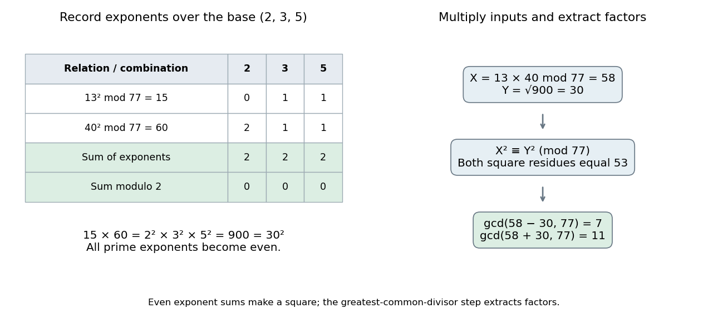

# Factor base

↑ **Parent:** [Integer factorization](integer-factorization.md)

A factor base is a finite [set](set-split.md) of small [prime numbers](prime-number-split.md) over which selected auxiliary [integers](integer-split.md) are completely factored. Some methods also record a sign coordinate for $-1$, which is not a [prime number](prime-number-split.md). A positive [integer](integer-split.md) supported entirely on the chosen [factor base](factor-base.md) gives an [exponent vector](exponent-vector.md); reducing that vector modulo two records which [prime exponents](p-adic-valuation.md) are [odd integers](odd-integer.md). The product is a [square of a number](square-of-a-number.md) precisely when every prime exponent is an [even integer](even-number.md).

For the original toy $N=77$, use [factor base](factor-base.md) $\{2,3,5\}$ and the two relations

$$
13^2\equiv15=3\cdot5\pmod{77},\qquad
40^2\equiv60=2^2\cdot3\cdot5\pmod{77}.
$$

The residues have exponent vectors $(0,1,1)$ and $(2,1,1)$ in the order $(2,3,5)$. Adding the two vectors modulo two gives $(0,0,0)$, so multiplying the residues gives $15\cdot60=900=30^2$. Consequently

$$
(13\cdot40)^2\equiv30^2\pmod{77},\qquad
X=13\cdot40\bmod77=58,\quad Y=30,
$$

and **$\gcd(X-Y,77)=7$ and $\gcd(X+Y,77)=11$**. Neither individual residue was a square; combining the relations made all exponents even.

**[Figure 1](#image-a-factor-base-turns-two-smooth-relations-into-a-congruence-of-squares-through-exponent-parity). A factor base turns two smooth relations into a congruence of squares through exponent parity**. The original $N=77$ example uses the ordered [factor base](factor-base.md) $(2,3,5)$. The rows $(0,1,1)$ and $(2,1,1)$ add to zero modulo two, giving residue product $900=30^2$. The product of the original inputs is $520\equiv58\pmod{77}$; [greatest common divisor](greatest-common-divisor.md) calculations then extract seven and eleven.

In a larger collection, choose relations $x_i^2\equiv r_i\pmod N$ with positive residues $r_i=\prod_{j=1}^B p_j^{e_{ji}}$. If a nonempty selection $I$ has an even sum in every exponent coordinate, set

$$
X=\prod_{i\in I}x_i\bmod N,\qquad
Y=\prod_{j=1}^B p_j^{\frac12\sum_{i\in I}e_{ji}}\bmod N.
$$

Then $X^2\equiv Y^2\pmod N$. Finding such a selection is a [linear dependence](linear-dependence.md) problem over the [finite field](finite-field.md) $\mathbb F_2$: the indicator vector of the chosen relations belongs to the [kernel of a linear map](kernel-of-a-linear-map-split.md) given by the parity matrix. This is why a problem about [prime factors](prime-factor.md) recruits [linear algebra](linear-algebra-split.md). The final [congruence of squares](congruence-of-squares.md) may still be trivial, so another selection can be needed. [Ben Lynn, Factoring and Discrete Logarithms, Dixon's Algorithm: exponent matrix and kernel](https://crypto.stanford.edu/pbc/notes/crypto/factoring.html).

There is a tradeoff: a small [factor base](factor-base.md) gives a smaller parity matrix, but fewer auxiliary [integers](integer-split.md) factor completely over it. A larger [factor base](factor-base.md) accepts more relations but makes the [linear algebra](linear-algebra-split.md) larger. Negative auxiliary values need an additional sign coordinate, and a selected product needs even sign parity as well as even prime exponents. Pomerance's account explains this balance and the historical development of combining smooth relations; the toy example omits algorithm-specific sieving and running-time claims. [Carl Pomerance, A Tale of Two Sieves (1996), pp. 1475–1476: exponent parity, factor bases and signs](https://math.dartmouth.edu/~carlp/PDF/paper109.pdf).

**Table of contents**

- [Exponent vector](exponent-vector.md)
  - [Prime-exponent difference](prime-exponent-difference.md)

## ↑ Ancestors (5)

1. [Integer factorization](integer-factorization.md)
2. [Number theory](number-theory-split.md)
3. [Area of mathematics](area-of-mathematics.md)
4. [Mathematics](mathematics-split.md)
5. [Codex Wiki](split.md)

## ← Incoming links (7)

- [B-smooth integer](b-smooth-integer.md)
- [Congruence of squares](congruence-of-squares.md)
- [Exponent vector](exponent-vector.md)
- [Factor base](factor-base.md)
- [Integer factorization](integer-factorization.md)
- [P-adic valuation](p-adic-valuation.md)
- [Solution](past-exam-of-the-mathematics-course-of-the-university-of-cambridge/2008/ii/paper-4/11h/solution.md)
