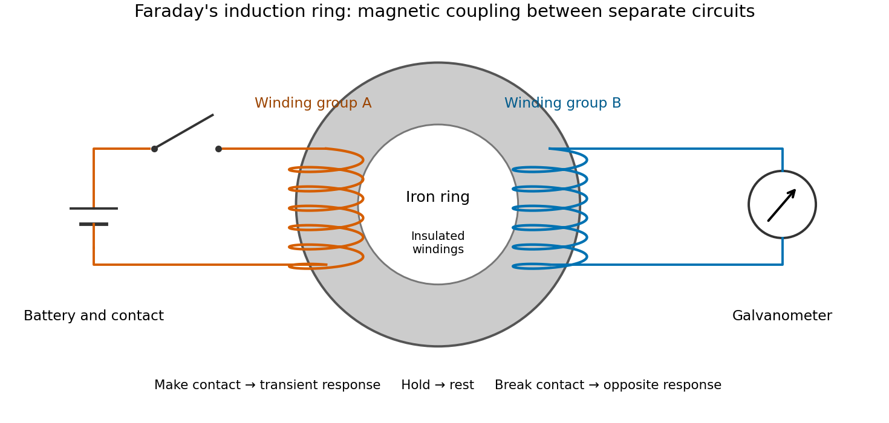

# Faraday induction-ring experiment

↑ **Parent:** [Faraday's law of induction](faraday-s-law-of-induction.md)

[Michael Faraday](michael-faraday.md)'s induction ring separates two questions: can one [electrical circuit](electrical-circuit-split.md) affect another without an electrical connection, and does that effect continue under steady conditions? The surviving apparatus uses insulated [copper](copper.md) windings around an [iron](iron.md) ring; the Royal Institution dates the successful experiment to 29 August 1831.[Collection record, date, materials and Description](michael-faraday-s-ring-coil-apparatus-by-royal-institution.md)

Faraday connected one winding group to a [battery](electric-battery.md), the other to a [galvanometer](galvanometer.md). Making battery contact deflected the needle; maintaining contact let it return to rest; breaking contact reversed the response. Reversing the battery reversed the deflections. His separate cylinder comparison enhanced induction with [iron](iron.md), whereas replacing it with [copper](copper.md) gave no enhancement over the windings alone.[First Series, §§27–30, ring, connections and reversal; §§34–35, distinct cylinder comparison](experimental-researches-in-electricity-volume-1-by-michael-faraday.md)

**[Figure 4](#image-separate-electrical-circuits-in-faraday-s-induction-ring-experiment). Separate electrical circuits in Faraday's induction-ring experiment**. [Source](faraday-induction-ring-functional-apparatus.py). Original functional diagram. Each drawn winding represents a winding group; the illustration gives no historical turn count, dimensions or scale. The needle is the readout, rather than a plotted electric-current measurement.

The contrast between a switching response and a quiet steady state makes [mutual induction](mutual-induction.md) tangible. A steady primary [electric current](electric-current.md) can maintain [magnetic flux](magnetic-flux.md) without sustaining a secondary [electromotive force](electromotive-force.md). Changes in [magnetic flux linkage](magnetic-flux-linkage.md) matter, as expressed by [Faraday's law of induction](faraday-s-law-of-induction.md). This is why a driven [electrical transformer](transformer-electrical-engineering.md) uses repeated changes in [magnetic flux](magnetic-flux.md) to supply secondary [power](power.md).

The [galvanometer readout of an induction pulse](galvanometer-readout-of-an-induction-pulse.md) also separates the measured motion from the inferred [electric current](electric-current.md). Its [moment of inertia](moment-of-inertia.md) and [damping](damping.md) mean that a deflection is not an instantaneous trace of [electric current](electric-current.md). The following [coupled RL induction model](coupled-rl-induction-model.md) calculates currents in a stipulated circuit, rather than fitting Faraday's needle motion or reconstructing his switching times.

**Table of contents**

- [Coupled RL induction model](coupled-rl-induction-model.md)
  - [Equal-loop RL induction step](equal-loop-rl-induction-step.md)
  - [Closed-return induction under a voltage pulse](closed-return-induction-under-a-voltage-pulse.md)
  - [Energy balance of coupled RL circuits](energy-balance-of-coupled-rl-circuits.md)

## ↑ Ancestors (6)

1. [Faraday's law of induction](faraday-s-law-of-induction.md)
2. [Maxwell equations](maxwell-equations-split.md)
3. [Electromagnetism](electromagnetism-split.md)
4. [Branches of physics](branches-of-physics.md)
5. [Physics](physics-split.md)
6. [Codex Wiki](split.md)
