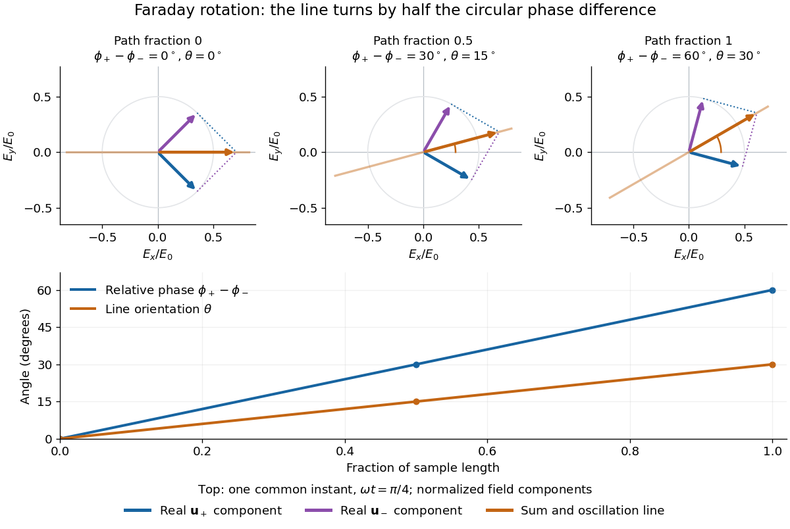

# Faraday rotation from circular phases

↑ **Parent:** [Faraday effect](faraday-effect.md)

The factor of one half follows from [superposition](superposition-principle.md), without assigning ambiguous right/left names to the [circular polarizations](circular-polarization.md). Use the [complex amplitude](complex-amplitude.md) convention $\operatorname{Re}[\mathbf E(z)e^{-i\omega t}]$ and fixed transverse [unit vectors](unit-vector.md)

$$
\mathbf u_+=\frac{\widehat{\mathbf x}-i\widehat{\mathbf y}}{\sqrt2},\qquad
\mathbf u_-=\frac{\widehat{\mathbf x}+i\widehat{\mathbf y}}{\sqrt2},\qquad
\widehat{\mathbf x}=\frac{\mathbf u_++\mathbf u_-}{\sqrt2}.
$$

For equal transmitted [wave amplitudes](wave-amplitude.md), let the accumulated [wave phases](phase-waves.md) be $\phi_+$ and $\phi_-$. Their sum is

$$
\frac{\mathbf u_+e^{i\phi_+}+\mathbf u_-e^{i\phi_-}}{\sqrt2}
=e^{i\bar\phi}\left(\widehat{\mathbf x}\cos\theta+\widehat{\mathbf y}\sin\theta\right),\qquad
\bar\phi=\frac{\phi_++\phi_-}{2},\quad
\theta=\frac{\phi_+-\phi_-}{2}.
$$

The common [wave phase](phase-waves.md) $\bar\phi$ sets the timing of the [electric field](electric-field-split.md) oscillation; the real direction in parentheses sets its [linear polarization](linear-polarization.md). Opposite [circular polarizations](circular-polarization.md) have changed their relative [wave phase](phase-waves.md), yet their sum still oscillates along a line. Unequal transmitted [wave amplitudes](wave-amplitude.md) would generally give [elliptical polarization](elliptical-polarization.md) instead.

In a uniform sample, with [refractive indices](refractive-index.md) $n_+,n_-$ and [vacuum](vacuum.md) [wavenumber](wavenumber.md) $k_0=2\pi/\lambda_0$, the [phase difference](phase-difference.md) is $(k_+-k_-)L=k_0(n_+-n_-)L$. Thus

$$
\theta=\frac{\pi L}{\lambda_0}(n_+-n_-),\qquad
n_+-n_-=\frac{\lambda_0}{\pi}VB_\parallel.
$$

The second relation identifies the small signed [circular birefringence](circular-birefringence.md) responsible for the rotation in this basis. Unlike a [waveplate](waveplate.md), whose separated modes have orthogonal [linear polarizations](linear-polarization.md), this ideal rotator has modes with opposite [circular polarizations](circular-polarization.md).

**[Figure 6](#image-equal-opposite-circular-polarizations-acquire-a-60-circ-relative-wave-phase-and-give-30-circ-faraday-rotation). Equal opposite circular polarizations acquire a $60^\circ$ relative wave phase and give $30^\circ$ Faraday rotation**. Original normalized model: common [wave phase](phase-waves.md) is removed, and the relative [wave phase](phase-waves.md) grows linearly with path fraction. The top panels add the real circular-component [electric field](electric-field-split.md) vectors at the same time. Orange lines mark the resulting [linear polarization](linear-polarization.md) direction. The lower panel compares relative [wave phase](phase-waves.md) with its half-angle rotation. No material measurements are plotted.

## ↑ Ancestors (8)

1. [Faraday effect](faraday-effect.md)
2. [Polarization of an electromagnetic wave](polarization-of-an-electromagnetic-wave.md)
3. [Plane electromagnetic wave](plane-electromagnetic-wave.md)
4. [Electromagnetic wave](electromagnetic-wave-split.md)
5. [Electromagnetism](electromagnetism-split.md)
6. [Branches of physics](branches-of-physics.md)
7. [Physics](physics-split.md)
8. [Codex Wiki](split.md)
