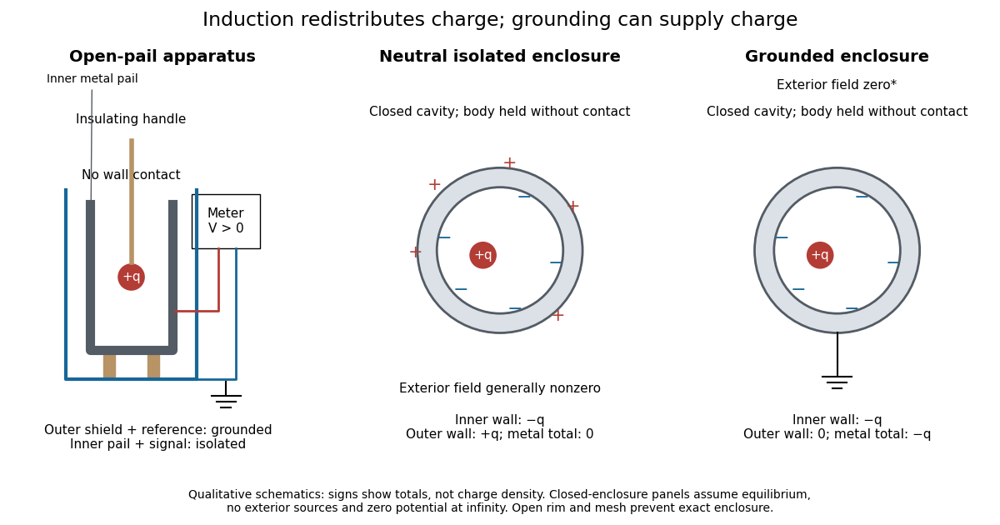
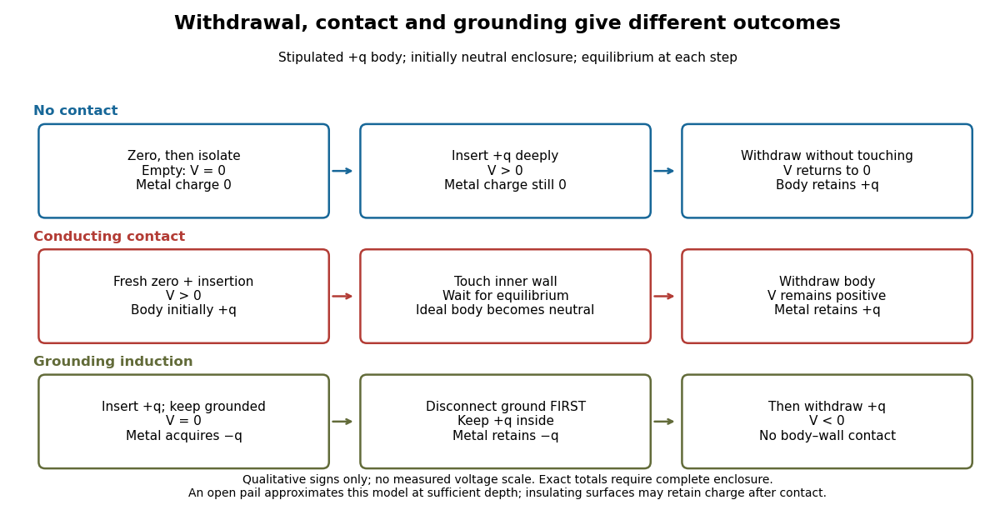

<h1 id="faraday-s-ice-pail-experiment">Faraday's ice pail experiment</h1>

↑ **Parent:** [Electrostatics](electrostatics-split.md)

[Faraday's ice pail experiment](faraday-s-ice-pail-experiment.md) distinguishes **redistribution** of [electric charge](electric-charge-split.md) by [electrostatic induction](electrostatic-induction.md) from **transfer** of [electric charge](electric-charge-split.md) by contact. Lower a charged body into an initially neutral isolated metal pail: an externally connected [electrometer](electrometer.md) responds even though the body never touches the metal. Withdraw the body without contact and the response disappears. Repeat with conductive contact before withdrawal and a residual response can remain. The striking point is that an exterior response does not establish that the pail has gained net [electric charge](electric-charge-split.md).

**Apparatus and readout.** A modern implementation uses two concentric wire-mesh cylinders: a 10 cm diameter, 15 cm high inner pail on insulating rods and a grounded outer shield. Connect the [electrometer](electrometer.md)'s signal lead to the inner pail and its reference lead to the shield. Momentarily ground and zero the signal assembly, then isolate it; the shield remains grounded. A charged disk on an insulating handle goes into the lower half without touching. The [electrometer](electrometer.md) measures [electric potential difference](electric-potential-difference.md) in [volts](volt.md), with sign determined by the lead connections. It does not directly measure [electric charge](electric-charge-split.md) in [coulombs](coulomb.md).[Basic Electrostatics System, instruction manual 012-07227G, printed pp. 9–10, 13–15, Figure 1.1 and Procedure 1A](basic-electrostatics-system-es-9080b-instruction-manual-012-07227g-by-cecilia-hernandez.md)

**[Figure 1](#image-faraday-s-ice-pail-experiment-apparatus-and-isolated-versus-grounded-electric-charge-accounting). Faraday's ice pail experiment: apparatus and isolated versus grounded electric charge accounting**. Original qualitative schematics. The open pail approximates enclosure; the two closed [cavity in a conductor](cavity-in-a-conductor.md) panels stipulate exact enclosure, [electrostatic equilibrium](electrostatic-equilibrium.md), no exterior sources and zero [electric potential](electric-potential.md) at infinity. Signs denote total [electric charges](electric-charge-split.md), not a measured or uniform [surface charge density](surface-charge-density.md).

**A charge ledger before contact.** To separate exact reasoning from the open apparatus, first idealize the pail as a closed [cavity in a conductor](cavity-in-a-conductor.md) with one internal body of total [electric charge](electric-charge-split.md) $q$. Let the isolated metal have total [electric charge](electric-charge-split.md) $Q_0$. The metal's [electric field](electric-field-split.md) is zero at [electrostatic equilibrium](electrostatic-equilibrium.md).[Richard Fitzpatrick, Ideal Conductors, equations 2.124–2.126: zero field and constant potential in metal](intermediate-college-physics-by-richard-fitzpatrick/ideal-conductors.md) A [Gaussian surface](gaussian-surface.md) enclosing the [cavity in a conductor](cavity-in-a-conductor.md) but lying wholly in the metal therefore has zero [electric flux](electric-flux.md). [Gauss's law](gauss-s-law.md) and [charge conservation](charge-conservation.md) give

$$
q+Q_{\rm inner}=0,\qquad Q_{\rm inner}+Q_{\rm outer}=Q_0,\qquad Q_{\rm outer}=Q_0+q.
$$

For $Q_0=0$ and $q>0$, the inner-wall total is $-q$ and the outer-wall total is $+q$: the metal remains neutral. The exterior [electric field](electric-field-split.md) can therefore be nonzero without any transfer from the body. The connected [electrometer](electrometer.md) and signal cable belong to the same isolated conducting assembly and share its exterior [electric charge](electric-charge-split.md). The zero-[electric field](electric-field-split.md) assertion concerns metal, not the occupied [cavity in a conductor](cavity-in-a-conductor.md).

This ledger fixes totals, not the local [surface charge density](surface-charge-density.md). Moving an off-center body changes the inner-wall distribution while its [integral](integral-split.md) remains $-q$. With fixed outer geometry, fixed $Q_0+q$ and unchanged exterior sources, [Uniqueness of the Dirichlet problem](uniqueness-of-the-dirichlet-problem.md) together with the fixed total outer [electric charge](electric-charge-split.md) determines the same exterior solution: the outside cannot reveal the body's position or detailed internal distribution. For example, internal bodies with stipulated [electric charges](electric-charge-split.md) $+2q$ and $-q$ give the same total exterior response as a single body with $+q$. Internal bodies with $+q$ and $-q$ can give a null exterior response while retaining a nonzero internal [electric field](electric-field-split.md). This is why a null reading cannot establish an empty [cavity in a conductor](cavity-in-a-conductor.md).

**Withdrawal is the control.** Record a baseline, insert without contact, withdraw, and check return to baseline. After a fresh zero, repeat with the charged disk touching the inner wall, then withdraw and record the residual response. Finally zero the pail and reinsert the disk without contact to test remaining [electric charge](electric-charge-split.md). Keep the operator grounded, discharge unwanted handle [electric charge](electric-charge-split.md), and keep the unused charged disk distant. Dirty supports and humidity promote leakage. These controls separate transfer from [electrostatic induction](electrostatic-induction.md) and stray coupling.[Basic Electrostatics System, instruction manual 012-07227G, printed pp. 4–5 and 14–15, Procedure 1A steps 3–8: handle charge, withdrawal, contact and disk retest](basic-electrostatics-system-es-9080b-instruction-manual-012-07227g-by-cecilia-hernandez.md)

**[Figure 2](#image-faraday-s-ice-pail-experiment-qualitative-withdrawal-contact-and-grounding-sequences). Faraday's ice pail experiment: qualitative withdrawal, contact and grounding sequences**. Stipulated ideal-model outcomes for a body initially carrying positive [electric charge](electric-charge-split.md) $q$, with a separate neutral initial state for each row. No measured [electric potential differences](electric-potential-difference.md) or time scale are depicted. The grounding sequence disconnects ground before withdrawal; reversing that order removes its residual [electric charge](electric-charge-split.md).

In the ideal contact test, the internal body is itself an [electrical conductor](electrical-conductor.md) and makes a conducting connection to the wall. After [charge relaxation](charge-relaxation.md), body and enclosure become a single [equipotential](equipotential.md); the remaining charge-free void has zero [electric field](electric-field-split.md). The body then carries no excess [electric charge](electric-charge-split.md) on surfaces facing that void. Withdrawal without subsequent charging leaves total metal [electric charge](electric-charge-split.md) $Q_0+q$. A coated paddle can retain [electric charge](electric-charge-split.md) on insulating patches, so merely touching it does not guarantee complete transfer. A residual reading establishes some transfer under the controls; the disk retest checks the stronger claim of complete transfer. The ideal argument assumes no leakage and no relevant contact-generated charging.

**Grounding changes the ledger.** With no exterior sources and zero [electric potential](electric-potential.md) at infinity, a closed grounded enclosure has zero exterior [electric field](electric-field-split.md), inner-wall [electric charge](electric-charge-split.md) $-q$ and zero outer-wall [electric charge](electric-charge-split.md).[II.5, §5–10, final shielding argument: a closed grounded conducting shell separates the two electrostatic problems](the-feynman-lectures-on-physics-volume-ii-by-richard-feynman-and-others.md) Consequently, disconnecting ground before withdrawal retains total metal [electric charge](electric-charge-split.md) $-q$, which moves to the exterior after withdrawal. Keeping ground connected during withdrawal instead restores zero [electric charge](electric-charge-split.md). A lasting opposite-sign response can therefore arise through grounding without body–wall contact.

For the real open pail, no [Gaussian surface](gaussian-surface.md) lying wholly in metal closes over the mouth. Increasing insertion depth and seeking a stable response tests whether enclosure is a good approximation; mesh openings, rim proximity and nearby objects limit it. In a fixed-geometry approximation, the positive insertion response obeys $\Delta V\simeq q/C_{\rm eff}$, where $C_{\rm eff}$ is the effective [capacitance](capacitance.md) of the pail, shield, cable and [electrometer](electrometer.md) input. Changed geometry changes that conversion. Wait for [charge relaxation](charge-relaxation.md) and instrument settling at each step, while keeping the observation short compared with leakage. The experiment probes settled [electrostatics](electrostatics-split.md); it does not establish shielding against arbitrary changing [electromagnetic fields](electromagnetic-field.md).

## ↑ Ancestors (5)

1. [Electrostatics](electrostatics-split.md)
2. [Electromagnetism](electromagnetism-split.md)
3. [Branches of physics](branches-of-physics.md)
4. [Physics](physics-split.md)
5. [Codex Wiki](split.md)

## ← Incoming links (4)

- [Cavity in a conductor](cavity-in-a-conductor.md)
- [Conductor in electrostatic equilibrium](conductor-in-electrostatic-equilibrium.md)
- [Electrostatic shielding](electrostatic-shielding.md)
- [Faraday's ice pail experiment](faraday-s-ice-pail-experiment.md)
