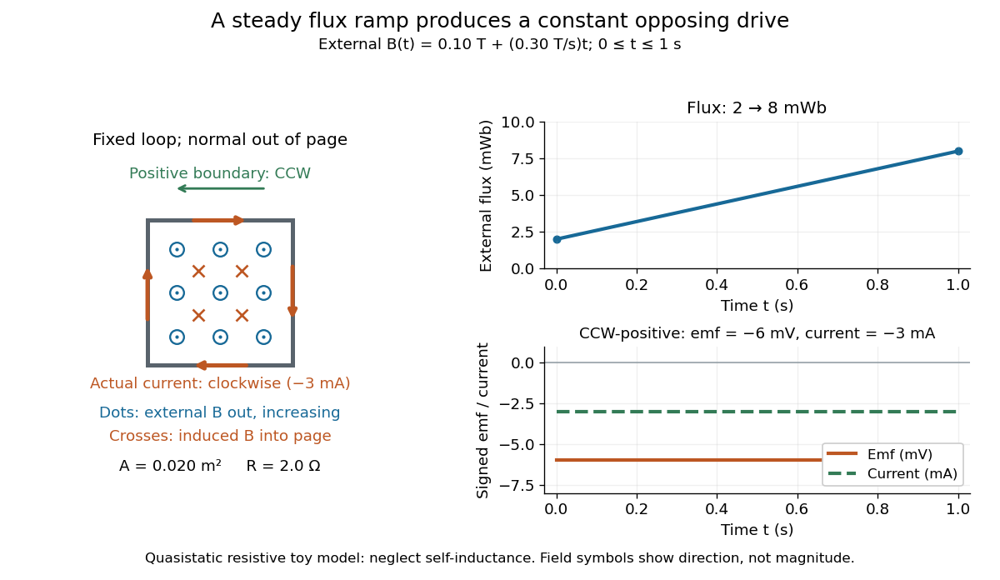

<h1 id="faraday-s-law-of-induction">Faraday's law of induction</h1>

↑ **Parent:** [Maxwell equations](maxwell-equations-split.md)  
ⓦ [Wiki](https://en.wikipedia.org/wiki/Faraday's_law_of_induction)

[Faraday's law of induction](faraday-s-law-of-induction.md) relates a changing [magnetic field](magnetic-field-split.md) to circulation of the [electric field](electric-field-split.md). For a fixed [oriented surface](oriented-surface.md) $S$ with boundary $C=\partial S$, choose the positive direction around $C$ by the [right-hand rule](right-hand-rule.md): the fingers follow $C$ while the thumb follows the chosen [unit normal](unit-normal.md). The fixed-loop electromagnetic [electromotive force](electromotive-force.md) is

$$
\mathcal E=\oint_C\mathbf E\cdot d\mathbf l
=-\frac{\partial}{\partial t}\int_S\mathbf B\cdot d\mathbf S
=-\frac{d\Phi_B}{dt},
\qquad
\nabla\times\mathbf E=-\frac{\partial\mathbf B}{\partial t}.
$$

The final [derivative](derivative.md) of [magnetic flux](magnetic-flux.md) is an ordinary time derivative, with the [surface](topological-surface-split.md) held fixed. Reversing both the [unit normal](unit-normal.md) and the boundary direction reverses both signs. The loop may be an imagined path: the field law does not require a wire or an [electric current](electric-current.md). [Feynman lectures, II.17.1: electric-field circulation and induction](https://www.feynmanlectures.caltech.edu/II_17.html#Ch17-S1).

For a computed example, a fixed single-turn loop has [area](surface-area.md) $A=0.020\,\mathrm{m^2}$ and out-of-page [unit normal](unit-normal.md). Prescribe an external uniform [magnetic field](magnetic-field-split.md) in that direction with $B(t)=0.10\,\mathrm T+(0.30\,\mathrm{T/s})t$ for $0\le t\le1.0\,\mathrm s$. Then

$$
\Phi_{\mathrm{ext}}(t)=AB(t)
=0.0020\,\mathrm{Wb}+(0.0060\,\mathrm{Wb/s})t,
\qquad
\mathcal E_{\mathrm{CCW}}=-0.0060\,\mathrm V.
$$

In a quasistatic resistive model with [electrical resistance](electrical-resistance.md) $R=2.0\,\Omega$, neglect the loop's [self-inductance](self-inductance.md) and its own contribution to changing [magnetic flux](magnetic-flux.md). [Ohm's law](ohm-s-law.md) gives

$$
I_{\mathrm{CCW}}=\frac{\mathcal E_{\mathrm{CCW}}}{R}=-0.0030\,\mathrm A.
$$

The [magnetic flux](magnetic-flux.md) rises from $0.0020\,\mathrm{Wb}$ to $0.0080\,\mathrm{Wb}$ while the induced [electromotive force](electromotive-force.md) stays constant: it measures the rate of change, rather than the amount of [magnetic flux](magnetic-flux.md). The negative sign means clockwise [electric current](electric-current.md); its [magnetic field](magnetic-field-split.md) through the loop points into the page, as explained by [Lenz's law](lenz-s-law.md). The toy model describes the interval of steady ramping, excluding switching transients at its ends.

**[Figure 3](#image-faraday-s-law-of-induction-and-lenz-s-law-for-increasing-out-of-page-magnetic-flux). Faraday's law of induction and Lenz's law for increasing out-of-page magnetic flux**. Counterclockwise is the positive orientation. Dots denote the external out-of-page [magnetic field](magnetic-field-split.md), and crosses denote the in-page [magnetic field](magnetic-field-split.md) produced by the clockwise induced [electric current](electric-current.md). The plots show $\Phi_{\mathrm{ext}}$ increasing from $2$ to $8\,\mathrm{mWb}$, with constant $\mathcal E=-6\,\mathrm{mV}$ and $I=-3\,\mathrm{mA}$ in the resistive approximation.

For a moving conducting loop $C(t)$, the electromagnetic [electromotive force](electromotive-force.md) instead includes the [Lorentz force](lorentz-force.md) contribution from the local [velocity](velocity.md) $\mathbf v$ of each conductor segment:

$$
\mathcal E(t)=\oint_{C(t)}(\mathbf E+\mathbf v\times\mathbf B)\cdot d\mathbf l
=-\frac{d}{dt}\int_{S(t)}\mathbf B\cdot d\mathbf S.
$$

This form assumes a thin-wire model with a well-defined closed contour and spanning [oriented surface](oriented-surface.md) that move compatibly, a [magnetic field](magnetic-field-split.md) satisfying [Gauss's law for magnetism](gauss-s-law-for-magnetism.md), and conductor speeds small compared with the [speed of light](speed-of-light.md). Ideal sliding contacts such as those in [motional electromotive force](motional-electromotive-force.md) can be treated piecewise. Arbitrary changes of electrical connections require checking the actual contour and conductor velocities; differentiating the flux through an arbitrary chosen moving path is insufficient. The [velocity](velocity.md) here describes conductor motion, not the charge carriers' drift along the wire. [Feynman lectures, II.17.2: limits of the flux rule](https://www.feynmanlectures.caltech.edu/II_17.html#Ch17-S2).

A short derivation of the fixed-loop integral statement applies [Stokes theorem](stokes-theorem.md) to the local [curl](curl.md) equation and differentiates under the fixed [surface integral](surface-integral.md). For the moving loop, the [magnetic flux transport for a moving circuit](magnetic-flux-transport-for-a-moving-circuit.md) adds the swept-area term $-\oint_C(\mathbf v\times\mathbf B)\cdot d\mathbf l$ to $d\Phi_B/dt$. Combining these two identities gives the moving-loop statement. This derives the integral forms from the local field law; it is not a proof of that empirical law from mathematics alone.

The useful unity is geometric: changing the [magnetic field](magnetic-field-split.md), the enclosed [area](surface-area.md), or the orientation can change [magnetic flux](magnetic-flux.md) and hence produce an [electromotive force](electromotive-force.md). A coil's multiple turns are accounted for by [magnetic flux linkage](magnetic-flux-linkage.md), rather than by multiplying a single-turn flux without checking which flux each turn receives. [OpenStax University Physics 2, §13.1: flux changes and coils](https://openstax.org/books/university-physics-volume-2/pages/13-1-faradays-law).

Faraday's report read on 24 November 1831 describes opposite momentary responses when a neighboring circuit is connected and disconnected, with no continuing response while its steady [electric current](electric-current.md) is maintained. These are concrete experimental roots of the changing-flux idea. The report predates the modern [Maxwell equations](maxwell-equations-split.md) notation used above. [Faraday, Experimental Researches in Electricity, First Series (1831), §§10–11, reprinted in volume I](experimental-researches-in-electricity-volume-1-by-michael-faraday.md).

**Table of contents**

- [Induced current in a tilted resistive loop](induced-current-in-a-tilted-resistive-loop.md)
- [Faraday induction-ring experiment](faraday-induction-ring-experiment.md)
  - [Coupled RL induction model](coupled-rl-induction-model.md)
    - [Equal-loop RL induction step](equal-loop-rl-induction-step.md)
    - [Closed-return induction under a voltage pulse](closed-return-induction-under-a-voltage-pulse.md)
    - [Energy balance of coupled RL circuits](energy-balance-of-coupled-rl-circuits.md)
- [Pickup coil](pickup-coil.md)
- [Lenz's law](lenz-s-law.md)
  - [Terminal speed of a falling conducting loop](terminal-speed-of-a-falling-conducting-loop.md)
    - [Lossless limit of magnetic loop braking](lossless-limit-of-magnetic-loop-braking.md)

## ↑ Ancestors (5)

1. [Maxwell equations](maxwell-equations-split.md)
2. [Electromagnetism](electromagnetism-split.md)
3. [Branches of physics](branches-of-physics.md)
4. [Physics](physics-split.md)
5. [Codex Wiki](split.md)

## ← Incoming links (49)

- [Barkhausen effect](barkhausen-effect.md)
- [Barkhausen pulse area](barkhausen-pulse-area.md)
- [Conductivity-gradient term in magnetic induction](conductivity-gradient-term-in-magnetic-induction.md)
- [Eddy current](eddy-current.md)
- [Electric potential](electric-potential.md)
- [Electromagnetic induction](electromagnetic-induction.md)
- [Electromagnetism](electromagnetism-split.md)
- [Electrostatics](electrostatics-split.md)
- [Faraday induction-ring experiment](faraday-induction-ring-experiment.md)
- [Faraday's law of induction](faraday-s-law-of-induction.md)
- [Field-cooled Meissner experiment](field-cooled-meissner-experiment.md)
- [Free induction decay](free-induction-decay.md)
- [Induced current in a tilted resistive loop](induced-current-in-a-tilted-resistive-loop.md)
- [Induction coil](induction-coil.md)
- [Inductive impulse outside a switched solenoid](inductive-impulse-outside-a-switched-solenoid.md)
- [Lenz's law](lenz-s-law.md)
- [Magnetic field](magnetic-field-split.md)
- [Magnetic flux](magnetic-flux.md)
- [Meissner effect and flux history](meissner-effect-and-flux-history.md)
- [Motional electromotive force](motional-electromotive-force.md)
- [Solution](past-exam-of-the-astrophysical-fluid-dynamics-course-of-the-university-of-cambridge/2018/section-a/a1/b/solution.md)
- [Solution](past-exam-of-the-mphil-in-micro-and-nanotechnology-enterprise-course-of-the-university-of-cambridge/2017/paper-2/section-a-ii/16/i/solution.md)
- [Solution](past-exam-of-the-optics-and-electrodynamics-course-of-the-university-of-cambridge/2017/4/solution.md)
- [Solution](past-exam-of-the-physics-b-course-of-the-university-of-cambridge/2011/paper-1/section-b/b6/c/solution.md)
- [Solution](past-exam-of-the-physics-b-course-of-the-university-of-cambridge/2012/paper-1/section-b/b9/solution.md)
- [Solution](past-exam-of-the-physics-b-course-of-the-university-of-cambridge/2013/paper-1/section-b/b8/solution.md)
- [Solution](past-exam-of-the-physics-b-course-of-the-university-of-cambridge/2013/paper-2/section-b/b6/a/solution.md)
- [Solution](past-exam-of-the-physics-b-course-of-the-university-of-cambridge/2013/paper-2/section-b/b6/c/solution.md)
- [Solution](past-exam-of-the-physics-b-course-of-the-university-of-cambridge/2014/paper-2/section-b/b7/solution.md)
- [Solution](past-exam-of-the-physics-b-course-of-the-university-of-cambridge/2015/paper-1/section-a/a4/solution.md)
- [Solution](past-exam-of-the-physics-b-course-of-the-university-of-cambridge/2015/paper-1/section-b/b7/solution.md)
- [Solution](past-exam-of-the-physics-b-course-of-the-university-of-cambridge/2015/paper-1/section-b/b9/solution.md)
- [Solution](past-exam-of-the-physics-b-course-of-the-university-of-cambridge/2016/paper-2/section-b/b6/b/solution.md)
- [Solution](past-exam-of-the-physics-b-course-of-the-university-of-cambridge/2017/paper-1/section-b/b9/solution.md)
- [Solution](past-exam-of-the-physics-b-course-of-the-university-of-cambridge/2018/paper-1/section-b/b8/solution.md)
- [Solution](past-exam-of-the-physics-b-course-of-the-university-of-cambridge/2019/paper-1/section-b/b6/solution.md)
- [Solution](past-exam-of-the-physics-b-course-of-the-university-of-cambridge/2022/paper-1/section-c/c8/c/solution.md)
- [Solution](past-exam-of-the-physics-course-of-the-year-1-of-the-natural-sciences-course-of-the-university-of-cambridge/2011/paper-1/section-e/e14/c/solution.md)
- [Solution](past-exam-of-the-physics-course-of-the-year-1-of-the-natural-sciences-course-of-the-university-of-cambridge/2016/paper-1/section-e/e15/c/solution.md)
- [Solution](past-exam-of-the-physics-course-of-the-year-1-of-the-natural-sciences-course-of-the-university-of-cambridge/2018/section-e/15/c/solution.md)
- [Solution](past-exam-of-the-physics-course-of-the-year-1-of-the-natural-sciences-course-of-the-university-of-cambridge/2019/section-a/5/solution.md)
- [Solution](past-exam-of-the-physics-course-of-the-year-1-of-the-natural-sciences-course-of-the-university-of-cambridge/2024/paper-1/section-b/10/d/solution.md)
- [Solution](past-exam-of-the-physics-course-of-the-year-4-of-the-natural-sciences-course-of-the-university-of-cambridge/2016/paper-1/section-b/b3/solution.md)
- [Solution](past-exam-of-the-relativity-course-of-the-university-of-cambridge/2012/paper-1/2/c/solution.md)
- [Persistent current in a superconducting loop experiment](persistent-current-in-a-superconducting-loop-experiment.md)
- [Rüchardt experiment](ruchardt-experiment.md)
- [Self-inductance](self-inductance.md)
- [Surface impedance of a good conductor](surface-impedance-of-a-good-conductor.md)
- [Vibrating-sample magnetometer](vibrating-sample-magnetometer.md)
