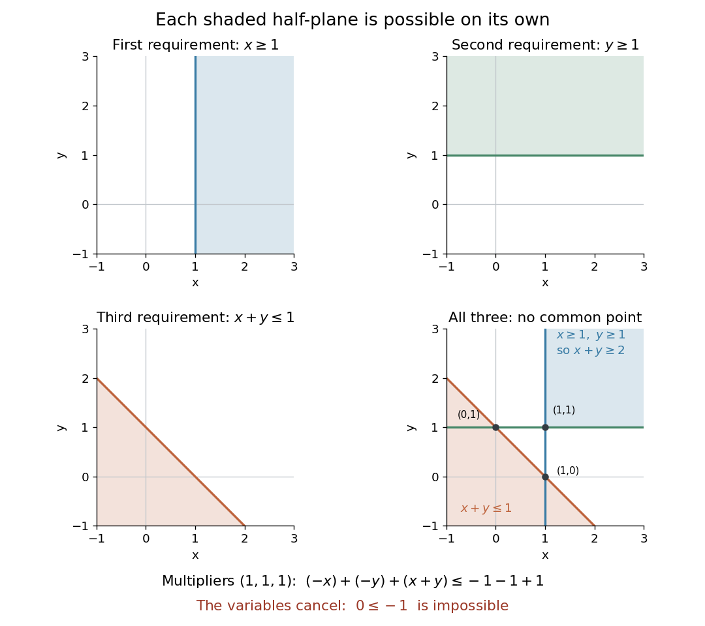

# Farkas certificate for linear inequalities

↑ **Parent:** [Farkas' lemma](farkas-lemma.md)

Let $C\in\mathbb R^{m\times n}$ and $d\in\mathbb R^m$. For unrestricted $x\in\mathbb R^n$, the [system of linear inequalities](system-of-linear-inequalities.md) $Cx\leq d$ has no [feasible point](feasible-point.md) if and only if there is a [vector](vector.md) $y\in\mathbb R^m$ with

$$
y\geq0,\qquad C^Ty=0,\qquad d^Ty<0.
$$

The entries $y_i$ are nonnegative [Lagrange multipliers](lagrange-multiplier.md) for the rows. Multiplying inequalities by them preserves their direction; the condition $C^Ty=0$ cancels every variable, leaving the contradiction

$$
0=(C^Ty)^Tx=y^TCx\leq y^Td<0.
$$

This is a [Farkas' lemma](farkas-lemma.md) alternative for non-strict inequalities; no strict-feasibility assumption is needed. See [Boyd and Vandenberghe, Convex Optimization (2004), §5.8.3, pp. 261–262](https://www.seas.ucla.edu/~vandenbe/cvxbook/bv_cvxbook.pdf#page=275).

**Three individually possible requirements, jointly impossible.** Suppose two unrestricted real coordinates $x_1,x_2$, drawn as $x,y$ in the diagram, must satisfy

$$
x_1\geq1,\qquad x_2\geq1,\qquad x_1+x_2\leq1.
$$

Write every row in the same $\leq$ direction:

$$
C=\begin{pmatrix}-1&0\\0&-1\\1&1\end{pmatrix},\qquad
d=\begin{pmatrix}-1\\-1\\1\end{pmatrix},\qquad
y=\begin{pmatrix}1\\1\\1\end{pmatrix}.
$$

Then $C^Ty=(0,0)^T$ and $d^Ty=-1$. The nonnegative weighted sum, with [Lagrange multipliers](lagrange-multiplier.md) $(1,1,1)$, is visibly

$$
\underbrace{-x_1}_{\leq-1}+\underbrace{-x_2}_{\leq-1}
+\underbrace{(x_1+x_2)}_{\leq1}\quad\Longrightarrow\quad 0\leq-1.
$$

Each individual requirement defines a [half-space](half-space.md) in the plane. Even every pair has a [feasible point](feasible-point.md): $(1,1)$ satisfies the first two, $(1,0)$ the first and third, and $(0,1)$ the second and third. Their common [intersection](set-intersection.md) is empty, because the first two force $x_1+x_2\geq2$, while the third demands at most $1$.

**[Figure 4](#image-each-half-plane-is-nonempty-but-their-three-constraints-add-to-the-contradiction-0-leq-1). Each half-plane is nonempty, but their three constraints add to the contradiction $0\leq-1$**. The first three panels shade each [half-space](half-space.md) separately. The final panel compares the simultaneous requirements $x\geq1,y\geq1$ with $x+y\leq1$; the two regions are disjoint. The points $(1,1)$, $(1,0)$ and $(0,1)$ satisfy only pairs of constraints.

**Why cancellation is necessary for unrestricted variables.** A nonzero [linear functional](linear-functional.md) $(C^Ty)^Tx$ can be made arbitrarily positive or negative by varying unrestricted $x$, so $C^Ty\geq0$ alone would not yield a contradiction. Equality is essential here. If $x\geq0$ is also imposed, the sufficient certificate becomes $y\geq0$, $C^Ty\geq0$, $d^Ty<0$, because then $y^TCx\geq0$. This is the sign convention used in [robust infeasibility under uniform constraint relaxation](robust-infeasibility-under-uniform-constraint-relaxation.md). One can instead append the rows $-x_j\leq0$ and use the equality certificate on the enlarged system. Reversing all constraints to $Cx\geq d$ reverses the scalar sign to $d^Ty>0$, as in the [normalized integer Farkas infeasibility gap](normalized-integer-farkas-infeasibility-gap.md).

**Checking a solver's infeasibility claim.** A returned [Farkas certificate for linear inequalities](farkas-certificate-for-linear-inequalities.md) gives a short verification procedure: compute $C^Ty$ and $d^Ty$, and check the three displayed conditions against the original constraints. Any positive multiple is another certificate; division by $-d^Ty$ normalizes $d^Ty$ to $-1$. With [rational numbers](rational-number.md) as data and certificate, the tests can be exact. With [floating-point arithmetic](floating-point-arithmetic-split.md), a small residual $C^Ty$ is a diagnostic rather than an exact cancellation: unrestricted $x$ can amplify a nonzero residual without bound. A rigorous certificate therefore needs exact cancellation or justified error bounds and additional bounds on the variables. The strict negative scalar is the margin of contradiction.

**The same weighted sums give dual bounds.** For the [linear program](linear-programming-split.md) maximizing $c^Tx$ over unrestricted $x$ with $Cx\leq d$, any $y\geq0$ satisfying $C^Ty=c$ gives

$$
c^Tx=y^TCx\leq y^Td
$$

for every [feasible point](feasible-point.md). Minimizing $d^Ty$ over these multipliers is the [dual linear program](dual-linear-program.md); the bound itself is [weak duality](weak-duality.md). For example, maximize $x_1+x_2$ subject to $-x_1\leq0$, $-x_2\leq0$, $x_1+x_2\leq1$. The multipliers $(0,0,1)$ give the upper bound $1$, attained at $(1,0)$. The infeasibility example above uses the same row directions, but lower bounds of $1$ on both coordinates. Its multipliers cancel the [objective function](objective-function.md) as well as the variables: $c=0$ with $d^Ty=-1$ would bound zero by a negative number. Thus impossibility and [linear programming optimality certificates](linear-programming-optimality-certificate.md) use the same arithmetic. See [Boyd and Vandenberghe, Convex Optimization slides, §§5.32–5.35](https://web.stanford.edu/~boyd/cvxbook/bv_cvxslides.pdf#page=187) for infeasibility as a dual alternative.

**Why every inconsistent system has such a certificate.** Introduce a [slack variable](slack-variable.md) vector $s\geq0$ and write $Cx+s=d$. Split the unrestricted vector as $x=u-v$ with $u,v\geq0$. Applying [Farkas' lemma](farkas-lemma.md) to the column [matrix](matrix.md) $[C\ -C\ I_m]$ gives $C^Ty\geq0$, $-C^Ty\geq0$, $y\geq0$ and $d^Ty<0$. The first two conditions together are exactly $C^Ty=0$. This reduction explains both the equality and the nonnegative row multipliers.

**Table of contents**

- [Normalized integer Farkas infeasibility gap](normalized-integer-farkas-infeasibility-gap.md)

## ↑ Ancestors (7)

1. [Farkas' lemma](farkas-lemma.md)
2. [Conic optimization](conic-optimization.md)
3. [Convex optimization](convex-optimization-split.md)
4. [Mathematical optimization](mathematical-optimization-split.md)
5. [Area of mathematics](area-of-mathematics.md)
6. [Mathematics](mathematics-split.md)
7. [Codex Wiki](split.md)

## ← Incoming links (7)

- [Farkas certificate for linear inequalities](farkas-certificate-for-linear-inequalities.md)
- [Farkas' lemma](farkas-lemma.md)
- [Normalized integer Farkas infeasibility gap](normalized-integer-farkas-infeasibility-gap.md)
- [Solution](past-exam-of-the-mathematics-course-of-the-university-of-cambridge/2003/iii/paper-37/2/solution.md)
- [Solution](past-exam-of-the-mathematics-course-of-the-university-of-cambridge/2013/iii/paper-62/3/a/solution.md)
- [Solution](past-exam-of-the-mathematics-course-of-the-university-of-cambridge/2013/iii/paper-62/3/b/solution.md)
- [System of linear inequalities](system-of-linear-inequalities.md)
