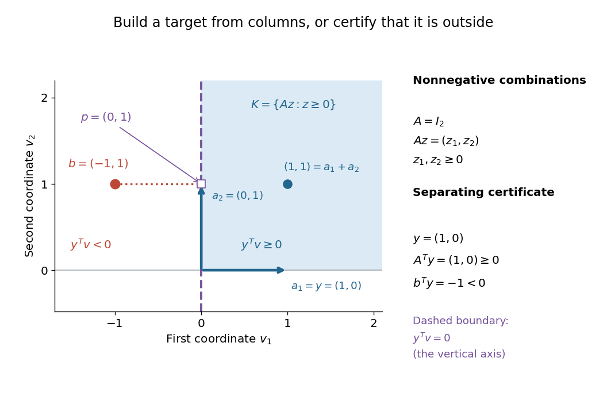

# Farkas' lemma

↑ **Parent:** [Conic optimization](conic-optimization.md)  
ⓦ [Wiki](https://en.wikipedia.org/wiki/Farkas'_lemma)

For a real [matrix](matrix.md) $A\in\mathbb R^{m\times n}$ and a [vector](vector.md) $b\in\mathbb R^m$, exactly one of the following systems has a solution:

$$
\begin{aligned}
&Az=b,\qquad z\in\mathbb R^n,\quad z\geq0;\\
&A^Ty\geq0,\qquad y\in\mathbb R^m,\quad b^Ty<0.
\end{aligned}
$$

The [linear inequalities](linear-inequality.md) here are componentwise. In the first system $z$ is nonnegative; in the second system $y$ is unrestricted in sign. The second system is a certificate that the first has no [feasible point](feasible-point.md). This nonnegative-equations alternative is developed in [Boyd and Vandenberghe, Convex Optimization slides, §5.34](https://web.stanford.edu/~boyd/cvxbook/bv_cvxslides.pdf#page=188).

**Build the target, or separate it.** Write the columns of $A$ as $a_1,\ldots,a_n$. Then $Az=\sum_jz_ja_j$ is a [conic combination](conic-combination.md): its [coefficients](coefficient.md) must be nonnegative, but need not sum to one. The obtainable targets form the [finitely generated cone](finitely-generated-cone.md)

$$
K=\{Az:z\geq0\}=\operatorname{cone}\{a_1,\ldots,a_n\}.
$$

A solution $z$ explains how to build $b$ from those columns. A certificate $y$ instead defines a [linear functional](linear-functional.md) $v\mapsto y^Tv$. The condition $A^Ty\geq0$ says that its [dot product](dot-product.md) with every generating column is nonnegative, and hence with every point of $K$. But $y^Tb<0$ places the target strictly on the other side of the [hyperplane](hyperplane.md) $y^Tv=0$. Thus $y$ belongs to the [dual cone](dual-cone.md) of $K$ and rules out every allowed [conic combination](conic-combination.md) at once.

**A certificate that can be checked by eye.** Take the [identity matrix](identity-matrix.md)

$$
A=I_2=\begin{pmatrix}1&0\\0&1\end{pmatrix},\qquad
b=\begin{pmatrix}-1\\1\end{pmatrix}.
$$

Here $K$ is the [nonnegative orthant](nonnegative-orthant.md). The equation $Az=b$ forces $z=(-1,1)^T$, violating $z\geq0$. The certificate $y=(1,0)^T$ gives

$$
A^Ty=\begin{pmatrix}1\\0\end{pmatrix}\geq0,\qquad b^Ty=-1<0.
$$

The [linear functional](linear-functional.md) simply reads the first coordinate: all allowed column combinations have a nonnegative first coordinate, while $b$ has first coordinate $-1$. For comparison, the target $(1,1)^T$ is obtained with $z=(1,1)^T$.

**[Figure 3](#image-nonnegative-column-combinations-lie-in-a-cone-while-a-farkas-certificate-separates-the-target). Nonnegative column combinations lie in a cone, while a Farkas certificate separates the target**. For $A=I_2$, the shaded [nonnegative orthant](nonnegative-orthant.md) is the [conic hull](conic-hull.md) of the two columns. The [hyperplane](hyperplane.md) $y^Tv=0$ for $y=(1,0)^T$ is the vertical axis; $b=(-1,1)^T$ lies strictly on its negative side. The obtainable target $(1,1)^T$ illustrates the other alternative.

**Why this is useful and striking.** A successful search can exhibit one [feasible point](feasible-point.md); an unsuccessful search alone cannot explain why every candidate fails. [Farkas' lemma](farkas-lemma.md) guarantees an equally concrete witness of impossibility for this finite linear problem. Once $y$ is supplied, verification needs only [matrix multiplication](matrix-multiplication.md), sign tests and one [dot product](dot-product.md). The same idea gives a [Farkas certificate for linear inequalities](farkas-certificate-for-linear-inequalities.md) and underlies [linear programming duality](linear-programming-duality.md).

**Brief geometric proof.** The two systems cannot both hold, because they would imply

$$
0>b^Ty=(Az)^Ty=z^T(A^Ty)\geq0.
$$

For existence of a certificate when $b\notin K$, [closedness of finitely generated cones](closedness-of-finitely-generated-cones.md) makes $K$ a [closed convex cone](closed-convex-cone.md), so [separation from a closed convex cone](separation-from-a-closed-convex-cone.md) supplies $y^Tb<0$ and $y^Tv\geq0$ for every $v\in K$. Testing each column gives $A^Ty\geq0$. Concretely, let $p$ be the [Euclidean projection onto a convex set](euclidean-projection-onto-a-convex-set.md) of $b$ onto $K$ and set $y=p-b$. The projection inequality gives $y^T(v-p)\geq0$ for $v\in K$. Testing $v=0$ and $v=2p$ gives $y^Tp=0$, whence $y^Tb=-\|p-b\|_2^2<0$. In the example, $p=(0,1)^T$ and $y=(1,0)^T$. Alternatively, the [Fenchel-Moreau theorem](fenchel-moreau-theorem.md) applied to the cone's [indicator functional](indicator-functional-of-a-constraint-set.md) proves the same separation through its polar cone.

An original historical source is Julius Farkas's [Theorie der einfachen Ungleichungen, Journal für die reine und angewandte Mathematik 124 (1902), pp. 1–27](https://geodesic.mathdoc.fr/item/JRAM_1902__124_149129/). The linked archival record verifies the author, title and publication details.

**Table of contents**

- [Robust infeasibility under uniform constraint relaxation](robust-infeasibility-under-uniform-constraint-relaxation.md)
- [Farkas certificate for linear inequalities](farkas-certificate-for-linear-inequalities.md)
  - [Normalized integer Farkas infeasibility gap](normalized-integer-farkas-infeasibility-gap.md)

## ↑ Ancestors (6)

1. [Conic optimization](conic-optimization.md)
2. [Convex optimization](convex-optimization-split.md)
3. [Mathematical optimization](mathematical-optimization-split.md)
4. [Area of mathematics](area-of-mathematics.md)
5. [Mathematics](mathematics-split.md)
6. [Codex Wiki](split.md)

## ← Incoming links (10)

- [Farkas certificate for linear inequalities](farkas-certificate-for-linear-inequalities.md)
- [Farkas' lemma](farkas-lemma.md)
- [Homogeneous self-dual embedding of a linear program](homogeneous-self-dual-embedding-of-a-linear-program.md)
- [Solution](past-exam-of-the-mathematics-course-of-the-university-of-cambridge/2002/iii/paper-4/6/ii/solution.md)
- [Solution](past-exam-of-the-mathematics-course-of-the-university-of-cambridge/2008/iii/paper-38/1/solution.md)
- [Solution](past-exam-of-the-mathematics-course-of-the-university-of-cambridge/2013/iii/paper-62/3/a/solution.md)
- [Solution](past-exam-of-the-mathematics-course-of-the-university-of-cambridge/2013/iii/paper-62/3/b/solution.md)
- [Piecewise integer-linear representation of a free Abelian lattice-ordered group](piecewise-integer-linear-representation-of-a-free-abelian-lattice-ordered-group.md)
- [Robust infeasibility under uniform constraint relaxation](robust-infeasibility-under-uniform-constraint-relaxation.md)
- [Stiemke theorem](stiemke-theorem.md)
