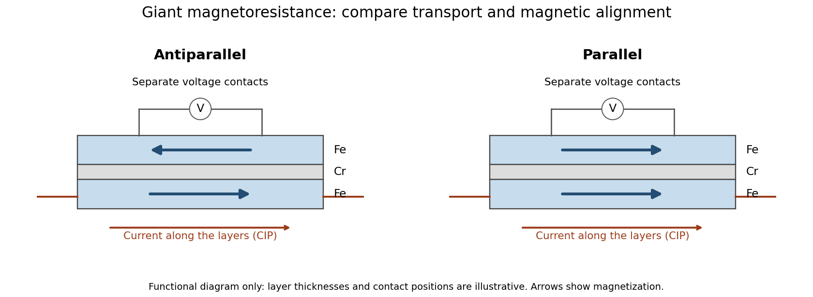

# Fe-Cr giant magnetoresistance experiments

↑ **Parent:** [Giant magnetoresistance](giant-magnetoresistance.md)

The 1988 study grew alternating [iron](iron.md)/[chromium](chromium.md) layers by [molecular beam epitaxy](molecular-beam-epitaxy.md) on [gallium arsenide](gallium-arsenide.md). [Magnetization](magnetization.md) and [torque](torque.md) measurements tested the magnetic configuration. An AC [electrical resistance](electrical-resistance.md) measurement passed [electric current](electric-current.md) along the layers while the applied [magnetic field](magnetic-field-split.md) changed. Comparing field directions and spacer thicknesses linked the resistance decrease to magnetic saturation. [Electron microscopy](electron-microscopy.md) and surface analysis checked layer formation, while leaving atomic-scale interface roughness unresolved.[pp.2472–2474, preparation, Figs.1–3 and interface limits](giant-magnetoresistance-of-001-fe%E2%81%84-001-cr-magnetic-superlattices-by-mario-norberto-baibich-and-others.md)

The independent Jülich study used [four-terminal sensing](four-terminal-sensing.md) on epitaxial Fe/Cr/Fe strips. A single [iron](iron.md) film supplied an [anisotropic magnetoresistance](anisotropic-magnetoresistance.md) comparison. [Magneto-optic Kerr effect](magneto-optic-kerr-effect.md) signals and [Brillouin light scattering](brillouin-scattering.md) from [spin waves](spin-wave.md) identified the layer alignments, rather than inferring them from resistance alone. Field scans along different magnetic axes connected the optical signatures to the resistance changes.[pp.4828–4830, four-point method, reference film and Figs.1–2](enhanced-magnetoresistance-in-layered-magnetic-structures-with-antiferromagnetic-interlayer-exchange-by-g-binasch-and-others.md)

[Peter Andreas Grünberg](peter-andreas-grunberg.md)'s retrospective explains why the preceding [interlayer exchange coupling](interlayer-exchange-coupling.md) measurements mattered: coupled [spin wave](spin-wave.md) modes supplied signatures of magnetic alignment before that alignment became an electrical signal.[pp.1533–1535, coupled modes and antiferromagnetic interlayer exchange](nobel-lecture-from-spin-waves-to-giant-magnetoresistance-and-beyond-by-peter-andreas-grunberg.md)

**[Figure 11](#image-current-along-a-magnetic-multilayer-and-an-independent-check-of-layer-alignment). Current along a magnetic multilayer and an independent check of layer alignment**. [Source](giant-magnetoresistance-in-plane-readout.py). Original functional illustration of current-in-plane transport and a generic four-terminal readout. Two idealized magnetic configurations are shown; dimensions, contact positions and layer count do not reconstruct either historical specimen. Optical probing supplies alignment information independently of the electrical signal.

A resistance curve alone does not reveal the microscopic direction of every magnetic layer. The optical measurements add a different observable, while the reference film tests an orientation-dependent response that can occur without a multilayer. Sample preparation and cross-checks therefore belong to the physical explanation.

## ↑ Ancestors (10)

1. [Giant magnetoresistance](giant-magnetoresistance.md)
2. [Magnetoresistance](magnetoresistance.md)
3. [Electrical resistance](electrical-resistance.md)
4. [Electrical resistance and conductance](electrical-resistance-and-conductance.md)
5. [Electric current](electric-current.md)
6. [Electric charge](electric-charge-split.md)
7. [Electromagnetism](electromagnetism-split.md)
8. [Branches of physics](branches-of-physics.md)
9. [Physics](physics-split.md)
10. [Codex Wiki](split.md)

## ← Incoming links (2)

- [Current-in-plane magnetoresistance](current-in-plane-magnetoresistance.md)
- [Giant magnetoresistance](giant-magnetoresistance.md)
