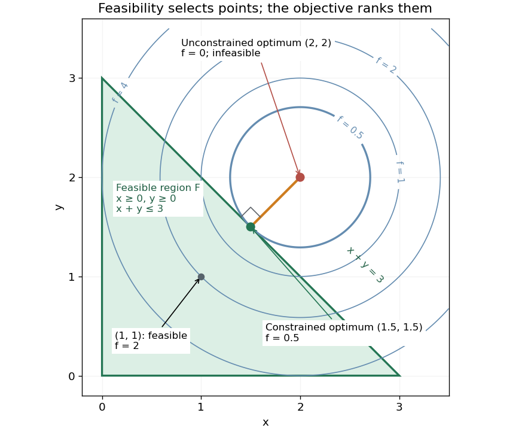

# Feasible triangle with a squared-distance objective

↑ **Parent:** [Feasible region](feasible-region.md)

Take the decision domain $D=\mathbb R^2$ and minimize the [objective function](objective-function.md)

$$
f(x,y)=(x-2)^2+(y-2)^2
\qquad\text{subject to }x\geq0,\quad y\geq0,\quad x+y\leq3.
$$

Each [inequality](inequality-mathematics.md) permits a [closed half-space](closed-half-space.md); their intersection is the filled [triangle](triangle.md) with vertices $(0,0)$, $(3,0)$ and $(0,3)$, including its edges. The [feasible region](feasible-region.md) is a [compact set](compact-space.md) and a [convex set](convex-set-split.md). The point $(1,1)$ is a [feasible point](feasible-point.md), but its [objective function](objective-function.md) value $2$ will not be best. Without the [optimization constraints](optimization-constraint.md), the unique [global minimum](global-minimum.md) is at $(2,2)$ with value $0$. That point is infeasible because $2+2>3$.

The [objective function](objective-function.md) is the squared [Euclidean distance](euclidean-distance.md) from $(2,2)$. Its positive [level sets](level-set.md) are [circles](circle.md) centered there. Expanding a [circle](circle.md) from that center, the first contact with the [feasible region](feasible-region.md) is at $(3/2,3/2)$, with [objective function](objective-function.md) value $1/2$. Thus the optimum is the [Euclidean projection onto a convex set](euclidean-projection-onto-a-convex-set.md) of the target $(2,2)$. Squaring a nonnegative [Euclidean distance](euclidean-distance.md) preserves which point is nearest.[§8.1.1, printed p. 398: squared Euclidean projection onto a polyhedron and half-space projection formula](convex-optimization-by-stephen-boyd-and-lieven-vandenberghe.md)

**[Figure 6](#image-feasible-triangle-with-a-squared-distance-objective-the-first-attainable-level-set-has-value-0-5-at-1-5-1-5). Feasible triangle with a squared-distance objective: the first attainable level set has value 0.5 at (1.5,1.5)**

Here is a direct certificate, without relying on the picture. Put $s=x+y$ and $d=x-y$. The [objective function](objective-function.md) becomes

$$
f(x,y)=\frac{(s-4)^2+d^2}{2}\geq\frac12
\qquad(0\leq s\leq3).
$$

Equality requires $s=3$ and $d=0$, so the unique optimum is $(3/2,3/2)$. At this point $x+y\leq3$ is an [active constraint](active-constraint.md), while $x\geq0$ and $y\geq0$ are strict. An [active constraint](active-constraint.md) identifies a tight restriction at a specified point; it alone does not establish optimality. For example, $(3,0)$ has the same tight sum restriction but [objective function](objective-function.md) value $5$.

For a check using the [Karush-Kuhn-Tucker conditions](karush-kuhn-tucker-conditions.md), write the [inequalities](inequality-mathematics.md) as $-x\leq0$, $-y\leq0$, $g=x+y-3\leq0$. Their [Lagrange multipliers](lagrange-multiplier.md) at the optimum are $(0,0,1)$. The [gradient](gradient.md) equation is

$$
\nabla f(3/2,3/2)+1\nabla g=(-1,-1)+(1,1)=(0,0).
$$

Feasibility, nonnegative [Lagrange multipliers](lagrange-multiplier.md) and [complementary slackness](complementary-slackness.md) also hold. With this [strictly convex function](strictly-convex-function.md) and affine [optimization constraints](optimization-constraint.md), the [Karush-Kuhn-Tucker conditions](karush-kuhn-tucker-conditions.md) certify the unique [global minimum](global-minimum.md).[§5.5.3, printed pp. 243–244, equation (5.49) and sufficiency for convex problems](convex-optimization-by-stephen-boyd-and-lieven-vandenberghe.md)

## ↑ Ancestors (6)

1. [Feasible region](feasible-region.md)
2. [Feasible point](feasible-point.md)
3. [Mathematical optimization](mathematical-optimization-split.md)
4. [Area of mathematics](area-of-mathematics.md)
5. [Mathematics](mathematics-split.md)
6. [Codex Wiki](split.md)

## ← Incoming links (3)

- [Empty and open feasible regions](empty-and-open-feasible-regions.md)
- [Equality slice of a feasible triangle](equality-slice-of-a-feasible-triangle.md)
- [Feasible triangle with a squared-distance objective](feasible-triangle-with-a-squared-distance-objective.md)
