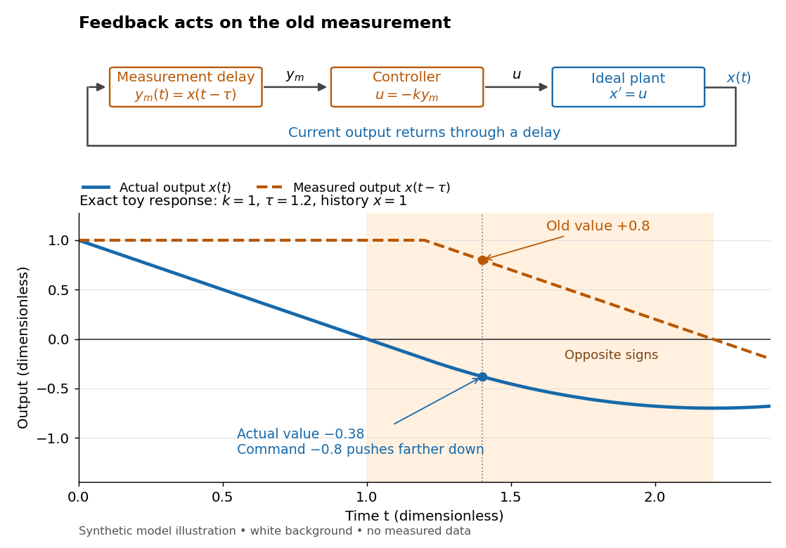

# Feedback delay

↑ **Parent:** [Closed-loop control](closed-loop-control.md)

A [feedback delay](feedback-delay.md) means a [controller](controller-control-theory.md) reacts to an earlier [plant output](output-control-theory.md). An accurate measurement can still be stale: when the [plant output](output-control-theory.md) has already crossed the [reference signal](reference-signal.md), a [controller](controller-control-theory.md) using the earlier value may continue pushing it away from the target. In a pure constant-delay model, $y_m(t)=y(t-\tau)$ with $\tau\ge0$. This isolates timing from [measurement noise](measurement-noise.md); it does not describe every sampling or communication mechanism. [Steven A. Frank, Control Theory Tutorial, section 13.4: delayed feedback of an integrator](https://stevefrank.org/control/controlBook.pdf#page=99)

For the ideal [scalar](scalar.md) [controlled plant](plant-control-theory.md) $\dot x=u$, a zero [reference signal](reference-signal.md), no [control disturbance](control-disturbance.md), and [proportional control](proportional-control.md) with constant [feedback gain](feedback-gain.md) $k>0$, the equations are

$$
y(t)=x(t),\qquad y_m(t)=x(t-\tau),\qquad u(t)=-k y_m(t),\qquad x'(t)=-k x(t-\tau).
$$

With $\tau=0$, this is an [ordinary differential equation](ordinary-differential-equation.md) with [exponential decay](exponential-decay.md) $x(t)=x(0)e^{-kt}$. With $\tau>0$, it is a [delay differential equation](delay-differential-equation.md), requiring an [initial history of delayed feedback](initial-history-of-delayed-feedback.md). The [delay stability of proportional integrator control](delay-stability-of-proportional-integrator-control.md) depends on the product $k\tau$: even this simple [controlled plant](plant-control-theory.md) loses [asymptotic stability](asymptotic-stability.md) at $k\tau=\pi/2$.

**[Figure 7](#image-a-stale-measured-output-can-command-motion-away-from-the-target). A stale measured output can command motion away from the target**. Original schematic and exact toy trajectory for $k=1$, $\tau=1.2$, and [initial history of delayed feedback](initial-history-of-delayed-feedback.md) $x(t)=1$ on $[-1.2,0]$. At $t=1.4$, the [plant output](output-control-theory.md) is $x=-0.38$, but the [measured output](measured-output.md) is $x(0.2)=0.8$, so $u=-0.8$ drives $x$ farther below zero. The shaded interval has actual and measured values of opposite signs. All plotted coordinates are [dimensionless quantities](dimensionless-quantity.md); these are model predictions, not measured data.

**Table of contents**

- [Initial history of delayed feedback](initial-history-of-delayed-feedback.md)
- [Delay stability of proportional integrator control](delay-stability-of-proportional-integrator-control.md)
- [Delayed cursor feedback experiment](delayed-cursor-feedback-experiment.md)

## ↑ Ancestors (5)

1. [Closed-loop control](closed-loop-control.md)
2. [Control theory](control-theory-split.md)
3. [Area of mathematics](area-of-mathematics.md)
4. [Mathematics](mathematics-split.md)
5. [Codex Wiki](split.md)

## ← Incoming links (10)

- [Delay differential equation](delay-differential-equation.md)
- [Delay stability of proportional integrator control](delay-stability-of-proportional-integrator-control.md)
- [Delayed cursor feedback experiment](delayed-cursor-feedback-experiment.md)
- [Delayed negative feedback model](delayed-negative-feedback-model.md)
- [Feedback delay](feedback-delay.md)
- [Initial history of delayed feedback](initial-history-of-delayed-feedback.md)
- [Measured output](measured-output.md)
- [Solution](past-exam-of-the-systems-biology-course-of-the-university-of-cambridge/2024/paper-1/section-ii/2-1/solution.md)
- [Proportional control](proportional-control.md)
- [Steady-state tracking error](steady-state-tracking-error.md)
