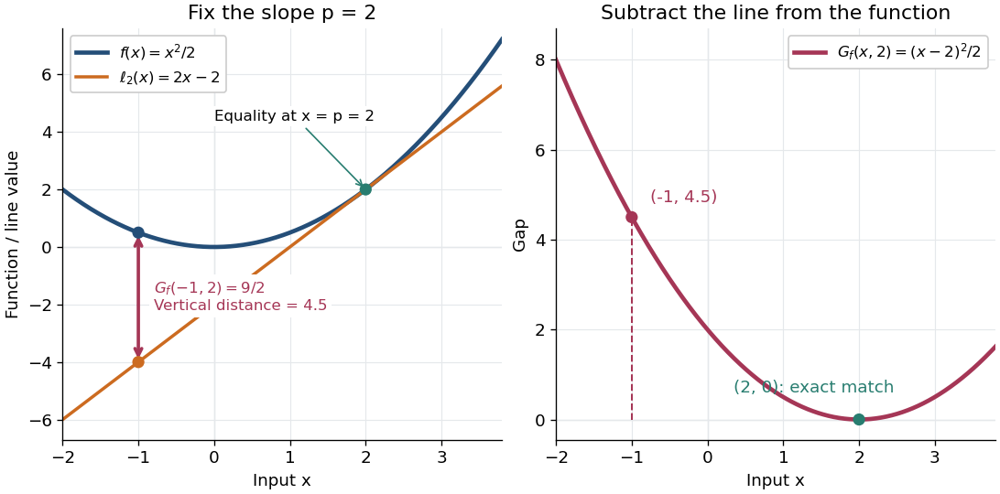

<h1 id="fenchel-young-gap">Fenchel–Young gap</h1>

↑ **Parent:** [Fenchel–Young inequality](fenchel-young-inequality.md)

The [Fenchel–Young gap](fenchel-young-gap.md) is the nonnegative discrepancy

$$
G_f(x,p)=f(x)+f^*(p)-p\cdot x\geq0
$$

for a [proper convex function](proper-convex-function.md) and its [convex conjugate](convex-conjugate.md). It can be $+\infty$. When $f^*(p)$ is finite, it is the vertical distance between $f(x)$ and its [affine minorant](affine-minorant.md) $\ell_p(x)=p\cdot x-f^*(p)$. The [Fenchel–Young gap](fenchel-young-gap.md) vanishes exactly when $p\in\partial f(x)$, so it measures whether an input and a slope satisfy the [subgradient](subgradient.md) relation.

For the [convex quadratic function](convex-quadratic-function.md) $f(x)=x^2/2$, completing the square gives

$$
G_f(x,p)=\frac{x^2}{2}+\frac{p^2}{2}-px=\frac{(x-p)^2}{2}.
$$

At $x=-1$ and $p=2$, the function value is $1/2$ and the [tangent line](tangent-line.md) $2x-2$ has value $-4$, giving a [Fenchel–Young gap](fenchel-young-gap.md) of $9/2$. In $\mathbb R^n$, the same calculation for $f(x)=\|x\|_2^2/2$ gives $f^*(p)=\|p\|_2^2/2$ and $G_f(x,p)=\|x-p\|_2^2/2$, half the squared [Euclidean norm](euclidean-norm.md) of the mismatch.

**[Figure 10](#image-the-fenchel-young-gap-for-a-convex-quadratic-function-is-the-vertical-distance-above-a-tangent-line). The Fenchel–Young gap for a convex quadratic function is the vertical distance above a tangent line**. The left panel fixes $p=2$ and marks the distance $G_f(-1,2)=9/2$ between the [convex quadratic function](convex-quadratic-function.md) $x^2/2$ and its [tangent line](tangent-line.md) $2x-2$. The right panel plots the [Fenchel–Young gap](fenchel-young-gap.md) $(x-2)^2/2$, which vanishes at the matching input $x=p=2$.

**An exact optimization error certificate.** Fix a slope $p$ with $f^*(p)<+\infty$ and minimize the linearly tilted [objective function](objective-function.md) $h_p(z)=f(z)-p\cdot z$. By the definition of the [convex conjugate](convex-conjugate.md), $\inf_z h_p(z)=-f^*(p)$, so

$$
h_p(x)-\inf_z h_p(z)=G_f(x,p).
$$

This identity holds even when the [infimum](infimum.md) is not attained. Thus a computed finite [Fenchel–Young gap](fenchel-young-gap.md) is exactly the error in objective value for this [minimization problem](minimization-problem.md). For the [convex quadratic function](convex-quadratic-function.md), $G_f(x,p)\leq\varepsilon$ implies $|x-p|\leq\sqrt{2\varepsilon}$. A general [proper convex function](proper-convex-function.md) need not convert a small gap into a small distance: the [absolute value](absolute-value.md) has zero gap at $p=1$ for every $x\geq0$.

The [Fenchel–Young gap](fenchel-young-gap.md) also connects [convex analysis](convex-analysis.md) to [optimal transport](optimal-transport.md). For a [proper convex function](proper-convex-function.md) $\Phi$, define [Kantorovich potentials](kantorovich-potential.md) $u(x)=\|x\|_2^2/2-\Phi(x)$ and $v(y)=\|y\|_2^2/2-\Phi^*(y)$. The half-squared [Euclidean distance](euclidean-distance.md) cost satisfies $\|x-y\|_2^2/2-u(x)-v(y)=G_\Phi(x,y)$. For a [transport plan](transport-plan.md) with finite integrated cost and integrable [Kantorovich potentials](kantorovich-potential.md), integrating this identity gives the difference between transport cost and the potentials' bound. This is the same local [subgradient](subgradient.md) mismatch summed over transported pairs.

## ↑ Ancestors (7)

1. [Fenchel–Young inequality](fenchel-young-inequality.md)
2. [Convex conjugate](convex-conjugate.md)
3. [Convex optimization](convex-optimization-split.md)
4. [Mathematical optimization](mathematical-optimization-split.md)
5. [Area of mathematics](area-of-mathematics.md)
6. [Mathematics](mathematics-split.md)
7. [Codex Wiki](split.md)

## ← Incoming links (2)

- [Fenchel–Young gap](fenchel-young-gap.md)
- [Solution](past-exam-of-the-mathematics-course-of-the-university-of-cambridge/2019/iii/paper-348/4/c/solution.md)
