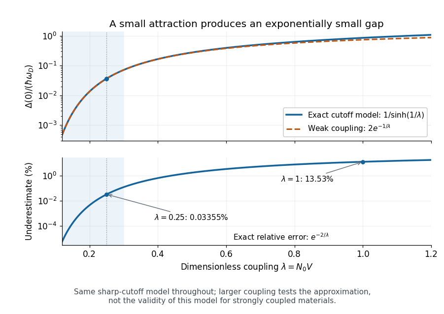
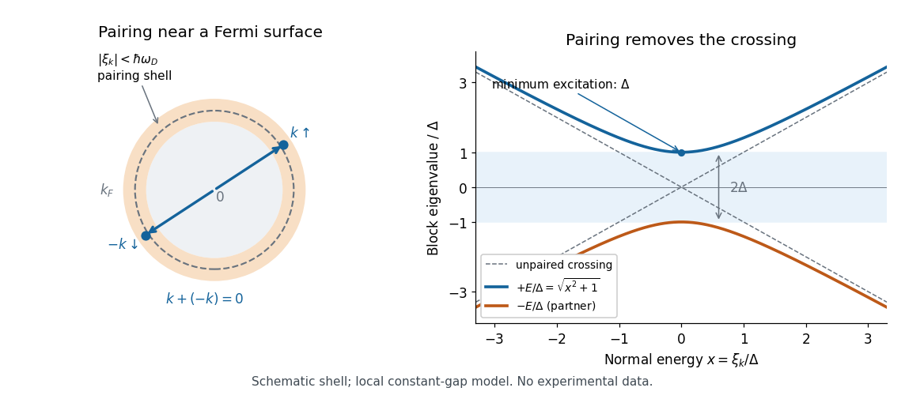
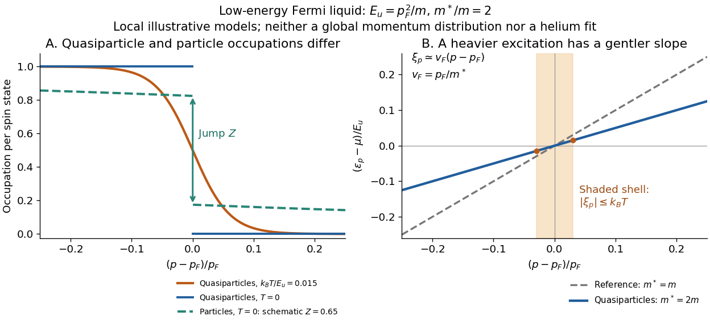
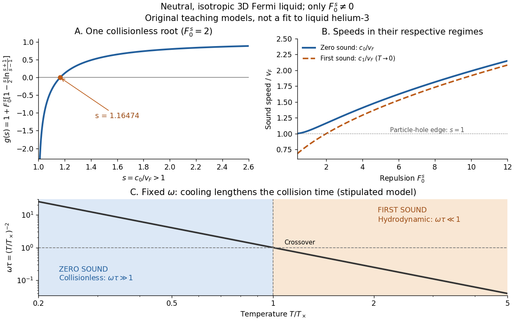

# Fermi liquid

↑ **Parent:** [Statistical physics](statistical-physics.md)  
ⓦ [Wiki](https://en.wikipedia.org/wiki/Fermi_liquid)

Why can a strongly interacting liquid resemble a gas? Its low-energy excitations can be long-lived [Landau quasiparticles](#landau-quasiparticle) near a [Fermi surface](#fermi-surface). Normal liquid [helium-3](chemical-substance.md#helium-3) motivates this [Fermi liquid](fermi-liquid.md) description: interactions survive in effective excitation [energies](energy.md) and interactions.[p.920 and section 1](physics-bibliography.md#the-theory-of-a-fermi-liquid-by-lev-davidovich-landau)

Interacting one-dimensional [fermion](tensor-product-of-quantum-systems.md#fermion) systems often form [Luttinger liquids](statistical-physics.md#luttinger-liquid); [non-Fermi liquids](statistical-physics.md#non-fermi-liquid) also occur in higher dimensions. A [Cooper instability](#cooper-instability) can produce a paired phase.[Sections IV E, VI D and XI](physics-bibliography.md#renormalization-group-approach-to-interacting-fermions-by-ramamurti-shankar)

The [Fermi-surface renormalization-group scaling](#fermi-surface-renormalization-group-scaling) below organizes the low-energy interactions; [zero sound](#zero-sound) tests whether their collective dynamics survives even when collisions are rare.

**Table of contents**

- [Fermi surface](#fermi-surface)
  - [Free-electron Fermi circle in a square lattice](#free-electron-fermi-circle-in-a-square-lattice)
  - [Fermi-surface reconstruction in a weak square potential](#fermi-surface-reconstruction-in-a-weak-square-potential)
    - [Circular-cap carrier count in a square Brillouin zone](#circular-cap-carrier-count-in-a-square-brillouin-zone)
  - [Hole pocket](#hole-pocket)
  - [Electron pocket](#electron-pocket)
  - [Fermi sphere](#fermi-sphere)
  - [Fermi point](#fermi-point)
  - [Fermi contour](#fermi-contour)
    - [Fermi circle](#fermi-circle)
- [Fermi-surface renormalization-group scaling](#fermi-surface-renormalization-group-scaling)
- [BCS theory](#bcs-theory)
  - [Fermionic Bogoliubov quasiparticle](#fermionic-bogoliubov-quasiparticle)
  - [BCS-BEC crossover](#bcs-bec-crossover)
  - [Asymmetric-cutoff BCS transition temperature](#asymmetric-cutoff-bcs-transition-temperature)
    - [Density crossover of a fixed-coupling BCS cutoff model](#density-crossover-of-a-fixed-coupling-bcs-cutoff-model)
  - [BCS pairing-field effective action](#bcs-pairing-field-effective-action)
    - [Subtracted grand potential of the reduced BCS model](#subtracted-grand-potential-of-the-reduced-bcs-model)
    - [Fermionic pairing-block determinant normalization](#fermionic-pairing-block-determinant-normalization)
  - [Weak-coupling BCS thermodynamic ratios](#weak-coupling-bcs-thermodynamic-ratios)
  - [Superconducting gap](#superconducting-gap)
    - [Superconducting gap function](#superconducting-gap-function)
      - [Phase-sensitive superconducting gap experiment](#phase-sensitive-superconducting-gap-experiment)
        - [Phase-sensitive test of d-wave pairing](#phase-sensitive-test-of-d-wave-pairing)
        - [Tricrystal half-flux experiment](#tricrystal-half-flux-experiment)
  - [Cooper pair](#cooper-pair)
    - [Cooper problem](#cooper-problem)
      - [Cooper pair binding energy](#cooper-pair-binding-energy)
      - [Cooper shell projection](#cooper-shell-projection)
    - [Pairing gap](#pairing-gap)
  - [BCS ground state](#bcs-ground-state)
    - [Cooper-pair pseudospin coherent state](#cooper-pair-pseudospin-coherent-state)
  - [BCS coherence factors](#bcs-coherence-factors)
    - [BCS population above the normal-state Fermi surface](#bcs-population-above-the-normal-state-fermi-surface)
    - [Hebel-Slichter coherence peak](#hebel-slichter-coherence-peak)
  - [BCS anomalous average](#bcs-anomalous-average)
  - [Reduced BCS pairing Hamiltonian](#reduced-bcs-pairing-hamiltonian)
  - [Cooper instability](#cooper-instability)
  - [BCS gap equation](#bcs-gap-equation)
    - [Matsubara derivation of the BCS saddle](#matsubara-derivation-of-the-bcs-saddle)
    - [Mass-anisotropy enhancement of a weak-coupling BCS gap](#mass-anisotropy-enhancement-of-a-weak-coupling-bcs-gap)
    - [Constant-shell BCS gap equation](#constant-shell-bcs-gap-equation)
      - [BCS dimensionless coupling](#bcs-dimensionless-coupling)
  - [BCS quasiparticle spectrum](#bcs-quasiparticle-spectrum)
    - [BCS quasiparticle](#bcs-quasiparticle)
    - [BCS electronic density of states](#bcs-electronic-density-of-states)
    - [Superconducting energy gap](#superconducting-energy-gap)
  - [BCS coherence length](#bcs-coherence-length)
  - [Superconducting isotope effect](#superconducting-isotope-effect)
- [Landau quasiparticle](#landau-quasiparticle)
  - [Low-energy Fermi-liquid quasiparticle lifetime](#low-energy-fermi-liquid-quasiparticle-lifetime)
    - [Particle out-scattering versus quasiparticle spectral width](#particle-out-scattering-versus-quasiparticle-spectral-width)
  - [Landau quasiparticle energy functional](#landau-quasiparticle-energy-functional)
    - [Thermal Landau quasiparticle energy shift](#thermal-landau-quasiparticle-energy-shift)
    - [Landau parameter](#landau-parameter)
  - [Fermi-liquid effective mass](#fermi-liquid-effective-mass)
  - [Quasiparticle residue](#quasiparticle-residue)
  - [Particle-hole continuum](#particle-hole-continuum)
- [Zero sound](#zero-sound)
  - [Isotropic zero-sound model](#isotropic-zero-sound-model)
  - [First-to-zero-sound crossover](#first-to-zero-sound-crossover)
  - [Abel-Anderson-Wheatley zero-sound experiment](#abel-anderson-wheatley-zero-sound-experiment)

## Fermi surface

↑ **Parent:** [Fermi liquid](fermi-liquid.md)  
ⓦ [Wiki](https://en.wikipedia.org/wiki/Fermi_surface)

A Fermi surface is the codimension-one surface in momentum space separating occupied and unoccupied zero-temperature states of a fermionic system.

### Free-electron Fermi circle in a square lattice

↑ **Parent:** [Fermi surface](#fermi-surface)

For a two-dimensional [free electron gas](physics.md#free-electron-model) with two spin states and $z$ [electrons](physics.md#electron) per square cell of side $a$, counting occupied [wavevectors](elasticity-physics.md#wavevector) gives $z/a^2=2\pi k_F^2/(2\pi)^2$. The square [first Brillouin zone](bloch-s-theorem.md#first-brillouin-zone) has half-width $\pi/a$. A monovalent circle lies inside its faces; a divalent circle crosses its faces but not its corners. A real [periodic potential](bloch-s-theorem.md#periodic-potential) can deform and reconnect the crossings, as in [Fermi-surface reconstruction in a weak square potential](#fermi-surface-reconstruction-in-a-weak-square-potential); valence alone is insufficient to prove insulation.

### Fermi-surface reconstruction in a weak square potential

↑ **Parent:** [Fermi surface](#fermi-surface)

For a free circle of radius $R$ and square reciprocal period $Q$ with $\sqrt2R<Q<2R$, the circle cuts the faces but not the corners of the first zone. Weak Bragg gaps reconnect the folded branches into two inequivalent edge-centred [electron pockets](#electron-pocket) and one corner-centred [hole pocket](#hole-pocket). The zero-potential limit retains band crossings instead of avoided crossings.

#### Circular-cap carrier count in a square Brillouin zone

↑ **Parent:** [Fermi-surface reconstruction in a weak square potential](#fermi-surface-reconstruction-in-a-weak-square-potential)

For $s=Q/(2R)$, each face cap has area $C=R^2[\arccos s-s\sqrt{1-s^2}]$. The total second-band electron area is $4C$; the first-band [hole](quantum-mechanics.md#electron-hole) area is $Q^2-\pi R^2+4C$. Multiplying either area by the [spin degeneracy](statistical-physics.md#spin-degeneracy) two and dividing by $(2\pi)^2$ gives the carrier densities. This is an infinitesimal-potential count, not an exact finite-gap formula.

### Hole pocket

↑ **Parent:** [Fermi surface](#fermi-surface)

A [hole pocket](#hole-pocket) surrounds unoccupied states near a band maximum. Its [hole](quantum-mechanics.md#electron-hole) [carrier density](electric-charge.md#carrier-density) counts missing states in the nearly filled band, not all occupied electrons. In two dimensions the count is $gA_h/(2\pi)^2$. Four corner pieces of a square-zone plot can be one pocket on the periodically identified zone.

### Electron pocket

↑ **Parent:** [Fermi surface](#fermi-surface)

An [electron pocket](#electron-pocket) surrounds occupied states near a conduction-band minimum. In two dimensions its [carrier density](electric-charge.md#carrier-density) is $gA/(2\pi)^2$, where $A$ is its total reciprocal-space area and $g$ the unresolved degeneracy. Portions drawn at opposite zone faces can belong to the same pocket after periodic identification.

### Fermi sphere

↑ **Parent:** [Fermi surface](#fermi-surface)

For an isotropic three-dimensional [free electron gas](physics.md#free-electron-model) at zero temperature, occupied wavevectors fill a sphere of radius $k_F$. Including two spin states, $n=k_F^3/(3\pi^2)$. The volume in reciprocal space counts occupied states; folding an extended-zone sphere into a first [Brillouin zone](bloch-s-theorem.md#brillouin-zone) does not remove states outside that first zone.

### Fermi point

↑ **Parent:** [Fermi surface](#fermi-surface)

A [Fermi point](#fermi-point) is a point of the zero-temperature [Fermi surface](#fermi-surface) in one-dimensional momentum space. For a spin-degenerate band with one occupied interval, its two boundaries are usually $-k_F$ and $+k_F$. Low-energy excitations near them form left- and right-moving branches. A perturbation at wavevector $2k_F$ can mix those branches, as in a [Peierls distortion](quantum-ideal-gas-statistics.md#peierls-distortion).

### Fermi contour

↑ **Parent:** [Fermi surface](#fermi-surface)

For a two-dimensional [energy band](bloch-s-theorem.md#energy-band), a Fermi contour is the set of [wavevectors](elasticity-physics.md#wavevector) at the [Fermi energy](quantum-ideal-gas-statistics.md#fermi-energy). It is the two-dimensional counterpart of a [Fermi surface](#fermi-surface). At a regular value it consists locally of curves; at a band extremum or a crossing it can acquire isolated points or intersecting branches. At zero [temperature](temperature.md), each band's occupied region satisfies $E_n(\mathbf k)<E_F$, so the contours must be labelled by band when determining occupations. The [Fermi contours of an isotropic Rashba band](atomic-physics.md#fermi-contours-of-an-isotropic-rashba-band) illustrate why two contours need not belong to two different bands.

#### Fermi circle

↑ **Parent:** [Fermi contour](#fermi-contour)

The circular zero-temperature occupation boundary of an isotropic two-dimensional [electron](physics.md#electron) gas. The occupied disk has area $\pi k_F^2$; converting its area to particle number requires the reciprocal-space state density and a separately specified [spin degeneracy](statistical-physics.md#spin-degeneracy).

## Fermi-surface renormalization-group scaling

↑ **Parent:** [Fermi liquid](fermi-liquid.md)

Fermi-surface renormalization-group scaling sends frequency and normal displacement from the Fermi surface to zero while leaving tangential momentum fixed. Generic interactions are irrelevant, while forward-scattering and opposite-momentum Cooper channels can remain marginal.

## BCS theory

↑ **Parent:** [Fermi liquid](fermi-liquid.md)  
ⓦ [Wiki](https://en.wikipedia.org/wiki/BCS_theory)

BCS theory describes a superconducting instability caused by attractive interactions between opposite-momentum fermions near a [Fermi surface](#fermi-surface).

[John Bardeen](physicist.md#john-bardeen), [Leon Neil Cooper](physicist.md#leon-neil-cooper) and [John Robert Schrieffer](physicist.md#john-robert-schrieffer) developed [BCS theory](#bcs-theory) in 1957, using attraction mediated by [phonons](quantum-ideal-gas-statistics.md#phonon).[pp.1175–1177, introduction and microscopic pairing mechanism](physics-bibliography.md#theory-of-superconductivity-by-john-bardeen-and-others)

Weak-coupling [Cooper pairs](#cooper-pair) overlap. The [Cooper instability](#cooper-instability) reorganizes an unpaired [Fermi surface](#fermi-surface); it is not [Bose-Einstein condensation](quantum-ideal-gas-statistics.md#bose-einstein-condensation) of compact, pre-existing [molecules](molecule.md). The original paper explicitly distinguishes these pictures.[p.1177, footnote 18 and coherence-distance discussion](physics-bibliography.md#theory-of-superconductivity-by-john-bardeen-and-others)

Two complementary clues made the microscopic problem concrete. The [superconducting isotope effect](#superconducting-isotope-effect) connected the transition to [phonons](quantum-ideal-gas-statistics.md#phonon).[p.55, isotope effect as a clue to the microscopic mechanism](physics-bibliography.md#electron-phonon-interactions-and-superconductivity-by-john-bardeen)

A 1957 transmission experiment used thin [lead](chemical-substance.md#lead) and [tin](chemical-substance.md#tin) films as samples in far-[infrared](optics.md#infrared) and millimeter-[microwave](electromagnetic-radiation.md#microwave) measurements. The measured transmission was converted to complex [electrical conductivity](electric-charge.md#electrical-conductivity), normalized to the normal-state value. Comparing film thickness, resistance, annealing and the two metals tested the response's reproducibility. Weak low-[photon](quantum-mechanics.md#photon)-[energy](energy.md) absorption followed by an onset supported a [superconducting energy gap](#superconducting-energy-gap); its extraction required a thin-film electrodynamic model.[Abstract: sample metals, transmission method, normal-state normalization and comparisons; inferred excitation gap](physics-bibliography.md#conductivity-of-superconducting-films-for-photon-energies-between-0-3-and-40ktc-by-r-e-glover-iii-and-m-tinkham)

The later [Giaever superconducting tunnelling experiment](superconductivity.md#giaever-gap-experiment) provided another way to resolve the [superconducting energy gap](#superconducting-energy-gap) through [quantum tunnelling](quantum-mechanics.md#quantum-tunnelling).[p.61, section 4, tunnelling conductance and the superconducting density of states](physics-bibliography.md#electron-phonon-interactions-and-superconductivity-by-john-bardeen) The derivations below explain what the model predicts, including the distinction between a single [quasiparticle](quantum-mechanics.md#quasiparticle)'s minimum [energy](energy.md) and the threshold for making two of them.

### Fermionic Bogoliubov quasiparticle

↑ **Parent:** [BCS theory](#bcs-theory)

A fermionic excitation obtained by a canonical particle–hole [Bogoliubov transformation](quantum-field-theory.md#bogoliubov-transformation) of a paired mean-field Hamiltonian. The uniform spin-singlet problem has the displayed positive energy and weights $|u|^2=(1+\xi/E)/2$, $|v|^2=(1-\xi/E)/2$. It interpolates between particle-like and hole-like excitations across the Fermi surface. These single-particle excitations differ from collective phase and amplitude modes of the [order parameter](critical-phenomenon.md#order-parameter).

### BCS-BEC crossover

↑ **Parent:** [BCS theory](#bcs-theory)

The continuous evolution, in suitable attractive Fermi systems, from weakly paired overlapping [Cooper pairs](#cooper-pair) to tightly bound composite [bosons](tensor-product-of-quantum-systems.md#boson) undergoing [Bose-Einstein condensation](quantum-ideal-gas-statistics.md#bose-einstein-condensation). Pair formation, phase coherence and the [chemical potential](chemical-potential.md) must be determined consistently across the crossover. A weak-coupling gap-temperature formula with fixed [density of states](quantum-ideal-gas-statistics.md#density-of-states) is not uniformly valid through the molecular limit.

### Asymmetric-cutoff BCS transition temperature

↑ **Parent:** [BCS theory](#bcs-theory)

For a constant effective [density of states](quantum-ideal-gas-statistics.md#density-of-states) and attractive coupling $\lambda$, let the linearized [BCS theory](#bcs-theory) gap equation integrate $\tanh(\xi/(2k_BT_c))/(2\xi)$ over $-\sigma<\xi<\theta$, with positive cutoffs. Its even integrand makes the result the mean of two positive-cutoff logarithms. When $k_BT_c\ll\sigma,\theta$, $1/\lambda\simeq\frac12\ln(1.13\theta/(k_BT_c))+\frac12\ln(1.13\sigma/(k_BT_c))$, giving the displayed geometric mean of cutoffs.

If a band bottom truncates the lower side, $\sigma=\min(\mu,\theta)$ for positive [chemical potential](chemical-potential.md) $\mu$. The weak-coupling limit at fixed $\mu/\theta>0$ must not be interchanged with an uncontrolled $\mu\to0$ extrapolation: the lower logarithm requires $\mu\gg k_BT_c$ when $\mu<\theta$.

#### Density crossover of a fixed-coupling BCS cutoff model

↑ **Parent:** [Asymmetric-cutoff BCS transition temperature](#asymmetric-cutoff-bcs-transition-temperature)

Set the [chemical potential](chemical-potential.md) equal to the degenerate three-dimensional spin-degenerate [Fermi energy](quantum-ideal-gas-statistics.md#fermi-energy), proportional to $n^{2/3}$, and keep the effective coupling and upper cutoff fixed. The [asymmetric-cutoff BCS transition temperature](#asymmetric-cutoff-bcs-transition-temperature) scales as $n^{1/3}$ below $n_\theta$ and saturates above it. At low density the predicted $k_BT_c/\mu$ instead grows as $n^{-1/3}$, eventually invalidating the degenerate and logarithmic approximations. This is a prescribed cutoff model, not a self-consistent treatment of the [BCS-BEC crossover](#bcs-bec-crossover).

### BCS pairing-field effective action

↑ **Parent:** [BCS theory](#bcs-theory)

An attractive local pairing interaction can be decoupled with a complex [Hubbard–Stratonovich transformation](quantum-field-theory.md#hubbard-stratonovich-transformation). Integrating the fermionic [Grassmann variables](multilinear-algebra.md#grassmann-variable) gives an [effective action](perturbative-quantum-field-theory.md#effective-action) for the pair field. Its uniform saddle is the [BCS gap equation](#bcs-gap-equation), and its slow-field expansion near the transition gives the [Ginzburg-Landau theory of superconductivity](superconductivity.md#ginzburg-landau-theory-of-superconductivity). A [trace](linear-algebra.md#matrix-trace) over a fully doubled particle-hole basis requires the corresponding factor of one half; the displayed formula uses one independent pairing block.

#### Subtracted grand potential of the reduced BCS model

↑ **Parent:** [BCS pairing-field effective action](#bcs-pairing-field-effective-action)

Subtracting the normal-state [grand potential](statistical-physics.md#grand-potential) fixes the reference constant in the uniform [BCS pairing-field effective action](#bcs-pairing-field-effective-action). Here $\omega_n=(2n+1)\pi/\beta$ has energy units and $E_k^2=\xi_k^2+|\Delta|^2$. The ratio cancels a field-independent determinant phase and produces a convergent high-frequency sum under the same momentum regulator. Differentiation gives the [BCS gap equation](#bcs-gap-equation). For a fixed attractive pairing shell, this is a finite regulated model; an unrestricted continuum contact interaction additionally needs ultraviolet renormalization. Its weak-coupling condensation density $-\nu_F\Delta^2/2$ uses a single-spin [density of states](quantum-ideal-gas-statistics.md#density-of-states) per volume.

#### Fermionic pairing-block determinant normalization

↑ **Parent:** [BCS pairing-field effective action](#bcs-pairing-field-effective-action)

A two-component [Nambu spinor](quantum-field-theory.md#nambu-spinor) $(\psi_{k\uparrow},\bar\psi_{-k\downarrow})$ for every k accounts for both spin species once after relabelling. Its [Grassmann integral](supersymmetric-quantum-mechanics.md#berezin-integral) contributes one [functional determinant](quantum-field-theory.md#functional-determinant). A fully doubled spin-particle-hole basis instead has redundancy and requires one half in the [trace](linear-algebra.md#matrix-trace) logarithm or a corresponding Pfaffian convention. A reliable check is the zero-gap limit: the [grand potential](statistical-physics.md#grand-potential) must become $-2\beta^{-1}\sum_k\ln(1+e^{-\beta\xi_k})$, with exactly two spin states and no invented vacuum offset.

### Weak-coupling BCS thermodynamic ratios

↑ **Parent:** [BCS theory](#bcs-theory)

The isotropic weak-coupling [BCS theory](#bcs-theory) predicts the gap ratio approximately $3.528$ and the electronic heat-capacity jump approximately $1.426$ in units of the normal-state [heat capacity](heat.md#heat-capacity) at the transition. These compare distinct measurements of the same paired state. They are conditional predictions of the weak-coupling fully gapped model, rather than universal numbers for all [superconductors](superconductivity.md#superconductor).

### Superconducting gap

↑ **Parent:** [BCS theory](#bcs-theory)

The gap feature in a superconducting single-particle excitation spectrum. In a simple BCS model, excitations have $E_{\mathbf k}=\sqrt{\xi_{\mathbf k}^2+|\Delta(\mathbf k)|^2}$. The [superconducting gap function](#superconducting-gap-function) specifies the pairing amplitude and its phase; its magnitude need not be constant, and nodes can leave gapless excitations.

#### Superconducting gap function

↑ **Parent:** [Superconducting gap](#superconducting-gap)

A complex momentum-dependent pairing amplitude. Its crystal-symmetry transformation, nodes and relative signs distinguish candidate superconducting states. Magnitude-sensitive spectra alone generally do not establish all relative signs; [phase-sensitive superconducting gap experiments](#phase-sensitive-superconducting-gap-experiment) test them through interference.

##### Phase-sensitive superconducting gap experiment

↑ **Parent:** [Superconducting gap function](#superconducting-gap-function)

An experiment converting the relative phase of a superconducting pairing amplitude into a measurable interference or flux signal. Orthogonal-face Josephson junctions and tricrystal rings are examples. Junction asymmetry, trapped flux, loop inductance and comparison geometries are important controls.

###### Phase-sensitive test of d-wave pairing

↑ **Parent:** [Phase-sensitive superconducting gap experiment](#phase-sensitive-superconducting-gap-experiment)

Compare superconducting phase information from different crystal directions rather than only measuring the gap magnitude. Orthogonal-face junctions and a [tricrystal half-flux experiment](#tricrystal-half-flux-experiment) can test sign changes of a candidate d-wave gap. Junction properties, trapped flux and loop inductance must be controlled; a measured half-flux signal needs its actual device model.

###### Tricrystal half-flux experiment

↑ **Parent:** [Phase-sensitive superconducting gap experiment](#phase-sensitive-superconducting-gap-experiment)

A ring crossing three appropriately oriented grain-boundary junctions tests a superconducting pairing sign pattern. An odd total intrinsic $\pi$ offset frustrates integer phase matching and can favor a half-flux state. Actual enclosed flux also depends on loop inductance and junction currents; the measurement requires controls against ordinary trapped flux.[1994 primary tricrystal-ring pairing-symmetry experiment](physics-bibliography.md#pairing-symmetry-and-flux-quantization-in-a-tricrystal-superconducting-ring-by-c-c-tsuei-and-others)

### Cooper pair

↑ **Parent:** [BCS theory](#bcs-theory)  
ⓦ [Wiki](https://en.wikipedia.org/wiki/Cooper_pair)

A Cooper pair is a correlated pair of [fermions](tensor-product-of-quantum-systems.md#fermion) associated with [superconductivity](superconductivity.md). The conventional [BCS ground state](#bcs-ground-state) uses opposite-momentum, opposite-spin pair creation operators $c_{k\uparrow}^\dagger c_{-k\downarrow}^\dagger$. Their total momentum is zero for every relative momentum $k$; zero total momentum does not restrict $k$ to zero.

#### Cooper problem

↑ **Parent:** [Cooper pair](#cooper-pair)

Two added [electrons](physics.md#electron) move above a frozen filled [Fermi sea](quantum-ideal-gas-statistics.md#fermi-sea) and attract within a thin [energy](energy.md) shell. The Pauli-blocked continuum has a logarithmic pair susceptibility, so an arbitrarily weak net attractive constant interaction produces a state below the two-particle threshold at zero [temperature](temperature.md). This two-added-particle result is not by itself a full many-electron superconducting state.

##### Cooper pair binding energy

↑ **Parent:** [Cooper problem](#cooper-problem)

For shell width $D$, attraction $g>0$ and constant single-spin [density of states](quantum-ideal-gas-statistics.md#density-of-states) $\rho$, $1=(g\rho/2)\log[(2D+B)/B]$ gives $B=2D/[\exp(2/(g\rho))-1]$. The pair [energy](energy.md) relative to the free threshold is $-B$. At weak coupling this scale is nonanalytic in $g$.

##### Cooper shell projection

↑ **Parent:** [Cooper problem](#cooper-problem)

The pairing Hamiltonian is projected onto empty states in a specified shell above the inert [Fermi sea](quantum-ideal-gas-statistics.md#fermi-sea). A state restricted to that shell is an eigenstate of this projected model, not necessarily of a contact interaction that remains unrestricted at all momenta.

#### Pairing gap

↑ **Parent:** [Cooper pair](#cooper-pair)

A [pairing gap](#pairing-gap) is an [energy](energy.md) scale for fermionic excitations above a paired [superfluid](statistical-physics.md#superfluid) or [superconductor](superconductivity.md#superconductor) [ground state](quantum-mechanics.md#ground-state). In a simple isotropic paired system the [quasiparticle](quantum-mechanics.md#quasiparticle) dispersion has the form $E_{\mathbf k}=\sqrt{\xi_{\mathbf k}^2+|\Delta|^2}$, where $\xi_{\mathbf k}$ measures the unpaired single-particle [energy](energy.md) relative to the [chemical potential](chemical-potential.md). A nonzero minimum gap gives exponentially small fermionic thermal occupations when $k_BT\ll|\Delta|$. If the gap varies with direction and has nodes, gapless directions can instead produce power-law thermodynamics. Collective excitations must be counted separately from the gapped fermionic [quasiparticles](quantum-mechanics.md#quasiparticle).

### BCS ground state

↑ **Parent:** [BCS theory](#bcs-theory)

The BCS ground state is the normalized product of empty and occupied pair states $\prod_k(u_k+v_kb_k^\dagger)|0\rangle$. For $u_k^2+v_k^2=1$, each pair factor is normalized. The inverse [Bogoliubov transformation](quantum-field-theory.md#bogoliubov-transformation) annihilates it, so it is the vacuum of positive-energy [quasiparticles](quantum-mechanics.md#quasiparticle). Although individual factors use opposite momenta, $k$ runs over the relative pair momenta; it is not restricted to $k=0$.

#### Cooper-pair pseudospin coherent state

↑ **Parent:** [BCS ground state](#bcs-ground-state)

The empty and doubly occupied states of a paired [momentum](momentum.md) block form a two-level space. Define $S_k^+=a_{k\uparrow}^\dagger a_{-k\downarrow}^\dagger$, $S_k^-=a_{-k\downarrow}a_{k\uparrow}$ and $S_k^z=(n_{k\uparrow}+n_{-k\downarrow}-1)/2$. They obey the spin algebra on that space. The normalized factor $u_k|0\rangle+v_k|\mathrm{pair}\rangle$ is a spin-one-half coherent state; the product over blocks is the [BCS ground state](#bcs-ground-state). Pauli exclusion prevents interpreting a block as an unrestricted harmonic-oscillator pair mode.

### BCS coherence factors

↑ **Parent:** [BCS theory](#bcs-theory)

For real gap and the particle-hole block $\left(\begin{smallmatrix}\xi_k&-\Delta_k\\-\Delta_k&-\xi_k\end{smallmatrix}\right)$, the BCS coherence factors obey $u_k^2=(1+\xi_k/E_k)/2$, $v_k^2=(1-\xi_k/E_k)/2$ and $u_kv_k=\Delta_k/(2E_k)$, where $E_k=\sqrt{\xi_k^2+\Delta_k^2}$. They diagonalize the [Bogoliubov--de Gennes Hamiltonian](topological-quantum-matter.md#bogoliubov-de-gennes-hamiltonian) and give the empty/pair amplitudes of the [BCS ground state](#bcs-ground-state). Their relative sign depends on the pairing convention.

For an original check, write $x=\xi_k/\Delta$ with constant real $\Delta>0$. At $x=0$, the [BCS coherence factors](#bcs-coherence-factors) give $u_k^2=v_k^2=1/2$. At $x=1$, they give $(u_k^2,v_k^2)=(0.853553,0.146447)$; at $x=-1$ these values exchange places. Thus the zero-[temperature](temperature.md) occupation $v_k^2$ rounds the normal [Fermi sea](quantum-ideal-gas-statistics.md#fermi-sea)'s step over an [energy](energy.md) interval of order $\Delta$. This mixing is strongest at the [Fermi surface](#fermi-surface), where the [BCS quasiparticle spectrum](#bcs-quasiparticle-spectrum) has its minimum.

#### BCS population above the normal-state Fermi surface

↑ **Parent:** [BCS coherence factors](#bcs-coherence-factors)

For a uniform isotropic weak-gap BCS state, the zero-temperature [electron](physics.md#electron) occupation is $n(\xi)=(1-\xi/\sqrt{\xi^2+\Delta^2})/2$. The number above the normal-state [Fermi surface](#fermi-surface) is approximately $D(\mu)\int_0^\infty n(\xi)d\xi$. The integral equals $\Delta/2$, while a three-dimensional parabolic band including both spins has $D(\mu)=3N/(2\mu)$. This gives the displayed leading fraction.

The result measures redistribution relative to a normal [Fermi sea](quantum-ideal-gas-statistics.md#fermi-sea), not bosonic single-mode condensate depletion or [quasiparticle](quantum-mechanics.md#quasiparticle) occupation. A different band dimension or anisotropic gap requires its actual density-of-states or [momentum](momentum.md) integral. Material estimates need specified gap and chemical-potential scales.

#### Hebel-Slichter coherence peak

↑ **Parent:** [BCS coherence factors](#bcs-coherence-factors)

In a conventional isotropic spin-singlet [superconductor](superconductivity.md#superconductor), the nuclear spin-lattice relaxation rate can rise just below the transition before falling at lower [temperature](temperature.md). The [BCS coherence factors](#bcs-coherence-factors) and enhanced near-gap [density of states](quantum-ideal-gas-statistics.md#density-of-states) produce the coherence enhancement. Nuclear relaxation and ultrasonic attenuation have different coherence factors, so their contrasting [temperature](temperature.md) dependences test pairing structure rather than only the existence of a gap.[Abstract, physical system and comparison with [BCS theory](#bcs-theory)](physics-bibliography.md#nuclear-spin-relaxation-in-normal-and-superconducting-aluminum-by-l-c-hebel-and-charles-pence-slichter)

### BCS anomalous average

↑ **Parent:** [BCS theory](#bcs-theory)

The BCS anomalous average is the pair expectation $\langle b_k\rangle=\langle c_{-k\downarrow}c_{k\uparrow}\rangle$. In the [BCS ground state](#bcs-ground-state) it is $u_kv_k=\Delta_k/(2E_k)$ for real gap at zero temperature. At temperature $T$ it becomes $\Delta_k\tanh(E_k/(2k_BT))/(2E_k)$. Substitution into the pairing-field definition gives the [BCS gap equation](#bcs-gap-equation).

### Reduced BCS pairing Hamiltonian

↑ **Parent:** [BCS theory](#bcs-theory)

The [reduced BCS pairing Hamiltonian](#reduced-bcs-pairing-hamiltonian) retains scattering of opposite-momentum, opposite-spin [Cooper pairs](#cooper-pair):

$$
H=\sum_{k,\sigma}\epsilon_kc_{k\sigma}^\dagger c_{k\sigma}+\sum_{k,k'}V_{k,k'}b_k^\dagger b_{k'},\qquad b_k^\dagger=c_{k\uparrow}^\dagger c_{-k\downarrow}^\dagger.
$$

A [mean-field approximation](critical-phenomenon.md#mean-field-approximation) introduces the [BCS anomalous average](#bcs-anomalous-average) and pairing field $\Delta_k=-\sum_{k'}V_{k,k'}\langle b_{k'}\rangle$. The subtraction $-\sum V_{k,k'}\langle b_k^\dagger\rangle\langle b_{k'}\rangle$ corrects the double counting of the mean-field interaction energy.

### Cooper instability

↑ **Parent:** [BCS theory](#bcs-theory)  
ⓦ [Wiki](https://en.wikipedia.org/wiki/Cooper_instability)

The Cooper instability is the logarithmic growth of an attractive BCS coupling at low energy. If $\nu_F$ is the density of states and $V<0$, perturbation theory breaks down at a scale proportional to $\Lambda e^{-1/(\nu_F|V|)}$.

### BCS gap equation

↑ **Parent:** [BCS theory](#bcs-theory)  
ⓦ [Wiki](https://en.wikipedia.org/wiki/BCS_gap_equation)

At zero temperature and weak coupling, the BCS gap equation gives $\Delta\simeq2\Lambda e^{-1/(\nu_F|V|)}$. Its exponential scale agrees with the renormalization-group scale of the [Cooper instability](#cooper-instability).

#### Matsubara derivation of the BCS saddle

↑ **Parent:** [BCS gap equation](#bcs-gap-equation)

Differentiate the [subtracted grand potential of the reduced BCS model](#subtracted-grand-potential-of-the-reduced-bcs-model) with respect to the squared pairing amplitude. The displayed fermionic [Matsubara sum](quantum-field-theory.md#bosonic-matsubara-sum) converts the derivative of the trace logarithm into $\sum_k\tanh(\beta E_k/2)/(2E_k)$. Setting it equal to $V/\lambda$ gives the uniform nonzero-gap saddle. The limit E→0 is finite at positive temperature, $\beta/4$. The sum relies on antiperiodic temporal boundary conditions from the [fermionic coherent-state trace](quantum-theory.md#fermionic-coherent-state-trace).

#### Mass-anisotropy enhancement of a weak-coupling BCS gap

↑ **Parent:** [BCS gap equation](#bcs-gap-equation)

For a fixed-density balanced two-spin Fermi gas with masses $(m,m,\gamma m)$, the Fermi energy scales as $\gamma^{-1/3}$ while the single-spin Fermi-level [density of states](quantum-ideal-gas-statistics.md#density-of-states) scales as $\gamma^{1/3}$. A constant attractive interaction $g$ within a narrow symmetric energy window $\varepsilon_c\ll\varepsilon_F$ therefore gives $1=\lambda_0\gamma^{1/3}\operatorname{arsinh}(\varepsilon_c/\Delta)$. Solving gives $\Delta=\varepsilon_c/\sinh[1/(\lambda_0\gamma^{1/3})]$, whose weak-coupling limit is displayed. Extrapolating to arbitrarily large anisotropy violates the assumptions that the Fermi energy dominates the window and that the pairing coupling is small.

#### Constant-shell BCS gap equation

↑ **Parent:** [BCS gap equation](#bcs-gap-equation)

An attractive interaction $V_{k,k'}=-V/\mathcal V$ within $|\xi_k|,|\xi_{k'}|<\Omega_D$ gives a constant gap inside that energy shell and zero outside. With approximately constant [single-spin density of states](quantum-ideal-gas-statistics.md#single-spin-density-of-states) $\nu_s$ per volume,

$$
1=\nu_sV\int_0^{\Omega_D}\frac{d\xi}{\sqrt{\xi^2+\Delta^2}}=\nu_sV\operatorname{arsinh}(\Omega_D/\Delta),\qquad \Delta=\frac{\Omega_D}{\sinh(1/(\nu_sV))}.
$$

The [weak coupling](perturbative-quantum-field-theory.md#weak-coupling) limit is $\Delta\simeq2\Omega_De^{-1/(\nu_sV)}$. A density counting both spin species is twice $\nu_s$ and must be divided by two. The shell cutoff is a relative-energy condition, even when every [Cooper pair](#cooper-pair) has zero total momentum.

##### BCS dimensionless coupling

↑ **Parent:** [Constant-shell BCS gap equation](#constant-shell-bcs-gap-equation)

Use $N_0=\nu_s$ for the normal-state [single-spin density of states](quantum-ideal-gas-statistics.md#single-spin-density-of-states) per unit [energy](energy.md) and [volume](geometry-and-topology.md#volume) at the [Fermi surface](#fermi-surface). Write the attraction as $-V/\mathcal V$, with $V>0$, and define $\lambda=N_0V$.[p.1182, equations (2.34)–(2.40), one-spin density of states; volume normalization stated here](physics-bibliography.md#theory-of-superconductivity-by-john-bardeen-and-others)

Since $V/\mathcal V$ has units of [energy](energy.md), $V$ has units of [energy](energy.md) times [volume](geometry-and-topology.md#volume), making $\lambda$ dimensionless. Set $\Omega_D=\hbar\omega_D$, an [energy](energy.md) cutoff using the [Debye frequency](quantum-ideal-gas-statistics.md#debye-frequency) $\omega_D$, rather than a frequency itself. These conventions also fix the meaning of the earlier [constant-shell BCS gap equation](#constant-shell-bcs-gap-equation).

Here is the reduction of the [BCS gap equation](#bcs-gap-equation) in these conventions. Substituting the zero-[temperature](temperature.md) [BCS anomalous average](#bcs-anomalous-average) gives

$$
\Delta=\frac{V}{\mathcal V}\sum_{|\xi_k|<\Omega_D}\frac{\Delta}{2\sqrt{\xi_k^2+\Delta^2}}.
$$

The $k$ sum counts one [spin](angular-momentum-operator.md#spin) species. For $\Delta>0$, cancelling $\Delta$ and replacing this sum by an [integral](integral.md) with constant $N_0$ gives

$$
1=\frac{N_0V}{2}\int_{-\Omega_D}^{\Omega_D}\frac{d\xi}{\sqrt{\xi^2+\Delta^2}}
=\lambda\int_0^{\Omega_D}\frac{d\xi}{\sqrt{\xi^2+\Delta^2}}.
$$

The factor two from the symmetric [integral](integral.md) cancels the $1/2$ in the [BCS anomalous average](#bcs-anomalous-average); it is not an extra [spin](angular-momentum-operator.md#spin) degeneracy. Substituting $\xi=\Delta\sinh t$ evaluates the [integral](integral.md) as $\operatorname{arsinh}(\Omega_D/\Delta)$. Solving gives

$$
\Delta(0)=\frac{\hbar\omega_D}{\sinh(1/\lambda)}
=\frac{2\hbar\omega_De^{-1/\lambda}}{1-e^{-2/\lambda}}
\simeq2\hbar\omega_D\exp\left[-\frac{1}{N_0V}\right],\qquad \lambda\ll1.
$$

The first equality is exact within the constant-[density of states](quantum-ideal-gas-statistics.md#density-of-states), sharp-cutoff [mean-field approximation](critical-phenomenon.md#mean-field-approximation); the last is the [weak coupling](perturbative-quantum-field-theory.md#weak-coupling) asymptote. Extending the first equality to large $\lambda$ does not make this simplified model an accurate description of a strongly coupled material.

For an original numerical example, choose $\hbar\omega_D=20\ \mathrm{meV}$ and $\lambda=0.25$. The exact [constant-shell BCS gap equation](#constant-shell-bcs-gap-equation) gives $\Delta(0)=0.732871\ \mathrm{meV}$; the [weak coupling](perturbative-quantum-field-theory.md#weak-coupling) formula gives $0.732626\ \mathrm{meV}$. Its fractional underestimate, measured against the exact result, is exactly $e^{-2/\lambda}=e^{-8}\simeq0.03355\%$. At $\lambda=1$ that error is $e^{-2}\simeq13.53\%$, so the two formulas are no longer interchangeable. No material parameters have been fitted here.

**[Figure 1](#image-the-exact-cutoff-gap-and-the-range-of-the-weak-coupling-approximation). The exact cutoff gap and the range of the weak-coupling approximation**. Original zero-[temperature](temperature.md) [constant-shell BCS gap equation](#constant-shell-bcs-gap-equation) calculation. The upper panel compares $1/\sinh(1/\lambda)$ with $2e^{-1/\lambda}$; the lower panel gives the exact fractional underestimate $e^{-2/\lambda}$. The shaded interval is a chosen small-coupling illustration, not an experimental boundary. The large-coupling part tests the asymptote within the same model.

At nonzero [temperature](temperature.md), substitute the finite-[temperature](temperature.md) [BCS anomalous average](#bcs-anomalous-average) instead. The same cancellation yields

$$
1=\lambda\int_0^{\Omega_D}\frac{\tanh\!\left(\sqrt{\xi^2+\Delta(T)^2}/(2k_BT)\right)}{\sqrt{\xi^2+\Delta(T)^2}}\,d\xi.
$$

At the [superconducting transition temperature](superconductivity.md#superconducting-transition-temperature) take the continuous $\Delta\to0$ limit. The integrand at $\xi=0$ then has the finite limiting value $1/(2k_BT_c)$, so no divergent endpoint needs to be inserted into a numerical quadrature. For $k_BT_c\ll\Omega_D$, the resulting [integral](integral.md) gives $k_BT_c\simeq1.134\Omega_De^{-1/\lambda}$ and $2\Delta(0)/(k_BT_c)\simeq3.528$. These ratios concern the isotropic [weak coupling](perturbative-quantum-field-theory.md#weak-coupling) model.[1972 lecture, thermodynamic properties of the ideal superconductor, pp.80–82](physics-bibliography.md#microscopic-quantum-interference-effects-in-the-theory-of-superconductivity-by-leon-neil-cooper)

### BCS quasiparticle spectrum

↑ **Parent:** [BCS theory](#bcs-theory)

The [BCS quasiparticle spectrum](#bcs-quasiparticle-spectrum) is the positive excitation [energy](energy.md) obtained by diagonalizing the paired particle-hole block. Here the [weak coupling](perturbative-quantum-field-theory.md#weak-coupling) shell model has $\Delta\ll\Omega_D$: the minimum lies inside the pairing shell, and states outside it cost more. To derive it for a uniform isotropic real $\Delta>0$, measure the normal-state [energy](energy.md) from the [chemical potential](chemical-potential.md), $\xi_k=\epsilon_k-\mu$, and use the same sign convention as the [BCS coherence factors](#bcs-coherence-factors):

$$
\mathcal H_k=\begin{pmatrix}\xi_k&-\Delta\\-\Delta&-\xi_k\end{pmatrix},\qquad
\det(\mathcal H_k-\varepsilon I)=\varepsilon^2-\xi_k^2-\Delta^2=0.
$$

Its [eigenvalues](linear-operator-theory.md#eigenvalue) are $\varepsilon_\pm=\pm E_k$, where $E_k=\sqrt{\xi_k^2+\Delta^2}$. The positive $E_k$ is the cost of creating a [quasiparticle](quantum-mechanics.md#quasiparticle) above the [BCS ground state](#bcs-ground-state). The lower branch $-E_k$ is its particle-hole partner in this doubled matrix description, not an excitation that lowers the [ground state](quantum-mechanics.md#ground-state) [energy](energy.md) without bound.

The location and value of the minimum follow directly:

$$
\frac{dE}{d\xi}=\frac{\xi}{\sqrt{\xi^2+\Delta^2}},\qquad
\frac{d^2E}{d\xi^2}=\frac{\Delta^2}{(\xi^2+\Delta^2)^{3/2}}>0.
$$

The unique minimum as a function of $\xi$ is $E(0)=\Delta$, at the normal-state [Fermi surface](#fermi-surface). On an isotropic three-dimensional [Fermi surface](#fermi-surface) it occurs for every direction of $k$, rather than at a unique point of [momentum](momentum.md) space. Near that minimum,

$$
E(\xi)=\Delta+\frac{\xi^2}{2\Delta}+O(\xi^4/\Delta^3).
$$

Farther away, $E(\xi)\simeq|\xi|$ when $\Delta\ll|\xi|\ll\Omega_D$. For the illustrative $\lambda=0.25$ example, a state at $\xi=\Delta$ costs $\sqrt2\Delta\simeq1.03644\ \mathrm{meV}$ rather than the minimum $0.732871\ \mathrm{meV}$.

**[Figure 2](#image-opposite-momentum-cooper-pairing-opens-a-quasiparticle-gap). Opposite-momentum Cooper pairing opens a quasiparticle gap**. Original schematic section through a spherical [Fermi surface](#fermi-surface), alongside the local isotropic [BCS quasiparticle spectrum](#bcs-quasiparticle-spectrum). The shell thickness is exaggerated and its geometry is schematic. Both members of a shown [Cooper pair](#cooper-pair) have nonzero opposite [momenta](momentum.md). The spectrum uses $x=\xi/\Delta$ only within the pairing shell; the lower branch is the redundant particle-hole partner, while positive excitations cost at least $\Delta$.

#### BCS quasiparticle

↑ **Parent:** [BCS quasiparticle spectrum](#bcs-quasiparticle-spectrum)

An elementary excitation of the paired mean-field state whose [electron](physics.md#electron) operator has mixed creation and annihilation components. Its positive excitation [energy](energy.md) is $E_k=\sqrt{\xi_k^2+|\Delta_k|^2}$. At zero [temperature](temperature.md) the [BCS ground state](#bcs-ground-state) has zero occupation of these positive-energy modes, even though physical [electrons](physics.md#electron) have a smooth nontrivial [momentum](momentum.md) occupation.

#### BCS electronic density of states

↑ **Parent:** [BCS quasiparticle spectrum](#bcs-quasiparticle-spectrum)

For a particle-hole-symmetric normal [density of states](quantum-ideal-gas-statistics.md#density-of-states) $g_F$ and isotropic [superconducting energy gap](#superconducting-energy-gap) $\Delta>0$, the electron spectral density is zero for $|E|<\Delta$ and has the displayed form outside the gap. The [BCS coherence factors](#bcs-coherence-factors) weight the two roots $\xi=\pm\sqrt{E^2-\Delta^2}$, where $\xi$ is normal-state energy relative to the [Fermi energy](quantum-ideal-gas-statistics.md#fermi-energy). At positive $E$, their electron weights $(1+\xi/E)/2$ sum to one. Multiplying their sum by the Jacobian $|d\xi/dE|=E/\sqrt{E^2-\Delta^2}$ proves the formula. This electron spectral density differs from the unweighted count of all positive-energy [quasiparticles](quantum-mechanics.md#quasiparticle), which receives both roots. Its gap-edge divergence is integrable and approaches the normal electronic density at large $|E|$.

#### Superconducting energy gap

↑ **Parent:** [BCS quasiparticle spectrum](#bcs-quasiparticle-spectrum)

In this fully gapped isotropic [BCS quasiparticle spectrum](#bcs-quasiparticle-spectrum), $\Delta$ is the minimum single-[quasiparticle](quantum-mechanics.md#quasiparticle) excitation [energy](energy.md). The interval between $-\Delta$ and $+\Delta$ has width $2\Delta$. A process that creates two [quasiparticles](quantum-mechanics.md#quasiparticle) from the [BCS ground state](#bcs-ground-state) has an energetic threshold $2\Delta$, subject also to its transition-selection rules.[1972 lecture, excitation spectrum and correlated background, pp.78–80](physics-bibliography.md#microscopic-quantum-interference-effects-in-the-theory-of-superconductivity-by-leon-neil-cooper)

For example, two independently created excitations with $\xi_1=\xi_2=0$ cost $E_1+E_2=2\Delta$. With the chosen cutoff example this is $1.46574\ \mathrm{meV}$, while adding one excitation costs at least $0.732871\ \mathrm{meV}$. This factor of two matters when comparing [photon](quantum-mechanics.md#photon) absorption with the [Giaever superconducting tunnelling experiment](superconductivity.md#giaever-gap-experiment). [Quantum tunnelling](quantum-mechanics.md#quantum-tunnelling) from a normal metal can add one excitation to a sample exhibiting [superconductivity](superconductivity.md); with two gapped electrodes, their excitation costs add. A minimum excitation cost is an energetic condition; the measured onset can additionally depend on [temperature](temperature.md) and on the available transitions.

### BCS coherence length

↑ **Parent:** [BCS theory](#bcs-theory)

The clean isotropic weak-coupling [BCS coherence length](#bcs-coherence-length) is conventionally $\xi_0=\hbar v_F/(\pi\Delta(0))$, with [Fermi velocity](quantum-ideal-gas-statistics.md#fermi-velocity) $v_F$. It characterizes the spatial extent of pairing correlations.[pp.1195–1196, equations (5.43) and (5.50)](physics-bibliography.md#theory-of-superconductivity-by-john-bardeen-and-others)

The scale follows from the same spectral calculation. Linearizing the normal [energy](energy.md) near the [Fermi surface](#fermi-surface) gives $\xi_k\simeq\hbar v_F(k-k_F)$. The region $|\xi_k|\lesssim\Delta$ therefore has radial width $\delta k\sim\Delta/(\hbar v_F)$. [Fourier analysis](fourier-analysis.md) associates this width with a distance $\ell\sim1/\delta k\sim\hbar v_F/\Delta$. This argument establishes the scale, not the conventional factor $1/\pi$. A small [superconducting energy gap](#superconducting-energy-gap) consequently permits pairing correlations over many interparticle spacings.

### Superconducting isotope effect

↑ **Parent:** [BCS theory](#bcs-theory)

The [superconducting isotope effect](#superconducting-isotope-effect) is the dependence of the [superconducting transition temperature](superconductivity.md#superconducting-transition-temperature) on isotopic [mass](classical-mechanics.md#mass) $M$ at fixed chemical composition. Its discovery in 1950 was a crucial clue that [phonons](quantum-ideal-gas-statistics.md#phonon) participate in conventional [superconductivity](superconductivity.md).[p.55, isotope-effect discovery and its significance for the electron-phonon mechanism](physics-bibliography.md#electron-phonon-interactions-and-superconductivity-by-john-bardeen)

The model prediction can be derived from two assumptions. For harmonic motion with a fixed restoring-force constant $K$, a [phonon](quantum-ideal-gas-statistics.md#phonon) frequency scales as $\omega\propto\sqrt{K/M}$. If the [BCS dimensionless coupling](#bcs-dimensionless-coupling) is independent of $M$, the [weak coupling](perturbative-quantum-field-theory.md#weak-coupling) result $k_BT_c\simeq1.134\hbar\omega_De^{-1/\lambda}$ then gives $T_c\propto M^{-1/2}$ and $\alpha=1/2$. Changes in the effective interaction can change this exponent; it is not a universal law for every material exhibiting [superconductivity](superconductivity.md). For a stipulated mass ratio $M_2/M_1=1.04$, the ideal model predicts $T_{c,2}/T_{c,1}=1/\sqrt{1.04}\simeq0.98058$. This is an original scaling example, not a pair of measured transition temperatures.

## Landau quasiparticle

↑ **Parent:** [Fermi liquid](fermi-liquid.md)

A [Landau quasiparticle](#landau-quasiparticle) is a [fermionic](tensor-product-of-quantum-systems.md#fermion) excitation connected continuously to a [Fermi gas](quantum-ideal-gas-statistics.md#fermi-gas) particle when interactions preserve the phase. Near an isotropic [Fermi surface](#fermi-surface), its energy relative to the [chemical potential](chemical-potential.md) is $\xi_p=\epsilon_p-\mu\simeq v_F(p-p_F)$, with [Fermi momentum](quantum-ideal-gas-statistics.md#fermi-momentum) $p_F$ and [Fermi velocity](quantum-ideal-gas-statistics.md#fermi-velocity) $v_F$.[Section 1, pp.921–922](physics-bibliography.md#the-theory-of-a-fermi-liquid-by-lev-davidovich-landau)

The [Pauli exclusion principle](tensor-product-of-quantum-systems.md#pauli-exclusion-principle) restricts decay. For a three-dimensional normal [Fermi liquid](fermi-liquid.md) with regular short-range interactions, a representative low-energy lifetime model is

$$
\frac{\hbar}{\tau_p}=A\frac{\xi_p^2+(\pi k_BT)^2}{E_*},\qquad A>0,
$$

Here $E_*$ is an [energy](energy.md) scale and $A$ is dimensionless; sharpness requires $\hbar/\tau_p\ll|\xi_p|$ at zero [temperature](temperature.md).[Section VIII, manuscript p.114, quadratic lifetime corrections](physics-bibliography.md#renormalization-group-approach-to-interacting-fermions-by-ramamurti-shankar)

For an original example, stipulate $A=1$ and $T=0$. At $|\xi_p|/E_*=0.02$, the decay energy is $0.0004E_*$, just $2\%$ of the excitation [energy](energy.md); halving $|\xi_p|$ reduces that ratio to $1\%$. Approaching the [Fermi surface](#fermi-surface) improves the particle description even though the microscopic interaction has not weakened. This quadratic illustration is three-dimensional; low-dimensional corrections require separate analysis.

**[Figure 3](#image-quasiparticle-occupation-and-energy-near-a-fermi-surface). Quasiparticle occupation and energy near a Fermi surface**. Original local models with $E_u=p_F^2/m$, [Fermi-liquid effective mass](#fermi-liquid-effective-mass) $m^*=2m$ and [quasiparticle residue](#quasiparticle-residue) $Z=0.65$. The finite-[temperature](temperature.md) curve is the [Fermi-Dirac distribution](quantum-ideal-gas-statistics.md#fermi-dirac-distribution) of [Landau quasiparticles](#landau-quasiparticle); the dashed particle distribution is a separate schematic. The shaded energy shell uses $k_BT/E_u=0.015$. These stipulated examples are not a fit to [helium-3](chemical-substance.md#helium-3).

### Low-energy Fermi-liquid quasiparticle lifetime

↑ **Parent:** [Landau quasiparticle](#landau-quasiparticle)

The [Pauli exclusion principle](tensor-product-of-quantum-systems.md#pauli-exclusion-principle) restricts final states available to a low-energy [Landau quasiparticle](#landau-quasiparticle) and the particle–[hole](quantum-mechanics.md#electron-hole) pair it excites. In a regular three-dimensional [Fermi liquid](fermi-liquid.md), this phase-space restriction makes the decay rate quadratic in excitation [energy](energy.md) or [temperature](temperature.md). The excitation's width divided by its [energy](energy.md) therefore vanishes at the [Fermi surface](#fermi-surface), allowing an asymptotically sharp quasiparticle despite interactions.

#### Particle out-scattering versus quasiparticle spectral width

↑ **Parent:** [Low-energy Fermi-liquid quasiparticle lifetime](#low-energy-fermi-liquid-quasiparticle-lifetime)

A particle loss rate can include the factor $1-f(\xi)$, whereas a spectral decay width also contains the complementary inverse collision process. Their sum has the regular quadratic low-energy scale $\xi^2+(\pi k_BT)^2$. Particle and hole decay must not be confused with an occupied-state loss probability.

### Landau quasiparticle energy functional

↑ **Parent:** [Landau quasiparticle](#landau-quasiparticle)

Changing one [Landau quasiparticle](#landau-quasiparticle) occupation changes the energies of others. To second order around equilibrium,

$$
\delta(E-\mu N)=\sum_{p\sigma}\xi_p\delta n_{p\sigma}+\frac{1}{2\mathcal V}\sum_{p\sigma,p'\sigma'}f_{\sigma\sigma'}(p,p')\delta n_{p\sigma}\delta n_{p'\sigma'}.
$$

Here $\mathcal V$ is [volume](geometry-and-topology.md#volume), occupations are per [momentum](momentum.md) and [spin](angular-momentum-operator.md#spin) state, and $f$ has units of [energy](energy.md) times [volume](geometry-and-topology.md#volume).[p.70, equation (1); integrate the energy shift to obtain the quadratic functional](physics-bibliography.md#on-the-theory-of-the-fermi-liquid-by-lev-davidovich-landau)

For a toy two-state change at fixed [volume](geometry-and-topology.md#volume), take $\delta n_a=\delta n_b=\eta$, $f_{aa}=f_{bb}=0$, $f_{ab}=f_{ba}=g\mathcal V$, and unperturbed energies $\xi_a=\xi_b=e$. The expression gives $2e\eta+g\eta^2$. The factor $1/2$ counts the interaction of the same pair once; it does not halve each excitation's energy. This finite-state illustration only explains the bookkeeping of the [Landau quasiparticle energy functional](#landau-quasiparticle-energy-functional).

#### Thermal Landau quasiparticle energy shift

↑ **Parent:** [Landau quasiparticle energy functional](#landau-quasiparticle-energy-functional)

For a symmetric interaction kernel, $\delta E/\delta n_a=\epsilon_a+V^{-1}\sum_bf_{ab}\delta n_b$. Smooth Fermi-surface kernels and fixed-density chemical-potential shifts give an $O(T^2)$ thermal correction by the [Sommerfeld expansion](quantum-ideal-gas-statistics.md#sommerfeld-expansion). The reference dispersion already includes zero-temperature interactions.

#### Landau parameter

↑ **Parent:** [Landau quasiparticle energy functional](#landau-quasiparticle-energy-functional)

For a three-dimensional isotropic unpolarized spin-one-half [Fermi liquid](fermi-liquid.md), define $f^s=(f_{\uparrow\uparrow}+f_{\uparrow\downarrow})/2$ and $f^a=(f_{\uparrow\uparrow}-f_{\uparrow\downarrow})/2$. Dimensionless [Landau parameters](#landau-parameter) use the [spin-summed density of states](quantum-ideal-gas-statistics.md#spin-summed-density-of-states) per [volume](geometry-and-topology.md#volume):

$$
N^*(0)=\frac{m^*p_F}{\pi^2\hbar^3},\qquad N^*(0)f^{s,a}(\cos\theta)=\sum_{\ell=0}^{\infty}F_\ell^{s,a}P_\ell(\cos\theta).
$$

$P_\ell$ is a [Legendre polynomial](linear-ordinary-differential-equation.md#legendre-polynomial); $s,a$ label spin symmetry. No extra $(2\ell+1)$ multiplies this expansion.[Section VIII, angular interaction function; normalization stated explicitly here](physics-bibliography.md#renormalization-group-approach-to-interacting-fermions-by-ramamurti-shankar) The superscript $s$ on $F_0^s$ is unrelated to the dimensionless wave speed $s$ below.

### Fermi-liquid effective mass

↑ **Parent:** [Landau quasiparticle](#landau-quasiparticle)

In a three-dimensional uniform isotropic continuum obeying the [Principle of Galilean relativity](special-relativity.md#principle-of-galilean-relativity), with one bare particle [mass](classical-mechanics.md#mass) $m$, the [Fermi-liquid effective mass](#fermi-liquid-effective-mass) satisfies

$$
\frac{m^*}{m}=1+\frac{F_1^s}{3}.
$$

A [band effective mass](bloch-s-theorem.md#band-effective-mass) need not satisfy this relation.[Section 2, equations (8)–(11), metallic-quasimomentum footnote](physics-bibliography.md#the-theory-of-a-fermi-liquid-by-lev-davidovich-landau)

For the stipulated $m^*=2m$ in the occupation figure, this relation requires $F_1^s=3$ if those assumptions apply. At fixed $p_F$, $v_F$ is half its free-particle value, so moving by $0.04p_F$ from the [Fermi surface](#fermi-surface) costs approximately $0.02p_F^2/m$ instead of $0.04p_F^2/m$. The factor of three belongs to the three-dimensional angular average, not to a universal definition of [effective mass](bloch-s-theorem.md#band-effective-mass).

### Quasiparticle residue

↑ **Parent:** [Landau quasiparticle](#landau-quasiparticle)

The [quasiparticle residue](#quasiparticle-residue) is the coherent pole weight of the single-particle [Green's function](green-s-function.md). Its coherent spectral term $Z\delta(E-\xi_p)$ contributes $Z\Theta(-\xi_p)$ to the zero-[temperature](temperature.md) [momentum](momentum.md) occupation. A smooth remainder leaves a jump $Z$ at the [Fermi surface](#fermi-surface); [Landau quasiparticle](#landau-quasiparticle) occupations have a unit step.[p.70, equations (4)–(6); integrate the pole spectral weight](physics-bibliography.md#on-the-theory-of-the-fermi-liquid-by-lev-davidovich-landau)

For the local illustrative distribution in the figure, put $x=(p-p_F)/p_F$ and

$$
n_{\rm particle}(x)=0.65\Theta(-x)+0.35\left[\frac12-0.2\tanh(2x)\right].
$$

$\Theta$ is the [Heaviside step function](integral-transform.md#heaviside-step-function). Its one-sided limits are $0.825$ and $0.175$, giving $Z=0.65$. The smooth term is stipulated; this local curve does not specify a normalized distribution over all momenta. In particular, $Z$ is neither the fraction of atoms above the [Fermi surface](#fermi-surface) nor $m/m^*$.

### Particle-hole continuum

↑ **Parent:** [Landau quasiparticle](#landau-quasiparticle)

## Zero sound

↑ **Parent:** [Fermi liquid](fermi-liquid.md)  
ⓦ [Wiki](https://en.wikipedia.org/wiki/Zero_sound)

[Zero sound](#zero-sound) is a collisionless collective [Fermi surface](#fermi-surface) deformation sustained by [Landau quasiparticle](#landau-quasiparticle) interactions.[Opening and section 1, pp.101–103](physics-bibliography.md#oscillations-in-a-fermi-liquid-by-lev-davidovich-landau)

A useful analogy is a crowd whose members respond to their neighbors' density without repeatedly bumping into them: the restoring interaction can remain effective when collisions cannot relax the distribution within one cycle. [Zero sound](#zero-sound) is collective; it is not a single [Landau quasiparticle](#landau-quasiparticle) outrunning every other excitation.

### Isotropic zero-sound model

↑ **Parent:** [Zero sound](#zero-sound)

Consider a neutral, isotropic, unpolarized three-dimensional spin-one-half [Fermi liquid](fermi-liquid.md), with only $F_0^s>0$ nonzero. A longitudinal density wave with [angular frequency](lagrangian-mechanics.md#angular-frequency) $\omega$ and [wavevector](elasticity-physics.md#wavevector) magnitude $q$ has $s=\omega/(qv_F)=c_0/v_F$. The collisionless angular equation for the energy displacement $\nu(u)$ of the [Fermi surface](#fermi-surface) is

$$
(s-u)\nu(u)=uF_0^s\langle\nu\rangle,\qquad \langle\nu\rangle=\frac12\int_{-1}^1\nu(u)\,du,\qquad u=\cos\theta.
$$

Averaging gives

$$
1=\frac{F_0^s}{2}\int_{-1}^{1}\frac{u}{s-u}\,du=F_0^s\left[\frac{s}{2}\log\frac{s+1}{s-1}-1\right].
$$

The bracket decreases from infinity to zero on $1<s<\infty$: each $F_0^s>0$ gives one undamped root above the small-$q$ [particle-hole continuum](#particle-hole-continuum).[Section 1, equations (11)–(15), pp.103–104](physics-bibliography.md#oscillations-in-a-fermi-liquid-by-lev-davidovich-landau)

For an original example, $F_0^s=2$ gives $s=1.16474145$. Since $F_1^s=0$ here, the [Principle of Galilean relativity](special-relativity.md#principle-of-galilean-relativity) gives $m^*=m$ and taking the hydrodynamic limit before $T\to0$ gives $c_1/v_F=\sqrt{(1+F_0^s)/3}=1$. Stipulating $v_F=50\ \mathrm{m\,s^{-1}}$ gives $c_0\simeq58.24\ \mathrm{m\,s^{-1}}$ and $c_1=50\ \mathrm{m\,s^{-1}}$. These are model choices, not [helium-3](chemical-substance.md#helium-3) measurements. At large $F_0^s$, expanding the logarithm gives $s\sim\sqrt{F_0^s/3}$; for small positive $F_0^s$, the root approaches $1$ exponentially closely, so numerical resolution matters. A charged [electron](physics.md#electron) liquid needs its long-range interaction included; this neutral model is not its long-wavelength density mode.

**[Figure 4](#image-collisionless-zero-sound-root-and-the-first-sound-collision-condition). Collisionless zero-sound root and the first-sound collision condition**. Original three-dimensional $F_0^s$-only model. [Zero sound](#zero-sound) and [first sound](physics.md#first-sound) speeds refer to their respective limits, rather than two simultaneous solutions at a fixed collision rate. The lower panel stipulates $\omega\tau=(T/T_\times)^{-2}$ at fixed [angular frequency](lagrangian-mechanics.md#angular-frequency); its crossover is not measured [helium-3](chemical-substance.md#helium-3) data.

### First-to-zero-sound crossover

↑ **Parent:** [Zero sound](#zero-sound)

Angular-relaxation collision time $\tau$ distinguishes [first sound](physics.md#first-sound) ($\omega\tau\ll1$) from [zero sound](#zero-sound) ($\omega\tau\gg1$). Collisions establish local [thermodynamic equilibrium](thermodynamics.md#thermodynamic-equilibrium) in the former.[Sections 2–3, finite-temperature kinetic equation and absorption](physics-bibliography.md#oscillations-in-a-fermi-liquid-by-lev-davidovich-landau)

For the figure's stipulated law $\omega\tau=(T/T_\times)^{-2}$, cooling from $T=5T_\times$ to $T=T_\times/5$ changes $\omega\tau$ from $0.04$ to $25$, without changing the driving [angular frequency](lagrangian-mechanics.md#angular-frequency). The crossover temperature is defined by $\omega\tau(T_\times)=1$. Calling [zero sound](#zero-sound) a high-frequency mode therefore means high relative to the collision rate $1/\tau$, while its excitation [energy](energy.md) must still remain within the low-energy domain of the [Fermi liquid](fermi-liquid.md).

### Abel-Anderson-Wheatley zero-sound experiment

↑ **Parent:** [Zero sound](#zero-sound)

In 1966, [William Russell Abel](physicist.md#william-russell-abel), [Ansel Cochran Anderson](physicist.md#ansel-cochran-anderson) and [John Charles Wheatley](physicist.md#john-charles-wheatley) sent [acoustic waves](fluid-mechanics.md#acoustic-wave) through bulk liquid [helium-3](chemical-substance.md#helium-3) at $0.32\ \mathrm{atm}$ and frequencies $15.4$ and $45.5\ \mathrm{MHz}$. A [quartz](chemical-substance.md#quartz) delay line and receiving [acoustic transducer](physics.md#acoustic-transducer) bounded a $0.138\ \mathrm{mm}$ liquid gap; shielding reduced electrical pickup. Powdered [cerium magnesium nitrate](chemical-substance.md#cerium-magnesium-nitrate) provided magnetic thermometry during a slow warm-up. Pulse amplitudes measured [acoustic attenuation](physics.md#acoustic-attenuation); [phase difference](wave.md#phase-difference) comparison measured velocity. Calibration pulses checked gain; early received cycles avoided multiple reflections. On cooling through a maximum, [acoustic attenuation](physics.md#acoustic-attenuation) changed from $\alpha\propto\omega^2/T^{*2}$ to $\alpha\propto T^{*2}$ with a velocity shift supporting [zero sound](#zero-sound); $T^*$ is their magnetic [temperature](temperature.md) scale. Weak [acoustic attenuation](physics.md#acoustic-attenuation) was harder to resolve.[pp.74–75, Fig.1 and readout/control paragraphs](physics-bibliography.md#propagation-of-zero-sound-in-liquid-he3-at-low-temperatures-by-william-russell-abel-and-others)

This 1966 test followed [Lev Landau](physicist.md#lev-davidovich-landau)'s 1962 [Nobel Prize in Physics](nobel-prize-in-physics.md).[1962 award to Landau for condensed-matter theory](physics-bibliography.md#the-nobel-prize-in-physics-1962-by-nobel-prize-outreach)

The experiment concerned normal liquid [helium-3](chemical-substance.md#helium-3), distinct from the later discovery of [superfluid](statistical-physics.md#superfluid) [helium-3](chemical-substance.md#helium-3).[pp.3–4, normal-liquid sound and later superfluid work](physics-bibliography.md#john-c-wheatley-by-robert-e-ecke-and-others) Landau's original papers are theoretical calculations, not reports of an apparatus.

## ↑ Ancestors (4)

1. [Statistical physics](statistical-physics.md)
2. [Branches of physics](physics.md#branches-of-physics)
3. [Physics](physics.md)
4. [Codex Wiki](README.md)

## ← Incoming links (24)

- [Electronic heat capacity coefficient](heat.md#electronic-heat-capacity-coefficient)
- [Fermi liquid](fermi-liquid.md)
- [Fermi temperature](quantum-ideal-gas-statistics.md#fermi-temperature)
- [First sound](physics.md#first-sound)
- [First-to-zero-sound crossover](#first-to-zero-sound-crossover)
- [Isotropic zero-sound model](#isotropic-zero-sound-model)
- [Kondo-lattice coherence temperature](physics.md#kondo-lattice-coherence-temperature)
- [Landau parameter](#landau-parameter)
- [Landau quasiparticle](#landau-quasiparticle)
- [Low-energy Fermi-liquid quasiparticle lifetime](#low-energy-fermi-liquid-quasiparticle-lifetime)
- [Low-temperature calorimetry and resistivity of CeAl3](physics.md#low-temperature-calorimetry-and-resistivity-of-ceal3)
- [Solution](past-exam-of-the-advanced-quantum-condensed-matter-physics-course-of-the-university-of-cambridge/2012/paper-1.md#3/c/solution)
- [Solution](past-exam-of-the-advanced-quantum-condensed-matter-physics-course-of-the-university-of-cambridge/2014/paper-1.md#1/solution)
- [Solution](past-exam-of-the-advanced-quantum-condensed-matter-physics-course-of-the-university-of-cambridge/2015/paper-1.md#2/a/solution)
- [Solution](past-exam-of-the-advanced-quantum-condensed-matter-physics-course-of-the-university-of-cambridge/2016/paper-1.md#3/c/solution)
- [Solution](past-exam-of-the-mathematics-course-of-the-university-of-cambridge/2025/iii/paper-337.md#2/a/solution)
- [Solution](past-exam-of-the-physics-b-course-of-the-university-of-cambridge/2018/paper-2.md#section-c/c13/solution)
- [Solution](past-exam-of-the-physics-of-nanoelectronic-systems-course-of-the-university-of-cambridge/2012/paper-1.md#2/solution)
- [Solution](past-exam-of-the-quantum-condensed-matter-course-of-the-university-of-cambridge/2005.md#section-b/b4/d/solution)
- [Solution](past-exam-of-the-quantum-condensed-matter-course-of-the-university-of-cambridge/2007.md#section-b/b2/b/solution)
- [Solution](past-exam-of-the-quantum-condensed-matter-course-of-the-university-of-cambridge/2013.md#2/a/solution)
- [Solution](past-exam-of-the-quantum-condensed-matter-course-of-the-university-of-cambridge/2013.md#2/c/solution)
- [Solution](past-exam-of-the-quantum-condensed-matter-course-of-the-university-of-cambridge/2017.md#2/c/solution)
- [Solution](past-exam-of-the-quantum-condensed-matter-course-of-the-university-of-cambridge/2017.md#4/solution)
