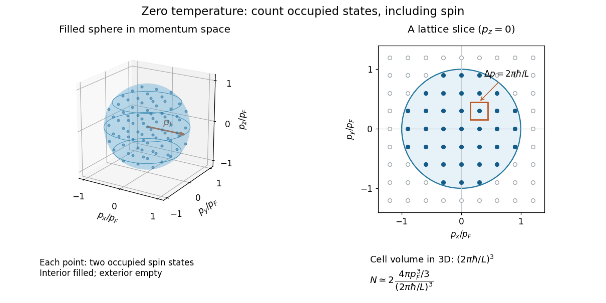

# Fermi momentum

↑ **Parent:** [Fermi energy](fermi-energy.md)

Fermi momentum is the magnitude of the [momentum](momentum-split.md) at the boundary of filled one-particle states in an isotropic zero-temperature [Fermi gas](fermi-gas.md). For the uniform three-dimensional two-component [electron](electron.md) model, a short state count gives

$$
N\simeq 2\,\frac{V}{(2\pi\hbar)^3}\,\frac{4\pi p_F^3}{3},\qquad
n=\frac{p_F^3}{3\pi^2\hbar^3},\qquad
p_F=\hbar(3\pi^2n)^{1/3}.
$$

To see the factors, impose [periodic boundary conditions](periodic-boundary-conditions.md) on a cubic box of side $L$, so $V=L^3$ and each [momentum](momentum-split.md) component is $p_i=2\pi\hbar j_i/L$ for an [integer](integer-split.md) $j_i$. Each allowed [momentum](momentum-split.md) point occupies a cell of [volume](volume.md) $(2\pi\hbar/L)^3$ in [momentum space](momentum-space.md). Divide the [sphere](sphere.md) [volume](volume.md) $4\pi p_F^3/3$ by this cell [volume](volume.md) and multiply by two for the two [spin](spin.md) states. Replacing the discrete count with a [volume](volume.md) is the large-box approximation; surface and shell effects are neglected.[Statistical Physics by David Tong; §3.1, periodic wavevectors and momentum-space integration measure; §3.6.1, spin degeneracy](statistical-physics-by-david-tong/3-quantum-gases.md)

**[Figure 3](#image-the-occupied-momentum-sphere-counts-two-spin-states-per-momentum-point-a-slice-shows-the-state-lattice). The occupied momentum sphere counts two spin states per momentum point; a slice shows the state lattice**.

The factor two is not automatic for every [Fermi gas](fermi-gas.md). If only one internal state is populated, its [number density](number-density.md) $n_\sigma$ instead satisfies $p_{F,\sigma}=\hbar(6\pi^2n_\sigma)^{1/3}$. For two equally populated states, $n_\sigma=n/2$ recovers the displayed result. A [Fermi surface](fermi-surface.md) in a crystal can have a more complicated shape, so a single spherical [Fermi momentum](fermi-momentum.md) is a property of this isotropic model.

**Table of contents**

- [Fermi velocity](fermi-velocity.md)
- [Fermi wavevector](fermi-wavevector.md)
  - [Fermi wavelength](fermi-wavelength.md)

## ↑ Ancestors (8)

1. [Fermi energy](fermi-energy.md)
2. [Fermi gas](fermi-gas.md)
3. [Fermi-Dirac distribution](fermi-dirac-distribution.md)
4. [Quantum ideal-gas statistics](quantum-ideal-gas-statistics-split.md)
5. [Statistical physics](statistical-physics-split.md)
6. [Branches of physics](branches-of-physics.md)
7. [Physics](physics-split.md)
8. [Codex Wiki](split.md)

## ← Incoming links (18)

- [Electron Fermi temperature](electron-fermi-temperature.md)
- [Equation of state of a cold electron gas](equation-of-state-of-a-cold-electron-gas.md)
- [Fermi energy](fermi-energy.md)
- [Fermi energy of a model electron gas](fermi-energy-of-a-model-electron-gas.md)
- [Fermi momentum](fermi-momentum.md)
- [Fermi velocity](fermi-velocity.md)
- [Fermi wavevector](fermi-wavevector.md)
- [Landau quasiparticle](landau-quasiparticle.md)
- [Solution](past-exam-of-the-mathematics-course-of-the-university-of-cambridge/2006/iii/paper-71/3/a/solution.md)
- [Solution](past-exam-of-the-mathematics-course-of-the-university-of-cambridge/2007/iii/paper-66/3/b/solution.md)
- [Solution](past-exam-of-the-mathematics-course-of-the-university-of-cambridge/2008/iii/paper-70/3/a/solution.md)
- [Solution](past-exam-of-the-mathematics-course-of-the-university-of-cambridge/2011/ii/paper-3/10e/i/solution.md)
- [Solution](past-exam-of-the-mathematics-course-of-the-university-of-cambridge/2014/iii/paper-55/4/solution.md)
- [Solution](past-exam-of-the-mathematics-course-of-the-university-of-cambridge/2017/iii/paper-317/4/solution.md)
- [Solution](past-exam-of-the-mathematics-course-of-the-university-of-cambridge/2019/iii/paper-317/3/i/solution.md)
- [Solution](past-exam-of-the-quantum-condensed-matter-course-of-the-university-of-cambridge/2022/section-b/5/f/solution.md)
- [Thermal electron relativistic threshold](thermal-electron-relativistic-threshold.md)
- [White dwarf](white-dwarf.md)
